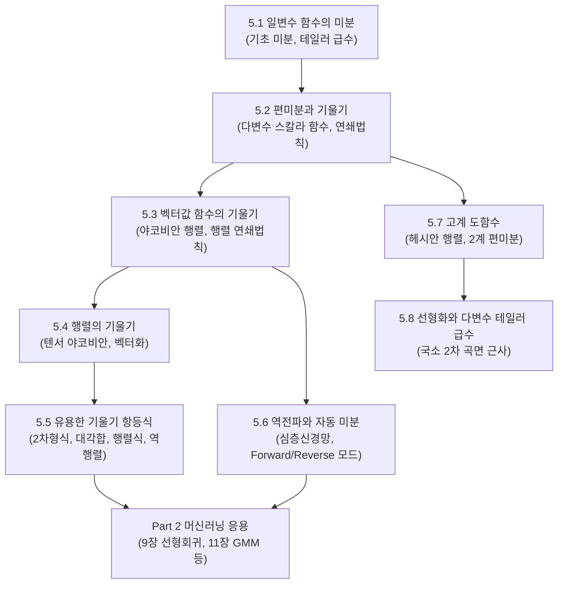

> **교재 쪽수**: 139~171쪽  
> **이 장이 뒤쪽 장에서 어디에 다시 쓰이는가**:
> 7장 연속 최적화(Continuous Optimization, 경사하강법 및 뉴턴 방법의 토대), 9장 선형 회귀(Linear Regression, 비용함수 미분 및 정규방정식 $\nabla_{\boldsymbol{\theta}} L = \mathbf{0}$ 도출), 10장 차원 축소(Dimensionality Reduction/PCA, 라그랑주 승수법을 적용한 분산 극대화 목적식 미분), 11장 밀도 추정(Density Estimation/GMM, EM 알고리즘의 로그우도 매개변수 최적화), 12장 분류(SVM, 초평면 마진 최적화와 KKT 조건 유도). 머신러닝의 '학습(learning)'은 곧 목적함수를 최적화하는 과정이며, 매개변수 공간에서 어느 방향으로 이동해야 손실(오차)이 가장 빠르게 줄어드는지를 알려주는 유일한 나침반이 바로 이 장의 기울기(gradient)와 야코비안(Jacobian)이다.

---

## 0. 이 장 지도

벡터 미적분은 머신러닝 모델의 파라미터를 데이터에 맞추어 최적화(학습)하기 위한 필수적인 수학적 언어다. 스칼라 함수를 다루던 고등학교 미분에서 출발하여, 다변수 함수(편미분/기울기), 벡터를 벡터로 보내는 함수(야코비안), 나아가 행렬에 대한 미분과 신경망 역전파(자동 미분)로 점진적으로 확장된다.



### 절 목록 및 핵심 요약과 중요도

| 절 번호 및 제목 | 핵심 한 줄 요약 | 중요도 | 근거 |
|---|---|:---:|---|
| **5.1 일변수 함수의 미분** *(pp. 141~146)* | 미분의 극한 정의와 다항식 테일러 급수 근사의 기초를 다룬다. | ★☆☆ | 뒤쪽 장에서 직접 단독으로 쓰이기보다는 다변수 확장의 논리적 징검다리 역할을 한다. |
| **5.2 편미분과 기울기** *(pp. 146~149)* | 다변수 스칼라 함수의 편미분을 모은 기울기 벡터(Gradient)와 연쇄법칙을 정의한다. | ★★★ | MML의 핵심 관례인 **분자 중심 표기법(행벡터 기울기)**\ 의 출발점이며 다변수 최적화의 기본이다. |
| **5.3 벡터값 함수의 기울기** *(pp. 149~154)* | 벡터 출력 함수의 도함수인 야코비안 행렬(Jacobian)과 다변수 연쇄법칙의 행렬곱을 다룬다. | ★★★ | 신경망의 층별 변환, 6장 확률변수의 변수 변환(야코비안 행렬식), 가우스-뉴턴 최적화의 필수 기저다. |
| **5.4 행렬의 기울기** *(pp. 155~157)* | 행렬을 벡터로 미분할 때 나타나는 3차원 텐서 야코비안과 벡터화($\text{vec}$) 기법을 학습한다. | ★★☆ | 신경망 가중치 행렬 미분과 공분산 행렬 추정식 전개에 사용된다. |
| **5.5 기울기 계산을 위한 유용한 항등식** *(pp. 157~158)* | 2차 형식, 대각합(trace), 행렬식(determinant), 역행렬의 행렬 미분 공식을 정리한다. | ★★★ | 9장 선형회귀의 정규방정식 도출, 10장 PCA, 11장 GMM 정규분포 모수 추정에서 수식 전개에 직결된다. |
| **5.6 역전파와 자동 미분** *(pp. 159~164)* | 연쇄법칙의 결합법칙을 이용한 역전파(Reverse-mode autodiff)의 계산 효율성을 증명한다. | ★★★ | 딥러닝 전체를 관통하는 핵심 알고리즘이다. 스칼라 손실의 기울기 전체를 순전파의 상수배 정도 계산으로 한 번에 구한다. |
| **5.7 고계 도함수** *(pp. 164~165)* | 2계 편도함수를 모은 헤시안 행렬(Hessian Matrix)과 슈와르츠 대칭성 정리를 배운다. | ★★☆ | 7장 뉴턴 방법 2차 최적화와 국소 극값(극소, 극대, 안장점) 판정에 쓰인다. |
| **5.8 선형화와 다변수 테일러 급수** *(pp. 165~170)* | 다변수 비선형 함수를 기울기와 헤시안을 이용해 국소 1차/2차 다항식으로 근사한다. | ★★☆ | 최적화 알고리즘의 국소 2차 모델링(수렴성 증명) 및 칼만 필터의 선형화(EKF)의 수학적 기초다. |
| **5.9 추가 읽을거리** *(pp. 170~171)* | 행렬 미분 바이블(The Matrix Cookbook) 및 자동 미분 서베이 논문을 소개한다. | ★☆☆ | 심화 연구 및 확장 참고용이다. |

---

## 5.1 일변수 함수의 미분(Differentiation of Univariate Functions, 교재 141~146쪽)

### 왜 필요한가 (직관)
머신러닝의 궁극적인 목표는 손실 함수(Loss function)의 값을 최소화하는 최적의 매개변수를 찾는 것이다. 만약 우리가 조정할 수 있는 매개변수가 딱 하나($x$)뿐이라면, "현재 위치에서 $x$를 아주 조금 오른쪽으로 움직였을 때 손실이 늘어나는가, 줄어드는가?"를 알아야 한다. 이 질문에 답을 주는 수학적 도구가 바로 **도함수(derivative)**\ 다. 도함수는 곡선 위의 한 점 근처를 직선(접선)으로 단순화하여, 변화의 즉각적인 방향과 속도를 알려준다.

### 정의와 성질

#### 1. 미분의 정의
함수 $f: \mathbb{R} \to \mathbb{R}$에 대하여 점 $x$에서의 도함수 $f'(x)$ (또는 $\frac{df}{dx}$)는 **차분상(difference quotient)**\ 의 극한으로 정의된다:
$$f'(x) = \frac{df}{dx} = \lim_{h \to 0} \frac{f(x+h) - f(x)}{h}$$
- $h$: 입력값의 미세한 변화량
- $f(x+h) - f(x)$: 그에 따른 출력값의 변화량
- 기하학적 의미: 곡선 $y = f(x)$ 위의 점 $(x, f(x))$에서의 **접선의 기울기(tangent slope)**.

#### 2. 5.1.1 테일러 급수(Taylor Series)
복잡한 비선형 함수 $f(x)$를 다루기는 어렵지만, 다항식(polynomial)은 미분하기도 쉽고 계산하기도 매우 편하다. 점 $x_0$ 근처에서 무한 번 미분 가능한 함수 $f(x)$를 다항식으로 근사하는 기법이 **테일러 급수**다.

$n$차 **테일러 다항식(Taylor polynomial)** $T_n(x)$는 다음과 같이 정의된다:
$$T_n(x) = \sum_{k=0}^n \frac{f^{(k)}(x_0)}{k!} (x - x_0)^k = f(x_0) + f'(x_0)(x - x_0) + \frac{f''(x_0)}{2!}(x - x_0)^2 + \cdots + \frac{f^{(n)}(x_0)}{n!}(x - x_0)^n$$
- $x_0$: 근사의 기준이 되는 중심점(expansion point). $x_0 = 0$일 때를 특별히 **매클로린 급수(Maclaurin series)**\ 라고 부른다.
- $f^{(k)}(x_0)$: $f$의 $k$계 도함수를 $x_0$에서 평가한 값.
- $k!$: $k$ 팩토리얼 ($k! = k \times (k-1) \times \cdots \times 1$).
- **테일러 정리(Taylor's Theorem)**\ 에 따르면, 원래 함수와 다항식 사이의 오차는 잉여항(remainder) $R_n(x)$로 주어지며, $f(x) = T_n(x) + R_n(x)$가 성립한다.

#### 3. 5.1.2 미분 규칙(Differentiation Rules)
기본적인 미분 규칙은 다변수 미분에서도 성분별 계산에 그대로 적용된다:
1. **선형성(Linearity)**: $(\alpha f + \beta g)'(x) = \alpha f'(x) + \beta g'(x)$ (단, $\alpha, \beta \in \mathbb{R}$)
2. **곱의 미분법(Product Rule)**: $(f \cdot g)'(x) = f'(x)g(x) + f(x)g'(x)$
3. **몫의 미분법(Quotient Rule)**: $\left(\frac{f}{g}\right)'(x) = \frac{f'(x)g(x) - f(x)g'(x)}{(g(x))^2}$ (단, $g(x) \neq 0$)
4. **연쇄 법칙(Chain Rule)**: 합성함수 $(g \circ f)(x) = g(f(x))$에 대하여,
   $$(g \circ f)'(x) = g'(f(x)) \cdot f'(x), \quad \text{즉 } \frac{dy}{dx} = \frac{dy}{du} \cdot \frac{du}{dx} \quad (y = g(u), u = f(x))$$

### 손으로 풀어 보는 예제

#### [예제 1-1] 곱의 미분법과 연쇄법칙
함수 $f(x) = x^3 e^{-2x}$의 도함수를 구하고, $x = 1$에서의 값을 계산하라.
- **1단계 (함수 분해)**: $u(x) = x^3$, $v(x) = e^{-2x}$로 둔다.
- **2단계 (개별 미분)**:
  - $u'(x) = 3x^2$
  - $v(x) = e^{w}$ (단, $w = -2x$)이므로 연쇄법칙에 의해 $v'(x) = e^w \cdot \frac{dw}{dx} = e^{-2x} \cdot (-2) = -2e^{-2x}$
- **3단계 (곱의 미분법 결합)**:
  $$f'(x) = u'(x)v(x) + u(x)v'(x) = (3x^2)(e^{-2x}) + (x^3)(-2e^{-2x}) = (3x^2 - 2x^3)e^{-2x} = x^2(3 - 2x)e^{-2x}$$
- **4단계 ($x=1$ 대입)**:
  $$f'(1) = 1^2 (3 - 2(1)) e^{-2(1)} = 1 \cdot 1 \cdot e^{-2} = e^{-2} \approx 0.1353$$

#### [예제 1-2] 로지스틱 시그모이드(Logistic Sigmoid)의 도함수
딥러닝의 대표적 활성화 함수인 로지스틱 시그모이드 $\sigma(x) = \frac{1}{1 + e^{-x}}$의 도함수가 $\sigma(x)(1 - \sigma(x))$임을 증명하라.
- **1단계 (음의 지수꼴 표현)**: $\sigma(x) = (1 + e^{-x})^{-1}$
- **2단계 (연쇄법칙 적용)**:
  겉함수는 $u^{-1}$, 속함수는 $u = 1 + e^{-x}$이다.
  $$\sigma'(x) = -1 \cdot (1 + e^{-x})^{-2} \cdot \frac{d}{dx}(1 + e^{-x})$$
- **3단계 (속함수 미분)**: $\frac{d}{dx}(1 + e^{-x}) = 0 + e^{-x}(-1) = -e^{-x}$
- **4단계 (정리)**:
  $$\sigma'(x) = -(1 + e^{-x})^{-2} (-e^{-x}) = \frac{e^{-x}}{(1 + e^{-x})^2}$$
- **5단계 (형태 변형)**:
  $$\frac{e^{-x}}{(1 + e^{-x})^2} = \frac{1}{1 + e^{-x}} \cdot \frac{e^{-x}}{1 + e^{-x}} = \frac{1}{1 + e^{-x}} \cdot \frac{(1 + e^{-x}) - 1}{1 + e^{-x}} = \sigma(x) \left(1 - \frac{1}{1 + e^{-x}}\right) = \sigma(x)(1 - \sigma(x))$$
  이 성질은 뒤쪽 5.6절의 역전파 계산에서 시그모이드 층의 기울기를 구할 때 계산량을 극적으로 줄여준다.

#### [예제 1-3] 테일러 다항식 계산
$x_0 = 0$에서 $f(x) = \cos(x)$의 4차 테일러 다항식 $T_4(x)$를 구하고, $x = 0.5$에서의 참값과 근사값을 비교하라.
- **1단계 (도함수 값 계산)**:
  - $f(0) = \cos(0) = 1$
  - $f'(0) = -\sin(0) = 0$
  - $f''(0) = -\cos(0) = -1$
  - $f'''(0) = \sin(0) = 0$
  - $f^{(4)}(0) = \cos(0) = 1$
- **2단계 (테일러 다항식 조립)**:
  $$T_4(x) = 1 + 0 \cdot x + \frac{-1}{2!} x^2 + 0 \cdot x^3 + \frac{1}{4!} x^4 = 1 - \frac{1}{2} x^2 + \frac{1}{24} x^4$$
- **3단계 ($x = 0.5$ 계산)**:
  $$T_4(0.5) = 1 - 0.5 \times 0.25 + \frac{1}{24} \times 0.0625 = 1 - 0.125 + 0.00260417 = 0.87760417$$
  실제 $\cos(0.5)$ 참값은 약 $0.87758256$이다. 오차는 약 $0.0000216$($0.002\%$)에 불과하다.

### 헷갈리는 점 / 자주 하는 실수
- **연쇄법칙 속함수 누락**: $f(x) = \sin(x^3)$을 미분할 때 $\cos(x^3)$만 쓰고 속함수 미분인 $3x^2$를 곱하는 것을 잊는 실수가 매우 흔하다.
- **테일러 급수 분모 팩토리얼 누락**: 2차 항의 분모는 $2! = 2$, 3차 항의 분모는 $3! = 6$, 4차 항의 분모는 $4! = 24$이다. 팩토리얼을 그냥 차수 수치로 착각하지 않도록 주의한다.

---

## 5.2 편미분과 기울기(Partial Differentiation and Gradients, 교재 146~149쪽)

### 왜 필요한가 (직관)
실제 머신러닝 모델의 파라미터는 1개가 아니라 수천, 수백만 개(벡터 $\boldsymbol{x} \in \mathbb{R}^n$)다. 예를 들어 산비탈에 서 있을 때, 동서 방향으로 한 걸음 갈 때의 경사와 남북 방향으로 한 걸음 갈 때의 경사는 완전히 다르다.
다변수 함수 $f(x_1, x_2, \dots, x_n)$에서 **다른 모든 변수는 얼어붙은 듯 고정(상수 취급)**\ 시키고, **관심 있는 변수 하나($x_i$)만 살짝 움직였을 때의 변화율**을 구하는 것이 바로 **편미분(partial differentiation)**\ 이다. 그리고 이 모든 방향의 편미분을 하나의 벡터로 정돈해 묶은 것이 **기울기(gradient, 그레디언트)**\ 다.

### 정의와 성질

#### 1. 편미분의 정의
$n$개 변수를 가지는 함수 $f: \mathbb{R}^n \to \mathbb{R}$에 대하여, $i$번째 변수 $x_i$에 대한 편도함수(partial derivative)는 다음과 같이 정의된다:
$$\frac{\partial f}{\partial x_i} = \lim_{h \to 0} \frac{f(x_1, \dots, x_{i-1}, x_i + h, x_{i+1}, \dots, x_n) - f(x_1, \dots, x_n)}{h}$$
기호 $\partial$는 편미분을 나타내며, 읽을 때는 '라운드(round)' 또는 '파셜(partial)'이라고 읽는다.

#### 2. 기울기(Gradient)의 정의와 MML의 표기 관례
편미분들을 가로로 늘어놓아 벡터로 만든 것을 **기울기(gradient)** 또는 **야코비안(Jacobian)**\ 이라고 부른다.

$$\nabla_{\boldsymbol{x}} f = \text{grad}\, f = \frac{df}{d\boldsymbol{x}} = \begin{bmatrix} \frac{\partial f(\boldsymbol{x})}{\partial x_1} & \frac{\partial f(\boldsymbol{x})}{\partial x_2} & \cdots & \frac{\partial f(\boldsymbol{x})}{\partial x_n} \end{bmatrix} \in \mathbb{R}^{1 \times n}$$

> **[매우 중요! MML 교재의 핵심 관례: 분자 중심 표기법(Numerator Layout)]**
> 교재 MML에서는 입력 벡터가 $\boldsymbol{x} = [x_1, \dots, x_n]^\top \in \mathbb{R}^{n \times 1}$ (열벡터)일 때, 스칼라 함수 $f$의 기울기 $\frac{df}{d\boldsymbol{x}}$를 반드시 **$1 \times n$ 행벡터(row vector)**\ 로 정의한다!
> 
> **왜 행벡터로 정의하는가? (교재의 두 가지 이유)**
> 1. **일관된 일반화**: 이후 5.3절에서 배울 벡터값 함수 $\boldsymbol{f}: \mathbb{R}^n \to \mathbb{R}^m$의 도함수(야코비안 행렬)는 $m \times n$ 행렬이 된다. $m=1$인 특수한 경우가 바로 스칼라 함수이므로, $1 \times n$ 행벡터가 되는 것이 차원적으로 완벽히 일관된다.
> 2. **연쇄법칙의 깔끔함**: 기울기를 행벡터로 정의해야만 다변수 연쇄법칙을 쓸 때 전치($^\top$) 기호를 덕지덕지 붙이지 않고 단순 행렬곱 $\frac{dz}{d\boldsymbol{x}} = \frac{dz}{d\boldsymbol{y}} \frac{d\boldsymbol{y}}{d\boldsymbol{x}}$ ($1 \times n = (1 \times m) \times (m \times n)$)으로 직관적으로 쓸 수 있다.
> 
> **(주의: 딥러닝 관례와의 차이)**
> 딥러닝 실무나 일부 교재(예: Goodfellow의 Deep Learning)에서는 **분모 중심 표기법(Denominator Layout)**\ 을 사용하여 기울기를 $\boldsymbol{x}$와 같은 형태인 $n \times 1$ 열벡터로 표기하기도 한다. 시험 답안을 작성할 때는 MML의 정의에 따라 기본적으로 **행벡터($1 \times n$)**\ 로 서술하되, 필요 시 "분모 중심 표기법에서는 이를 전치한 열벡터 $\nabla f \in \mathbb{R}^{n \times 1}$로 표현한다"고 덧붙여 주는 것이 안전하다.

#### 3. 5.2.1 편미분의 기본 규칙
- **합의 규칙**: $\frac{\partial}{\partial \boldsymbol{x}} (f(\boldsymbol{x}) + g(\boldsymbol{x})) = \frac{\partial f}{\partial \boldsymbol{x}} + \frac{\partial g}{\partial \boldsymbol{x}}$
- **곱의 규칙**: $\frac{\partial}{\partial \boldsymbol{x}} (f(\boldsymbol{x}) g(\boldsymbol{x})) = g(\boldsymbol{x}) \frac{\partial f}{\partial \boldsymbol{x}} + f(\boldsymbol{x}) \frac{\partial g}{\partial \boldsymbol{x}}$ (스칼라 함수들의 곱)

#### 4. 5.2.2 다변수 연쇄 법칙(Chain Rule)
함수 $f(x_1, x_2)$가 있고, 변수 $x_1(t)$와 $x_2(t)$가 또 다른 단일 변수 $t$의 함수라고 하자. 이때 $t$의 변화가 $x_1$과 $x_2$를 동시에 거쳐 $f$에 전달되므로, 전체 변화율은 각 경로의 변화율을 모두 더한 것이 된다:
$$\frac{df}{dt} = \frac{\partial f}{\partial x_1} \frac{dx_1}{dt} + \frac{\partial f}{\partial x_2} \frac{dx_2}{dt} = \begin{bmatrix} \frac{\partial f}{\partial x_1} & \frac{\partial f}{\partial x_2} \end{bmatrix} \begin{bmatrix} \frac{dx_1}{dt} \\ \frac{dx_2}{dt} \end{bmatrix} = \frac{df}{d\boldsymbol{x}} \frac{d\boldsymbol{x}}{dt}$$
행벡터 기울기와 열벡터 변화율의 행렬곱으로 정확히 표현된다!

### 손으로 풀어 보는 예제

#### [예제 2-1] 편미분과 기울기 벡터 계산 (교재 예제 5.7 변형)
함수 $f(x_1, x_2) = x_1^2 x_2 + x_1 x_2^3$에 대하여 편도함수들과 기울기 벡터를 구하고, 점 $\boldsymbol{x} = \begin{bmatrix} 2 \\ 1 \end{bmatrix}$에서의 기울기를 계산하라.
- **1단계 ($x_1$ 편미분)**: $x_2$를 상수 취급한다.
  $$\frac{\partial f}{\partial x_1} = \frac{\partial}{\partial x_1}(x_1^2) \cdot x_2 + \frac{\partial}{\partial x_1}(x_1) \cdot x_2^3 = 2x_1 x_2 + 1 \cdot x_2^3 = 2x_1 x_2 + x_2^3$$
- **2단계 ($x_2$ 편미분)**: $x_1$을 상수 취급한다.
  $$\frac{\partial f}{\partial x_2} = x_1^2 \cdot \frac{\partial}{\partial x_2}(x_2) + x_1 \cdot \frac{\partial}{\partial x_2}(x_2^3) = x_1^2 \cdot 1 + x_1 \cdot (3x_2^2) = x_1^2 + 3x_1 x_2^2$$
- **3단계 (기울기 행벡터 조립)**:
  $$\frac{df}{d\boldsymbol{x}} = \begin{bmatrix} \frac{\partial f}{\partial x_1} & \frac{\partial f}{\partial x_2} \end{bmatrix} = \begin{bmatrix} 2x_1 x_2 + x_2^3 & x_1^2 + 3x_1 x_2^2 \end{bmatrix} \in \mathbb{R}^{1 \times 2}$$
- **4단계 (점 $(2, 1)$ 대입)**:
  - $\frac{\partial f}{\partial x_1}(2, 1) = 2(2)(1) + 1^3 = 4 + 1 = 5$
  - $\frac{\partial f}{\partial x_2}(2, 1) = 2^2 + 3(2)(1^2) = 4 + 6 = 10$
  - 따라서 $\nabla_{\boldsymbol{x}} f(2, 1) = \begin{bmatrix} 5 & 10 \end{bmatrix} \in \mathbb{R}^{1 \times 2}$

#### [예제 2-2] 다변수 연쇄법칙 (교재 예제 5.8)
$f(x_1, x_2) = x_1^2 + 2x_2$이고 $x_1(t) = \sin t$, $x_2(t) = \cos t$일 때, $\frac{df}{dt}$를 연쇄법칙으로 구하고 직접 대입법과 비교하라.
- **1단계 (각각의 도함수 계산)**:
  - $\frac{\partial f}{\partial x_1} = 2x_1 = 2\sin t$
  - $\frac{\partial f}{\partial x_2} = 2$
  - $\frac{dx_1}{dt} = \cos t$, $\frac{dx_2}{dt} = -\sin t$
- **2단계 (연쇄법칙 적용)**:
  $$\frac{df}{dt} = \frac{\partial f}{\partial x_1}\frac{dx_1}{dt} + \frac{\partial f}{\partial x_2}\frac{dx_2}{dt} = (2\sin t)(\cos t) + (2)(-\sin t) = 2\sin t \cos t - 2\sin t = \sin(2t) - 2\sin t$$
- **3단계 (직접 대입법으로 검산)**:
  $f(t) = (\sin t)^2 + 2\cos t = \sin^2 t + 2\cos t$.
  미분하면:
  $$\frac{df}{dt} = 2\sin t \cos t + 2(-\sin t) = 2\sin t \cos t - 2\sin t$$
  두 결과가 완전히 일치한다!

### 헷갈리는 점 / 자주 하는 실수
- **다른 변수를 상수로 취급하지 못하는 실수**: $x_1$으로 미분할 때 $x_2$를 보면서 '곱의 미분법을 써야 하나?' 망설이는 경우가 있다. $x_1$ 이외의 모든 기호는 숫자 3이나 5처럼 완전한 상수다.
- **행벡터와 열벡터의 차원 불일치**: 교재 관례에 따라 $\nabla f$는 $1 \times n$ 행벡터다. 이를 경사하강법 갱신식 $\boldsymbol{x}_{k+1} = \boldsymbol{x}_k - \gamma \nabla f^\top$에 넣을 때는 전치하여 $n \times 1$ 열벡터로 만들어 주어야 $\boldsymbol{x}$와 차원이 맞는다.

---

## 5.3 벡터값 함수의 기울기(Gradients of Vector-Valued Functions, 교재 149~154쪽)

### 왜 필요한가 (직관)
입력도 벡터이고 출력도 벡터인 함수 $\boldsymbol{f}: \mathbb{R}^n \to \mathbb{R}^m$는 머신러닝의 도처에 존재한다. 신경망의 한 계층(layer)은 입력 벡터 $\boldsymbol{x} \in \mathbb{R}^n$을 받아 은닉 상태 벡터 $\boldsymbol{h} \in \mathbb{R}^m$를 출력한다.
이때 $n$개의 입력 변수 각각이 $m$개의 출력 변수 각각에 미치는 모든 편미분 영향력을 빠짐없이 기록하려면 직사각형 형태의 행렬이 필요하다. 이 행렬이 바로 **야코비안 행렬(Jacobian Matrix)**\ 이다.

### 정의와 성질

#### 1. 야코비안 행렬(Jacobian)의 정의
함수 $\boldsymbol{f}: \mathbb{R}^n \to \mathbb{R}^m$의 야코비안 행렬 $J = \frac{d\boldsymbol{f}}{d\boldsymbol{x}} \in \mathbb{R}^{m \times n}$은 모든 1계 편도함수를 모아 놓은 행렬이다:

$$J = \frac{d\boldsymbol{f}(\boldsymbol{x})}{d\boldsymbol{x}} = \begin{bmatrix}
\frac{\partial f_1}{\partial x_1} & \frac{\partial f_1}{\partial x_2} & \cdots & \frac{\partial f_1}{\partial x_n} \\
\frac{\partial f_2}{\partial x_1} & \frac{\partial f_2}{\partial x_2} & \cdots & \frac{\partial f_2}{\partial x_n} \\
\vdots & \vdots & \ddots & \vdots \\
\frac{\partial f_m}{\partial x_1} & \frac{\partial f_m}{\partial x_2} & \cdots & \frac{\partial f_m}{\partial x_n}
\end{bmatrix} \in \mathbb{R}^{m \times n}$$

- **행(Row)의 의미**: $i$번째 행은 출력의 $i$번째 성분 $f_i$에 대한 기울기 행벡터 $\nabla_{\boldsymbol{x}} f_i \in \mathbb{R}^{1 \times n}$이다.
  $$J = \begin{bmatrix} \nabla_{\boldsymbol{x}} f_1 \\ \nabla_{\boldsymbol{x}} f_2 \\ \vdots \\ \nabla_{\boldsymbol{x}} f_m \end{bmatrix}$$
- **열(Column)의 의미**: $j$번째 열은 입력 변수 $x_j$로 전체 함수 벡터 $\boldsymbol{f}$를 편미분한 열벡터 $\frac{\partial \boldsymbol{f}}{\partial x_j} \in \mathbb{R}^{m \times 1}$이다.
- **차원 규칙**: **(출력의 차원 $m$) $\times$ (입력의 차원 $n$)**.

#### 2. 다변수 연쇄법칙의 행렬곱 표현
두 벡터값 함수의 합성 $\boldsymbol{x} \in \mathbb{R}^n \xrightarrow{\boldsymbol{f}} \boldsymbol{y} \in \mathbb{R}^m \xrightarrow{\boldsymbol{g}} \boldsymbol{z} \in \mathbb{R}^k$에 대하여, 최종 출력 $\boldsymbol{z}$의 입력 $\boldsymbol{x}$에 대한 야코비안은 각 단계 야코비안의 **단순 행렬곱**이다:

$$\frac{d\boldsymbol{z}}{d\boldsymbol{x}} = \frac{d\boldsymbol{g}}{d\boldsymbol{y}} \frac{d\boldsymbol{f}}{d\boldsymbol{x}} \in \mathbb{R}^{k \times n}$$

- 차원 확인:
  $$\underbrace{\frac{d\boldsymbol{z}}{d\boldsymbol{x}}}_{k \times n} = \underbrace{\frac{d\boldsymbol{g}}{d\boldsymbol{y}}}_{k \times m} \times \underbrace{\frac{d\boldsymbol{f}}{d\boldsymbol{x}}}_{m \times n}$$
  가운데 차원 $m$이 자연스럽게 소거되면서 $k \times n$이 완성된다. 분자 중심 표기법을 채택했기 때문에 가능한 우아한 결과다.

### 손으로 풀어 보는 예제

#### [예제 3-1] 아핀 변환(Affine Transformation)의 야코비안
$\boldsymbol{f}(\boldsymbol{x}) = A\boldsymbol{x} + \boldsymbol{b}$ (단, $A \in \mathbb{R}^{m \times n}, \boldsymbol{b} \in \mathbb{R}^m$)의 야코비안이 $A$임을 성분별로 증명하라.
- **1단계 (성분별 표현)**:
  출력 벡터의 $i$번째 성분은 $f_i(\boldsymbol{x}) = \sum_{j=1}^n A_{ij} x_j + b_i$이다.
- **2단계 (편미분 계산)**:
  이를 입력 변수 $x_k$로 편미분하면:
  $$\frac{\partial f_i}{\partial x_k} = \frac{\partial}{\partial x_k} \left( A_{i1}x_1 + \dots + A_{ik}x_k + \dots + A_{in}x_n + b_i \right) = A_{ik}$$
- **3단계 (행렬 구성)**:
  야코비안의 $(i, k)$ 성분이 정확히 행렬 $A$의 $(i, k)$ 성분 $A_{ik}$와 같다!
  따라서:
  $$\frac{d(A\boldsymbol{x} + \boldsymbol{b})}{d\boldsymbol{x}} = A \in \mathbb{R}^{m \times n}$$
  일변수 함수 $ax+b$를 미분하면 $a$가 남듯이, 벡터 함수 $A\boldsymbol{x}+\boldsymbol{b}$를 미분하면 변환 행렬 $A$ 자체가 남는다.

#### [예제 3-2] 극좌표 변환과 야코비안 행렬식
2차원 평면에서 극좌표 $(r, \theta)$를 직교좌표 $(x, y)$로 변환하는 함수 $\boldsymbol{f}(r, \theta) = \begin{bmatrix} r \cos \theta \\ r \sin \theta \end{bmatrix}$의 야코비안을 구하고, 그 행렬식(determinant)을 계산하라.
- **1단계 (편도함수 계산)**:
  - $f_1(r, \theta) = r\cos\theta \implies \frac{\partial f_1}{\partial r} = \cos\theta, \quad \frac{\partial f_1}{\partial \theta} = -r\sin\theta$
  - $f_2(r, \theta) = r\sin\theta \implies \frac{\partial f_2}{\partial r} = \sin\theta, \quad \frac{\partial f_2}{\partial \theta} = r\cos\theta$
- **2단계 (야코비안 조립)**:
  $$J = \begin{bmatrix} \frac{\partial f_1}{\partial r} & \frac{\partial f_1}{\partial \theta} \\ \frac{\partial f_2}{\partial r} & \frac{\partial f_2}{\partial \theta} \end{bmatrix} = \begin{bmatrix} \cos\theta & -r\sin\theta \\ \sin\theta & r\cos\theta \end{bmatrix} \in \mathbb{R}^{2 \times 2}$$
- **3단계 (행렬식 계산)**:
  $$\det(J) = (\cos\theta)(r\cos\theta) - (-r\sin\theta)(\sin\theta) = r\cos^2\theta + r\sin^2\theta = r(\cos^2\theta + \sin^2\theta) = r$$
  이 $\det(J) = r$은 미적분학에서 2중적분 치환 시 미소 면적 요소가 $dx dy = r dr d\theta$가 되는 이유이며, 6장 확률분포의 변수 변환(Change of Variables) 공식에서 핵심적인 역할을 한다.

#### [예제 3-3] 합성함수의 야코비안 연쇄법칙 계산
$\boldsymbol{x} = \begin{bmatrix} x_1 \\ x_2 \end{bmatrix} \xrightarrow{\boldsymbol{f}} \boldsymbol{y} = \begin{bmatrix} x_1 x_2 \\ x_1 + x_2 \end{bmatrix} \xrightarrow{g} z = y_1^2 + 3y_2$ 일 때, 점 $\boldsymbol{x} = \begin{bmatrix} 1 \\ 2 \end{bmatrix}$에서 $\frac{dz}{d\boldsymbol{x}}$를 연쇄법칙으로 구하라.
- **1단계 (중간값 계산)**:
  $\boldsymbol{x} = \begin{bmatrix} 1 \\ 2 \end{bmatrix}$ 대입 $\implies y_1 = 1 \times 2 = 2, \quad y_2 = 1 + 2 = 3$.
- **2단계 ($J_{\boldsymbol{f}}$ 계산)**:
  $$J_{\boldsymbol{f}} = \begin{bmatrix} \frac{\partial(x_1 x_2)}{\partial x_1} & \frac{\partial(x_1 x_2)}{\partial x_2} \\ \frac{\partial(x_1 + x_2)}{\partial x_1} & \frac{\partial(x_1 + x_2)}{\partial x_2} \end{bmatrix} = \begin{bmatrix} x_2 & x_1 \\ 1 & 1 \end{bmatrix} \implies J_{\boldsymbol{f}}(1, 2) = \begin{bmatrix} 2 & 1 \\ 1 & 1 \end{bmatrix} \in \mathbb{R}^{2 \times 2}$$
- **3단계 ($J_g$ 계산)**:
  $z$는 스칼라이므로 $J_g$는 $1 \times 2$ 행벡터다:
  $$J_g = \begin{bmatrix} \frac{\partial z}{\partial y_1} & \frac{\partial z}{\partial y_2} \end{bmatrix} = \begin{bmatrix} 2y_1 & 3 \end{bmatrix} \implies J_g(2, 3) = \begin{bmatrix} 2(2) & 3 \end{bmatrix} = \begin{bmatrix} 4 & 3 \end{bmatrix} \in \mathbb{R}^{1 \times 2}$$
- **4단계 (연쇄법칙 행렬곱)**:
  $$\frac{dz}{d\boldsymbol{x}} = J_g \cdot J_{\boldsymbol{f}} = \begin{bmatrix} 4 & 3 \end{bmatrix} \begin{bmatrix} 2 & 1 \\ 1 & 1 \end{bmatrix} = \begin{bmatrix} 4(2) + 3(1) & 4(1) + 3(1) \end{bmatrix} = \begin{bmatrix} 8 + 3 & 4 + 3 \end{bmatrix} = \begin{bmatrix} 11 & 7 \end{bmatrix} \in \mathbb{R}^{1 \times 2}$$
- **5단계 (직접 대입 검산)**:
  $z = (x_1 x_2)^2 + 3(x_1 + x_2) = x_1^2 x_2^2 + 3x_1 + 3x_2$.
  $\frac{\partial z}{\partial x_1} = 2x_1 x_2^2 + 3 \implies 2(1)(4) + 3 = 11$.
  $\frac{\partial z}{\partial x_2} = 2x_1^2 x_2 + 3 \implies 2(1)(2) + 3 = 7$.
  $\begin{bmatrix} 11 & 7 \end{bmatrix}$로 완벽히 일치한다!

### 헷갈리는 점 / 자주 하는 실수
- **야코비안의 차원 반대 표기**: 야코비안 행렬의 행 수는 '출력의 개수($m$)', 열 수는 '입력의 개수($n$)'이다. 이를 $n \times m$으로 잘못 쓰면 연쇄법칙 행렬곱의 안쪽 차원이 맞지 않아 계산이 완전히 불가능해진다.

---

## 5.4 행렬의 기울기(Gradients of Matrices, 교재 155~157쪽)

### 왜 필요한가 (직관)
신경망의 가중치 $W$나 다변량 가우시안의 공분산 행렬 $\Sigma$는 벡터가 아니라 2차원 격자 구조를 가진 행렬이다. 손실 함수 $L$을 최소화하기 위해서는 "행렬의 각 성분 $W_{ij}$를 어떻게 바꾸어야 하는가?"를 계산해야 한다. 나아가 행렬 입력이 벡터 출력을 내거나, 행렬이 행렬로 변환되는 복잡한 함수를 다룰 때의 미분 체계를 이해해야 한다.

### 정의와 성질

#### 1. 행렬을 벡터로 미분: 3차원 텐서 야코비안
행렬 $A \in \mathbb{R}^{m \times n}$의 각 원소가 벡터 $\boldsymbol{x} \in \mathbb{R}^p$의 함수일 때, $\frac{dA}{d\boldsymbol{x}}$는 3차원 배열(3rd-order tensor)이 된다:
$$\frac{dA}{d\boldsymbol{x}} \in \mathbb{R}^{m \times n \times p}, \quad \left(\frac{dA}{d\boldsymbol{x}}\right)_{ijk} = \frac{\partial A_{ij}}{\partial x_k}$$
교재 그림 5.7처럼, 각 입력 성분 $x_k$에 대한 편미분 편평면 $\frac{\partial A}{\partial x_k} \in \mathbb{R}^{m \times n}$이 $p$장 겹쳐져 있는 직육면체 모양의 텐서로 시각화할 수 있다.

#### 2. 스칼라를 행렬로 미분
머신러닝에서 가장 흔히 마주치는 상황은 스칼라 손실 $f: \mathbb{R}^{m \times n} \to \mathbb{R}$을 행렬 $X \in \mathbb{R}^{m \times n}$로 미분하는 것이다.
$$\frac{\partial f}{\partial X} \in \mathbb{R}^{m \times n}, \quad \left(\frac{\partial f}{\partial X}\right)_{ij} = \frac{\partial f}{\partial X_{ij}}$$
즉, 원래 행렬 $X$와 동일한 모양($m \times n$)의 격자 안에 각 성분에 대한 편미분 값을 채워 넣는다.

#### 3. 벡터화(Vectorization, $\text{vec}$) 기법
텐서 연산은 일반적인 2차원 행렬 대수에 비해 직관적이지 못하다. 이를 해결하는 가장 표준적인 수학적 방법은 $m \times n$ 행렬 $A$의 열들을 차례로 세로로 길게 이어붙여 $mn \times 1$ 크기의 거대한 열벡터 $\text{vec}(A)$로 만드는 것이다.
- 행렬 $A = \begin{bmatrix} a_{11} & a_{12} \\ a_{21} & a_{22} \end{bmatrix}$ 이면 $\text{vec}(A) = \begin{bmatrix} a_{11} \\ a_{21} \\ a_{12} \\ a_{22} \end{bmatrix} \in \mathbb{R}^{4 \times 1}$.
- 벡터화를 적용하면 모든 행렬 미분 문제를 5.3절의 표준 벡터 야코비안 문제($\mathbb{R}^{mn} \to \mathbb{R}^{kl}$)로 환원하여 연쇄법칙을 적용할 수 있다.

### 손으로 풀어 보는 예제

#### [예제 4-1] 스칼라 함수에 대한 행렬 미분 성분 계산
$A = \begin{bmatrix} 1 & 2 \\ 3 & 4 \end{bmatrix}$, $X = \begin{bmatrix} x_{11} & x_{12} \\ x_{21} & x_{22} \end{bmatrix}$일 때, $f(X) = \text{tr}(AX)$의 도함수 $\frac{\partial f}{\partial X}$를 성분별로 직접 구하라.
- **1단계 (행렬곱 $AX$ 계산)**:
  $$AX = \begin{bmatrix} 1 & 2 \\ 3 & 4 \end{bmatrix} \begin{bmatrix} x_{11} & x_{12} \\ x_{21} & x_{22} \end{bmatrix} = \begin{bmatrix} 1x_{11} + 2x_{21} & 1x_{12} + 2x_{22} \\ 3x_{11} + 4x_{21} & 3x_{12} + 4x_{22} \end{bmatrix}$$
- **2단계 (대각합 $\text{tr}(AX)$ 계산)**:
  대각 성분들의 합을 구한다:
  $$f(X) = \text{tr}(AX) = (x_{11} + 2x_{21}) + (3x_{12} + 4x_{22}) = x_{11} + 3x_{12} + 2x_{21} + 4x_{22}$$
- **3단계 (각 성분별 편미분)**:
  - $\frac{\partial f}{\partial x_{11}} = 1$
  - $\frac{\partial f}{\partial x_{12}} = 3$
  - $\frac{\partial f}{\partial x_{21}} = 2$
  - $\frac{\partial f}{\partial x_{22}} = 4$
- **4단계 (행렬 조립)**:
  $$\frac{\partial f}{\partial X} = \begin{bmatrix} \frac{\partial f}{\partial x_{11}} & \frac{\partial f}{\partial x_{12}} \\ \frac{\partial f}{\partial x_{21}} & \frac{\partial f}{\partial x_{22}} \end{bmatrix} = \begin{bmatrix} 1 & 3 \\ 2 & 4 \end{bmatrix}$$
  놀랍게도 이 결과는 $A = \begin{bmatrix} 1 & 2 \\ 3 & 4 \end{bmatrix}$의 전치행렬인 $A^\top = \begin{bmatrix} 1 & 3 \\ 2 & 4 \end{bmatrix}$와 정확히 같다!
  따라서 $\frac{\partial \text{tr}(AX)}{\partial X} = A^\top$가 성립함을 손계산으로 직접 확인하였다.

### 헷갈리는 점 / 자주 하는 실수
- **전치($^\top$)의 출현**: $\text{tr}(AX)$를 $X$로 미분하면 $A$가 아니라 $A^\top$가 나온다. 행렬 대각합의 성분 인덱스 결합 구조 때문에 전치가 필연적으로 발생하므로 공식을 암기할 때 전치 부착 여부를 반드시 체크해야 한다.

---

## 5.5 기울기 계산을 위한 유용한 항등식(Useful Identities for Computing Gradients, 교재 158쪽)

### 왜 필요한가 (직관)
복잡한 머신러닝 논문의 수식(예: 선형 회귀의 정규방정식, 가우시안 우도 극대화, 칼만 필터 게인 유도)을 전개할 때 매번 원소 단위($x_{ij}$)로 풀어서 합기호($\sum$)를 전개하는 것은 지나치게 비효율적이고 실수하기 쉽다. 선형대수학의 검증된 **행렬 미분 항등식(Matrix Calculus Identities)**\ 을 활용하면 복잡한 다변수 목적함수의 최적화 해를 단 서너 줄 만에 깔끔하게 유도할 수 있다.

### 정의와 성질: 핵심 10대 항등식 및 차원(Shape) 완전 분석

교재 식 (5.99)~(5.108)의 항등식(1~6번, 10번)과, 교재의 일반형(대각합·행렬식 식)을 $f(X)=X$ 같은 경우로 특수화한 자주 쓰는 공식(7~9번, 교재 밖 보충)을 차원 규칙과 함께 정리한다:

| 번호 | 항등식 (MML 교재 형태) | 조건 및 차원 (Shape 확인) | 비고 / 머신러닝 활용처 |
|:---:|---|---|---|
| 1 | $\frac{\partial (\boldsymbol{a}^\top \boldsymbol{x})}{\partial \boldsymbol{x}} = \boldsymbol{a}^\top$ | $\boldsymbol{a}, \boldsymbol{x} \in \mathbb{R}^n$, 결과 $\mathbb{R}^{1 \times n}$ | 선형 모델 예측식 미분 |
| 2 | $\frac{\partial (\boldsymbol{x}^\top \boldsymbol{a})}{\partial \boldsymbol{x}} = \boldsymbol{a}^\top$ | $\boldsymbol{a}, \boldsymbol{x} \in \mathbb{R}^n$, 결과 $\mathbb{R}^{1 \times n}$ | $\boldsymbol{x}^\top \boldsymbol{a} = \boldsymbol{a}^\top \boldsymbol{x}$ (스칼라 대칭) |
| 3 | $\frac{\partial (\boldsymbol{x}^\top B \boldsymbol{x})}{\partial \boldsymbol{x}} = \boldsymbol{x}^\top (B + B^\top)$ | $\boldsymbol{x} \in \mathbb{R}^n, B \in \mathbb{R}^{n \times n}$, 결과 $\mathbb{R}^{1 \times n}$ | **2차 형식 미분**. $B$가 대칭이면 $2\boldsymbol{x}^\top B$ |
| 4 | $\frac{\partial}{\partial \boldsymbol{s}} (\boldsymbol{x} - A\boldsymbol{s})^\top W (\boldsymbol{x} - A\boldsymbol{s}) = -2(\boldsymbol{x} - A\boldsymbol{s})^\top W A$ | $W = W^\top$, 결과 $\mathbb{R}^{1 \times k}$ | **가중 최소제곱법(WLS) 손실함수 미분** |
| 5 | $\frac{\partial (\boldsymbol{a}^\top X \boldsymbol{b})}{\partial X} = \boldsymbol{a} \boldsymbol{b}^\top$ | $\boldsymbol{a} \in \mathbb{R}^m, \boldsymbol{b} \in \mathbb{R}^n, X \in \mathbb{R}^{m \times n}$, 결과 $\mathbb{R}^{m \times n}$ | 쌍선형 형식(Bilinear form) 미분 |
| 6 | $\frac{\partial (\boldsymbol{a}^\top X^{-1} \boldsymbol{b})}{\partial X} = -(X^{-1})^\top \boldsymbol{a} \boldsymbol{b}^\top (X^{-1})^\top$ | $X \in \mathbb{R}^{m \times m}$ 가역행렬 | 마할라노비스 거리 및 가우시안 공분산 미분 |
| 7 | $\frac{\partial \text{tr}(X)}{\partial X} = I$ | $X \in \mathbb{R}^{n \times n}$, 결과 $\mathbb{R}^{n \times n}$ | 대각합의 기본 미분 |
| 8 | $\frac{\partial \text{tr}(AXB)}{\partial X} = A^\top B^\top$ | 크기 정합하는 행렬들, 결과 $X$와 동일 크기 | 행렬 샌드위치 대각합 미분 |
| 9 | $\frac{\partial \det(X)}{\partial X} = \det(X) (X^{-1})^\top$ | **Jacobi 공식**. $X$ 가역행렬 | 가우시안 정규화 상수 미분 |
| 10 | $\frac{\partial X^{-1}}{\partial t} = -X^{-1} \frac{\partial X}{\partial t} X^{-1}$ | $X(t)$ 가역행렬 경로 | 역행렬의 도함수 (식 5.102) |

> **[차원 정합성 자가 검증 팁]**
> 항등식 4번을 보자:
> - $\boldsymbol{x} \in \mathbb{R}^D, \boldsymbol{s} \in \mathbb{R}^K, A \in \mathbb{R}^{D \times K}, W \in \mathbb{R}^{D \times D}$.
> - 미분 대상 스칼라를 $K \times 1$ 열벡터 $\boldsymbol{s}$로 미분하므로 MML 분자 표기법에 의해 결과는 **$1 \times K$ 행벡터**가 나와야 한다.
> - 우변의 차원: $\underbrace{(\boldsymbol{x} - A\boldsymbol{s})^\top}_{1 \times D} \times \underbrace{W}_{D \times D} \times \underbrace{A}_{D \times K} = 1 \times K$.
> 차원이 완벽하게 일치한다! 시험장에서 수식이 헷갈릴 때는 이처럼 양변의 shape를 맞춰보면 실수를 100% 잡아낼 수 있다.

### 손으로 풀어 보는 예제

#### [예제 5-1] 2차 형식의 기울기 검산
행렬 $B = \begin{bmatrix} 2 & 1 \\ 3 & 5 \end{bmatrix}$ (비대칭 행렬)에 대하여 $f(\boldsymbol{x}) = \boldsymbol{x}^\top B \boldsymbol{x}$의 기울기를 항등식과 성분 전개 두 가지 방식으로 각각 구하라.
- **방식 1 (항등식 3번 공식 적용)**:
  $B^\top = \begin{bmatrix} 2 & 3 \\ 1 & 5 \end{bmatrix}$이므로,
  $$B + B^\top = \begin{bmatrix} 2+2 & 1+3 \\ 3+1 & 5+5 \end{bmatrix} = \begin{bmatrix} 4 & 4 \\ 4 & 10 \end{bmatrix}$$
  공식 $\frac{df}{d\boldsymbol{x}} = \boldsymbol{x}^\top (B + B^\top)$을 적용하면:
  $$\frac{df}{d\boldsymbol{x}} = \begin{bmatrix} x_1 & x_2 \end{bmatrix} \begin{bmatrix} 4 & 4 \\ 4 & 10 \end{bmatrix} = \begin{bmatrix} 4x_1 + 4x_2 & 4x_1 + 10x_2 \end{bmatrix} \in \mathbb{R}^{1 \times 2}$$
- **방식 2 (성분 전개법)**:
  $$f(\boldsymbol{x}) = \begin{bmatrix} x_1 & x_2 \end{bmatrix} \begin{bmatrix} 2x_1 + x_2 \\ 3x_1 + 5x_2 \end{bmatrix} = x_1(2x_1 + x_2) + x_2(3x_1 + 5x_2) = 2x_1^2 + 4x_1 x_2 + 5x_2^2$$
  각 변수로 편미분:
  - $\frac{\partial f}{\partial x_1} = 4x_1 + 4x_2$
  - $\frac{\partial f}{\partial x_2} = 4x_1 + 10x_2$
  기울기 행벡터 조립:
  $$\frac{df}{d\boldsymbol{x}} = \begin{bmatrix} 4x_1 + 4x_2 & 4x_1 + 10x_2 \end{bmatrix}$$
  두 방식의 결과가 완전히 일치한다!

### 헷갈리는 점 / 자주 하는 실수
- **행렬의 대칭성 확인 소홀**: $\boldsymbol{x}^\top B \boldsymbol{x}$를 미분할 때 $B$가 대칭이라는 보장이 없는데 무턱대고 $2\boldsymbol{x}^\top B$라고 쓰면 감점된다. 반드시 $\boldsymbol{x}^\top (B + B^\top)$로 적거나, "$B$가 대칭행렬이므로 $B+B^\top = 2B$"라는 조건을 명시해야 한다.

---

## 5.6 역전파와 자동 미분(Backpropagation and Automatic Differentiation, 교재 159~164쪽)

### 왜 필요한가 (직관)
신경망 학습의 본질은 수억 개의 가중치 매개변수에 대해 손실 함수 $L$의 기울기를 구하는 것이다.
- **수치 미분(Numerical differentiation)**: $\frac{f(x+h)-f(x)}{h}$로 구하려면 매개변수가 1억 개일 때 네트워크 순전파를 1억 번 실행해야 하므로 실시간 학습이 완전히 불가능하다 ($O(D)$ 연산량).
- **기호 미분(Symbolic differentiation)**: 연쇄법칙 수식을 수학적으로 전부 전개하면 공통 부분식이 중복 생성되어 수식의 길이가 지수적으로 폭발(Expression swell)한다.
- **자동 미분(Automatic differentiation)과 역전파(Backpropagation)**: 계산 그래프 상에서 중간 계산값들을 한 번 메모리에 저장해 두고, 연쇄법칙의 **결합법칙(associativity)**\ 을 역방향으로 묶음으로써 역방향 패스 한 번(순전파의 상수배 정도 비용)으로 모든 매개변수의 정확한 기울기를 계산해 낸다.

### 정의와 성질

#### 1. 5.6.1 심층 신경망(Deep Network)에서의 연쇄법칙
$K$개의 층을 가진 인공신경망의 순전파는 다단계 함수 합성이다:
$$\boldsymbol{y} = (\boldsymbol{f}_K \circ \boldsymbol{f}_{K-1} \circ \cdots \circ \boldsymbol{f}_1)(\boldsymbol{x})$$
각 층의 연산은 선형 변환 후 활성화 함수 $\sigma$ 적용이다:
$$\boldsymbol{f}_0 := \boldsymbol{x}, \quad \boldsymbol{f}_i := \sigma_i(A_{i-1}\boldsymbol{f}_{i-1} + \boldsymbol{b}_{i-1}), \quad i = 1, \dots, K$$
제곱 오차 손실 $L = \|\boldsymbol{y} - \boldsymbol{f}_K\|^2$에 대해 $i$번째 층의 매개변수 $\theta_i = \{A_i, \boldsymbol{b}_i\}$에 대한 편미분은 연쇄법칙에 의해:
$$\frac{\partial L}{\partial \theta_i} = \underbrace{\frac{\partial L}{\partial \boldsymbol{f}_K} \frac{\partial \boldsymbol{f}_K}{\partial \boldsymbol{f}_{K-1}} \cdots \frac{\partial \boldsymbol{f}_{i+2}}{\partial \boldsymbol{f}_{i+1}}}_{\text{이미 계산된 오차 전달 항}} \frac{\partial \boldsymbol{f}_{i+1}}{\partial \theta_i}$$
만약 우리가 바로 앞 층인 $\frac{\partial L}{\partial \theta_{i+1}}$를 이미 계산해 두었다면, 붉은색 괄호 친 앞부분의 행렬곱은 새로 계산할 필요 없이 **그대로 재사용(Dynamic Programming / 메모이제이션)**\ 할 수 있다!

#### 2. 5.6.2 자동 미분: Forward Mode vs Reverse Mode의 대조
연쇄법칙 $\frac{dy}{dx} = J_K J_{K-1} \cdots J_2 J_1$에서 행렬곱은 **결합법칙(Associative property)**\ 이 성립하므로 괄호를 어디에 묶느냐에 따라 계산 비용이 천양지차로 갈린다.

```mermaid
flowchart LR
    subgraph ForwardMode["순방향 모드 (Forward Mode): 우측 우선 결합"]
        direction LR
        FM1["J1"] --> FM2["J2 * J1"] --> FM3["J3 * (J2 * J1)"]
    end
    subgraph ReverseMode["역방향 모드 (Reverse Mode / 역전파): 좌측 우선 결합"]
        direction RL
        RM3["(JK * JK-1) * ..."] <-- RM2["JK * JK-1"] <-- RM1["JK"]
    end
```

- **순방향 모드(Forward Mode)**:
  $$\frac{dy}{dx} = \Big( J_K \Big( \dots \big( J_2 (J_1) \big) \Big) \Big)$$
  데이터가 흐르는 방향(입력 $\to$ 출력)과 동일하게 기울기를 누적한다.
  - **장점**: 중간 상태를 메모리에 보관할 필요가 없다.
  - **적합한 경우**: 입력의 차원 $N$이 매우 작고 출력의 차원 $M$이 매우 큰 경우 ($N \ll M$).
- **역방향 모드(Reverse Mode / Backpropagation)**:
  $$\frac{dy}{dx} = \Big( \Big( \big( (J_K) J_{K-1} \big) \dots \Big) J_1 \Big)$$
  손실값 출력에서 입력 방향으로 거꾸로 기울기를 역전파한다.
  - **적합한 경우**: **출력은 스칼라 손실($M=1$)이고 파라미터/입력이 수없이 많은 경우 ($N \gg M$)**.
  - **압도적인 계산 효율의 비밀**:
    맨 처음 시작하는 $J_K = \frac{\partial L}{\partial \boldsymbol{f}_K}$가 **$1 \times D$ 행벡터**다!
    따라서 이후의 모든 곱셈은 **(행벡터 $1 \times D$) $\times$ (야코비안 행렬 $D \times D$) = (행벡터 $1 \times D$)** 형태의 가벼운 벡터-행렬 곱셈이 된다. 행렬-행렬 곱셈(층마다 $O(D^3)$) 대신 벡터-행렬 곱셈(층마다 $O(D^2)$)만 하면 되어 훨씬 싸다.

### 손으로 풀어 보는 예제

#### [예제 6-1] 2층 인공신경망의 손계산 역전파
- **네트워크 구조**:
  - 입력 $\boldsymbol{x} = \begin{bmatrix} 1 \\ 0.5 \end{bmatrix} \in \mathbb{R}^2$
  - 1층: 가중치 $W = \begin{bmatrix} 1 & 2 \\ -1 & 1 \end{bmatrix}$, 편향 $\boldsymbol{b} = \begin{bmatrix} 0 \\ 0 \end{bmatrix}$, 활성화 $\sigma(z) = z$ (선형)
  - 2층: 가중치 $\boldsymbol{v} = \begin{bmatrix} 2 \\ -1 \end{bmatrix} \in \mathbb{R}^2$, 출력 $\hat{y} = \boldsymbol{v}^\top \boldsymbol{h}$ (스칼라)
  - 참값 $y = 3$, 손실 함수 $L = \frac{1}{2}(\hat{y} - y)^2$
- **1단계 (순전파 Forward Pass)**:
  - 1층 은닉 상태 $\boldsymbol{h} = W\boldsymbol{x} + \boldsymbol{b} = \begin{bmatrix} 1 & 2 \\ -1 & 1 \end{bmatrix} \begin{bmatrix} 1 \\ 0.5 \end{bmatrix} = \begin{bmatrix} 1(1) + 2(0.5) \\ -1(1) + 1(0.5) \end{bmatrix} = \begin{bmatrix} 2 \\ -0.5 \end{bmatrix}$
  - 2층 예측값 $\hat{y} = \boldsymbol{v}^\top \boldsymbol{h} = \begin{bmatrix} 2 & -1 \end{bmatrix} \begin{bmatrix} 2 \\ -0.5 \end{bmatrix} = 2(2) + (-1)(-0.5) = 4 + 0.5 = 4.5$
  - 손실값 $L = \frac{1}{2}(4.5 - 3)^2 = \frac{1}{2}(1.5)^2 = 1.125$
- **2단계 (역전파 Backward Pass)**:
  - 출력 오차: $\delta_y = \frac{\partial L}{\partial \hat{y}} = (\hat{y} - y) = 4.5 - 3 = 1.5$ (스칼라)
  - 2층 가중치 기울기:
    $$\frac{\partial L}{\partial \boldsymbol{v}} = \delta_y \cdot \boldsymbol{h}^\top = 1.5 \times \begin{bmatrix} 2 & -0.5 \end{bmatrix} = \begin{bmatrix} 3.0 & -0.75 \end{bmatrix} \in \mathbb{R}^{1 \times 2}$$
  - 은닉층 오차 역전파:
    $$\delta_{\boldsymbol{h}} = \frac{\partial L}{\partial \boldsymbol{h}} = \delta_y \cdot \boldsymbol{v}^\top = 1.5 \times \begin{bmatrix} 2 & -1 \end{bmatrix} = \begin{bmatrix} 3.0 & -1.5 \end{bmatrix} \in \mathbb{R}^{1 \times 2}$$
  - 1층 가중치 기울기:
    $$\frac{\partial L}{\partial W} = \delta_{\boldsymbol{h}}^\top \boldsymbol{x}^\top = \begin{bmatrix} 3.0 \\ -1.5 \end{bmatrix} \begin{bmatrix} 1 & 0.5 \end{bmatrix} = \begin{bmatrix} 3.0(1) & 3.0(0.5) \\ -1.5(1) & -1.5(0.5) \end{bmatrix} = \begin{bmatrix} 3.0 & 1.5 \\ -1.5 & -0.75 \end{bmatrix} \in \mathbb{R}^{2 \times 2}$$
  단 세 단계의 행렬 연산으로 모든 파라미터($\boldsymbol{v}, W$)의 기울기가 완벽하게 유도되었다.

### 헷갈리는 점 / 자주 하는 실수
- **순전파 활성화 값의 메모리 보존 필요성**: 역전파에서 가중치 기울기를 구할 때 순전파 단계에서 계산되었던 은닉 활성화 값 $\boldsymbol{h}$가 반드시 곱해진다. 따라서 순전파 시 중간 텐서들을 메모리에 들고 있어야 하며, 이것이 딥러닝 학습 시 GPU 메모리가 많이 소모되는 근본적인 이유다.

---

## 5.7 고계 도함수(Higher-Order Derivatives, 교재 164~165쪽)

### 왜 필요한가 (직관)
1계 도함수인 기울기(gradient)는 "어느 방향으로 가야 함숫값이 내려가는가?"만 알려줄 뿐, "그 골짜기가 완만한가, 가파른가?"하는 **곡률(Curvature)**\ 은 전혀 알려주지 못한다.
만약 곡률을 안다면, 경사가 완만한 곳에서는 큰 보폭으로 성큼성큼 걷고, 곡률이 심해 요동치는 곳에서는 조심스럽게 보폭을 줄일 수 있다(7장 뉴턴 방법). 또한 어떤 지점에서 기울기가 0이 되었을 때, 이곳이 진짜 바닥(극소)인지, 봉우리(극대)인지, 아니면 말안장처럼 한쪽은 올라가고 한쪽은 내려가는 함정(**안장점, Saddle point**)인지 감별하기 위해 2계 편도함수가 필수적이다.

### 정의와 성질

#### 1. 헤시안 행렬(Hessian Matrix)의 정의
2번 미분 가능한 다변수 스칼라 함수 $f: \mathbb{R}^n \to \mathbb{R}$에 대하여, 모든 2계 편도함수를 모은 $n \times n$ 정방행렬을 **헤시안 행렬(Hessian Matrix)**\ 이라고 부른다:

$$H = \nabla_{\boldsymbol{x}}^2 f = \begin{bmatrix}
\frac{\partial^2 f}{\partial x_1^2} & \frac{\partial^2 f}{\partial x_1 \partial x_2} & \cdots & \frac{\partial^2 f}{\partial x_1 \partial x_n} \\
\frac{\partial^2 f}{\partial x_2 \partial x_1} & \frac{\partial^2 f}{\partial x_2^2} & \cdots & \frac{\partial^2 f}{\partial x_2 \partial x_n} \\
\vdots & \vdots & \ddots & \vdots \\
\frac{\partial^2 f}{\partial x_n \partial x_1} & \frac{\partial^2 f}{\partial x_n \partial x_2} & \cdots & \frac{\partial^2 f}{\partial x_n^2}
\end{bmatrix} \in \mathbb{R}^{n \times n}$$

#### 2. 슈와르츠 정리(Schwarz's Theorem / Clairaut's Theorem)
함수 $f$가 2계 연속 미분 가능(twice continuously differentiable)하다면, 편미분을 수행하는 순서는 결과에 영향을 주지 않는다:
$$\frac{\partial^2 f}{\partial x_i \partial x_j} = \frac{\partial^2 f}{\partial x_j \partial x_i}$$
따라서 **헤시안 행렬은 항상 대칭행렬(Symmetric Matrix, $H = H^\top$)**\ 이다!

#### 3. 2계 충분조건과 임계점 판정법
기울기가 0인 점($\nabla f(\boldsymbol{x}^*) = \mathbf{0}$, 임계점/정상점)에서 헤시안 $H(\boldsymbol{x}^*)$의 고유값(eigenvalue) $\lambda_i$들의 부호로 극값을 판정한다:
1. **모든 고유값 $\lambda_i > 0$ ($H$가 양의 정부호, Positive Definite)**:
   - 모든 방향으로 위로 볼록한 골짜기 형태이다 $\implies$ **엄격한 국소 극소점(Strict Local Minimum)**.
2. **모든 고유값 $\lambda_i < 0$ ($H$가 음의 정부호, Negative Definite)**:
   - 모든 방향으로 아래로 굽은 봉우리 형태이다 $\implies$ **엄격한 국소 극대점(Strict Local Maximum)**.
3. **양의 고유값과 음의 고유값이 공존 ($H$가 부정부호, Indefinite)**:
   - 어떤 방향으로는 극소지만 다른 방향으로는 극대이다 $\implies$ **안장점(Saddle Point)**.

### 손으로 풀어 보는 예제

#### [예제 7-1] 임계점 탐색과 헤시안 고유값 판정
함수 $f(x_1, x_2) = x_1^3 - 3x_1 + x_2^2$의 모든 임계점을 찾고, 헤시안 행렬을 통해 극소, 극대, 안장점 여부를 판정하라.
- **1단계 (기울기가 0인 임계점 연립방정식)**:
  - $\frac{\partial f}{\partial x_1} = 3x_1^2 - 3 = 0 \implies 3(x_1^2 - 1) = 0 \implies x_1 = 1 \text{ 또는 } x_1 = -1$
  - $\frac{\partial f}{\partial x_2} = 2x_2 = 0 \implies x_2 = 0$
  따라서 임계점은 두 개다: $P_1(1, 0)$과 $P_2(-1, 0)$.
- **2단계 (일반 헤시안 행렬 도출)**:
  - $\frac{\partial^2 f}{\partial x_1^2} = 6x_1$
  - $\frac{\partial^2 f}{\partial x_1 \partial x_2} = \frac{\partial^2 f}{\partial x_2 \partial x_1} = 0$
  - $\frac{\partial^2 f}{\partial x_2^2} = 2$
  $$H(x_1, x_2) = \begin{bmatrix} 6x_1 & 0 \\ 0 & 2 \end{bmatrix}$$
- **3단계 (점 $P_1(1, 0)$ 판정)**:
  $$H(1, 0) = \begin{bmatrix} 6 & 0 \\ 0 & 2 \end{bmatrix}$$
  대각행렬이므로 고유값은 $\lambda_1 = 6 > 0, \lambda_2 = 2 > 0$이다.
  양의 정부호이므로 $P_1(1, 0)$은 **엄격한 국소 극소점(Local Minimum)**\ 이다.
- **4단계 (점 $P_2(-1, 0)$ 판정)**:
  $$H(-1, 0) = \begin{bmatrix} -6 & 0 \\ 0 & 2 \end{bmatrix}$$
  고유값은 $\lambda_1 = -6 < 0, \lambda_2 = 2 > 0$이다.
  부호가 엇갈리므로 $P_2(-1, 0)$은 **안장점(Saddle Point)**\ 이다!

### 헷갈리는 점 / 자주 하는 실수
- **기울기가 0이라고 무조건 극값이라 단정하는 실수**: 고차원 공간(딥러닝 손실 표면)에서는 국소 극소점보다 안장점의 빈도가 훨씬 높다. 1계 미분만으로는 안장점을 걸러낼 수 없음을 명심해야 한다.

---

## 5.8 선형화와 다변수 테일러 급수(Linearization and Multivariate Taylor Series, 교재 165~170쪽)

### 왜 필요한가 (직관)
현실의 시스템은 대부분 지독하게 비선형적(non-linear)이다. 하지만 어떤 고정된 작동점 $\boldsymbol{x}_0$ 근처에서 아주 작은 범위만 관찰한다면, 곡면은 평평한 평면(1차 근사)이나 타원 포물면(2차 근사)처럼 보인다. 복잡한 비선형 목적함수를 국소 2차 곡면으로 모델링하여 최적의 이동 방향과 보폭을 한 번에 계산하는 것이 2차 최적화의 핵심 원리다.

### 정의와 성질

#### 1. 선형화(Linearization)
점 $\boldsymbol{x}_0$ 근처에서 다변수 함수 $f(\boldsymbol{x})$의 1차 테일러 근사는 다음과 같다:
$$f(\boldsymbol{x}) \approx f(\boldsymbol{x}_0) + \nabla_{\boldsymbol{x}} f(\boldsymbol{x}_0) (\boldsymbol{x} - \boldsymbol{x}_0)$$
- $\nabla_{\boldsymbol{x}} f(\boldsymbol{x}_0) \in \mathbb{R}^{1 \times D}$ (행벡터)
- $(\boldsymbol{x} - \boldsymbol{x}_0) \in \mathbb{R}^{D \times 1}$ (열벡터)
- 두 벡터의 곱은 스칼라가 되며, 이는 기하학적으로 점 $(\boldsymbol{x}_0, f(\boldsymbol{x}_0))$에서의 **접평면(tangent plane)** 방정식이다.

#### 2. 다변수 2차 테일러 급수(Multivariate 2nd-order Taylor Series)
곡률까지 반영하는 2차 근사는 헤시안 행렬을 포함한다:
$$f(\boldsymbol{x}) \approx f(\boldsymbol{x}_0) + \nabla_{\boldsymbol{x}} f(\boldsymbol{x}_0) (\boldsymbol{x} - \boldsymbol{x}_0) + \frac{1}{2} (\boldsymbol{x} - \boldsymbol{x}_0)^\top H(\boldsymbol{x}_0) (\boldsymbol{x} - \boldsymbol{x}_0)$$
변위 벡터를 $\boldsymbol{\delta} := \boldsymbol{x} - \boldsymbol{x}_0$로 두면:
$$f(\boldsymbol{x}_0 + \boldsymbol{\delta}) \approx f(\boldsymbol{x}_0) + \nabla f(\boldsymbol{x}_0) \boldsymbol{\delta} + \frac{1}{2} \boldsymbol{\delta}^\top H(\boldsymbol{x}_0) \boldsymbol{\delta}$$
- 상수 항: $f(\boldsymbol{x}_0)$ (0차)
- 선형 항: $\nabla f(\boldsymbol{x}_0) \boldsymbol{\delta} = \sum_{i=1}^D \frac{\partial f}{\partial x_i} \delta_i$ (1차)
- 2차 곡률 항: $\frac{1}{2} \boldsymbol{\delta}^\top H \boldsymbol{\delta} = \frac{1}{2} \sum_{i=1}^D \sum_{j=1}^D H_{ij} \delta_i \delta_j$ (2차 형식)

### 손으로 풀어 보는 예제

#### [예제 8-1] 다변수 함수의 테일러 전개 (교재 예제 5.15)
함수 $f(x, y) = x^2 + 2xy + y^3$을 점 $(x_0, y_0) = (1, 2)$ 근처에서 2차 테일러 다항식으로 전개하라.
- **1단계 (중심점에서의 함수값 계산)**:
  $$f(1, 2) = 1^2 + 2(1)(2) + 2^3 = 1 + 4 + 8 = 13$$
- **2단계 (1계 도함수 및 중심점 평가)**:
  - $\frac{\partial f}{\partial x} = 2x + 2y \implies \frac{\partial f}{\partial x}(1, 2) = 2(1) + 2(2) = 6$
  - $\frac{\partial f}{\partial y} = 2x + 3y^2 \implies \frac{\partial f}{\partial y}(1, 2) = 2(1) + 3(4) = 14$
  - 기울기 행벡터: $\nabla f(1, 2) = \begin{bmatrix} 6 & 14 \end{bmatrix}$
- **3단계 (2계 도함수 및 헤시안 평가)**:
  - $\frac{\partial^2 f}{\partial x^2} = 2$
  - $\frac{\partial^2 f}{\partial x \partial y} = 2$
  - $\frac{\partial^2 f}{\partial y^2} = 6y \implies \frac{\partial^2 f}{\partial y^2}(1, 2) = 6(2) = 12$
  - 헤시안 행렬: $H(1, 2) = \begin{bmatrix} 2 & 2 \\ 2 & 12 \end{bmatrix}$
- **4단계 (테일러 다항식 조립)**:
  변위를 $\delta_x = x - 1, \delta_y = y - 2$라 두면,
  $$T_2(x, y) = 13 + \begin{bmatrix} 6 & 14 \end{bmatrix} \begin{bmatrix} x - 1 \\ y - 2 \end{bmatrix} + \frac{1}{2} \begin{bmatrix} x - 1 & y - 2 \end{bmatrix} \begin{bmatrix} 2 & 2 \\ 2 & 12 \end{bmatrix} \begin{bmatrix} x - 1 \\ y - 2 \end{bmatrix}$$
  전개하면:
  $$T_2(x, y) = 13 + 6(x-1) + 14(y-2) + (x-1)^2 + 2(x-1)(y-2) + 6(y-2)^2$$
  원래 함수가 3차식이므로, 여기에 3차 항 $\frac{1}{3!} \frac{\partial^3 f}{\partial y^3}(y-2)^3 = (y-2)^3$만 더해주면 원래 함수와 완벽히 동일해진다.

### 헷갈리는 점 / 자주 하는 실수
- **2차 항 앞의 $\frac{1}{2}$ 계수 누락**: 1차 항에는 계수가 없지만 2차 항 앞에는 반드시 테일러 정리의 $\frac{1}{2!} = \frac{1}{2}$이 곱해져야 한다.

---

## 5.9 추가 읽을거리(Further Reading, 교재 170~171쪽)

1. **The Matrix Cookbook (Petersen and Pedersen, 2012)**:
   머신러닝과 통계학에서 쓰이는 모든 행렬 미분 공식, 켤레 전치, 크로네커 곱 항등식이 망라된 사실상의 표준 레퍼런스다. 복잡한 미분 항등식을 확인할 때 필수적이다.
2. **Automatic Differentiation in Machine Learning: A Survey (Baydin et al., 2018)**:
   순방향/역방향 모드 자동 미분의 수학적 원리와 PyTorch, JAX의 내부 연산 그래프 구현 메커니즘을 심도 있게 다룬다.

---

## 핵심 유도 모음 (백지 유도)

### [유도 1] 2차 형식 $f(\boldsymbol{x}) = \boldsymbol{x}^\top A \boldsymbol{x}$의 그래디언트 유도
- **목표**: $\frac{\partial (\boldsymbol{x}^\top A \boldsymbol{x})}{\partial \boldsymbol{x}} = \boldsymbol{x}^\top (A + A^\top)$ 임을 유도한다.

1. **스칼라 합 형태로 전개**:
   $$\boldsymbol{x}^\top A \boldsymbol{x} = \sum_{i=1}^n \sum_{j=1}^n x_i A_{ij} x_j$$
   *(이유: 행렬-벡터 곱의 정의)*
2. **임의의 $k$번째 성분 $x_k$로 편미분**:
   변수 $x_k$는 인덱스 $i=k$일 때와 $j=k$일 때 두 번 등장한다:
   $$\frac{\partial}{\partial x_k} \left( \sum_{i=1}^n \sum_{j=1}^n x_i A_{ij} x_j \right) = \frac{\partial}{\partial x_k} \left( x_k A_{kk} x_k + \sum_{j \neq k} x_k A_{kj} x_j + \sum_{i \neq k} x_i A_{ik} x_k + \sum_{i \neq k} \sum_{j \neq k} x_i A_{ij} x_j \right)$$
   *(이유: $x_k$가 포함된 항들을 분리)*
3. **각 항을 미분**:
   - $x_k^2 A_{kk}$ 미분 $\implies 2 A_{kk} x_k$
   - $\sum_{j \neq k} x_k A_{kj} x_j$ 미분 $\implies \sum_{j \neq k} A_{kj} x_j$
   - $\sum_{i \neq k} x_i A_{ik} x_k$ 미분 $\implies \sum_{i \neq k} x_i A_{ik} = \sum_{i \neq k} A_{ik} x_i$
   - 나머지 항 미분 $\implies 0$
4. **항을 합치기**:
   $$\frac{\partial f}{\partial x_k} = \sum_{j=1}^n A_{kj} x_j + \sum_{i=1}^n A_{ik} x_i = \sum_{j=1}^n A_{kj} x_j + \sum_{j=1}^n (A^\top)_{kj} x_j = \sum_{j=1}^n (A + A^\top)_{kj} x_j$$
   *(이유: $A_{ik} = (A^\top)_{ki}$ 이고 인덱스 문자를 $j$로 통일)*
5. **행벡터로 결합**:
   $$\frac{df}{d\boldsymbol{x}} = \boldsymbol{x}^\top (A + A^\top) \quad \text{(증명 완료)}$$
   *(이유: 성분별 결과가 정확히 행벡터 $\boldsymbol{x}^\top$와 행렬 $A+A^\top$의 곱의 $k$번째 원소임)*

---

### [유도 2] 선형 회귀 최소제곱 오차 기울기 및 정규방정식(Normal Equation) 유도
- **목표**: $L(\boldsymbol{\theta}) = \|\boldsymbol{y} - \Phi \boldsymbol{\theta}\|^2$에 대하여 $\nabla_{\boldsymbol{\theta}} L = \mathbf{0}$을 풀어 최적해 $\boldsymbol{\theta}^* = (\Phi^\top \Phi)^{-1} \Phi^\top \boldsymbol{y}$를 도출한다.

1. **노름 제곱을 행렬 곱으로 전개**:
   $$L(\boldsymbol{\theta}) = (\boldsymbol{y} - \Phi \boldsymbol{\theta})^\top (\boldsymbol{y} - \Phi \boldsymbol{\theta}) = \boldsymbol{y}^\top \boldsymbol{y} - \boldsymbol{y}^\top \Phi \boldsymbol{\theta} - \boldsymbol{\theta}^\top \Phi^\top \boldsymbol{y} + \boldsymbol{\theta}^\top \Phi^\top \Phi \boldsymbol{\theta}$$
   *(이유: 벡터의 2-노름 제곱 정의 $\|\boldsymbol{v}\|^2 = \boldsymbol{v}^\top \boldsymbol{v}$ 및 전치 분배법칙)*
2. **스칼라 대칭성을 이용해 정리**:
   $\boldsymbol{y}^\top \Phi \boldsymbol{\theta}$는 스칼라이므로 자신의 전치와 같다: $(\boldsymbol{y}^\top \Phi \boldsymbol{\theta})^\top = \boldsymbol{\theta}^\top \Phi^\top \boldsymbol{y}$.
   $$L(\boldsymbol{\theta}) = \boldsymbol{y}^\top \boldsymbol{y} - 2 \boldsymbol{y}^\top \Phi \boldsymbol{\theta} + \boldsymbol{\theta}^\top (\Phi^\top \Phi) \boldsymbol{\theta}$$
   *(이유: 동류항 결합)*
3. **$\boldsymbol{\theta}$에 대해 미분**:
   - $\frac{\partial}{\partial \boldsymbol{\theta}} (\boldsymbol{y}^\top \boldsymbol{y}) = \mathbf{0}$ *(이유: $\boldsymbol{\theta}$와 무관한 상수)*
   - $\frac{\partial}{\partial \boldsymbol{\theta}} (-2 \boldsymbol{y}^\top \Phi \boldsymbol{\theta}) = -2 \boldsymbol{y}^\top \Phi$ *(이유: 5.5절 항등식 1번 $\frac{\partial (\boldsymbol{a}^\top \boldsymbol{\theta})}{\partial \boldsymbol{\theta}} = \boldsymbol{a}^\top$)*
   - $\frac{\partial}{\partial \boldsymbol{\theta}} (\boldsymbol{\theta}^\top \Phi^\top \Phi \boldsymbol{\theta}) = 2 \boldsymbol{\theta}^\top (\Phi^\top \Phi)$ *(이유: $B = \Phi^\top \Phi$는 대칭행렬이므로 항등식 3번에 의해 $2\boldsymbol{\theta}^\top B$)*
   $$\frac{dL}{d\boldsymbol{\theta}} = -2 \boldsymbol{y}^\top \Phi + 2 \boldsymbol{\theta}^\top \Phi^\top \Phi \in \mathbb{R}^{1 \times D}$$
4. **기울기를 $\mathbf{0}$으로 두고 전치 취하기**:
   $$-2 \boldsymbol{y}^\top \Phi + 2 \boldsymbol{\theta}^\top \Phi^\top \Phi = \mathbf{0} \implies \boldsymbol{\theta}^\top \Phi^\top \Phi = \boldsymbol{y}^\top \Phi$$
   양변에 전치($^\top$)를 취하면:
   $$\Phi^\top \Phi \boldsymbol{\theta} = \Phi^\top \boldsymbol{y} \quad \text{(정규방정식 도출)}$$
   *(이유: $(AB)^\top = B^\top A^\top$ 및 $(\Phi^\top \Phi)^\top = \Phi^\top \Phi$)*
5. **역행렬 곱하여 최적해 도출**:
   $$\boldsymbol{\theta}^* = (\Phi^\top \Phi)^{-1} \Phi^\top \boldsymbol{y} \quad \text{(증명 완료)}$$
   *(이유: $\Phi^\top \Phi$가 가역행렬이라고 가정)*

---

### [유도 3] 역행렬의 미분 공식 $\frac{d X^{-1}}{dt} = -X^{-1} \frac{dX}{dt} X^{-1}$ 유도
- **목표**: 가역행렬 $X(t)$에 대하여 역행렬의 도함수를 유도한다.

1. **역행렬의 항등식에서 출발**:
   $$X(t) X(t)^{-1} = I$$
   *(이유: 역행렬의 정의)*
2. **양변을 $t$에 대해 곱의 미분법 적용**:
   $$\frac{d}{dt} \left( X(t) X(t)^{-1} \right) = \frac{d}{dt} (I)$$
   $$\frac{dX}{dt} X^{-1} + X \frac{dX^{-1}}{dt} = O$$
   *(이유: 행렬곱의 미분법 및 단위행렬 $I$의 도함수는 영행렬 $O$)*
3. **구하고자 하는 $\frac{dX^{-1}}{dt}$ 항을 좌변에 남기기**:
   $$X \frac{dX^{-1}}{dt} = -\frac{dX}{dt} X^{-1}$$
   *(이유: 이항)*
4. **양변의 왼쪽에 $X^{-1}$을 곱하기**:
   $$X^{-1} X \frac{dX^{-1}}{dt} = -X^{-1} \frac{dX}{dt} X^{-1}$$
   $$I \frac{dX^{-1}}{dt} = -X^{-1} \frac{dX}{dt} X^{-1}$$
   $$\frac{dX^{-1}}{dt} = -X^{-1} \frac{dX}{dt} X^{-1} \quad \text{(증명 완료)}$$
   *(이유: $X^{-1}X = I$)*

---

### [유도 4] 행렬식 미분 Jacobi 공식 $\frac{\partial \det(X)}{\partial X} = \det(X) (X^{-1})^\top$ 유도
- **목표**: 가역 정방행렬 $X$에 대하여 $\det(X)$의 행렬 미분을 유도한다.

1. **라플라스 여인수 전개(Laplace expansion)**:
   $\det(X)$를 임의의 $i$번째 행에 대해 전개하면:
   $$\det(X) = \sum_{j=1}^n X_{ij} C_{ij}$$
   *(이유: 행렬식의 여인수 전개 공식. 여기서 $C_{ij} = (-1)^{i+j} M_{ij}$는 $(i, j)$ 여인수(cofactor)이며, $C_{ij}$는 $X_{ij}$ 원소 자체를 포함하지 않음)*
2. **특정 원소 $X_{ij}$로 편미분**:
   $$\frac{\partial \det(X)}{\partial X_{ij}} = C_{ij}$$
   *(이유: $\det(X)$는 $X_{ij}$에 대해 1차 선형식이므로 계수인 여인수 $C_{ij}$만 남음)*
3. **여인수 행렬과 역행렬의 관계 이용 (Cramer's Rule)**:
   수반 행렬(adjugate matrix) $\text{adj}(X)$는 여인수 행렬의 전치로 정의되며, $X^{-1} = \frac{1}{\det(X)} \text{adj}(X)$ 가 성립한다:
   $$\text{adj}(X)_{ij} = C_{ji} \implies C_{ij} = \text{adj}(X)_{ji} = (\text{adj}(X)^\top)_{ij}$$
   따라서:
   $$X^{-1} = \frac{1}{\det(X)} \text{adj}(X) \implies \text{adj}(X) = \det(X) X^{-1} \implies \text{adj}(X)^\top = \det(X) (X^{-1})^\top$$
4. **행렬 형태로 조립**:
   $$\frac{\partial \det(X)}{\partial X} = \det(X) (X^{-1})^\top \quad \text{(증명 완료)}$$
   *(이유: 각 성분 편미분이 $\det(X)(X^{-1})^\top$의 성분과 일치)*

---

### [유도 5] 2층 인공신경망의 역전파 델타 규칙(Delta Rule) 유도
- **목표**: $\boldsymbol{z}^{(1)} = W^{(1)}\boldsymbol{x} + \boldsymbol{b}^{(1)}$, $\boldsymbol{a}^{(1)} = \sigma(\boldsymbol{z}^{(1)})$, $\boldsymbol{z}^{(2)} = W^{(2)}\boldsymbol{a}^{(1)} + \boldsymbol{b}^{(2)}$, $\hat{\boldsymbol{y}} = \boldsymbol{z}^{(2)}$, $L = \frac{1}{2}\|\boldsymbol{y} - \hat{\boldsymbol{y}}\|^2$ 일 때 가중치 기울기를 유도한다.

1. **출력층 오차 정의**:
   $$\boldsymbol{\delta}^{(2)} := \frac{\partial L}{\partial \boldsymbol{z}^{(2)}} = (\hat{\boldsymbol{y}} - \boldsymbol{y})^\top \in \mathbb{R}^{1 \times D_{out}}$$
   *(이유: $L = \frac{1}{2}\sum (\hat{y}_k - y_k)^2$ 미분)*
2. **2층 가중치 $W^{(2)}$에 대한 기울기**:
   연쇄법칙에 의해:
   $$\frac{\partial L}{\partial W^{(2)}_{ij}} = \frac{\partial L}{\partial z^{(2)}_i} \frac{\partial z^{(2)}_i}{\partial W^{(2)}_{ij}} = \delta^{(2)}_i a^{(1)}_j$$
   행렬 형태로 묶으면:
   $$\frac{\partial L}{\partial W^{(2)}} = (\boldsymbol{\delta}^{(2)})^\top (\boldsymbol{a}^{(1)})^\top \in \mathbb{R}^{D_{out} \times D_{hid}}$$
   *(이유: 외적(outer product) 형태 결합)*
3. **1층 은닉층 오차 $\boldsymbol{\delta}^{(1)}$ 역전파**:
   $$\boldsymbol{\delta}^{(1)} := \frac{\partial L}{\partial \boldsymbol{z}^{(1)}} = \frac{\partial L}{\partial \boldsymbol{z}^{(2)}} \frac{\partial \boldsymbol{z}^{(2)}}{\partial \boldsymbol{a}^{(1)}} \frac{\partial \boldsymbol{a}^{(1)}}{\partial \boldsymbol{z}^{(1)}}$$
   - $\frac{\partial \boldsymbol{z}^{(2)}}{\partial \boldsymbol{a}^{(1)}} = W^{(2)}$
   - $\frac{\partial \boldsymbol{a}^{(1)}}{\partial \boldsymbol{z}^{(1)}} = \text{diag}(\sigma'(\boldsymbol{z}^{(1)}))$
   따라서:
   $$\boldsymbol{\delta}^{(1)} = \left( \boldsymbol{\delta}^{(2)} W^{(2)} \right) \odot (\sigma'(\boldsymbol{z}^{(1)}))^\top \in \mathbb{R}^{1 \times D_{hid}}$$
   *(이유: 대각행렬과의 곱은 아다마르 곱(원소별 곱 $\odot$)과 동일)*
4. **1층 가중치 $W^{(1)}$에 대한 기울기**:
   $$\frac{\partial L}{\partial W^{(1)}} = (\boldsymbol{\delta}^{(1)})^\top \boldsymbol{x}^\top \in \mathbb{R}^{D_{hid} \times D_{in}} \quad \text{(증명 완료)}$$
   *(이유: 2단계와 동일한 외적 원리)*

---

## 말로 설명하기 (개념 서술형·구술 대비)

서술형 문항이나 구술 질문에 대비해 말로도 설명해 본다.

**Q. 기울기(gradient)와 야코비안의 차이는?**
"스칼라 함수 $f:\mathbb R^n\to\mathbb R$의 편미분을 모은 것이 기울기이고, 교재는 이것을 $1\times n$ 행벡터로 씁니다. 벡터 함수 $f:\mathbb R^n\to\mathbb R^m$의 편미분을 모은 $m\times n$ 행렬이 야코비안입니다. $i$행은 $i$번째 출력의 기울기입니다. 기울기는 출력이 하나인 야코비안이라고 볼 수 있습니다."

**Q. 다변수 연쇄법칙을 설명해 보세요.**
"합성함수의 야코비안은 각 단계 야코비안의 행렬곱입니다. $x\to y\to z$이면 $\frac{dz}{dx}=\frac{dz}{dy}\frac{dy}{dx}$이고, 크기가 $(k\times m)(m\times n)=k\times n$으로 맞아떨어집니다. 변수가 여러 경로로 영향을 주면 경로별 기여를 모두 더하는데, 이것이 행렬곱 안의 합으로 들어가 있습니다."

**Q. 역전파가 왜 효율적인가요?**
"신경망의 기울기는 야코비안을 여러 개 곱한 것입니다. 출력이 스칼라 손실이면 맨 끝 야코비안이 행벡터라, 출력 쪽부터 곱해 나가면 매 단계가 벡터-행렬 곱이 됩니다. 그래서 순전파의 상수배 정도 계산으로 모든 매개변수의 기울기를 한 번에 얻습니다. 순전파 때 중간값을 저장해 두고 재사용하는 것이 핵심이고, 그 대가로 메모리를 씁니다."

**Q. $x^\top Ax$를 미분하면? 왜 대칭 조건을 확인해야 하나요?**
"$\frac{d}{dx}x^\top Ax=x^\top(A+A^\top)$입니다. $A$가 대칭일 때만 $2x^\top A$로 줄어듭니다. 성분으로 펼치면 $x_k$가 행 쪽과 열 쪽에서 두 번 등장해 $A$와 $A^\top$가 함께 나옵니다. 선형회귀의 $\theta^\top\Phi^\top\Phi\theta$는 $\Phi^\top\Phi$가 대칭이라 $2\theta^\top\Phi^\top\Phi$가 됩니다."

**Q. 헤시안은 무엇이고 어디에 쓰나요?**
"2계 편미분을 모은 $n\times n$ 행렬이고, 2번 연속 미분 가능하면 대칭입니다. 기울기가 0인 점에서 헤시안이 양의 정부호면 극소, 음의 정부호면 극대, 고유값 부호가 섞이면 안장점입니다. 2차 테일러 근사에 들어가고, 7장의 볼록성 판정과 뉴턴 방법에서 곡률 정보로 씁니다."

**Q. 다변수 테일러 전개를 써 보세요.**
"$f(x_0+\delta)\approx f(x_0)+\nabla f(x_0)\delta+\frac12\delta^\top H(x_0)\delta$입니다. 1차까지가 접평면(선형화)이고, 2차 항이 곡률을 반영합니다. 2차 항 앞의 $\frac12$를 빠뜨리지 않아야 합니다."

---

## 연습문제

### 확인 문제 (10문제, 상세 풀이 및 파이썬 검산 완료)

#### [문제 1] (편미분과 기울기)
함수 $f(x_1, x_2, x_3) = x_1^2 x_2 - 2 x_2 x_3^3 + 4 x_1 x_3$에 대하여 점 $\boldsymbol{x} = \begin{bmatrix} 1 \\ 2 \\ -1 \end{bmatrix}$에서의 기울기 벡터 $\nabla_{\boldsymbol{x}} f$를 MML 관례(행벡터)에 따라 구하라.
- **[풀이]**:
  1. 성분별 편미분을 계산한다:
     - $\frac{\partial f}{\partial x_1} = 2x_1 x_2 + 4x_3$
     - $\frac{\partial f}{\partial x_2} = x_1^2 - 2x_3^3$
     - $\frac{\partial f}{\partial x_3} = -6x_2 x_3^2 + 4x_1$
  2. 점 $(1, 2, -1)$을 대입한다:
     - $\frac{\partial f}{\partial x_1} = 2(1)(2) + 4(-1) = 4 - 4 = 0$
     - $\frac{\partial f}{\partial x_2} = 1^2 - 2(-1)^3 = 1 - 2(-1) = 1 + 2 = 3$
     - $\frac{\partial f}{\partial x_3} = -6(2)(-1)^2 + 4(1) = -12(1) + 4 = -8$
  3. 행벡터 조립:
     $$\nabla_{\boldsymbol{x}} f = \begin{bmatrix} 0 & 3 & -8 \end{bmatrix} \in \mathbb{R}^{1 \times 3}$$

#### [문제 2] (야코비안 행렬 계산)
벡터 함수 $\boldsymbol{f}: \mathbb{R}^2 \to \mathbb{R}^3$가 $\boldsymbol{f}(x_1, x_2) = \begin{bmatrix} x_1^2 + x_2 \\ 3x_1 x_2 \\ \sin(x_1) \end{bmatrix}$로 정의될 때, 점 $\boldsymbol{x} = \begin{bmatrix} 0 \\ 1 \end{bmatrix}$에서의 야코비안 행렬 $J$를 구하라.
- **[풀이]**:
  1. $J \in \mathbb{R}^{3 \times 2}$이다 (출력 3개, 입력 2개).
  2. 각 성분의 편미분 계산:
     - 행 1: $\begin{bmatrix} \frac{\partial(x_1^2 + x_2)}{\partial x_1} & \frac{\partial(x_1^2 + x_2)}{\partial x_2} \end{bmatrix} = \begin{bmatrix} 2x_1 & 1 \end{bmatrix}$
     - 행 2: $\begin{bmatrix} \frac{\partial(3x_1 x_2)}{\partial x_1} & \frac{\partial(3x_1 x_2)}{\partial x_2} \end{bmatrix} = \begin{bmatrix} 3x_2 & 3x_1 \end{bmatrix}$
     - 행 3: $\begin{bmatrix} \frac{\partial(\sin x_1)}{\partial x_1} & \frac{\partial(\sin x_1)}{\partial x_2} \end{bmatrix} = \begin{bmatrix} \cos x_1 & 0 \end{bmatrix}$
  3. 점 $(0, 1)$ 대입:
     $$J(0, 1) = \begin{bmatrix} 2(0) & 1 \\ 3(1) & 3(0) \\ \cos(0) & 0 \end{bmatrix} = \begin{bmatrix} 0 & 1 \\ 3 & 0 \\ 1 & 0 \end{bmatrix}$$

#### [문제 3] (선형 변환의 야코비안)
$A = \begin{bmatrix} 2 & -1 & 3 \\ 0 & 4 & 5 \end{bmatrix} \in \mathbb{R}^{2 \times 3}$, $\boldsymbol{b} = \begin{bmatrix} 1 \\ -2 \end{bmatrix} \in \mathbb{R}^2$에 대하여 $\boldsymbol{f}(\boldsymbol{x}) = A\boldsymbol{x} + \boldsymbol{b}$의 야코비안 행렬 $\frac{d\boldsymbol{f}}{d\boldsymbol{x}}$를 구하라.
- **[풀이]**:
  5.3절의 정리에 의해 아핀 변환 $\boldsymbol{f}(\boldsymbol{x}) = A\boldsymbol{x} + \boldsymbol{b}$의 야코비안은 입력 $\boldsymbol{x}$의 값과 무관하게 항상 행렬 $A$ 자체이다.
  따라서:
  $$\frac{d\boldsymbol{f}}{d\boldsymbol{x}} = A = \begin{bmatrix} 2 & -1 & 3 \\ 0 & 4 & 5 \end{bmatrix} \in \mathbb{R}^{2 \times 3}$$

#### [문제 4] (2차 형식 기울기)
대칭행렬 $A = \begin{bmatrix} 3 & 2 \\ 2 & 1 \end{bmatrix}$와 벡터 $\boldsymbol{x} = \begin{bmatrix} x_1 \\ x_2 \end{bmatrix}$에 대하여 $f(\boldsymbol{x}) = \boldsymbol{x}^\top A \boldsymbol{x}$의 기울기를 구하라.
- **[풀이]**:
  1. $A$가 대칭행렬($A = A^\top$)이므로 항등식에 의해 $\frac{df}{d\boldsymbol{x}} = 2\boldsymbol{x}^\top A$이다.
  2. 행렬곱 계산:
     $$\frac{df}{d\boldsymbol{x}} = 2 \begin{bmatrix} x_1 & x_2 \end{bmatrix} \begin{bmatrix} 3 & 2 \\ 2 & 1 \end{bmatrix} = 2 \begin{bmatrix} 3x_1 + 2x_2 & 2x_1 + x_2 \end{bmatrix} = \begin{bmatrix} 6x_1 + 4x_2 & 4x_1 + 2x_2 \end{bmatrix}$$
  3. 성분 전개 검산: $f = 3x_1^2 + 4x_1 x_2 + x_2^2 \implies \frac{\partial f}{\partial x_1} = 6x_1 + 4x_2, \frac{\partial f}{\partial x_2} = 4x_1 + 2x_2$. 완전히 일치한다.

#### [문제 5] (행렬 대각합 미분)
$f(X) = \text{tr}(A X B)$ (단, $A = \begin{bmatrix} 1 & 0 \\ 2 & 1 \end{bmatrix}, B = \begin{bmatrix} 3 & 1 \\ 0 & 2 \end{bmatrix}$)일 때, $\frac{\partial f}{\partial X}$를 계산하라.
- **[풀이]**:
  1. 5.5절 항등식 8번에 의해 $\frac{\partial \text{tr}(AXB)}{\partial X} = A^\top B^\top = (BA)^\top$이다.
  2. $A^\top = \begin{bmatrix} 1 & 2 \\ 0 & 1 \end{bmatrix}$, $B^\top = \begin{bmatrix} 3 & 0 \\ 1 & 2 \end{bmatrix}$.
  3. 행렬곱 계산:
     $$\frac{\partial f}{\partial X} = \begin{bmatrix} 1 & 2 \\ 0 & 1 \end{bmatrix} \begin{bmatrix} 3 & 0 \\ 1 & 2 \end{bmatrix} = \begin{bmatrix} 1(3) + 2(1) & 1(0) + 2(2) \\ 0(3) + 1(1) & 0(0) + 1(2) \end{bmatrix} = \begin{bmatrix} 5 & 4 \\ 1 & 2 \end{bmatrix}$$

#### [문제 6] (헤시안 행렬 및 슈와르츠 정리)
함수 $f(x, y) = x^2 y^3 + 2x e^y$의 헤시안 행렬 $H$를 구하고, 혼합 편미분 $\frac{\partial^2 f}{\partial x \partial y} = \frac{\partial^2 f}{\partial y \partial x}$가 성립함을 보여라.
- **[풀이]**:
  1. 1계 편도함수:
     - $\frac{\partial f}{\partial x} = 2x y^3 + 2e^y$
     - $\frac{\partial f}{\partial y} = 3x^2 y^2 + 2x e^y$
  2. 2계 편도함수:
     - $\frac{\partial^2 f}{\partial x^2} = 2y^3$
     - $\frac{\partial^2 f}{\partial y \partial x} = \frac{\partial}{\partial y}(2x y^3 + 2e^y) = 6x y^2 + 2e^y$
     - $\frac{\partial^2 f}{\partial x \partial y} = \frac{\partial}{\partial x}(3x^2 y^2 + 2x e^y) = 6x y^2 + 2e^y$
     - $\frac{\partial^2 f}{\partial y^2} = 6x^2 y + 2x e^y$
  3. 혼합 편미분이 $6xy^2 + 2e^y$로 동일하므로 슈와르츠 정리가 성립한다.
  4. 헤시안 행렬:
     $$H = \begin{bmatrix} 2y^3 & 6xy^2 + 2e^y \\ 6xy^2 + 2e^y & 6x^2 y + 2x e^y \end{bmatrix}$$

#### [문제 7] (테일러 1차 선형 근사)
함수 $f(x_1, x_2) = \sqrt{x_1^2 + x_2^2}$를 점 $\boldsymbol{x}_0 = \begin{bmatrix} 3 \\ 4 \end{bmatrix}$ 근처에서 1차 선형 근사식을 구하고, 이를 이용해 $f(3.06, 3.92)$의 근사값을 구하라.
- **[풀이]**:
  1. 기준점 함수값: $f(3, 4) = \sqrt{3^2 + 4^2} = \sqrt{25} = 5$.
  2. 기울기 계산:
     - $\frac{\partial f}{\partial x_1} = \frac{2x_1}{2\sqrt{x_1^2 + x_2^2}} = \frac{x_1}{\sqrt{x_1^2 + x_2^2}} \implies \frac{\partial f}{\partial x_1}(3, 4) = \frac{3}{5} = 0.6$
     - $\frac{\partial f}{\partial x_2} = \frac{x_2}{\sqrt{x_1^2 + x_2^2}} \implies \frac{\partial f}{\partial x_2}(3, 4) = \frac{4}{5} = 0.8$
     - $\nabla f(3, 4) = \begin{bmatrix} 0.6 & 0.8 \end{bmatrix}$
  3. 1차 근사식 조립:
     $$f(\boldsymbol{x}) \approx 5 + 0.6(x_1 - 3) + 0.8(x_2 - 4)$$
  4. 변위 대입: $x_1 - 3 = 0.06$, $x_2 - 4 = -0.08$.
     $$f(3.06, 3.92) \approx 5 + 0.6(0.06) + 0.8(-0.08) = 5 + 0.036 - 0.064 = 5 - 0.028 = 4.972$$
  *(참고: 실제 참값은 $\sqrt{3.06^2 + 3.92^2} = \sqrt{9.3636 + 15.3664} = \sqrt{24.73} \approx 4.9729$로 오차가 $0.02\%$ 미만임)*

#### [문제 8] (체인룰을 이용한 합성함수 미분)
$f(z) = \ln(1 + z)$, $z = \boldsymbol{x}^\top \boldsymbol{x}$ (단, $\boldsymbol{x} \in \mathbb{R}^D$)일 때, $\frac{df}{d\boldsymbol{x}}$를 구하라.
- **[풀이]**:
  1. $f$는 $z$의 스칼라 함수: $\frac{df}{dz} = \frac{1}{1 + z} \in \mathbb{R}$.
  2. $z$는 $\boldsymbol{x}$의 2차형식 ($z = \boldsymbol{x}^\top I \boldsymbol{x}$): $\frac{dz}{d\boldsymbol{x}} = 2\boldsymbol{x}^\top \in \mathbb{R}^{1 \times D}$.
  3. 연쇄법칙 적용:
     $$\frac{df}{d\boldsymbol{x}} = \frac{df}{dz} \frac{dz}{d\boldsymbol{x}} = \frac{1}{1 + z} (2\boldsymbol{x}^\top) = \frac{2\boldsymbol{x}^\top}{1 + \boldsymbol{x}^\top \boldsymbol{x}} \in \mathbb{R}^{1 \times D}$$

#### [문제 9] (자동 미분 연산량 비교)
입력 차원이 $D = 1000$이고 출력이 스칼라($1$)인 신경망 모델이 있다. 가중치 파라미터가 100만 개일 때, 전체 기울기를 계산하는 데 필요한 비용을 수치 미분과 역전파(Reverse-mode autodiff) 관점에서 비교 설명하라.
- **[풀이]**:
  - **수치 미분(유한차분법)**: 100만 개의 각 파라미터를 $h$만큼 미세 변화시킨 후 순전파를 다시 실행해야 하므로, 총 1,000,001번의 네트워크 순전파가 필요하다. 계산 복잡도 $O(P)$ (여기서 $P$는 파라미터 수).
  - **역전파(Reverse-mode autodiff)**: 순전파 1번으로 중간 활성화 값을 캐싱한 뒤, 출력단에서부터 뒤로 $1 \times d$ 행벡터를 역전파하는 단 1번의 역방향 패스로 모든 100만 개 파라미터의 정확한 기울기를 한꺼번에 얻는다. 연산량은 순전파의 약 2~3배에 불과하며, 파라미터 수와 상관없이 역방향 패스는 한 번이다.

#### [문제 10] (로그 행렬식의 기울기)
대칭 양의 정부호 행렬 $X \in \mathbb{R}^{n \times n}$에 대하여 $f(X) = \ln \det(X)$의 기울기 $\frac{\partial f}{\partial X}$를 구하라.
- **[풀이]**:
  1. 연쇄법칙 적용: $u = \det(X)$라 두면 $f = \ln u$.
     $$\frac{\partial f}{\partial X_{ij}} = \frac{1}{u} \frac{\partial u}{\partial X_{ij}} = \frac{1}{\det(X)} \frac{\partial \det(X)}{\partial X_{ij}}$$
  2. 5.5절 항등식 9번 (Jacobi 공식)에 의해 $\frac{\partial \det(X)}{\partial X} = \det(X)(X^{-1})^\top$.
  3. 대입:
     $$\frac{\partial \ln \det(X)}{\partial X} = \frac{1}{\det(X)} \cdot \det(X) (X^{-1})^\top = (X^{-1})^\top$$
  4. $X$가 대칭행렬이므로 $X^{-1}$ 역시 대칭행렬이다 ($(X^{-1})^\top = X^{-1}$).
     따라서:
     $$\frac{\partial \ln \det(X)}{\partial X} = X^{-1}$$
     이 결과는 11장 GMM의 가우시안 공분산 행렬 MLE 추정에서 핵심적으로 쓰인다.

---

### 교재 연습문제 안내 (Exercises 5.1 ~ 5.9 상세 해설 및 풀이 방향)

#### Exercise 5.1
- **문제 요약**: $f(x) = \log(x^4) \sin(x^3)$의 도함수 $f'(x)$를 계산하라.
- **풀이**:
  로그 성질에 의해 $\log(x^4) = 4\log(x)$로 간단히 정리된다.
  곱의 미분법을 적용:
  $$f'(x) = \frac{d}{dx}[4\log x] \cdot \sin(x^3) + 4\log x \cdot \frac{d}{dx}[\sin(x^3)]$$
  - $\frac{d}{dx}[4\log x] = \frac{4}{x}$
  - $\frac{d}{dx}[\sin(x^3)] = \cos(x^3) \cdot 3x^2 = 3x^2 \cos(x^3)$
  결합하면:
  $$f'(x) = \frac{4\sin(x^3)}{x} + 12x^2 \log(x) \cos(x^3)$$

#### Exercise 5.2
- **문제 요약**: 로지스틱 시그모이드 $f(x) = \frac{1}{1 + \exp(-x)}$의 도함수를 구하라.
- **풀이**: 본문 5.1절 [예제 1-2]에서 상세 유도 완료.
  $$f'(x) = f(x)(1 - f(x))$$

#### Exercise 5.3
- **문제 요약**: $f(x) = \exp\left(-\frac{1}{2\sigma^2}(x - \mu)^2\right)$ (단, $\mu, \sigma \in \mathbb{R}$)의 도함수 $f'(x)$를 구하라.
- **풀이**:
  연쇄법칙 적용: $u(x) = -\frac{1}{2\sigma^2}(x - \mu)^2$로 두면 $f(x) = \exp(u)$.
  $u'(x) = -\frac{1}{2\sigma^2} \cdot 2(x - \mu) = -\frac{x - \mu}{\sigma^2}$.
  따라서:
  $$f'(x) = \exp(u) \cdot u'(x) = -\frac{x - \mu}{\sigma^2} \exp\left(-\frac{1}{2\sigma^2}(x - \mu)^2\right) = -\frac{x - \mu}{\sigma^2} f(x)$$

#### Exercise 5.4
- **문제 요약**: $x_0 = 0$에서 $f(x) = \sin(x) + \cos(x)$의 0차부터 5차까지의 테일러 다항식 $T_n(x)$를 구하라.
- **풀이**:
  $x_0 = 0$에서 도함수 값 주기성 확인:
  - $f(0) = \sin 0 + \cos 0 = 1$
  - $f'(0) = \cos 0 - \sin 0 = 1$
  - $f''(0) = -\sin 0 - \cos 0 = -1$
  - $f'''(0) = -\cos 0 + \sin 0 = -1$
  - $f^{(4)}(0) = \sin 0 + \cos 0 = 1$
  - $f^{(5)}(0) = \cos 0 - \sin 0 = 1$
  따라서 테일러 다항식들은:
  - $T_0(x) = 1$
  - $T_1(x) = 1 + x$
  - $T_2(x) = 1 + x - \frac{1}{2} x^2$
  - $T_3(x) = 1 + x - \frac{1}{2} x^2 - \frac{1}{6} x^3$
  - $T_4(x) = 1 + x - \frac{1}{2} x^2 - \frac{1}{6} x^3 + \frac{1}{24} x^4$
  - $T_5(x) = 1 + x - \frac{1}{2} x^2 - \frac{1}{6} x^3 + \frac{1}{24} x^4 + \frac{1}{120} x^5$

#### Exercise 5.5
- **문제 요약**: 다음 함수들에 대해 (a) 편도함수 차원을 구하고 (b) 야코비안을 계산하라.
  1. $f_1(\boldsymbol{x}) = \sin(x_1)\cos(x_2), \boldsymbol{x} \in \mathbb{R}^2$
  2. $f_2(\boldsymbol{x}, \boldsymbol{y}) = \boldsymbol{x}^\top \boldsymbol{y}, \boldsymbol{x}, \boldsymbol{y} \in \mathbb{R}^n$
  3. $f_3(\boldsymbol{x}) = \boldsymbol{x}\boldsymbol{x}^\top, \boldsymbol{x} \in \mathbb{R}^n$
- **풀이**:
  1. $f_1$: 출력이 스칼라이므로 차원은 $1 \times 2$ 행벡터.
     $$J_1 = \begin{bmatrix} \cos(x_1)\cos(x_2) & -\sin(x_1)\sin(x_2) \end{bmatrix} \in \mathbb{R}^{1 \times 2}$$
  2. $f_2$: $\boldsymbol{x}$에 대한 미분 차원은 $1 \times n$, 야코비안은 $\boldsymbol{y}^\top$.
     만약 결합벡터 $\begin{bmatrix} \boldsymbol{x} \\ \boldsymbol{y} \end{bmatrix} \in \mathbb{R}^{2n}$로 본다면 차원은 $1 \times 2n$이며, 야코비안은 $\begin{bmatrix} \boldsymbol{y}^\top & \boldsymbol{x}^\top \end{bmatrix}$이다.
  3. $f_3$: 출력이 $n \times n$ 행렬이고 입력이 $n \times 1$ 벡터이므로 차원은 $n \times n \times n$ 3차원 텐서이다.
     성분별로는 $\frac{\partial (x_i x_j)}{\partial x_k} = \delta_{ik} x_j + x_i \delta_{jk}$ (여기서 $\delta$는 크로네커 델타).
     벡터화 관점($\text{vec}(f_3) \in \mathbb{R}^{n^2}$)에서는 $n^2 \times n$ 야코비안 행렬이 된다.

#### Exercise 5.6
- **문제 요약**:
  1. $f(\boldsymbol{t}) = \sin(\log(\boldsymbol{t}^\top \boldsymbol{t})), \boldsymbol{t} \in \mathbb{R}^D$를 $\boldsymbol{t}$로 미분하라.
  2. $g(X) = \text{tr}(AXB), A \in \mathbb{R}^{D \times E}, X \in \mathbb{R}^{E \times F}, B \in \mathbb{R}^{F \times D}$를 $X$로 미분하라.
- **풀이**:
  1. 연쇄법칙: $u = \boldsymbol{t}^\top \boldsymbol{t} \implies \frac{du}{d\boldsymbol{t}} = 2\boldsymbol{t}^\top \in \mathbb{R}^{1 \times D}$.
     $v = \log(u) \implies \frac{dv}{du} = \frac{1}{u}$.
     $f = \sin(v) \implies \frac{df}{dv} = \cos(v)$.
     $$\frac{df}{d\boldsymbol{t}} = \cos(v) \cdot \frac{1}{u} \cdot 2\boldsymbol{t}^\top = \frac{2\cos(\log(\boldsymbol{t}^\top \boldsymbol{t}))}{\boldsymbol{t}^\top \boldsymbol{t}} \boldsymbol{t}^\top \in \mathbb{R}^{1 \times D}$$
  2. 5.5절 항등식 8번 적용:
     $$\frac{\partial g}{\partial X} = A^\top B^\top \in \mathbb{R}^{E \times F}$$
     차원 확인: $A^\top \in \mathbb{R}^{E \times D}$, $B^\top \in \mathbb{R}^{D \times F} \implies A^\top B^\top \in \mathbb{R}^{E \times F}$로 $X$의 차원과 완벽히 일치한다.

#### Exercise 5.7
- **문제 요약**: 연쇄법칙을 사용하여 다음 함수의 미분을 구하고 모든 중간 편미분의 차원을 명시하라.
  (a) $f(z) = \log(1 + z), z = \boldsymbol{x}^\top \boldsymbol{x}, \boldsymbol{x} \in \mathbb{R}^D$
  (b) $\boldsymbol{f}(\boldsymbol{z}) = \sin(\boldsymbol{z}), \boldsymbol{z} = A\boldsymbol{x} + \boldsymbol{b}, A \in \mathbb{R}^{E \times D}, \boldsymbol{x} \in \mathbb{R}^D, \boldsymbol{b} \in \mathbb{R}^{E}$
- **풀이**:
  (a) 중간 차원: $\frac{\partial f}{\partial z} = \frac{1}{1+z} \in \mathbb{R}^{1 \times 1}$, $\frac{\partial z}{\partial \boldsymbol{x}} = 2\boldsymbol{x}^\top \in \mathbb{R}^{1 \times D}$.
      $$\frac{df}{d\boldsymbol{x}} = \frac{\partial f}{\partial z} \frac{\partial z}{\partial \boldsymbol{x}} = \frac{2\boldsymbol{x}^\top}{1 + \boldsymbol{x}^\top \boldsymbol{x}} \in \mathbb{R}^{1 \times D}$$
  (b) $\sin(\boldsymbol{z})$는 원소별 적용이다.
      중간 차원: $\frac{\partial \boldsymbol{f}}{\partial \boldsymbol{z}} = \text{diag}(\cos(\boldsymbol{z})) \in \mathbb{R}^{E \times E}$, $\frac{\partial \boldsymbol{z}}{\partial \boldsymbol{x}} = A \in \mathbb{R}^{E \times D}$.
      $$\frac{d\boldsymbol{f}}{d\boldsymbol{x}} = \frac{\partial \boldsymbol{f}}{\partial \boldsymbol{z}} \frac{\partial \boldsymbol{z}}{\partial \boldsymbol{x}} = \text{diag}(\cos(A\boldsymbol{x} + \boldsymbol{b})) A \in \mathbb{R}^{E \times D}$$

#### Exercise 5.8
- **문제 요약**: 다음 함수들의 도함수 $\frac{df}{d\boldsymbol{x}}$를 구하라.
  (a) $f(z) = \exp(-\frac{1}{2}z), z = \boldsymbol{y}^\top S^{-1} \boldsymbol{y}, \boldsymbol{y} = \boldsymbol{x} - \boldsymbol{\mu}$ ($S$ 대칭)
  (b) $f(\boldsymbol{x}) = \text{tr}(\boldsymbol{x}\boldsymbol{x}^\top + \sigma^2 I)$
  (c) $\boldsymbol{f} = \tanh(\boldsymbol{z}) \in \mathbb{R}^M, \boldsymbol{z} = A\boldsymbol{x} + \boldsymbol{b}, A \in \mathbb{R}^{M \times N}$
- **풀이**:
  (a) $\frac{df}{dz} = -\frac{1}{2}\exp(-\frac{1}{2}z) \in \mathbb{R}^{1 \times 1}$.
      $\frac{dz}{d\boldsymbol{y}} = 2\boldsymbol{y}^\top S^{-1} \in \mathbb{R}^{1 \times D}$ ($S$ 대칭).
      $\frac{d\boldsymbol{y}}{d\boldsymbol{x}} = I_D \in \mathbb{R}^{D \times D}$.
      $$\frac{df}{d\boldsymbol{x}} = -\exp\left(-\frac{1}{2}(\boldsymbol{x}-\boldsymbol{\mu})^\top S^{-1}(\boldsymbol{x}-\boldsymbol{\mu})\right) (\boldsymbol{x}-\boldsymbol{\mu})^\top S^{-1} \in \mathbb{R}^{1 \times D}$$
  (b) 대각합의 성질: $\text{tr}(\boldsymbol{x}\boldsymbol{x}^\top) = \boldsymbol{x}^\top \boldsymbol{x} = \sum x_i^2$, $\text{tr}(\sigma^2 I) = D\sigma^2$.
      따라서 $f(\boldsymbol{x}) = \boldsymbol{x}^\top \boldsymbol{x} + D\sigma^2$.
      $$\frac{df}{d\boldsymbol{x}} = 2\boldsymbol{x}^\top \in \mathbb{R}^{1 \times D}$$
  (c) $\frac{\partial \boldsymbol{f}}{\partial \boldsymbol{z}} = \text{diag}(1 - \tanh^2(\boldsymbol{z})) \in \mathbb{R}^{M \times M}$, $\frac{\partial \boldsymbol{z}}{\partial \boldsymbol{x}} = A \in \mathbb{R}^{M \times N}$.
      $$\frac{d\boldsymbol{f}}{d\boldsymbol{x}} = \text{diag}(1 - \tanh^2(A\boldsymbol{x} + \boldsymbol{b})) A \in \mathbb{R}^{M \times N}$$

#### Exercise 5.9
- **문제 요약**: $g(\boldsymbol{x}, \boldsymbol{z}, \boldsymbol{\nu}) := \log p(\boldsymbol{x}, \boldsymbol{z}) - \log q(\boldsymbol{z}, \boldsymbol{\nu})$, $\boldsymbol{z} := \boldsymbol{t}(\boldsymbol{\epsilon}, \boldsymbol{\nu})$ 일 때 연쇄법칙으로 $\frac{d g}{d\boldsymbol{\nu}}$를 구하라.
- **풀이**:
  변수 $\boldsymbol{\nu}$는 두 경로로 $g$에 영향을 준다:
  1. $\boldsymbol{z} = \boldsymbol{t}(\boldsymbol{\epsilon}, \boldsymbol{\nu})$를 거치는 간접 경로
  2. $\log q(\boldsymbol{z}, \boldsymbol{\nu})$의 두 번째 인수로 직접 들어가는 직접 경로
  전미분 연쇄법칙을 적용하면:
  $$\frac{d g}{d\boldsymbol{\nu}} = \frac{\partial g}{\partial \boldsymbol{z}} \frac{\partial \boldsymbol{z}}{\partial \boldsymbol{\nu}} + \frac{\partial g}{\partial \boldsymbol{\nu}}$$
  - $\frac{\partial g}{\partial \boldsymbol{z}} = \frac{\partial \log p(\boldsymbol{x}, \boldsymbol{z})}{\partial \boldsymbol{z}} - \frac{\partial \log q(\boldsymbol{z}, \boldsymbol{\nu})}{\partial \boldsymbol{z}} \in \mathbb{R}^{1 \times E}$
  - $\frac{\partial \boldsymbol{z}}{\partial \boldsymbol{\nu}} = \frac{\partial \boldsymbol{t}(\boldsymbol{\epsilon}, \boldsymbol{\nu})}{\partial \boldsymbol{\nu}} \in \mathbb{R}^{E \times F}$
  - $\frac{\partial g}{\partial \boldsymbol{\nu}} = -\frac{\partial \log q(\boldsymbol{z}, \boldsymbol{\nu})}{\partial \boldsymbol{\nu}} \in \mathbb{R}^{1 \times F}$
  결합하면:
  $$\frac{d g}{d\boldsymbol{\nu}} = \left( \frac{\partial \log p(\boldsymbol{x}, \boldsymbol{z})}{\partial \boldsymbol{z}} - \frac{\partial \log q(\boldsymbol{z}, \boldsymbol{\nu})}{\partial \boldsymbol{z}} \right) \frac{\partial \boldsymbol{t}(\boldsymbol{\epsilon}, \boldsymbol{\nu})}{\partial \boldsymbol{\nu}} - \frac{\partial \log q(\boldsymbol{z}, \boldsymbol{\nu})}{\partial \boldsymbol{\nu}} \in \mathbb{R}^{1 \times F}$$
  *(이 수식은 VAE(변분 오토인코더)의 핵심인 재매개변수화 트릭(Reparameterization Trick)의 그래디언트 유도 공식 그 자체다!)*

---

## 시험 직전 10분 요약

### 1. 미분 대상별 차원(Shape) 판정표 (분자 중심 표기법 기준)

| 함수 형태 $f$ | 입력 형태 $\boldsymbol{x}$ | 도함수 기호 | 도함수의 차원 (Shape) | 명칭 |
|:---:|:---:|:---:|:---:|:---:|
| 스칼라 $\mathbb{R}$ | 스칼라 $\mathbb{R}$ | $\frac{df}{dx}$ | $1 \times 1$ 스칼라 | 통상 도함수 |
| 스칼라 $\mathbb{R}$ | 열벡터 $\mathbb{R}^n$ | $\frac{df}{d\boldsymbol{x}}$ | **$1 \times n$ 행벡터** | **기울기 (Gradient)** |
| 열벡터 $\mathbb{R}^m$ | 열벡터 $\mathbb{R}^n$ | $\frac{d\boldsymbol{f}}{d\boldsymbol{x}}$ | **$m \times n$ 행렬** | **야코비안 (Jacobian)** |
| 행렬 $\mathbb{R}^{m \times n}$ | 열벡터 $\mathbb{R}^p$ | $\frac{dA}{d\boldsymbol{x}}$ | $m \times n \times p$ 텐서 | 텐서 야코비안 |
| 스칼라 $\mathbb{R}$ | 행렬 $\mathbb{R}^{m \times n}$ | $\frac{\partial f}{\partial X}$ | $m \times n$ 행렬 | 행렬 편미분 |

### 2. 시험에 무조건 나오는 핵심 행렬 미분 항등식

1. **선형 형태**:
   $$\frac{\partial (\boldsymbol{a}^\top \boldsymbol{x})}{\partial \boldsymbol{x}} = \boldsymbol{a}^\top \in \mathbb{R}^{1 \times n}, \quad \frac{\partial (A\boldsymbol{x})}{\partial \boldsymbol{x}} = A \in \mathbb{R}^{m \times n}$$
2. **2차 형식**:
   $$\frac{\partial (\boldsymbol{x}^\top B \boldsymbol{x})}{\partial \boldsymbol{x}} = \boldsymbol{x}^\top (B + B^\top) \implies \text{대칭 } B \text{일 때 } 2\boldsymbol{x}^\top B$$
3. **가중 오차 제곱합**:
   $$\frac{\partial}{\partial \boldsymbol{s}} (\boldsymbol{x} - A\boldsymbol{s})^\top W (\boldsymbol{x} - A\boldsymbol{s}) = -2(\boldsymbol{x} - A\boldsymbol{s})^\top W A \quad (W = W^\top)$$
4. **대각합(Trace)**:
   $$\frac{\partial \text{tr}(X)}{\partial X} = I, \quad \frac{\partial \text{tr}(AXB)}{\partial X} = A^\top B^\top$$
5. **행렬식(Determinant)**:
   $$\frac{\partial \det(X)}{\partial X} = \det(X)(X^{-1})^\top, \quad \frac{\partial \ln\det(X)}{\partial X} = (X^{-1})^\top \implies X \text{ 대칭이면 } X^{-1}$$
6. **역행렬**:
   $$\frac{\partial X^{-1}}{\partial t} = -X^{-1} \frac{\partial X}{\partial t} X^{-1}, \quad \frac{\partial (\boldsymbol{a}^\top X^{-1} \boldsymbol{b})}{\partial X} = -(X^{-1})^\top \boldsymbol{a} \boldsymbol{b}^\top (X^{-1})^\top$$

### 3. 시험장 체크리스트
- [ ] 기울기를 쓸 때 **행벡터($1 \times n$)**\ 로 적었는가?
- [ ] 야코비안의 크기를 **(출력 차원 $m$) $\times$ (입력 차원 $n$)**\ 으로 정확히 맞추었는가?
- [ ] 2차 형식 미분에서 행렬의 **대칭성 조건($B = B^\top$)**\ 을 확인했는가?
- [ ] 헤시안 판정 시 고유값의 부호를 정확히 확인했는가? (모두 양수 $\to$ 극소, 부호 혼재 $\to$ 안장점)
- [ ] 테일러 2차 전개 시 헤시안 앞의 **$\frac{1}{2}$ 계수**를 빠뜨리지 않았는가?
