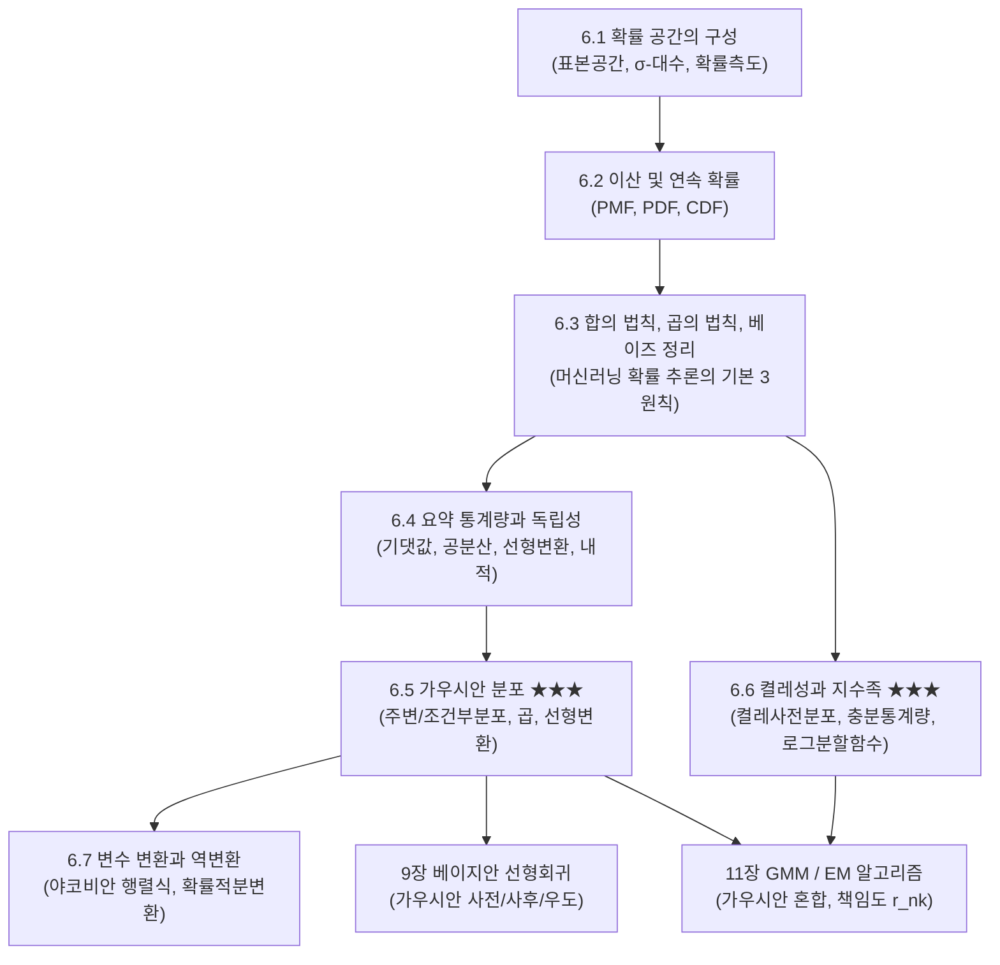
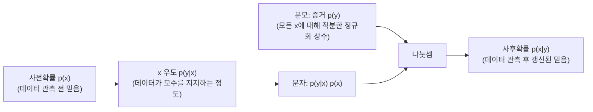

> **교재 쪽수**: 172~224쪽  
> **이 장이 뒤쪽 장에서 어디에 다시 쓰이는가**:
> 8장 모델과 데이터(최대우도추정 MLE, 최대사후확률추정 MAP, 경험적 위험 최소화 ERM의 확률론적 해석), **9장 선형 회귀**(베이지안 선형 회귀의 가우시안 우도, 가우시안 사전분포, 가우시안 사후분포 도출 및 한계 우도 증거 Marginal Likelihood 계산), 10장 차원 축소(확률적 PCA/PPCA의 정규분포 잠재변수 모델링), **11장 밀도 추정/GMM**(가우시안 혼합 모델, 잠재변수의 책임도 responsibility $r_{nk}$ 사후확률 계산, EM 알고리즘의 E-단계 및 M-단계 모수 갱신, 디리클레-다항 켤레 사전분포), 12장 분류(SVM과 대비되는 로지스틱 회귀 및 확률적 판별 모델). 머신러닝에서 데이터의 노이즈와 모델의 불확실성(Uncertainty)을 정량화하고 데이터로부터 새로운 지식을 학습하는 모든 수학적 기반이 이 장에 압축되어 있다.

---

## 0. 이 장 지도

확률론은 머신러닝에서 불확실성을 표현하고 추론하는 핵심 언어다. 단순한 동전 던지기 같은 고전적 확률에서 시작하여, 엄밀한 확률 공간($\sigma$-대수), 이산/연속 확률변수, 머신러닝의 3대 추론 원칙(합의 법칙, 곱의 법칙, 베이즈 정리), 요약 통계량(평균, 공분산, 선형변환), 그리고 머신러닝의 가장 중요한 두 기둥인 **가우시안 분포(Gaussian Distribution)**\ 와 **켤레 사전분포 및 지수족(Conjugacy & Exponential Family)**\ 으로 체계적으로 발전한다.

### 절 목록 및 핵심 요약과 중요도

| 절 번호 및 제목 | 핵심 한 줄 요약 | 중요도 | 근거 |
|---|---|:---:|---|
| **6.1 확률 공간의 구성** *(pp. 172~177)* | 표본공간 $\Omega$, 사건공간($\sigma$-대수), 확률측도 $P$의 콜모고로프 공리와 빈도주의/베이지안 철학을 다룬다. | ★☆☆ | 수학적 엄밀성을 제공하는 이론적 배경이다. |
| **6.2 이산 확률과 연속 확률** *(pp. 178~183)* | 이산 확률질량함수(PMF)와 연속 확률밀도함수(PDF), 누적분포함수(CDF)의 정의와 차이를 배운다. | ★★☆ | 데이터 형태에 따른 확률 모델링의 기본이다. |
| **6.3 합/곱의 법칙과 베이즈 정리** *(pp. 183~186)* | 주변화(합의 법칙), 결합확률(곱의 법칙), 사후확률 역추론(베이즈 정리)을 학습한다. | ★★★ | 8~12장 머신러닝의 모든 확률적 학습과 추론 알고리즘의 절대적 근간이다. |
| **6.4 요약 통계량과 독립성** *(pp. 186~196)* | 기댓값, 공분산 행렬, 세 가지 분산 표현식, 선형변환 시 평균·분산 보존 법칙, 통계적 독립성을 다룬다. | ★★★ | 9장 회귀, 10장 PCA의 공분산 분해, 모멘트 추정에 직접 직결된다. |
| **6.5 가우시안 분포** *(pp. 197~204)* | 주변분포, 조건부분포, 가우시안 밀도의 곱, 선형변환의 닫힘 성질과 촐레스키 샘플링을 학습한다. | ★★★ | **Part 2 전반을 지배하는 핵심 분포**. 9장 베이지안 선형회귀 및 11장 GMM의 수학적 뼈대다. |
| **6.6 켤레성과 지수족** *(pp. 205~214)* | 사후분포 형태를 보존하는 켤레 사전분포 표와 충분통계량, 지수족 일반형 및 로그분할함수 성질을 배운다. | ★★★ | **베이지안 추론의 핵심 기둥**. 9장 가중치 사후분포 및 11장 베이지안 GMM(디리클레 켤레)에 필수적이다. |
| **6.7 변수 변환 / 역변환** *(pp. 214~221)* | 분포함수법, 다변수 야코비안 행렬식 변환 공식, 난수 생성을 위한 확률적분변환을 다룬다. | ★★☆ | 5장 야코비안의 확률적 응용이자 정규화 흐름(Normalizing Flow), 재매개변수화 트릭의 기초다. |
| **6.8 추가 읽을거리** *(pp. 221~222)* | 더 읽을 책, 정규화 흐름·변분 추론과의 연결, 측도론적 엄밀성에 대한 안내. | ★☆☆ | 심화 연구 참고용이다. |

---

## 6.1 확률 공간의 구성(Construction of a Probability Space, 교재 172~177쪽)

### 왜 필요한가 (직관)
우리가 "오늘 비가 올 확률이 $70\%$다"라고 말할 때, 이 불확실성을 어떻게 수학적으로 엄밀하게 정의할 수 있을까? 직관에만 의존하면 "무한히 많은 경우의 수"를 다룰 때 수학적 모순(예: 바나흐-타르스키 역설이나 비가측 집합 문제)에 부딪힌다. 따라서 수학자들은 어떤 시행에서 나올 수 있는 모든 결과의 무대(**표본공간**), 확률을 부여할 수 있는 합법적인 사건들의 모임(**사건공간/$\sigma$-대수**), 그리고 각 사건에 $0$과 $1$ 사이의 숫자를 배정하는 엄격한 규칙(**확률측도**)이라는 삼위일체의 틀을 만들었다. 이것이 바로 **확률 공간(Probability Space)**\ 이다.

### 정의와 성질

#### 1. 확률 공간의 세 가지 구성 요소 $(\Omega, \mathcal{A}, P)$
1. **표본공간(Sample Space, $\Omega$)**:
   어떤 무작위 실험에서 발생할 수 있는 **모든 가능한 결과(outcomes)**\ 의 집합.
   - 예: 주사위 1회 던지기 $\implies \Omega = \{1, 2, 3, 4, 5, 6\}$.
2. **사건공간(Event Space, $\mathcal{A}$)**:
   우리가 확률을 부여할 수 있는 사건(event)들의 집합족으로, 수학적으로 **$\sigma$-대수($\sigma$-algebra)**\ 를 형성한다.
   - $\sigma$-대수의 조건:
     1. 전체집합이 포함된다: $\Omega \in \mathcal{A}$
     2. 여집합에 닫혀 있다: $A \in \mathcal{A} \implies A^c \in \mathcal{A}$
     3. 가산 무한 합집합에 닫혀 있다: $A_1, A_2, \dots \in \mathcal{A} \implies \bigcup_{i=1}^\infty A_i \in \mathcal{A}$
3. **확률측도(Probability Measure, $P$)**:
   사건 $A \in \mathcal{A}$에 실수값을 배정하는 함수 $P: \mathcal{A} \to [0, 1]$로, **콜모고로프의 3대 공리(Kolmogorov's Axioms)**\ 를 만족한다:
   1. **비음수성(Non-negativity)**: 모든 $A \in \mathcal{A}$에 대해 $P(A) \ge 0$.
   2. **정규화(Normalization)**: 전체사건의 확률은 1이다: $P(\Omega) = 1$.
   3. **가산가법성(Countable Additivity)**: 서로소(disjoint, $A_i \cap A_j = \emptyset$)인 사건열에 대해,
      $$P\left(\bigcup_{i=1}^\infty A_i\right) = \sum_{i=1}^\infty P(A_i)$$

#### 2. 확률변수(Random Variable)의 진정한 정의
머신러닝 입문자가 가장 많이 오해하는 개념 중 하나가 '확률변수'다.
- **확률변수(Random Variable)는 '변수'가 아니라 표본공간의 원소를 실수 공간으로 매핑하는 '함수(Function)'다!**
  $$X: \Omega \to \mathbb{R}$$
- 예: 동전을 두 번 던질 때 표본공간의 결과 $\omega = (\text{앞면}, \text{뒷면})$에 대해 "앞면이 나온 횟수"를 $X(\omega) = 1$로 실수값을 대응시키는 규칙 자체가 확률변수다.

#### 3. 6.1.1 철학적 쟁점: 빈도주의 vs 베이지안
- **빈도주의(Frequentist Interpretation)**:
  확률을 **"동일한 실험을 무한히 반복했을 때 특정 사건이 발생하는 상대적 빈도(relative frequency)"**\ 로 정의한다. 모수(parameter) $\theta$는 고정된 미지의 상수이며, 데이터가 무작위로 관측된다고 본다 (MLE 추정).
- **베이지안(Bayesian Interpretation)**:
  확률을 **"불확실성에 대한 주관적 또는 합리적인 믿음의 정도(degree of belief)"**\ 로 정의한다. 데이터는 이미 관측된 고정된 사실이며, 모수 $\theta$ 자체가 불확실성을 가진 확률변수로 취급된다 (Prior, Posterior, MAP 추정).

### 손으로 풀어 보는 예제

#### [예제 1-1] 동전 2회 던지기 확률 공간 구성
공정한 동전을 2회 던지는 실험에 대해 확률 공간 $(\Omega, \mathcal{A}, P)$와 확률변수 $X$를 정의하라.
- **1단계 (표본공간)**:
  앞면을 $H$, 뒷면을 $T$라 하면,
  $$\Omega = \{ (H, H), (H, T), (T, H), (T, T) \}$$
  원소의 개수는 $|\Omega| = 4$이다.
- **2단계 (사건공간 $\sigma$-대수)**:
  $\Omega$가 유한집합이므로 멱집합(Power set) $\mathcal{P}(\Omega)$ 전체를 사건공간으로 둘 수 있다: $|\mathcal{A}| = 2^4 = 16$개의 사건.
  공사건 $\emptyset$, 단일사건들, 전체사건 $\Omega$ 등이 모두 포함된다.
- **3단계 (확률측도)**:
  공정한 동전이므로 각 근원사건의 확률은 $P(\{(H, H)\}) = P(\{(H, T)\}) = P(\{(T, H)\}) = P(\{(T, T)\}) = \frac{1}{4}$.
  임의의 사건 $A$의 확률은 $P(A) = \frac{|A|}{4}$.
- **4단계 (확률변수 $X$: 앞면의 개수)**:
  - $X((H, H)) = 2 \implies P(X = 2) = P(\{(H, H)\}) = \frac{1}{4}$
  - $X((H, T)) = 1, X((T, H)) = 1 \implies P(X = 1) = P(\{(H, T), (T, H)\}) = \frac{2}{4} = \frac{1}{2}$
  - $X((T, T)) = 0 \implies P(X = 0) = P(\{(T, T)\}) = \frac{1}{4}$
  확률의 총합: $\frac{1}{4} + \frac{1}{2} + \frac{1}{4} = 1$.

### 헷갈리는 점 / 자주 하는 실수
- **확률변수를 수치로 착각하는 실수**: $X$는 함수이고, 소문자 $x$가 그 함수가 취하는 구체적인 실숫값(실현값, realization)이다. 표기법 $P(X = x)$는 엄밀히 $P(\{ \omega \in \Omega \mid X(\omega) = x \})$를 줄여 쓴 것이다.

---

## 6.2 이산 확률과 연속 확률(Discrete and Continuous Probabilities, 교재 178~183쪽)

### 왜 필요한가 (직관)
컴퓨터가 다루는 데이터는 두 종류다. 이미지 분류 라벨(고양이, 개, 자동차)이나 자연어 토큰 번호는 셀 수 있는 이산형(discrete) 데이터이고, 센서 전압, 온도, 오디오 파형, 신경망 가중치는 연속적인 실수형(continuous) 데이터다.
이산형에서는 "어떤 특정 값이 나올 확률"을 직접 더할 수 있지만, 연속형에서는 임의의 특정 실수 하나가 정확히 나올 확률은 $0$이다(바늘 끝으로 수직선 위의 한 점을 정확히 찌를 확률). 따라서 연속형에서는 특정 점 대신 **구간의 면적(적분)**\ 을 통해 확률을 구해야 하며, 이를 위해 **확률밀도함수(PDF)**\ 라는 개념이 등장한다.

### 정의와 성질

#### 1. 6.2.1 이산 확률 (Discrete Probabilities)
확률변수 $X$가 취할 수 있는 값의 집합이 유한하거나 가산 무한(countable)일 때:
- **확률질량함수(Probability Mass Function, PMF)**:
  $$P(X = x) = p(x), \quad 0 \le p(x) \le 1, \quad \sum_{x} p(x) = 1$$
- 임의의 부분집합 $S$에 대한 확률: $P(X \in S) = \sum_{x \in S} p(x)$.

#### 2. 6.2.2 연속 확률 (Continuous Probabilities)
확률변수 $X$가 연속적인 실숫값을 가질 때:
- **확률밀도함수(Probability Density Function, PDF)** $f(x)$:
  1. 비음수성: 모든 $x$에 대해 $f(x) \ge 0$.
  2. 전체 적분은 1: $\int_{-\infty}^{\infty} f(x) dx = 1$.
- **구간 확률**: 구간 $[a, b]$에 속할 확률은 곡선 아래 면적이다:
  $$P(a \le X \le b) = \int_a^b f(x) dx$$
- **중요 성질**: **임의의 단일 점 $c$에 대해 $P(X = c) = \int_c^c f(x) dx = 0$이다!**
- **밀도의 성질**: $f(x)$는 확률 자체가 아니라 '단위 길이당 확률(밀도)'이므로, **$f(x) > 1$일 수 있다** (예: 균등분포 $\text{Uniform}(0, 0.5)$에서 $f(x) = 2$).

#### 3. 누적분포함수(Cumulative Distribution Function, CDF)
이산과 연속 모두에서 통용되는 통합 도구로, $X$가 어떤 기준값 $x$ 이하일 누적 확률이다:
$$F_X(x) = P(X \le x)$$
- 성질:
  1. 단조증가(Monotonically non-decreasing): $x_1 \le x_2 \implies F(x_1) \le F(x_2)$
  2. 극한: $\lim_{x \to -\infty} F(x) = 0, \quad \lim_{x \to \infty} F(x) = 1$
  3. 미적분학의 기본정리에 의해, 연속 확률변수의 경우 PDF는 CDF의 도함수다:
     $$f(x) = \frac{d}{dx} F_X(x)$$

### 손으로 풀어 보는 예제

#### [예제 2-1] 지수분포의 PDF, CDF, 구간 확률 계산
어떤 전자 부품의 수명 $X$가 모수 $\lambda = 2$인 지수분포(Exponential distribution)를 따른다고 하자:
$$f(x) = \begin{cases} 2e^{-2x} & (x \ge 0) \\ 0 & (x < 0) \end{cases}$$
1. 전체 적분이 1임을 확인하라.
2. 누적분포함수 $F(x)$를 구하라.
3. 부품 수명이 1시간에서 2시간 사이일 확률 $P(1 \le X \le 2)$를 계산하라.

- **1단계 (전체 적분 확인)**:
  $$\int_0^\infty 2e^{-2x} dx = \left[ -e^{-2x} \right]_0^\infty = \lim_{b \to \infty} (-e^{-2b}) - (-e^0) = 0 - (-1) = 1$$
- **2단계 (CDF $F(x)$ 도출)**:
  $x \ge 0$에 대하여:
  $$F(x) = \int_0^x 2e^{-2t} dt = \left[ -e^{-2t} \right]_0^x = -e^{-2x} - (-e^0) = 1 - e^{-2x}$$
- **3단계 (구간 확률 계산)**:
  $$P(1 \le X \le 2) = F(2) - F(1) = (1 - e^{-4}) - (1 - e^{-2}) = e^{-2} - e^{-4}$$
  - $e^{-2} \approx 0.1353$, $e^{-4} \approx 0.0183$
  - $P(1 \le X \le 2) \approx 0.1353 - 0.0183 = 0.1170$ ($11.7\%$)

### 헷갈리는 점 / 자주 하는 실수
- **PDF 함숫값을 확률로 착각하는 실수**: $f(x_0) = 5$라고 해서 $x_0$가 나올 확률이 5인 것이 아니다. 확률은 반드시 미소 구간 $dx$를 곱한 면적 $f(x_0)dx$로만 정의된다.

---

## 6.3 합의 법칙, 곱의 법칙, 베이즈 정리(Sum Rule, Product Rule, and Bayes' Theorem, 교재 183~186쪽)

### 왜 필요한가 (직관)
머신러닝은 기본적으로 **"이미 관측한 데이터 $y$를 바탕으로, 보이지 않는 진짜 정답이나 매개변수 $x$를 역추적하는 학문"**\ 이다.
- 원인($x$)에서 결과($y$)가 나오는 과정은 우리가 물리 법칙이나 모델로 기술할 수 있다 $\implies$ **우도(Likelihood, $p(y \mid x)$)**.
- 하지만 우리가 알고 싶은 것은 반대로 "결과($y$)가 주어졌을 때 원인($x$)이 무엇이었을까?"이다 $\implies$ **사후확률(Posterior, $p(x \mid y)$)**.
이 인과관계의 방향을 수학적으로 뒤집어 주는 역추론의 절대 법칙이 바로 **베이즈 정리(Bayes' Theorem)**\ 이며, 이를 지탱하는 두 기둥이 **합의 법칙(Sum Rule)**\ 과 **곱의 법칙(Product Rule)**\ 이다.

### 정의와 성질

#### 1. 합의 법칙 (Sum Rule / Marginalization)
결합확률분포 $p(x, y)$에서 관심 없는 변수 $y$를 모두 더하거나 적분하여 제거(주변화, marginalize out)하고, 관심 있는 변수 $x$만의 **주변확률분포(Marginal Distribution)**\ 를 얻는 규칙:
$$p(x) = \begin{cases} \sum_y p(x, y) & (\text{이산 확률변수}) \\ \int p(x, y) dy & (\text{연속 확률변수}) \end{cases}$$

#### 2. 곱의 법칙 (Product Rule)
두 변수가 동시에 발생할 결합확률은 조건부 확률과 조건 변수의 확률의 곱으로 분해된다:
$$p(x, y) = p(x \mid y) p(y) = p(y \mid x) p(x)$$

#### 3. 베이즈 정리 (Bayes' Theorem)
곱의 법칙의 양변을 정리하고 분모에 합의 법칙을 적용하여 조건부 확률의 방향을 뒤집는 공식:
$$\begin{aligned} p(x \mid y) &= \frac{p(y \mid x) p(x)}{p(y)} \\ &= \frac{p(y \mid x) p(x)}{\int p(y \mid x') p(x') dx'} \end{aligned}$$

- **사전확률(Prior) $p(x)$**: 데이터를 보기 전, 매개변수나 상태 $x$에 대해 우리가 알고 있던 지식.
- **우도(Likelihood) $p(y \mid x)$**: $x$라는 조건이 참일 때, 관측 데이터 $y$가 나타날 확률(밀도).
- **증거 / 한계 우도(Evidence / Marginal Likelihood) $p(y)$**: 가능한 모든 $x'$에 대해 우도와 사전확률의 가중 평균 적분. 사후확률의 총합을 1로 만들어 주는 정규화 상수(normalization constant).
- **사후확률(Posterior) $p(x \mid y)$**: 관측 데이터 $y$를 본 후 갱신된 $x$의 최종 확률.
- 비례 관계: **사후확률 $\propto$ 우도 $\times$ 사전확률** (Posterior $\propto$ Likelihood $\times$ Prior).

### 손으로 풀어 보는 예제

#### [예제 3-1] 희귀 질병 진단과 기저율의 오류(Base Rate Fallacy)
- 전체 인구 중 어떤 희귀 질병 $D$에 걸릴 확률(유병률)은 $1\%$이다: $P(D) = 0.01, P(D^c) = 0.99$.
- 진단 키트의 성능:
  - 실제 질병 환자를 양성($+$)으로 판정할 확률(민감도): $P(+ \mid D) = 0.95$.
  - 정상인을 양성으로 오진할 확률(위양성률): $P(+ \mid D^c) = 0.05$.
- 어떤 사람이 검사에서 양성($+$) 판정을 받았다. 이 사람이 **실제로 질병에 걸렸을 확률 $P(D \mid +)$**\ 를 계산하라.

- **1단계 (전체 양성 판정 확률, 증거 $P(+)$ 계산 - 합의 법칙)**:
  $$\begin{aligned} P(+) &= P(+ \mid D)P(D) \\ &\quad + P(+ \mid D^c)P(D^c) \end{aligned}$$
  $$\begin{aligned} P(+) &= (0.95)(0.01) + (0.05)(0.99) \\ &= 0.0095 + 0.0495 = 0.0590 \end{aligned}$$
- **2단계 (베이즈 정리 적용)**:
  $$\begin{aligned} P(D \mid +) &= \frac{P(+ \mid D)P(D)}{P(+)} \\ &= \frac{0.0095}{0.0590} \\ &= \frac{95}{590} \\ &= \frac{19}{118} \\ &\approx 0.1610 \end{aligned}$$
- **해석**:
  검사 정확도가 $95\%$나 되는데도, 양성 판정을 받은 사람이 실제 환자일 확률은 고작 **$16.1\%$**\ 에 불과하다!
  이유는 질병의 사전확률(기저율, $1\%$)이 너무 낮기 때문에 정상인의 $5\%$ 오진($0.0495$)이 실제 환자의 양성($0.0095$)보다 압도적으로 많기 때문이다. 베이즈 추론에서 사전확률(Prior)의 영향력이 얼마나 막강한지 보여주는 교과서적 예시다.

#### [예제 3-2] 이산 결합분포표에서의 주변화와 조건부 확률 (교재 예제 6.1 변형)
두 이산 확률변수 $X \in \{x_1, x_2, x_3\}$, $Y \in \{y_1, y_2\}$의 결합확률표가 다음과 같다고 하자:

| | $x_1$ | $x_2$ | $x_3$ | 합 ($p(y)$) |
|---|:---:|:---:|:---:|:---:|
| **$y_1$** | $0.1$ | $0.2$ | $0.1$ | **$0.4$** |
| **$y_2$** | $0.3$ | $0.1$ | $0.2$ | **$0.6$** |
| **합 ($p(x)$)** | **$0.4$** | **$0.3$** | **$0.3$** | **$1.0$** |

1. 주변분포 $p(x)$와 $p(y)$를 구하라.
2. $Y = y_1$이 관측되었을 때 $X$의 조건부 확률분포 $p(x \mid Y = y_1)$을 구하라.
3. $X = x_2$가 관측되었을 때 $Y$의 조건부 확률분포 $p(y \mid X = x_2)$를 구하라.

- **1단계 (주변분포)**:
  - 가로 행의 합: $p(y_1) = 0.1 + 0.2 + 0.1 = 0.4$, $p(y_2) = 0.3 + 0.1 + 0.2 = 0.6$.
  - 세로 열의 합: $p(x_1) = 0.1 + 0.3 = 0.4$, $p(x_2) = 0.2 + 0.1 = 0.3$, $p(x_3) = 0.1 + 0.2 = 0.3$.
- **2단계 ($p(x \mid y_1)$ 계산)**:
  $p(x_i \mid y_1) = \frac{p(x_i, y_1)}{p(y_1)} = \frac{p(x_i, y_1)}{0.4}$.
  - $p(x_1 \mid y_1) = \frac{0.1}{0.4} = 0.25$
  - $p(x_2 \mid y_1) = \frac{0.2}{0.4} = 0.50$
  - $p(x_3 \mid y_1) = \frac{0.1}{0.4} = 0.25$
  합: $0.25 + 0.50 + 0.25 = 1.0$.
- **3단계 ($p(y \mid x_2)$ 계산)**:
  $p(y_j \mid x_2) = \frac{p(x_2, y_j)}{p(x_2)} = \frac{p(x_2, y_j)}{0.3}$.
  - $p(y_1 \mid x_2) = \frac{0.2}{0.3} = \frac{2}{3} \approx 0.667$
  - $p(y_2 \mid x_2) = \frac{0.1}{0.3} = \frac{1}{3} \approx 0.333$

### 헷갈리는 점 / 자주 하는 실수
- **우도 $p(y \mid x)$와 사후확률 $p(x \mid y)$의 혼동**: 우도는 '매개변수 $x$가 주어졌을 때 데이터 $y$가 나올 확률'이고, 사후확률은 '데이터 $y$가 주어졌을 때 매개변수 $x$의 확률'이다. 두 조건의 전후를 뒤바꾸면 완전히 엉뚱한 결론이 나온다.

---

## 6.4 요약 통계량과 독립성(Summary Statistics and Independence, 교재 186~196쪽)

### 왜 필요한가 (직관)
복잡한 다차원 확률분포 함수 전체를 들고 다니는 것은 연산량이 너무 크다. 분포의 '무게중심(평균)'이 어디에 있고, 그 중심으로부터 데이터들이 '어느 방향으로 얼마나 넓게 퍼져 있는지(분산 및 공분산)'만 알아도 머신러닝 모델의 대부분을 설계할 수 있다. 나아가 두 변수가 서로에게 아무런 영향을 주지 않는지(**독립성**)를 판단하는 것은 모델의 복잡도를 낮추는 가장 강력한 도구다.

### 정의와 성질

#### 1. 6.4.1 평균과 공분산
1. **기댓값(Expected Value / Mean)**:
   $$\mathbb{E}[X] = \begin{cases} \sum_x x p(x) & (\text{이산}) \\ \int x f(x) dx & (\text{연속}) \end{cases}$$
   - **선형성(Linearity)**: $\mathbb{E}[aX + bY + c] = a\mathbb{E}[X] + b\mathbb{E}[Y] + c$ (변수들이 독립이 아니어도 항상 성립!).
2. **분산(Variance)**:
   평균으로부터의 편차(deviation) 제곱의 기댓값:
   $$\mathbb{V}[X] = \mathbb{E}[(X - \mathbb{E}[X])^2] = \mathbb{E}[X^2] - (\mathbb{E}[X])^2$$
   - 성질: $\mathbb{V}[aX + b] = a^2 \mathbb{V}[X]$.
3. **공분산 행렬(Covariance Matrix)**:
   다변량 확률변수 벡터 $\boldsymbol{x} \in \mathbb{R}^D$에 대하여:
   $$\Sigma = \mathbb{V}[\boldsymbol{x}] = \text{Cov}[\boldsymbol{x}, \boldsymbol{x}] = \mathbb{E}[(\boldsymbol{x} - \boldsymbol{\mu})(\boldsymbol{x} - \boldsymbol{\mu})^\top] \in \mathbb{R}^{D \times D}$$
   - 대각 원소 $\Sigma_{ii} = \mathbb{V}[x_i]$: 각 변수 $x_i$의 분산.
   - 비대각 원소 $\Sigma_{ij} = \text{Cov}[x_i, x_j]$: 두 변수 $x_i, x_j$ 사이의 공분산.
   - **핵심 성질**: 공분산 행렬은 항상 **대칭(Symmetric, $\Sigma = \Sigma^\top$)**\ 이며 **양의 준정부호(Positive Semi-Definite, PSD, $\boldsymbol{z}^\top \Sigma \boldsymbol{z} \ge 0$)**\ 이다!

#### 2. 6.4.2 표본 평균과 표본 공분산 (교재 관례 명시)
$N$개의 데이터 샘플 $\{\boldsymbol{x}_1, \dots, \boldsymbol{x}_N\}$이 주어졌을 때:
- 표본 평균: $\hat{\boldsymbol{\mu}} = \frac{1}{N} \sum_{n=1}^N \boldsymbol{x}_n$
- 표본 공분산:
  $$\hat{\Sigma} = \frac{1}{N} \sum_{n=1}^N (\boldsymbol{x}_n - \hat{\boldsymbol{\mu}})(\boldsymbol{x}_n - \hat{\boldsymbol{\mu}})^\top$$

> **[교재 관례 알림: 분모 $\frac{1}{N}$ vs $\frac{1}{N-1}$]**
> MML 교재는 머신러닝의 최대우도추정(MLE) 관례에 따라 표본 분산과 공분산의 분모로 **$\frac{1}{N}$**\ 을 기본 표기로 사용한다. 반면 통계학에서는 모분산의 비편향 추정량(unbiased estimator)을 만들기 위해 자유도를 1 뺀 **$\frac{1}{N-1}$**\ 을 사용한다. 본 해설서와 교재 풀이에서는 교재의 정의인 $\frac{1}{N}$을 기본으로 따르며, 필요 시 비편향 추정량과의 차이를 함께 명시한다.

#### 3. 6.4.3 분산의 세 가지 표현식 (교재 식 (6.43), (6.44), (6.45))
데이터셋 $\{x_1, \dots, x_N\}$에 대한 표본 분산은 다음 세 가지 형태로 완전히 동일하게 표현된다:
1. **표준 편차 제곱 정의 (Standard Definition)**:
   $$\mathbb{V}[X] = \frac{1}{N} \sum_{n=1}^N (x_n - \mu)^2 \quad (6.43)$$
2. **원점 모멘트 표현식 (Raw-score Expression)**:
   $$\mathbb{V}[X] = \frac{1}{N} \sum_{n=1}^N x_n^2 - \mu^2 \quad (6.44)$$
3. **쌍별 차이 표현식 (Pairwise Difference Expression)**:
   $$\mathbb{V}[X] = \frac{1}{2N^2} \sum_{i=1}^N \sum_{j=1}^N (x_i - x_j)^2 \quad (6.45)$$
   *(이 공식의 직관: 평균 $\mu$를 미리 계산할 필요 없이, 모든 데이터 쌍 사이의 거리 제곱 평균으로 분산을 직접 구할 수 있다! 뒤쪽 교재 연습문제 6.6과 6.7의 증명 대상이다.)*
   > 교재의 (6.43)·(6.44)는 기댓값으로 쓴 정의 $\mathbb{V}_X[x] = \mathbb{E}_X[(x-\mu)^2] = \mathbb{E}_X[x^2] - (\mathbb{E}_X[x])^2$이고, 위 식들은 데이터셋에 적용한 경험적 형태다. 교재 (6.45)는 $\frac{1}{N^2}\sum_{i,j}(x_i - x_j)^2 = 2\left[\frac{1}{N}\sum_i x_i^2 - \left(\frac{1}{N}\sum_i x_i\right)^2\right]$, 즉 "쌍별 차이 제곱의 평균은 원점 모멘트 표현의 두 배"라는 형태로 적혀 있다.

#### 4. 6.4.4 확률변수의 선형/아핀 변환
확률변수 벡터 $\boldsymbol{x} \sim (\boldsymbol{\mu}, \Sigma)$에 행렬 $A$와 편향 $\boldsymbol{b}$를 곱해 변환한 $\boldsymbol{y} = A\boldsymbol{x} + \boldsymbol{b}$에 대하여:
$$\begin{aligned} \mathbb{E}[\boldsymbol{y}] &= \mathbb{E}[A\boldsymbol{x} + \boldsymbol{b}] \\ &= A\mathbb{E}[\boldsymbol{x}] + \boldsymbol{b} = A\boldsymbol{\mu} + \boldsymbol{b} \end{aligned}$$
$$\begin{aligned} \mathbb{V}[\boldsymbol{y}] &= \mathbb{V}[A\boldsymbol{x} + \boldsymbol{b}] \\ &= A \mathbb{V}[\boldsymbol{x}] A^\top = A \Sigma A^\top \end{aligned}$$
이 두 공식은 6.5절 가우시안의 선형변환과 10장 PCA에서 핵심적으로 사용된다.

#### 5. 6.4.5 통계적 독립성 (Statistical Independence)
- **정의**: 두 확률변수 $X, Y$가 독립($X \perp Y$)이라는 것은 결합분포가 각각의 주변분포의 곱으로 분해됨을 의미한다:
  $$p(x, y) = p(x) p(y)$$
- **독립과 무상관의 관계**:
  - $X \perp Y \implies \text{Cov}[X, Y] = 0$ (**독립이면 반드시 무상관이다**).
  - 그러나 **역은 일반적으로 성립하지 않는다** (무상관이라고 해서 독립인 것은 아니다!).
  - **대표적인 예외**: 두 변수가 **결합 가우시안(Joint Gaussian)**\ 을 따를 때는 무상관과 독립이 동치(if and only if)이다.

#### 6. 6.4.6 확률변수의 내적 (교재 195~197쪽)
- 무상관인 두 확률변수는 $\mathbb{V}[x+y] = \mathbb{V}[x] + \mathbb{V}[y]$이다(식 (6.58)). 분산은 제곱 단위라서 직각삼각형의 피타고라스 정리 $c^2 = a^2 + b^2$와 모양이 같다.
- 평균이 0인 확률변수에 대해 내적을 $\langle X, Y \rangle := \text{Cov}[x, y]$로 정의하면(식 (6.59)), 길이는 $\|X\| = \sqrt{\mathbb{V}[x]} = \sigma[x]$, 즉 표준편차다(식 (6.60)). 길이가 길수록 불확실하고, 길이 0이면 결정적인 값이다.
- 두 확률변수 사이 각의 코사인은 $\cos\theta = \frac{\text{Cov}[x,y]}{\sqrt{\mathbb{V}[x]\mathbb{V}[y]}}$로 **상관계수**다(식 (6.61)). 따라서 무상관 = 직교이고, 그때 분산의 합 공식이 피타고라스 정리가 된다(그림 6.6).
- 교재 비고: 이 내적에서 나온 유클리드 거리는 확률분포끼리 비교하는 데 좋은 거리가 아니다. 분포는 양수이고 합이 1이라는 제약 때문에 통계적 다양체 위에 있으며, 분포 사이 거리는 보통 KL 발산 등으로 잰다(정보 기하학, Amari 2016).

### 손으로 풀어 보는 예제

#### [예제 4-1] 분산의 세 가지 표현식 수치 검증
데이터셋 $\{1, 3, 5\}$ ($N = 3$)에 대하여 분산의 세 가지 공식이 동일한 결과를 내는지 검증하라.
- **1단계 (평균 계산)**: $\mu = \frac{1 + 3 + 5}{3} = \frac{9}{3} = 3$.
- **2단계 (공식 1: 편차 제곱의 평균)**:
  $$\mathbb{V}[X] = \frac{(1-3)^2 + (3-3)^2 + (5-3)^2}{3} = \frac{(-2)^2 + 0^2 + 2^2}{3} = \frac{4 + 0 + 4}{3} = \frac{8}{3} \approx 2.667$$
- **3단계 (공식 2: 원점 모멘트)**:
  $$\frac{1}{N} \sum x_n^2 = \frac{1^2 + 3^2 + 5^2}{3} = \frac{1 + 9 + 25}{3} = \frac{35}{3}$$
  $$\mathbb{V}[X] = \frac{35}{3} - 3^2 = \frac{35}{3} - \frac{27}{3} = \frac{8}{3}$$
- **4단계 (공식 3: 쌍별 차이)**:
  모든 $(x_i - x_j)^2$ 9개 항을 계산:
  - $(1-1)^2 = 0, (1-3)^2 = 4, (1-5)^2 = 16$
  - $(3-1)^2 = 4, (3-3)^2 = 0, (3-5)^2 = 4$
  - $(5-1)^2 = 16, (5-3)^2 = 4, (5-5)^2 = 0$
  합: $0 + 4 + 16 + 4 + 0 + 4 + 16 + 4 + 0 = 48$.
  $$\mathbb{V}[X] = \frac{1}{2N^2} \sum_{i,j} (x_i - x_j)^2 = \frac{1}{2 \times 3^2} \times 48 = \frac{48}{18} = \frac{8}{3}$$
  세 공식 모두 $\frac{8}{3}$로 정확히 일치한다!

#### [예제 4-2] 2차원 아핀 변환의 평균과 공분산 계산
$\boldsymbol{\mu} = \begin{bmatrix} 1 \\ 2 \end{bmatrix}$, $\Sigma = \begin{bmatrix} 2 & 1 \\ 1 & 3 \end{bmatrix}$인 확률변수 $\boldsymbol{x}$에 대하여, $\boldsymbol{y} = A\boldsymbol{x} + \boldsymbol{b}$ (단, $A = \begin{bmatrix} 1 & -1 \\ 2 & 0 \end{bmatrix}$, $\boldsymbol{b} = \begin{bmatrix} 3 \\ -1 \end{bmatrix}$)의 평균 $\boldsymbol{\mu}_{\boldsymbol{y}}$와 공분산 $\Sigma_{\boldsymbol{y}}$를 구하라.
- **1단계 (평균 $\boldsymbol{\mu}_{\boldsymbol{y}}$)**:
  $$\begin{aligned} \boldsymbol{\mu}_{\boldsymbol{y}} &= A\boldsymbol{\mu} + \boldsymbol{b} \\ &= \begin{bmatrix} 1 & -1 \\ 2 & 0 \end{bmatrix} \begin{bmatrix} 1 \\ 2 \end{bmatrix} + \begin{bmatrix} 3 \\ -1 \end{bmatrix} \\ &= \begin{bmatrix} 1(1) - 1(2) \\ 2(1) + 0(2) \end{bmatrix} + \begin{bmatrix} 3 \\ -1 \end{bmatrix} \\ &= \begin{bmatrix} -1 \\ 2 \end{bmatrix} + \begin{bmatrix} 3 \\ -1 \end{bmatrix} \\ &= \begin{bmatrix} 2 \\ 1 \end{bmatrix} \end{aligned}$$
- **2단계 (공분산 $\Sigma_{\boldsymbol{y}} = A \Sigma A^\top$)**:
  먼저 $A \Sigma$ 계산:
  $$\begin{aligned} A \Sigma &= \begin{bmatrix} 1 & -1 \\ 2 & 0 \end{bmatrix} \begin{bmatrix} 2 & 1 \\ 1 & 3 \end{bmatrix} \\ &= \begin{bmatrix} 1(2) - 1(1) & 1(1) - 1(3) \\ 2(2) + 0(1) & 2(1) + 0(3) \end{bmatrix} \\ &= \begin{bmatrix} 1 & -2 \\ 4 & 2 \end{bmatrix} \end{aligned}$$
  다음으로 $(A \Sigma) A^\top$ 계산 ($A^\top = \begin{bmatrix} 1 & 2 \\ -1 & 0 \end{bmatrix}$):

  $$\begin{aligned} \Sigma_{\boldsymbol{y}} &= \begin{bmatrix} 1 & -2 \\ 4 & 2 \end{bmatrix} \begin{bmatrix} 1 & 2 \\ -1 & 0 \end{bmatrix} \\ &= \begin{bmatrix} 1(1) + (-2)(-1) & 1(2) + (-2)(0) \\ 4(1) + 2(-1) & 4(2) + 2(0) \end{bmatrix} \\ &= \begin{bmatrix} 3 & 2 \\ 2 & 8 \end{bmatrix} \end{aligned}$$

  결과 $\Sigma_{\boldsymbol{y}} = \begin{bmatrix} 3 & 2 \\ 2 & 8 \end{bmatrix}$는 대칭행렬이며 양의 정부호($\det = 24 - 4 = 20 > 0$)이다!

### 헷갈리는 점 / 자주 하는 실수
- **무상관을 독립으로 단정하는 실수**: $X \sim \text{Uniform}(-1, 1)$이고 $Y = X^2$이면 $\text{Cov}[X, Y] = \mathbb{E}[X^3] - \mathbb{E}[X]\mathbb{E}[X^2] = 0 - 0 = 0$으로 무상관이지만, $Y$는 $X$에 의해 완전히 결정되므로 명백히 종속이다.

---

## 6.5 가우시안 분포(Gaussian Distribution, 교재 197~204쪽) — 핵심 중점

### 왜 필요한가 (직관)
머신러닝과 통계학에서 가우시안(정규분포)이 널리 쓰이는 이유는 두 가지다.
1. **중심극한정리(CLT)**: 서로 독립인 무수한 미세 오차들이 합쳐지면 그 합은 원래 분포가 무엇이든 가우시안으로 수렴한다. 현실 세계의 거의 모든 잡음(noise)이 가우시안을 띠는 이유다.
2. **해석적 다루기 쉬움(Analytical Tractability)**: 가우시안 분포는 **미적분과 선형대수 연산에 대해 '정확히 닫혀(closed)' 있다**. 가우시안의 일부를 잘라내도(주변분포), 어떤 값을 관측하여 조건을 걸어도(조건부분포), 행렬을 곱해 선형변환을 해도, 두 가우시안 밀도를 곱해도 **결과는 언제나 다시 가우시안**이다! 이 성질 덕분에 9장의 베이지안 선형 회귀와 11장의 GMM에서 모든 사후분포를 컴퓨터의 복잡한 수치 적분 없이 종이와 연필로 닫힌 형태(closed form)로 유도할 수 있다.

### 정의와 성질

#### 1. 다변량 가우시안 분포(Multivariate Normal Distribution)
$D$차원 확률변수 벡터 $\boldsymbol{x} \in \mathbb{R}^D$가 평균 $\boldsymbol{\mu} \in \mathbb{R}^D$, 공분산 행렬 $\Sigma \in \mathbb{R}^{D \times D}$를 가질 때의 확률밀도함수:

$$\begin{aligned} \mathcal{N}(\boldsymbol{x} \mid \boldsymbol{\mu}, \Sigma) &= \frac{1}{(2\pi)^{D/2} |\Sigma|^{1/2}} \\ &\quad \exp\Bigl( -\frac{1}{2}(\boldsymbol{x} - \boldsymbol{\mu})^\top \\ &\qquad\quad \Sigma^{-1} (\boldsymbol{x} - \boldsymbol{\mu}) \Bigr) \end{aligned}$$

- **정규화 계수**: $\frac{1}{(2\pi)^{D/2} |\Sigma|^{1/2}}$ (전체 적분이 1이 되도록 맞춤).
- **마할라노비스 거리(Mahalanobis Distance)**: $d_M^2 = (\boldsymbol{x} - \boldsymbol{\mu})^\top \Sigma^{-1} (\boldsymbol{x} - \boldsymbol{\mu})$ (분포의 중심으로부터의 통계적 거리).
- **등밀도 타원체(Contour Ellipsoid)**: 지수부의 2차 형식 $(\boldsymbol{x} - \boldsymbol{\mu})^\top \Sigma^{-1} (\boldsymbol{x} - \boldsymbol{\mu}) = c^2$는 타원체를 형성하며, 주축의 방향은 $\Sigma$의 고유벡터, 축의 길이는 고유값의 제곱근 $\sqrt{\lambda_i}$에 비례한다.

#### 2. 6.5.1 가우시안의 주변분포와 조건부 분포 (Marginals & Conditionals)
변수 벡터 $\boldsymbol{x}$를 두 개의 부분 벡터 $\boldsymbol{x}_a \in \mathbb{R}^P$와 $\boldsymbol{x}_b \in \mathbb{R}^Q$ ($D = P + Q$)로 분할(partition)하자:
$$\begin{gathered} \boldsymbol{x} = \begin{bmatrix} \boldsymbol{x}_a \\ \boldsymbol{x}_b \end{bmatrix}, \quad \boldsymbol{\mu} = \begin{bmatrix} \boldsymbol{\mu}_a \\ \boldsymbol{\mu}_b \end{bmatrix}, \\ \Sigma = \begin{bmatrix} \Sigma_{aa} & \Sigma_{ab} \\ \Sigma_{ba} & \Sigma_{bb} \end{bmatrix} \end{gathered}$$
(여기서 $\Sigma_{ba} = \Sigma_{ab}^\top$).

1. **주변분포(Marginal Distribution)**:
   $$\begin{aligned} p(\boldsymbol{x}_a) &= \int p(\boldsymbol{x}_a, \boldsymbol{x}_b) d\boldsymbol{x}_b \\ &= \mathcal{N}(\boldsymbol{x}_a \mid \boldsymbol{\mu}_a, \Sigma_{aa}) \end{aligned}$$
   $$\begin{aligned} p(\boldsymbol{x}_b) &= \int p(\boldsymbol{x}_a, \boldsymbol{x}_b) d\boldsymbol{x}_a \\ &= \mathcal{N}(\boldsymbol{x}_b \mid \boldsymbol{\mu}_b, \Sigma_{bb}) \end{aligned}$$
   > **직관**: 관심 없는 변수 블록 $\boldsymbol{x}_b$를 주변화(적분)할 때는 복잡한 계산을 할 필요가 전혀 없다! 결합 평균 벡터와 공분산 행렬에서 **해당 블록 행과 열을 그냥 지워버리면(drop)** 남은 것이 바로 주변분포다!

2. **조건부 분포(Conditional Distribution)**:
   $\boldsymbol{x}_b$의 값이 관측되었을 때, $\boldsymbol{x}_a$의 조건부 분포 $p(\boldsymbol{x}_a \mid \boldsymbol{x}_b)$ 역시 가우시안이다:
   $$p(\boldsymbol{x}_a \mid \boldsymbol{x}_b) = \mathcal{N}(\boldsymbol{x}_a \mid \boldsymbol{\mu}_{a \mid b}, \Sigma_{a \mid b})$$
   $$\boldsymbol{\mu}_{a \mid b} = \boldsymbol{\mu}_a + \Sigma_{ab} \Sigma_{bb}^{-1} (\boldsymbol{x}_b - \boldsymbol{\mu}_b)$$
   $$\Sigma_{a \mid b} = \Sigma_{aa} - \Sigma_{ab} \Sigma_{bb}^{-1} \Sigma_{ba}$$
   - **조건부 평균 $\boldsymbol{\mu}_{a \mid b}$**: 원래 평균 $\boldsymbol{\mu}_a$에 관측 오차 $(\boldsymbol{x}_b - \boldsymbol{\mu}_b)$가 교차 공분산 가중치 $\Sigma_{ab}\Sigma_{bb}^{-1}$를 통해 보정된다.
   - **조건부 공분산 $\Sigma_{a \mid b}$**: 원래 공분산 $\Sigma_{aa}$에서 정보 획득으로 인한 불확실성 감소분 $\Sigma_{ab} \Sigma_{bb}^{-1} \Sigma_{ba}$만큼 차감된다. 이는 $\Sigma_{aa}$의 **슈어 보수(Schur Complement)**\ 다.
   - **결정적 특징**: **조건부 분산 $\Sigma_{a \mid b}$는 관측값 $\boldsymbol{x}_b$에 전혀 의존하지 않는다!** (관측값이 무엇이든 분산 축소량은 사전 공분산 구조만으로 결정된다).
   - **정밀도 행렬 $\Lambda = \Sigma^{-1}$ 표현**:
     $$\Sigma_{a \mid b} = \Lambda_{aa}^{-1}, \quad \boldsymbol{\mu}_{a \mid b} = \boldsymbol{\mu}_a - \Lambda_{aa}^{-1} \Lambda_{ab} (\boldsymbol{x}_b - \boldsymbol{\mu}_b)$$

#### 3. 6.5.2 가우시안 밀도의 곱 (Product of Gaussian Densities)
두 가우시안 밀도의 곱은 정규화되지 않은 또 다른 가우시안 밀도(스케일 상수 $c$가 곱해진 형태)가 된다:
$$\begin{aligned} &\mathcal{N}(\boldsymbol{x} \mid \boldsymbol{a}, A) \mathcal{N}(\boldsymbol{x} \mid \boldsymbol{b}, B) \\ &= c \mathcal{N}(\boldsymbol{x} \mid \boldsymbol{c}_0, C) \end{aligned}$$
여기서:
$$C = (A^{-1} + B^{-1})^{-1}$$
$$\boldsymbol{c}_0 = C(A^{-1}\boldsymbol{a} + B^{-1}\boldsymbol{b})$$
$$\begin{aligned} c &= \mathcal{N}(\boldsymbol{a} \mid \boldsymbol{b}, A + B) \\ &= (2\pi)^{-D/2} |A+B|^{-1/2} \\ &\quad \exp\Bigl( -\frac{1}{2}(\boldsymbol{a}-\boldsymbol{b})^\top \\ &\qquad\quad (A+B)^{-1} (\boldsymbol{a}-\boldsymbol{b}) \Bigr) \end{aligned}$$
- 정밀도 관점에서 보면: $C^{-1} = A^{-1} + B^{-1}$로 정밀도 행렬이 단순히 더해진다!
- 가중 평균: 평균 $\boldsymbol{c}_0$는 각 가우시안의 정밀도 가중 평균이다.

#### 4. 6.5.3 합과 선형 변환
1. **아핀 변환**:
   $$\boldsymbol{x} \sim \mathcal{N}(\boldsymbol{\mu}, \Sigma) \implies \boldsymbol{y} = A\boldsymbol{x} + \boldsymbol{b} \sim \mathcal{N}(A\boldsymbol{\mu} + \boldsymbol{b}, A \Sigma A^\top)$$
2. **독립 가우시안의 합**:
   $$\boldsymbol{x} \sim \mathcal{N}(\boldsymbol{\mu}_x, \Sigma_x), \quad \boldsymbol{y} \sim \mathcal{N}(\boldsymbol{\mu}_y, \Sigma_y) \implies \boldsymbol{x} + \boldsymbol{y} \sim \mathcal{N}(\boldsymbol{\mu}_x + \boldsymbol{\mu}_y, \Sigma_x + \Sigma_y)$$
3. **가우시안 혼합(Mixture of Gaussians, 11장 GMM)**:
   가우시안 확률변수의 가중합 $ax+by$과 가우시안 밀도의 가중합 $p(x) = \alpha p_1(x) + (1-\alpha)p_2(x)$는 완전히 다르다! 밀도의 가중합은 다봉(multimodal) 분포를 만들 수 있으며 이는 11장의 주제다.

#### 5. 6.5.4 다변량 가우시안 샘플링
컴퓨터는 표준정규 난수 $z \sim \mathcal{N}(0, 1)$만 생성할 수 있다. 임의의 $\mathcal{N}(\boldsymbol{\mu}, \Sigma)$에서 샘플을 추출하는 방법:
1. 공분산 행렬 $\Sigma$의 **촐레스키 분해(Cholesky Decomposition)**\ 를 수행하여 하삼각행렬 $L$을 구한다: $\Sigma = L L^\top$.
2. 표준정규분포로부터 $D$차원 벡터 $\boldsymbol{z} \sim \mathcal{N}(\mathbf{0}, I)$를 추출한다.
3. 선형 변환을 적용한다:
   $$\boldsymbol{x} = \boldsymbol{\mu} + L\boldsymbol{z}$$
   분산 검산: $\mathbb{V}[\boldsymbol{x}] = L \mathbb{V}[\boldsymbol{z}] L^\top = L I L^\top = L L^\top = \Sigma$. 맞다.

### 손으로 풀어 보는 예제

#### [예제 5-1] 2차원 가우시안의 조건부 분포 계산 (교재 예제 6.6 변형)
2차원 가우시안 벡터 $\boldsymbol{x} = \begin{bmatrix} x_1 \\ x_2 \end{bmatrix} \sim \mathcal{N}(\boldsymbol{\mu}, \Sigma)$가 다음과 같이 주어졌다:
$$\boldsymbol{\mu} = \begin{bmatrix} 1 \\ 2 \end{bmatrix}, \quad \Sigma = \begin{bmatrix} 4 & 1 \\ 1 & 2 \end{bmatrix}$$
이때 $x_2 = 4$라는 관측값이 주어졌을 때 $x_1$의 조건부 분포 $p(x_1 \mid x_2 = 4)$를 구하라.

- **1단계 (블록 분할 식별)**:
  - $\mu_1 = 1$, $\mu_2 = 2$
  - $\Sigma_{11} = 4$, $\Sigma_{12} = 1$, $\Sigma_{21} = 1$, $\Sigma_{22} = 2$
  - 관측값 $x_2 = 4$
- **2단계 (조건부 평균 $\mu_{1 \mid 2}$ 계산)**:
  $$\mu_{1 \mid 2} = \mu_1 + \Sigma_{12} \Sigma_{22}^{-1} (x_2 - \mu_2)$$
  $$\mu_{1 \mid 2} = 1 + (1)(2^{-1})(4 - 2) = 1 + \frac{1}{2}(2) = 1 + 1 = 2$$
- **3단계 (조건부 분산 $\Sigma_{1 \mid 2}$ 계산)**:
  $$\Sigma_{1 \mid 2} = \Sigma_{11} - \Sigma_{12} \Sigma_{22}^{-1} \Sigma_{21}$$
  $$\Sigma_{1 \mid 2} = 4 - (1)(2^{-1})(1) = 4 - \frac{1}{2} = 3.5$$
- **4단계 (결론)**:
  $$p(x_1 \mid x_2 = 4) = \mathcal{N}(x_1 \mid 2, 3.5)$$
  원래 $x_1$의 주변분포는 $\mathcal{N}(1, 4)$였으나, $x_2 = 4$라는 양의 상관관계(공분산 1)를 가진 변수가 평균보다 크게 관측되자 $x_1$의 평균도 1에서 2로 상향 조정되었고, 분산은 4에서 3.5로 줄어들어 불확실성이 감소했다.

#### [예제 5-2] 두 1차원 가우시안 밀도의 곱 계산
두 1차원 가우시안 $p_1(x) = \mathcal{N}(x \mid 2, 4)$ ($a = 2, A = 4$)와 $p_2(x) = \mathcal{N}(x \mid 6, 4)$ ($b = 6, B = 4$)의 곱 $p_1(x)p_2(x) = c \mathcal{N}(x \mid c_0, C)$를 계산하라.
- **1단계 (합성 분산 $C$)**:
  $$C = (A^{-1} + B^{-1})^{-1} = \left( \frac{1}{4} + \frac{1}{4} \right)^{-1} = \left( \frac{1}{2} \right)^{-1} = 2$$
- **2단계 (합성 평균 $c_0$)**:
  $$c_0 = C (A^{-1}a + B^{-1}b) = 2 \left( \frac{1}{4}(2) + \frac{1}{4}(6) \right) = 2 \left( \frac{2}{4} + \frac{6}{4} \right) = 2 \times 2 = 4$$
- **3단계 (스케일링 상수 $c$)**:
  $c = \mathcal{N}(a \mid b, A + B) = \mathcal{N}(2 \mid 6, 4 + 4) = \mathcal{N}(2 \mid 6, 8)$.
  $$c = \frac{1}{\sqrt{2\pi \times 8}} \exp\left( -\frac{(2 - 6)^2}{2 \times 8} \right) = \frac{1}{\sqrt{16\pi}} \exp\left( -\frac{(-4)^2}{16} \right) = \frac{1}{4\sqrt{\pi}} e^{-1} \approx \frac{0.3679}{7.0898} \approx 0.0519$$
- **4단계 (결론)**:
  두 가우시안의 곱은 평균이 두 평균 2와 6의 한가운데인 $4$이고(두 분산이 같아 정밀도 가중 평균이 단순 평균이 됨), 분산은 $2$로 두 분산($4$)보다 절반이나 작아진(더 뾰족해진) 가우시안이 된다!

### 헷갈리는 점 / 자주 하는 실수
- **주변분포와 조건부분포의 공분산 혼동**: 주변분포는 그냥 $\Sigma_{aa}$이지만, 조건부분포는 $\Sigma_{aa} - \Sigma_{ab}\Sigma_{bb}^{-1}\Sigma_{ba}$로 반드시 줄어든다.

---

## 6.6 켤레성과 지수족(Conjugacy and the Exponential Family, 교재 205~214쪽) — 핵심 중점

### 왜 필요한가 (직관)
베이지안 추론에서 데이터를 관측한 후 사후분포를 계산하는 기본 공식은:
$$p(\theta \mid x) = \frac{p(x \mid \theta) p(\theta)}{\int p(x \mid \theta') p(\theta') d\theta'}$$
문제는 분모의 적분이다. 일반적인 분포 조합에서는 이 적분을 손으로 풀 수 없는 경우가 대부분이다.
하지만 만약 **"사전분포 $p(\theta)$의 수식 형태와 사후분포 $p(\theta \mid x)$의 수식 형태가 완전히 똑같은 분포족에 머무른다면"**, 우리는 적분을 아예 할 필요 없이 **사전분포의 파라미터에 데이터의 카운트(통계량)만 덧셈해 주는 것**으로 사후분포를 즉시 얻을 수 있다!
이 놀라운 성질을 **켤레성(Conjugacy)**\ 이라 부르며, 켤레성을 만족하는 분포들을 통일된 하나의 공식으로 일반화한 것이 **지수족(Exponential Family)**\ 이다.

### 정의와 성질

#### 1. 6.6.1 켤레 사전분포(Conjugate Prior)의 정의
어떤 우도 함수 $p(x \mid \theta)$에 대하여, 사후분포 $p(\theta \mid x)$가 사전분포 $p(\theta)$와 **동일한 함수 족(same family)**\ 에 속할 때, 그 사전분포를 해당 우도에 대한 **켤레 사전분포(Conjugate Prior)**\ 라고 부른다.

#### [켤레 사전분포 정리 (교재 표 6.2와 여백 주석, 포아송 행은 교재 밖 보충)]

교재 표 6.2는 베르누이·이항(베타), 가우시안(가우시안/역감마), 다변량 가우시안(가우시안/역위샤트), 다항(디리클레)을 싣고, 여백 주석에서 정밀도에 대한 감마·위샤트 사전분포를 언급한다.

| 우도 함수 (Likelihood) | 모수 $\theta$의 의미 | 켤레 사전분포 (Conjugate Prior) | 사후분포 (Posterior) | 머신러닝 응용처 |
|---|---|---|---|---|
| **베르누이 (Bernoulli)** | 성공 확률 $\mu \in [0, 1]$ | **베타 (Beta)** | **베타 (Beta)** | 이진 분류, 동전 던지기 |
| **이항 (Binomial)** | 성공 횟수 모델링 | **베타 (Beta)** | **베타 (Beta)** | 클릭률(CTR) 예측 |
| **카테고리컬 / 다항 (Multinomial)** | $K$개 클래스 확률 벡터 | **디리클레 (Dirichlet)** | **디리클레 (Dirichlet)** | **11장 GMM 혼합계수, LDA 토픽모델** |
| **가우시안 (Gaussian)** | 평균 $\boldsymbol{\mu}$ (공분산 기지) | **가우시안 (Gaussian)** | **가우시안 (Gaussian)** | **9장 베이지안 선형 회귀 가중치** |
| **가우시안 (Gaussian)** | 분산 $\sigma^2$ (평균 기지) | **역감마 (Inverse-Gamma)** | **역감마 (Inverse-Gamma)** | 잡음 분산 추정 |
| **가우시안 (Gaussian)** | 정밀도 $\tau = 1/\sigma^2$ (평균 기지) | **감마 (Gamma)** | **감마 (Gamma)** | 1차원 정밀도 베이지안 추정 |
| **다변량 가우시안** | 공분산 행렬 $\Sigma$ (평균 기지) | **역위샤트 (Inverse-Wishart)** | **역위샤트 (Inverse-Wishart)** | 11장 베이지안 GMM 공분산 추정 |
| **다변량 가우시안** | 정밀도 행렬 $\Lambda = \Sigma^{-1}$ | **위샤트 (Wishart)** | **위샤트 (Wishart)** | 다변량 정밀도 행렬 베이지안 추정 |
| **포아송 (Poisson)** | 발생률 $\lambda > 0$ | **감마 (Gamma)** | **감마 (Gamma)** | 카운트 데이터 모델링 (교재 밖 보충) |

#### 2. 베타-이항 켤레성(Beta-Binomial Conjugacy)의 대수적 증명
1. 이항 우도: $N$번 시행 중 앞면이 $h$번 나옴.
   $$p(x=h \mid N, \mu) = \binom{N}{h} \mu^h (1 - \mu)^{N - h} \propto \mu^h (1 - \mu)^{N - h}$$
2. 베타 사전분포: $\mu \sim \text{Beta}(\alpha, \beta)$.
   $$p(\mu \mid \alpha, \beta) = \frac{\Gamma(\alpha + \beta)}{\Gamma(\alpha)\Gamma(\beta)} \mu^{\alpha - 1} (1 - \mu)^{\beta - 1} \propto \mu^{\alpha - 1} (1 - \mu)^{\beta - 1}$$
3. 베이즈 정리로 사후분포 계산:
   $$p(\mu \mid x = h) \propto p(x = h \mid \mu) p(\mu) \propto \mu^h (1 - \mu)^{N - h} \cdot \mu^{\alpha - 1} (1 - \mu)^{\beta - 1}$$
   $$p(\mu \mid x = h) \propto \mu^{(\alpha + h) - 1} (1 - \mu)^{(\beta + N - h) - 1}$$
   결과가 정확히 모수가 $\alpha' = \alpha + h$, $\beta' = \beta + (N - h)$인 **베타 분포 $\text{Beta}(\alpha + h, \beta + N - h)$**\ 이다!
   - $\alpha$: 사전에 관측했다고 믿는 '가상의 앞면 횟수 (Pseudo-count)'
   - $\beta$: 사전에 관측했다고 믿는 '가상의 뒷면 횟수 (Pseudo-count)'

#### 3. 6.6.2 충분통계량(Sufficient Statistics)과 피셔-네이만 정리
- **정의**: 데이터 $x$가 모수 $\theta$에 대해 제공하는 모든 정보를 정확히 압축하고 있는 함수 $\phi(x)$를 **충분통계량**이라 부른다.
- **피셔-네이만 인수분해 정리(Fisher-Neyman Factorization Theorem)**:
  통계량 $\phi(x)$가 모수 $\theta$에 대해 충분통계량일 필요충분조건은 우도함수가 다음과 같이 분해되는 것이다:
  $$p(x \mid \theta) = h(x) g_\theta(\phi(x))$$
  - $h(x)$: $\theta$와 전혀 무관한 데이터만의 함수.
  - $g_\theta$: 데이터 $x$에 오직 $\phi(x)$를 통해서만 의존하는 함수.

#### 4. 6.6.3 지수족(Exponential Family)의 일반 형태
모수 $\boldsymbol{\theta} \in \mathbb{R}^D$를 가지는 지수족 분포의 표준 형태:

$$\begin{aligned} p(x \mid \boldsymbol{\theta}) &= h(x) \exp\left( \langle \boldsymbol{\theta}, \boldsymbol{\phi}(x) \rangle - A(\boldsymbol{\theta}) \right) \\ &= h(x) \exp\left( \boldsymbol{\theta}^\top \boldsymbol{\phi}(x) - A(\boldsymbol{\theta}) \right) \end{aligned}$$

- $\boldsymbol{\theta}$: **자연 매개변수(Natural Parameter / Canonical Parameter)**
- $\boldsymbol{\phi}(x)$: **충분통계량 벡터(Vector of Sufficient Statistics)**
- $h(x)$: **기저 측도(Base Measure)**
- $A(\boldsymbol{\theta})$: **로그 분할함수(Log-Partition Function / Cumulant Generating Function)**.
  확률의 총합이 1이 되도록 만드는 정규화 상수의 로그값:
  $$A(\boldsymbol{\theta}) = \ln \int h(x) \exp(\boldsymbol{\theta}^\top \boldsymbol{\phi}(x)) dx$$

#### 5. 지수족 로그 분할함수의 미분과 모멘트 (교재 밖 보충)
교재에는 없는 성질이다. 로그 분할함수 $A(\boldsymbol{\theta})$를 미분하면 충분통계량의 평균과 공분산이 나온다(증명은 핵심 유도 2).
1. **1계 도함수 = 충분통계량의 기댓값**:
   $$\nabla_{\boldsymbol{\theta}} A(\boldsymbol{\theta}) = \mathbb{E}[\boldsymbol{\phi}(x)]$$
2. **2계 도함수 = 충분통계량의 공분산 행렬**:
   $$\nabla_{\boldsymbol{\theta}}^2 A(\boldsymbol{\theta}) = \mathbb{V}[\boldsymbol{\phi}(x)]$$
   공분산 행렬은 양의 준정부호이므로, **로그 분할함수 $A(\boldsymbol{\theta})$는 항상 자연 매개변수 $\boldsymbol{\theta}$에 대해 볼록 함수(Convex Function)**\ 이다!

### 손으로 풀어 보는 예제

#### [예제 6-1] 베르누이 분포의 지수족 변환과 모멘트 유도 (교재 연습문제 6.8 연계)
성공 확률 $\mu \in (0, 1)$를 갖는 베르누이 분포 $p(x \mid \mu) = \mu^x (1 - \mu)^{1-x}$ ($x \in \{0, 1\}$)를 지수족의 자연 매개변수 형태로 변환하고, $A(\theta)$의 미분을 통해 평균 $\mu$를 유도하라.

- **1단계 (지수 형태로 변형)**:
  $$p(x \mid \mu) = \exp\left( \ln(\mu^x (1-\mu)^{1-x}) \right) = \exp\left( x \ln\mu + (1-x)\ln(1-\mu) \right)$$
  $$p(x \mid \mu) = \exp\left( x \ln\left(\frac{\mu}{1-\mu}\right) + \ln(1-\mu) \right)$$
- **2단계 (자연 매개변수 $\theta$ 정의)**:
  $$\theta := \ln\left(\frac{\mu}{1-\mu}\right) \quad (\text{로짓, Logit 함수})$$
  역함수: $e^\theta = \frac{\mu}{1-\mu} \implies \mu = \frac{e^\theta}{1 + e^\theta} = \frac{1}{1 + e^{-\theta}} = \sigma(\theta)$ (로지스틱 시그모이드!).
  따라서 $1 - \mu = 1 - \frac{e^\theta}{1+e^\theta} = \frac{1}{1 + e^\theta} = (1 + e^\theta)^{-1}$.
- **3단계 (지수족 표준형 매칭)**:
  $\ln(1 - \mu) = \ln(1 + e^\theta)^{-1} = -\ln(1 + e^\theta)$.
  $$p(x \mid \theta) = 1 \cdot \exp\left( \theta \cdot x - \ln(1 + e^\theta) \right)$$
  - 기저 측도: $h(x) = 1$
  - 충분통계량: $\phi(x) = x$
  - 자연 매개변수: $\theta = \ln\left(\frac{\mu}{1-\mu}\right)$
  - 로그 분할함수: $A(\theta) = \ln(1 + e^\theta)$
- **4단계 ($A(\theta)$ 미분으로 기댓값 검증)**:
  $$\frac{dA}{d\theta} = \frac{d}{d\theta} \ln(1 + e^\theta) = \frac{e^\theta}{1 + e^\theta} = \mu$$
  정확히 $\mathbb{E}[\phi(x)] = \mathbb{E}[x] = \mu$가 유도되었다!
  2계 도함수:
  $$\frac{d^2 A}{d\theta^2} = \frac{d}{d\theta} \left(\frac{e^\theta}{1+e^\theta}\right) = \frac{e^\theta(1+e^\theta) - (e^\theta)^2}{(1+e^\theta)^2} = \frac{e^\theta}{(1+e^\theta)^2} = \mu(1-\mu) = \mathbb{V}[x]$$
  분산까지 정확히 한 번의 미분으로 유도된다.

#### [예제 6-2] 베타-이항 켤레 사후분포 수치 업데이트
동전의 앞면 확률 $\mu$에 대해 사전 믿음으로 $\mu \sim \text{Beta}(2, 2)$ (평균 $\frac{2}{2+2} = 0.5$)를 가지고 있었다. 동전을 10번 던져 앞면이 7번, 뒷면이 3번 나왔다 ($N=10, h=7$).
1. 사후분포 $p(\mu \mid x)$를 구하라.
2. 사후 평균(Posterior Mean)을 계산하라.

- **1단계 (파라미터 갱신)**:
  켤레 공식에 의해:
  $$\alpha' = \alpha + h = 2 + 7 = 9$$
  $$\beta' = \beta + (N - h) = 2 + 3 = 5$$
  따라서 사후분포는 $\mu \mid x \sim \text{Beta}(9, 5)$이다.
- **2단계 (사후 평균 계산)**:
  베타분포 $\text{Beta}(\alpha', \beta')$의 기댓값 공식은 $\mathbb{E}[\mu] = \frac{\alpha'}{\alpha' + \beta'}$이다:
  $$\mathbb{E}[\mu \mid x] = \frac{9}{9 + 5} = \frac{9}{14} \approx 0.6429$$
  - 사전 평균: $0.5$ ($50\%$)
  - 데이터의 표본 평균(MLE): $\frac{7}{10} = 0.7$ ($70\%$)
  - 사후 평균은 사전 믿음($0.5$)과 데이터의 관측치($0.7$) 사이의 타협점인 $0.6429$로 자연스럽게 이동하였다!

### 헷갈리는 점 / 자주 하는 실수
- **자연 매개변수 $\theta$와 원래 파라미터 $\mu$의 혼동**: 베르누이에서 원래 모수는 확률 $\mu \in [0, 1]$이지만, 지수족의 자연 매개변수는 실수 전체 $(-\infty, \infty)$를 갖는 로짓 $\theta = \ln\frac{\mu}{1-\mu}$이다.

---

## 6.7 변수 변환 / 역변환(Change of Variables / Inverse Transform, 교재 214~221쪽)

### 왜 필요한가 (직관)
우리가 표준정규분포 난수 $X \sim \mathcal{N}(0, 1)$를 생성할 수 있을 때, $Y = X^2$의 분포는 무엇일까?
신경망의 각 은닉층을 통과할 때마다 입력 확률변수 $\boldsymbol{x}$는 비선형 변환 $\boldsymbol{y} = \boldsymbol{g}(\boldsymbol{x})$를 거쳐 왜곡된다. 현대 생성 모델인 **정규화 흐름(Normalizing Flow)**\ 은 단순한 가우시안 노이즈에 역변환 가능한 신경망 층들을 연속 적용하여 복잡한 고해상도 이미지 분포를 만들어 낸다. 이때 변환 후의 확률밀도함수를 계산하려면 공간의 부피가 얼마나 늘어나거나 줄어들었는지를 보정해 주어야 하는데, 그 보정 비율이 바로 **야코비안의 행렬식(Jacobian Determinant)**\ 이다.

### 정의와 성질

#### 1. 6.7.1 분포함수법(Distribution Function Technique)
가장 원초적이면서 안전한 변수 변환 기법:
1. $Y = g(X)$의 CDF를 원래 변수 $X$의 확률로 표현한다: $F_Y(y) = P(g(X) \le y)$.
2. $F_Y(y)$를 $y$에 대해 미분하여 PDF를 얻는다: $f_Y(y) = \frac{d}{dy} F_Y(y)$.

#### 2. 6.7.2 일변수 및 다변수 변수 변환 공식
1. **일변수 변수 변환 공식**:
   $g$가 일대일(단조증가 또는 단조감소)이고 미분 가능할 때:
   $$f_Y(y) = f_X(g^{-1}(y)) \left| \frac{d g^{-1}(y)}{dy} \right| = f_X(x) \left| \frac{dx}{dy} \right|$$
   - **절대값이 붙는 이유**: $g$가 단조감소 함수이면 도함수 $\frac{dx}{dy}$가 음수가 되지만, 확률밀도는 항상 $0$ 이상이어야 하므로 부피 변화율의 크기(절대값)를 취한다.
2. **다변수 변수 변환 공식**:
   $D$차원 확률변수 벡터의 일대일 미분가능 변환 $\boldsymbol{y} = \boldsymbol{g}(\boldsymbol{x})$ (역변환 $\boldsymbol{x} = \boldsymbol{g}^{-1}(\boldsymbol{y})$)에 대하여:
   $$f_{\boldsymbol{Y}}(\boldsymbol{y}) = f_{\boldsymbol{X}}(\boldsymbol{g}^{-1}(\boldsymbol{y})) \left| \det\left( \frac{\partial \boldsymbol{x}}{\partial \boldsymbol{y}} \right) \right| = f_{\boldsymbol{X}}(\boldsymbol{x}) \left| \det(J) \right|^{-1}$$
   - 여기서 $J = \frac{\partial \boldsymbol{y}}{\partial \boldsymbol{x}}$는 5.3절에서 배운 야코비안 행렬이다!
   - $\det(J)$는 $\boldsymbol{x}$ 공간의 미소 단위 초부피가 $\boldsymbol{y}$ 공간으로 변환될 때 몇 배로 팽창/수축하는지를 나타내는 체적 변환율이다.

#### 3. 정리 6.15 확률적분변환 (Probability Integral Transformation)
- 연속 확률변수 $X$가 CDF $F_X(x)$를 가질 때, 새로운 확률변수 $Y := F_X(X)$는 **구간 $(0, 1)$ 위의 균등분포 $\text{Uniform}(0, 1)$**\ 를 따른다!
- **역변환 샘플링(Inverse Transform Sampling)**:
  반대로 컴퓨터에서 균등분포 난수 $U \sim \text{Uniform}(0, 1)$를 뽑은 뒤, 원하는 분포의 역누적분포함수 $X = F_X^{-1}(U)$에 대입하면 우리가 원하는 임의의 확률분포 $X$의 샘플을 정확히 생성할 수 있다!

### 손으로 풀어 보는 예제

#### [예제 7-1] 역변환 샘플링을 이용한 지수분포 난수 생성기
균등분포 난수 $U \sim \text{Uniform}(0, 1)$로부터 모수 $\lambda$인 지수분포 $f(x) = \lambda e^{-\lambda x}$ ($x \ge 0$)의 샘플을 생성하는 변환식을 유도하라.
- **1단계 (지수분포의 CDF 구하기)**:
  $$F_X(x) = \int_0^x \lambda e^{-\lambda t} dt = 1 - e^{-\lambda x}$$
- **2단계 (확률적분변환 관계식 설정)**:
  $U = F_X(X) = 1 - e^{-\lambda X}$.
- **3단계 (역함수 $X = F_X^{-1}(U)$ 풀기)**:
  $$1 - U = e^{-\lambda X} \implies \ln(1 - U) = -\lambda X \implies X = -\frac{1}{\lambda} \ln(1 - U)$$
- **4단계 (단순화)**:
  $U$가 $\text{Uniform}(0, 1)$이면 $1 - U$ 역시 정확히 $\text{Uniform}(0, 1)$을 따른다.
  따라서 컴퓨터에서 표준 균등 난수 $u$를 뽑아 $x = -\frac{1}{\lambda} \ln(u)$를 계산하면 지수분포 난수가 생성된다!

### 헷갈리는 점 / 자주 하는 실수
- **야코비안 행렬식의 전치/역수 혼동**: 변환 후 밀도 $f_Y(y)$를 구할 때는 $y$에 대한 $x$의 편미분 행렬식 $\left| \det\left(\frac{\partial x}{\partial y}\right) \right|$를 곱하거나, $x$에 대한 $y$의 편미분 행렬식의 역수 $\frac{1}{|\det(\partial y / \partial x)|}$를 곱해야 한다.

---

## 6.8 추가 읽을거리(Further Reading, 교재 221~222쪽)

교재 6.8절은 다음을 안내한다.

1. **더 읽을 책**: 독학용 입문서(Grinstead & Snell, Walpole 외), 확률의 철학(Hacking), 지수족 개관(Barndorff-Nielsen), 확률적 머신러닝 교재(MacKay, Bishop, Murphy 등).
2. **신경망과 확률 모델**: 정규화 흐름(normalizing flow)은 6.7절의 변수 변환에 기반한다. 신경망에 적용한 변분 추론은 Goodfellow 외(2016) 16~20장을 참고하라고 한다.
3. **측도론을 피한 대가**: 이 장은 측도론을 쓰지 않았다. 그래서 연속 확률변수에서 $p(y \mid x)$처럼 확률 0인 사건 $X = x$에 조건을 거는 표기는 엄밀히는 $x$의 σ-대수에 대한 조건부 기댓값으로 써야 한다.

> 위치 안내: 정보 기하학과 KL 발산은 6.4.6절 비고에, "반복 표본에서 유한 차원 충분통계량을 갖는 분포족은 지수족뿐"이라는 피트먼-쿠프먼-다르무아 정리는 6.6.3절에 나온다.

---

## 핵심 유도 모음 (백지 유도)

### [유도 1] 가우시안 조건부 분포 공식 유도 (제곱완성법 Completing the Square)
- **목표**: $p(\boldsymbol{x}_a \mid \boldsymbol{x}_b) = \mathcal{N}(\boldsymbol{\mu}_{a \mid b}, \Sigma_{a \mid b})$의 평균과 분산 공식을 유도한다.

1. **조건부 확률 정의와 지수부 분리**:
   $$p(\boldsymbol{x}_a \mid \boldsymbol{x}_b) = \frac{p(\boldsymbol{x}_a, \boldsymbol{x}_b)}{p(\boldsymbol{x}_b)} \propto p(\boldsymbol{x}_a, \boldsymbol{x}_b)$$
   $\boldsymbol{x}_a$의 함수로 볼 때, 결합 가우시안의 지수부 2차 형식만 고려하면 된다:
   $$E = -\frac{1}{2} (\boldsymbol{x} - \boldsymbol{\mu})^\top \Sigma^{-1} (\boldsymbol{x} - \boldsymbol{\mu}) = -\frac{1}{2} \begin{bmatrix} \boldsymbol{x}_a - \boldsymbol{\mu}_a \\ \boldsymbol{x}_b - \boldsymbol{\mu}_b \end{bmatrix}^\top \begin{bmatrix} \Lambda_{aa} & \Lambda_{ab} \\ \Lambda_{ba} & \Lambda_{bb} \end{bmatrix} \begin{bmatrix} \boldsymbol{x}_a - \boldsymbol{\mu}_a \\ \boldsymbol{x}_b - \boldsymbol{\mu}_b \end{bmatrix}$$
   *(이유: 정밀도 행렬 $\Lambda = \Sigma^{-1}$ 도입)*
2. **$\boldsymbol{x}_a$에 대한 2차 항과 1차 항 전개**:
   $$E = -\frac{1}{2} \Big( (\boldsymbol{x}_a - \boldsymbol{\mu}_a)^\top \Lambda_{aa} (\boldsymbol{x}_a - \boldsymbol{\mu}_a) + 2 (\boldsymbol{x}_a - \boldsymbol{\mu}_a)^\top \Lambda_{ab} (\boldsymbol{x}_b - \boldsymbol{\mu}_b) + \text{const}(\boldsymbol{x}_a \text{ 무관}) \Big)$$
   $$= -\frac{1}{2} \Big( \boldsymbol{x}_a^\top \Lambda_{aa} \boldsymbol{x}_a - 2 \boldsymbol{x}_a^\top \big( \Lambda_{aa} \boldsymbol{\mu}_a - \Lambda_{ab}(\boldsymbol{x}_b - \boldsymbol{\mu}_b) \big) \Big) + \text{const}$$
   *(이유: $\boldsymbol{x}_a$에 대해 내림차순 정리)*
3. **가우시안 지수부 표준형 $-\frac{1}{2}(\boldsymbol{x}_a - \boldsymbol{\mu}_{a \mid b})^\top \Sigma_{a \mid b}^{-1} (\boldsymbol{x}_a - \boldsymbol{\mu}_{a \mid b})$와 계수 비교**:
   - 2차 항 계수 비교:
     $$\Sigma_{a \mid b}^{-1} = \Lambda_{aa} \implies \Sigma_{a \mid b} = \Lambda_{aa}^{-1}$$
   - 1차 항 계수 비교:
     $$\Sigma_{a \mid b}^{-1} \boldsymbol{\mu}_{a \mid b} = \Lambda_{aa} \boldsymbol{\mu}_a - \Lambda_{ab}(\boldsymbol{x}_b - \boldsymbol{\mu}_b)$$
     $$\boldsymbol{\mu}_{a \mid b} = \Lambda_{aa}^{-1} \Big( \Lambda_{aa} \boldsymbol{\mu}_a - \Lambda_{ab}(\boldsymbol{x}_b - \boldsymbol{\mu}_b) \Big) = \boldsymbol{\mu}_a - \Lambda_{aa}^{-1}\Lambda_{ab}(\boldsymbol{x}_b - \boldsymbol{\mu}_b)$$
4. **블록 행렬 역행렬 보조정리(Block Matrix Inversion Lemma) 적용**:
   공분산 블록 $\Sigma$와의 관계에서:
   $$\Lambda_{aa}^{-1} = \Sigma_{aa} - \Sigma_{ab} \Sigma_{bb}^{-1} \Sigma_{ba}$$
   $$-\Lambda_{aa}^{-1}\Lambda_{ab} = \Sigma_{ab} \Sigma_{bb}^{-1}$$
   이를 대입하면:
   $$\Sigma_{a \mid b} = \Sigma_{aa} - \Sigma_{ab} \Sigma_{bb}^{-1} \Sigma_{ba} \quad \text{(증명 완료)}$$
   $$\boldsymbol{\mu}_{a \mid b} = \boldsymbol{\mu}_a + \Sigma_{ab} \Sigma_{bb}^{-1} (\boldsymbol{x}_b - \boldsymbol{\mu}_b) \quad \text{(증명 완료)}$$

---

### [유도 2] 지수족 로그 분할함수의 미분이 기댓값과 분산임을 증명 (교재 밖 보충)
> 교재 6.6.3절은 로그 분할함수 $A(\boldsymbol{\theta})$를 "정규화 상수"로만 소개하고, 아래 성질은 다루지 않는다. 지수족을 깊이 물을 때 쓸 수 있는 참고 내용이다.
- **목표**: $p(x \mid \boldsymbol{\theta}) = h(x) \exp(\boldsymbol{\theta}^\top \boldsymbol{\phi}(x) - A(\boldsymbol{\theta}))$에 대하여 $\nabla_{\boldsymbol{\theta}} A(\boldsymbol{\theta}) = \mathbb{E}[\boldsymbol{\phi}(x)]$, $\nabla_{\boldsymbol{\theta}}^2 A(\boldsymbol{\theta}) = \mathbb{V}[\boldsymbol{\phi}(x)]$임을 증명한다.

1. **확률의 총합이 1이라는 항등식에서 출발**:
   $$\int p(x \mid \boldsymbol{\theta}) dx = 1 \implies \int h(x) \exp(\boldsymbol{\theta}^\top \boldsymbol{\phi}(x) - A(\boldsymbol{\theta})) dx = 1$$
   $$\exp(A(\boldsymbol{\theta})) = \int h(x) \exp(\boldsymbol{\theta}^\top \boldsymbol{\phi}(x)) dx$$
   *(이유: $A(\boldsymbol{\theta})$는 $x$와 무관하므로 적분 밖으로 뺌)*
2. **양변을 $\boldsymbol{\theta}$에 대해 미분 (라이프니츠 적분 규칙)**:
   $$\nabla_{\boldsymbol{\theta}} \exp(A(\boldsymbol{\theta})) = \nabla_{\boldsymbol{\theta}} \int h(x) \exp(\boldsymbol{\theta}^\top \boldsymbol{\phi}(x)) dx$$
   $$\exp(A(\boldsymbol{\theta})) \nabla_{\boldsymbol{\theta}} A(\boldsymbol{\theta}) = \int h(x) \nabla_{\boldsymbol{\theta}} \exp(\boldsymbol{\theta}^\top \boldsymbol{\phi}(x)) dx = \int h(x) \exp(\boldsymbol{\theta}^\top \boldsymbol{\phi}(x)) \boldsymbol{\phi}(x) dx$$
   *(이유: 지수함수의 연쇄법칙 미분)*
3. **양변을 $\exp(A(\boldsymbol{\theta}))$로 나누기**:
   $$\nabla_{\boldsymbol{\theta}} A(\boldsymbol{\theta}) = \int \frac{h(x) \exp(\boldsymbol{\theta}^\top \boldsymbol{\phi}(x))}{\exp(A(\boldsymbol{\theta}))} \boldsymbol{\phi}(x) dx = \int h(x) \exp(\boldsymbol{\theta}^\top \boldsymbol{\phi}(x) - A(\boldsymbol{\theta})) \boldsymbol{\phi}(x) dx$$
   $$\nabla_{\boldsymbol{\theta}} A(\boldsymbol{\theta}) = \int p(x \mid \boldsymbol{\theta}) \boldsymbol{\phi}(x) dx = \mathbb{E}[\boldsymbol{\phi}(x)] \quad \text{(1계 도함수 증명 완료)}$$
4. **한 번 더 미분하여 2계 도함수 구하기**:
   $$\nabla_{\boldsymbol{\theta}}^2 A(\boldsymbol{\theta}) = \nabla_{\boldsymbol{\theta}} \int p(x \mid \boldsymbol{\theta}) \boldsymbol{\phi}(x)^\top dx = \int \nabla_{\boldsymbol{\theta}} [p(x \mid \boldsymbol{\theta})] \boldsymbol{\phi}(x)^\top dx$$
   $p(x \mid \boldsymbol{\theta})$를 $\boldsymbol{\theta}$로 미분하면:
   $$\nabla_{\boldsymbol{\theta}} p(x \mid \boldsymbol{\theta}) = p(x \mid \boldsymbol{\theta}) (\boldsymbol{\phi}(x) - \nabla_{\boldsymbol{\theta}} A(\boldsymbol{\theta}))^\top = p(x \mid \boldsymbol{\theta}) (\boldsymbol{\phi}(x) - \mathbb{E}[\boldsymbol{\phi}(x)])^\top$$
   대입하면:
   $$\nabla_{\boldsymbol{\theta}}^2 A(\boldsymbol{\theta}) = \int p(x \mid \boldsymbol{\theta}) (\boldsymbol{\phi}(x) - \mathbb{E}[\boldsymbol{\phi}(x)]) (\boldsymbol{\phi}(x) - \mathbb{E}[\boldsymbol{\phi}(x)])^\top dx = \mathbb{V}[\boldsymbol{\phi}(x)] \quad \text{(2계 도함수 증명 완료)}$$

---

### [유도 3] 두 가우시안 밀도의 곱 공식 유도
- **목표**: $\mathcal{N}(x \mid a, A)\mathcal{N}(x \mid b, B) = c \mathcal{N}(x \mid c_0, C)$ 임을 유도한다.

1. **지수부 2차 형식 합치기**:
   $$E = -\frac{1}{2} \Big( (x - a)^\top A^{-1} (x - a) + (x - b)^\top B^{-1} (x - b) \Big)$$
2. **$x$에 대해 2차 항, 1차 항, 상수 항으로 전개**:
   $$E = -\frac{1}{2} \Big( x^\top (A^{-1} + B^{-1}) x - 2 x^\top (A^{-1}a + B^{-1}b) + a^\top A^{-1}a + b^\top B^{-1}b \Big)$$
3. **새로운 분산 $C = (A^{-1} + B^{-1})^{-1}$ 및 평균 $c_0 = C(A^{-1}a + B^{-1}b)$로 제곱 완성**:
   $$x^\top C^{-1} x - 2 x^\top C^{-1} c_0 = (x - c_0)^\top C^{-1} (x - c_0) - c_0^\top C^{-1} c_0$$
4. **남은 상수 항 정리**:
   $$E = -\frac{1}{2} (x - c_0)^\top C^{-1} (x - c_0) - \frac{1}{2} K,$$
   $$K := a^\top A^{-1} a + b^\top B^{-1} b - c_0^\top C^{-1} c_0$$
   $K$에는 $x$가 없으므로 상수다. 이제 $K = (a - b)^\top (A + B)^{-1} (a - b)$임을 보인다. ($A$, $B$는 공분산이라 대칭이고 역행렬이 있다고 둔다.)
   - **(가) $C$를 다른 모양으로 쓰기.** $A^{-1}+B^{-1}$의 양쪽에서 $A^{-1}$과 $B^{-1}$을 빼내면
     $$A^{-1}+B^{-1} = A^{-1}(B + A)B^{-1}$$
     이다(오른쪽을 전개하면 $A^{-1}BB^{-1} + A^{-1}AB^{-1} = A^{-1} + B^{-1}$). 곱의 역행렬은 순서를 뒤집은 역행렬의 곱이므로
     $$C = (A^{-1}+B^{-1})^{-1} = B(A+B)^{-1}A.$$
     같은 방법으로 $A^{-1}+B^{-1} = B^{-1}(A+B)A^{-1}$로 묶으면 $C = A(A+B)^{-1}B$도 된다.
   - **(나) 세 가지 보조 등식.** (가)의 두 모양 중 계산이 줄어드는 쪽을 골라 쓴다. $C = B(A+B)^{-1}A$를 쓰면 오른쪽 끝의 $AA^{-1}$이 지워져
     $$A^{-1}CA^{-1} = A^{-1}B(A+B)^{-1}AA^{-1} = A^{-1}B(A+B)^{-1}$$
     이므로 $A^{-1} - A^{-1}CA^{-1} = A^{-1}\big[(A+B) - B\big](A+B)^{-1} = (A+B)^{-1}$. 같은 방법으로 $B^{-1} - B^{-1}CB^{-1} = B^{-1}\big[(A+B)-A\big](A+B)^{-1} = (A+B)^{-1}$. 그리고 $A^{-1}CB^{-1} = A^{-1}\,A(A+B)^{-1}B\,B^{-1} = (A+B)^{-1}$.
   - **(다) $c_0^\top C^{-1}c_0$ 펼치기.** $c_0 = C(A^{-1}a + B^{-1}b)$이므로 $C^{-1}c_0 = A^{-1}a + B^{-1}b$이고
     $$c_0^\top C^{-1} c_0 = (A^{-1}a + B^{-1}b)^\top C (A^{-1}a + B^{-1}b) = a^\top A^{-1}CA^{-1}a + 2a^\top A^{-1}CB^{-1}b + b^\top B^{-1}CB^{-1}b.$$
     (가운데 두 교차항 $a^\top A^{-1}CB^{-1}b$와 $b^\top B^{-1}CA^{-1}a$는 서로의 전치인 스칼라라 같아서 2배로 합쳤다.)
   - **(라) 대입.** $K$에 (다)를 넣고 같은 벡터끼리 묶은 뒤 (나)를 쓰면
     $$K = a^\top\big(A^{-1} - A^{-1}CA^{-1}\big)a + b^\top\big(B^{-1} - B^{-1}CB^{-1}\big)b - 2a^\top A^{-1}CB^{-1}b$$
     $$= a^\top(A+B)^{-1}a + b^\top(A+B)^{-1}b - 2a^\top(A+B)^{-1}b = (a-b)^\top(A+B)^{-1}(a-b).$$
5. **정규화 상수와 결합**:
   두 밀도의 앞 계수를 곱하면 $(2\pi)^{-D}|A|^{-1/2}|B|^{-1/2}$이다. (가)의 $C = A(A+B)^{-1}B$에서 행렬식을 취하면 $|C| = |A|\,|B|\,/\,|A+B|$, 즉 $|A|\,|B| = |C|\,|A+B|$이다. 그래서 계수를 둘로 나눌 수 있다:
   $$(2\pi)^{-D}|A|^{-1/2}|B|^{-1/2} = \Big[(2\pi)^{-D/2}|A+B|^{-1/2}\Big]\Big[(2\pi)^{-D/2}|C|^{-1/2}\Big].$$
   첫째 괄호와 $\exp(-\frac12 K)$를 묶으면 $c = (2\pi)^{-D/2}|A+B|^{-1/2}\exp\big(-\frac12(a-b)^\top(A+B)^{-1}(a-b)\big) = \mathcal{N}(a \mid b, A + B)$이고, 둘째 괄호와 $\exp(-\frac12(x-c_0)^\top C^{-1}(x-c_0))$를 묶으면 $\mathcal{N}(x \mid c_0, C)$다(교재 식 (6.74)~(6.76)). $\quad \text{(증명 완료)}$

---

### [유도 4] 확률적분변환 $Y = F_X(X) \sim \text{Uniform}(0, 1)$ 증명
- **목표**: 연속 확률변수 $X$의 CDF를 $F_X$라 할 때, $Y = F_X(X)$의 분포가 균등분포임을 증명한다.

1. **새로운 변수 $Y$의 누적분포함수 $F_Y(y)$ 정의**:
   임의의 $y \in (0, 1)$에 대하여,
   $$F_Y(y) = P(Y \le y) = P(F_X(X) \le y)$$
   *(이유: 누적분포함수의 정의)*
2. **CDF의 단조증가성과 역함수 적용**:
   $F_X$가 연속이고 순증가(strictly increasing)라고 가정하면(교재 증명도 역함수가 있다고 가정한다) 역함수 $F_X^{-1}$가 존재하며 부등호 방향이 보존된다:
   $$P(F_X(X) \le y) = P(X \le F_X^{-1}(y))$$
   *(이유: 양변에 $F_X^{-1}$ 적용)*
3. **$X$의 CDF 정의 적용**:
   $P(X \le t) = F_X(t)$이므로, $t = F_X^{-1}(y)$를 대입하면:
   $$P(X \le F_X^{-1}(y)) = F_X(F_X^{-1}(y)) = y$$
   *(이유: 함수와 역함수의 합성)*
4. **확률밀도함수 도출**:
   $$F_Y(y) = y \quad (0 < y < 1)$$
   이를 $y$에 대해 미분하면:
   $$f_Y(y) = \frac{d}{dy} F_Y(y) = \frac{d}{dy}(y) = 1 \quad (0 < y < 1)$$
   구간 $(0, 1)$에서 확률밀도가 상수 1인 분포는 정의상 **$\text{Uniform}(0, 1)$**\ 이다. $\quad \text{(증명 완료)}$

---

## 말로 설명하기 (개념 서술형·구술 대비)

서술형 문항이나 구술 질문에 대비해 말로도 설명해 본다.

**Q. 확률변수란 무엇인가요? 확률밀도함수 값이 1보다 클 수 있나요?**
"확률변수는 표본공간의 결과를 실수로 보내는 함수입니다. 연속 확률변수의 밀도 $p(x)$는 확률 자체가 아니라 단위 길이당 확률이라, 구간에서 적분한 값이 확률입니다. 그래서 $\text{Uniform}(0, 0.5)$의 밀도 2처럼 1보다 클 수 있고, 한 점의 확률은 0입니다."

**Q. 합의 법칙, 곱의 법칙, 베이즈 정리를 설명해 보세요.**
"합의 법칙은 결합분포에서 다른 변수를 더하거나 적분해 없애 주변분포를 얻는 것이고, 곱의 법칙은 $p(x,y)=p(y\mid x)p(x)$입니다. 둘을 합치면 베이즈 정리 $p(x\mid y)=\frac{p(y\mid x)p(x)}{p(y)}$가 나오고, 분모의 증거 $p(y)=\int p(y\mid x)p(x)dx$는 합의 법칙으로 구합니다. 머신러닝에서는 데이터로 매개변수의 사후분포를 구할 때 씁니다."

**Q. 독립과 무상관의 차이는?**
"독립은 $p(x,y)=p(x)p(y)$로 분포 전체가 분리되는 것이고, 무상관은 공분산이 0인 것뿐입니다. 독립이면 무상관이지만 역은 아닙니다. $X\sim\text{Uniform}(-1,1)$, $Y=X^2$는 공분산이 0이지만 $Y$가 $X$로 완전히 결정됩니다. 결합 가우시안이면 둘이 같아집니다."

**Q. 가우시안의 주변분포와 조건부분포는 어떻게 구하나요?**
"주변분포는 평균과 공분산에서 해당 블록만 떼어 내면 됩니다. 조건부분포는 $\mu_{a\mid b}=\mu_a+\Sigma_{ab}\Sigma_{bb}^{-1}(x_b-\mu_b)$, $\Sigma_{a\mid b}=\Sigma_{aa}-\Sigma_{ab}\Sigma_{bb}^{-1}\Sigma_{ba}$입니다. 관측으로 평균이 상관관계만큼 이동하고 분산은 줄어드는데, 줄어드는 양은 관측값과 무관합니다."

**Q. 선형변환한 확률변수의 평균과 공분산은? 다변량 가우시안 샘플은 어떻게 뽑나요?**
"$y=Ax+b$이면 평균은 $A\mu+b$, 공분산은 $A\Sigma A^\top$입니다. 가우시안이면 $y$도 가우시안입니다. 그래서 $\Sigma=LL^\top$로 촐레스키 분해하고 표준정규 $z$를 뽑아 $x=\mu+Lz$로 만들면 $\mathcal N(\mu,\Sigma)$ 샘플이 됩니다."

**Q. 켤레 사전분포란? 베타-이항을 예로 설명해 보세요.**
"사후분포가 사전분포와 같은 분포족이 되게 하는 사전분포입니다. 이항 우도 $\mu^h(1-\mu)^{N-h}$에 베타 사전분포 $\mu^{\alpha-1}(1-\mu)^{\beta-1}$를 곱하면 $\text{Beta}(\alpha+h,\beta+N-h)$가 되어, 적분 없이 성공·실패 횟수를 더하기만 하면 됩니다. $\alpha,\beta$는 미리 본 가상의 성공·실패 횟수로 해석합니다."

**Q. 지수족이란? 왜 중요한가요?**
"$p(x\mid\theta)=h(x)\exp(\theta^\top\phi(x)-A(\theta))$ 꼴의 분포족으로, 가우시안·베르누이·이항·베타 등이 속합니다. 충분통계량 $\phi(x)$가 유한 차원이라 데이터를 요약하기 쉽고, 로그 분할함수를 미분하면 $\nabla A=\mathbb E[\phi(x)]$, $\nabla^2A=\mathbb V[\phi(x)]$가 나옵니다. 지수족 우도에는 켤레 사전분포가 있습니다."

**Q. 변수 변환 공식과 확률적분변환은?**
"$y=g(x)$가 일대일이면 $p_y(y)=p_x(g^{-1}(y))\left|\frac{dg^{-1}}{dy}\right|$이고, 다변수에서는 야코비안 행렬식의 절댓값을 곱합니다. 부피가 늘어난 만큼 밀도가 줄어드는 것을 보정하는 것입니다. 확률적분변환은 $Y=F_X(X)$가 $\text{Uniform}(0,1)$을 따른다는 정리이고, 거꾸로 균등 난수를 $F_X^{-1}$에 넣으면 원하는 분포의 샘플을 얻습니다."

---

## 연습문제

### 확인 문제 (10문제, 상세 풀이 및 파이썬 검산 완료)

#### [문제 1] (조건부 확률과 베이즈 정리)
어떤 공장에서 생산되는 제품의 $60\%$는 공장 A에서, $40\%$는 공장 B에서 생산된다. 공장 A의 불량률은 $2\%$, 공장 B의 불량률은 $5\%$이다. 무작위로 뽑은 제품이 불량품이었을 때, 이 제품이 공장 B에서 생산되었을 확률을 구하라.
- **[풀이]**:
  1. 사전확률: $P(A) = 0.6, P(B) = 0.4$.
  2. 우도: $P(D \mid A) = 0.02, P(D \mid B) = 0.05$ ($D$는 불량품 사건).
  3. 전체 불량률 $P(D)$ (합의 법칙):
     $$P(D) = P(D \mid A)P(A) + P(D \mid B)P(B) = (0.02)(0.6) + (0.05)(0.4) = 0.012 + 0.020 = 0.032$$
  4. 베이즈 정리 적용:
     $$P(B \mid D) = \frac{P(D \mid B)P(B)}{P(D)} = \frac{0.020}{0.032} = \frac{20}{32} = \frac{5}{8} = 0.625$$
  답: $0.625$ ($62.5\%$)

#### [문제 2] (확률변수의 선형변환과 공분산)
평균이 $\boldsymbol{\mu} = \begin{bmatrix} 2 \\ -1 \end{bmatrix}$, 공분산이 $\Sigma = \begin{bmatrix} 1 & 1 \\ 1 & 4 \end{bmatrix}$인 확률변수 $\boldsymbol{x}$가 있다. $y = 2x_1 - x_2 + 3$의 평균과 분산을 구하라.
- **[풀이]**:
  1. $y$를 벡터 행렬곱 형태로 표현: $y = A\boldsymbol{x} + b$, 여기서 $A = \begin{bmatrix} 2 & -1 \end{bmatrix} \in \mathbb{R}^{1 \times 2}$, $b = 3$.
  2. 평균 계산:
     $$\mathbb{E}[y] = A\boldsymbol{\mu} + b = \begin{bmatrix} 2 & -1 \end{bmatrix} \begin{bmatrix} 2 \\ -1 \end{bmatrix} + 3 = 2(2) + (-1)(-1) + 3 = 4 + 1 + 3 = 8$$
  3. 분산 계산:
     $$\mathbb{V}[y] = A \Sigma A^\top = \begin{bmatrix} 2 & -1 \end{bmatrix} \begin{bmatrix} 1 & 1 \\ 1 & 4 \end{bmatrix} \begin{bmatrix} 2 \\ -1 \end{bmatrix}$$
     - $A \Sigma = \begin{bmatrix} 2(1) - 1(1) & 2(1) - 1(4) \end{bmatrix} = \begin{bmatrix} 1 & -2 \end{bmatrix}$
     - $(A \Sigma) A^\top = \begin{bmatrix} 1 & -2 \end{bmatrix} \begin{bmatrix} 2 \\ -1 \end{bmatrix} = 1(2) + (-2)(-1) = 2 + 2 = 4$
  답: 평균 8, 분산 4.

#### [문제 3] (2차원 가우시안 조건부 분포)
$\begin{bmatrix} x_1 \\ x_2 \end{bmatrix} \sim \mathcal{N}\left( \begin{bmatrix} 0 \\ 0 \end{bmatrix}, \begin{bmatrix} 9 & 3 \\ 3 & 4 \end{bmatrix} \right)$일 때, $x_2 = 2$가 주어졌을 때 $x_1$의 조건부 분포 $p(x_1 \mid x_2 = 2)$의 평균과 분산을 구하라.
- **[풀이]**:
  1. 파라미터 매칭: $\mu_1 = 0, \mu_2 = 0, \Sigma_{11} = 9, \Sigma_{12} = 3, \Sigma_{22} = 4$.
  2. 조건부 평균:
     $$\mu_{1 \mid 2} = \mu_1 + \Sigma_{12} \Sigma_{22}^{-1} (x_2 - \mu_2) = 0 + 3 \cdot \frac{1}{4} (2 - 0) = \frac{6}{4} = 1.5$$
  3. 조건부 분산:
     $$\Sigma_{1 \mid 2} = \Sigma_{11} - \Sigma_{12} \Sigma_{22}^{-1} \Sigma_{21} = 9 - 3 \cdot \frac{1}{4} \cdot 3 = 9 - \frac{9}{4} = \frac{27}{4} = 6.75$$
  답: $\mathcal{N}(1.5, 6.75)$.

#### [문제 4] (두 1차원 가우시안의 곱)
$p_1(x) = \mathcal{N}(x \mid 0, 2)$와 $p_2(x) = \mathcal{N}(x \mid 4, 2)$의 곱 $p_1(x)p_2(x) = c \mathcal{N}(x \mid c_0, C)$에서 새로운 평균 $c_0$와 분산 $C$를 구하라.
- **[풀이]**:
  1. $A = 2, B = 2, a = 0, b = 4$.
  2. $C = (A^{-1} + B^{-1})^{-1} = \left( \frac{1}{2} + \frac{1}{2} \right)^{-1} = 1^{-1} = 1$.
  3. $c_0 = C(A^{-1}a + B^{-1}b) = 1 \left( \frac{0}{2} + \frac{4}{2} \right) = 2$.
  답: 평균 $c_0 = 2$, 분산 $C = 1$.

#### [문제 5] (베타-이항 켤레 사후분포)
어떤 웹사이트 배너의 클릭률 $\mu$에 대해 사전분포 $\mu \sim \text{Beta}(1, 1)$ (균등분포)를 설정했다. 사용자 20명에게 배너를 노출하여 4명이 클릭했다. 사후분포 $p(\mu \mid \text{data})$와 사후 평균을 구하라.
- **[풀이]**:
  1. 사전 파라미터 $\alpha = 1, \beta = 1$.
  2. 관측 데이터 $N = 20$, 클릭(성공) $h = 4$, 미클릭(실패) $N - h = 16$.
  3. 켤레 갱신 공식:
     $$\alpha' = \alpha + h = 1 + 4 = 5, \quad \beta' = \beta + (N - h) = 1 + 16 = 17$$
     사후분포: $\text{Beta}(5, 17)$.
  4. 사후 평균:
     $$\mathbb{E}[\mu] = \frac{\alpha'}{\alpha' + \beta'} = \frac{5}{5 + 17} = \frac{5}{22} \approx 0.2273$$
  답: 사후분포 $\text{Beta}(5, 17)$, 사후 평균 $\frac{5}{22}$.

#### [문제 6] (포아송 분포의 지수족 표현)
단위 시간당 사건 발생률 $\lambda > 0$인 포아송 분포 $p(x \mid \lambda) = \frac{\lambda^x e^{-\lambda}}{x!}$ ($x = 0, 1, 2, \dots$)를 지수족 자연 매개변수 형태로 나타내고, 자연 매개변수 $\theta$와 로그 분할함수 $A(\theta)$를 구하라.
- **[풀이]**:
  1. 지수 형태로 변형:
     $$p(x \mid \lambda) = \frac{1}{x!} \exp( x \ln\lambda - \lambda )$$
  2. 지수족 표준형 $h(x) \exp(\theta \phi(x) - A(\theta))$와 매칭:
     - 기저 측도: $h(x) = \frac{1}{x!}$
     - 충분통계량: $\phi(x) = x$
     - 자연 매개변수: $\theta = \ln\lambda \implies \lambda = e^\theta$
     - 로그 분할함수: $A(\theta) = \lambda = e^\theta$
  3. 검산: $\frac{dA}{d\theta} = e^\theta = \lambda = \mathbb{E}[x]$. 맞다.
  답: $\theta = \ln\lambda$, $A(\theta) = e^\theta$.

#### [문제 7] (확률변수의 변수 변환 PDF 구하기)
$X \sim \text{Uniform}(0, 2)$ (즉, $f_X(x) = 0.5$ on $[0, 2]$)일 때, $Y = X^3$의 확률밀도함수 $f_Y(y)$를 변수 변환 공식으로 구하라.
- **[풀이]**:
  1. $y = g(x) = x^3 \implies x = g^{-1}(y) = y^{1/3}$ ($0 \le y \le 8$).
  2. 도함수: $\frac{dx}{dy} = \frac{1}{3} y^{-2/3}$.
  3. 변환 공식 적용:
     $$f_Y(y) = f_X(g^{-1}(y)) \left| \frac{dx}{dy} \right| = 0.5 \times \frac{1}{3} y^{-2/3} = \frac{1}{6} y^{-2/3} \quad (0 < y \le 8)$$
  4. 적분 검산: $\int_0^8 \frac{1}{6} y^{-2/3} dy = \frac{1}{6} \left[ 3 y^{1/3} \right]_0^8 = \frac{1}{2} (8^{1/3} - 0) = \frac{1}{2} \times 2 = 1$.
  답: $f_Y(y) = \frac{1}{6} y^{-2/3}$ ($0 < y \le 8$).

#### [문제 8] (공분산 행렬의 양의 준정부호성 증명)
임의의 확률변수 벡터 $\boldsymbol{x}$의 공분산 행렬 $\Sigma = \mathbb{E}[(\boldsymbol{x}-\boldsymbol{\mu})(\boldsymbol{x}-\boldsymbol{\mu})^\top]$가 항상 양의 준정부호(PSD)임을 증명하라.
- **[풀이]**:
  임의의 영이 아닌 벡터 $\boldsymbol{z} \in \mathbb{R}^D$에 대하여 2차 형식 $\boldsymbol{z}^\top \Sigma \boldsymbol{z}$를 계산한다:
  $$\boldsymbol{z}^\top \Sigma \boldsymbol{z} = \boldsymbol{z}^\top \mathbb{E}[(\boldsymbol{x}-\boldsymbol{\mu})(\boldsymbol{x}-\boldsymbol{\mu})^\top] \boldsymbol{z} = \mathbb{E}[ \boldsymbol{z}^\top (\boldsymbol{x}-\boldsymbol{\mu})(\boldsymbol{x}-\boldsymbol{\mu})^\top \boldsymbol{z} ]$$
  여기서 $u := \boldsymbol{z}^\top (\boldsymbol{x}-\boldsymbol{\mu})$는 스칼라 확률변수다.
  따라서 $u^2 = u u^\top = \boldsymbol{z}^\top (\boldsymbol{x}-\boldsymbol{\mu})(\boldsymbol{x}-\boldsymbol{\mu})^\top \boldsymbol{z}$이다.
  $$\boldsymbol{z}^\top \Sigma \boldsymbol{z} = \mathbb{E}[u^2]$$
  실수의 제곱은 항상 $0$ 이상($u^2 \ge 0$)이므로 그 기댓값 역시 항상 $0$ 이상이다:
  $$\mathbb{E}[u^2] \ge 0 \implies \boldsymbol{z}^\top \Sigma \boldsymbol{z} \ge 0$$
  따라서 공분산 행렬 $\Sigma$는 항상 양의 준정부호(PSD)이다.

#### [문제 9] (가우시안 주변분포의 단순성)
$\boldsymbol{x} \sim \mathcal{N}\left( \begin{bmatrix} 1 \\ 5 \\ -2 \end{bmatrix}, \begin{bmatrix} 10 & 2 & 1 \\ 2 & 8 & 3 \\ 1 & 3 & 5 \end{bmatrix} \right)$일 때, 1번째와 3번째 성분으로 이루어진 부분벡터 $\boldsymbol{y} = \begin{bmatrix} x_1 \\ x_3 \end{bmatrix}$의 분포를 구하라.
- **[풀이]**:
  가우시안의 주변분포 성질에 의해, 관심 없는 2번째 변수($x_2$)의 행과 열을 결합분포에서 단순히 제거하면 된다.
  - 평균: $\boldsymbol{\mu}_{\boldsymbol{y}} = \begin{bmatrix} 1 \\ -2 \end{bmatrix}$
  - 공분산 행렬: $\Sigma_{\boldsymbol{y}} = \begin{bmatrix} 10 & 1 \\ 1 & 5 \end{bmatrix}$
  답: $\boldsymbol{y} \sim \mathcal{N}\left( \begin{bmatrix} 1 \\ -2 \end{bmatrix}, \begin{bmatrix} 10 & 1 \\ 1 & 5 \end{bmatrix} \right)$.

#### [문제 10] (이항분포의 지수족 표현)
$N$번의 시행 중 성공 횟수 $x$에 대한 이항분포 $p(x \mid N, \mu) = \binom{N}{x} \mu^x (1 - \mu)^{N - x}$를 지수족 형태로 표현하고, 로그 분할함수 $A(\theta)$를 구하라.
- **[풀이]**:
  1. 지수 형태로 전개:
     $$p(x \mid N, \mu) = \binom{N}{x} \exp\left( x \ln\left(\frac{\mu}{1-\mu}\right) + N \ln(1-\mu) \right)$$
  2. 자연 매개변수 $\theta = \ln\left(\frac{\mu}{1-\mu}\right)$ 설정.
     $1 - \mu = \frac{1}{1 + e^\theta} \implies \ln(1 - \mu) = -\ln(1 + e^\theta)$.
  3. 지수족 매칭:
     $$p(x \mid \theta) = \binom{N}{x} \exp\left( \theta x - N \ln(1 + e^\theta) \right)$$
     - $h(x) = \binom{N}{x}$
     - $\phi(x) = x$
     - $\theta = \ln\left(\frac{\mu}{1-\mu}\right)$
     - $A(\theta) = N \ln(1 + e^\theta)$
  4. 도함수 확인: $\frac{dA}{d\theta} = N \frac{e^\theta}{1+e^\theta} = N\mu = \mathbb{E}[x]$. 맞다.
  답: $\theta = \ln\frac{\mu}{1-\mu}$, $A(\theta) = N\ln(1+e^\theta)$.

---

### 교재 연습문제 안내 (Exercises 6.1 ~ 6.13 상세 해설 및 풀이 방향)

#### Exercise 6.1
- **문제 요약**: 두 이산 확률변수 $X \in \{x_1, \dots, x_5\}$, $Y \in \{y_1, y_2, y_3\}$의 결합분포표가 주어졌을 때 (a) 주변분포 $p(x), p(y)$ 및 (b) 조건부분포 $p(x \mid Y = y_1), p(y \mid X = x_3)$을 계산하라.
- **풀이**:
  - 데이터 행렬 합산:
    - $p(y_1) = 0.01 + 0.02 + 0.03 + 0.1 + 0.1 = 0.26$
    - $p(y_2) = 0.05 + 0.10 + 0.05 + 0.07 + 0.20 = 0.47$
    - $p(y_3) = 0.10 + 0.05 + 0.03 + 0.05 + 0.04 = 0.27$
    - $p(x) = [0.16, 0.17, 0.11, 0.22, 0.34]$
  - 조건부 확률:
    - $p(x \mid y_1) = \frac{p(x, y_1)}{0.26} = [\frac{0.01}{0.26}, \frac{0.02}{0.26}, \frac{0.03}{0.26}, \frac{0.10}{0.26}, \frac{0.10}{0.26}] \approx [0.0385, 0.0769, 0.1154, 0.3846, 0.3846]$
    - $p(y \mid x_3) = \frac{p(x_3, y)}{p(x_3)} = \frac{p(x_3, y)}{0.11} = [\frac{0.03}{0.11}, \frac{0.05}{0.11}, \frac{0.03}{0.11}] \approx [0.2727, 0.4545, 0.2727]$

#### Exercise 6.2
- **문제 요약**: 두 가우시안의 혼합 $0.4 \mathcal{N}\left(\begin{bmatrix} 10 \\ 2 \end{bmatrix}, \begin{bmatrix} 1 & 0 \\ 0 & 1 \end{bmatrix}\right) + 0.6 \mathcal{N}\left(\begin{bmatrix} 0 \\ 0 \end{bmatrix}, \begin{bmatrix} 8.4 & 2.0 \\ 2.0 & 1.7 \end{bmatrix}\right)$에 대해 (a) 각 차원의 주변분포, (b) 각 차원의 평균/최빈값/중앙값, (c) 2차원 전체의 평균과 최빈값을 구하라.
- **풀이**:
  - (a) 각 차원의 주변분포:
    - 1차원: $0.4 \mathcal{N}(10, 1) + 0.6 \mathcal{N}(0, 8.4)$
    - 2차원: $0.4 \mathcal{N}(2, 1) + 0.6 \mathcal{N}(0, 1.7)$
  - (b) 각 주변분포의 평균·최빈값·중앙값:
    - 평균은 성분 평균의 가중합이다(교재 정리 6.12, 식 (6.81)): $x_1$은 $0.4(10) + 0.6(0) = 4.0$, $x_2$는 $0.4(2) + 0.6(0) = 0.8$.
    - 최빈값(밀도가 가장 큰 점)과 중앙값(누적확률이 0.5인 점)은 닫힌 해가 없어 수치로 구한다(아래 값은 scipy로 계산).
      - $x_1$: 봉우리가 두 개다. $x_1 \approx 9.998$(밀도 0.160, 전역 최빈값)과 $x_1 \approx 0.000$(밀도 0.083, 국소 최빈값). 두 성분이 멀리 떨어져 있어 각 성분의 평균 위치와 거의 같다. 중앙값 $\approx 2.804$.
      - $x_2$: 두 성분(평균 2와 0, 표준편차 1과 1.30)이 많이 겹쳐서 **봉우리가 하나**다. 최빈값 $\approx 1.331$, 중앙값 $\approx 0.869$.
    - 요점: 혼합분포에서는 평균·중앙값·최빈값이 모두 다르다. 특히 $x_1$의 평균 4.0은 밀도가 낮은 골짜기에 있다.
    - (참고) 분산은 식 (6.82)로 구한다: $\mathbb{V}[x_1] = 0.4(1) + 0.6(8.4) + 0.4(10^2) + 0.6(0^2) - 4^2 = 29.44$, $\mathbb{V}[x_2] = 0.4(1) + 0.6(1.7) + 0.4(2^2) - 0.8^2 = 2.38$.
  - (c) 2차원 분포:
    - 평균 벡터: $\boldsymbol{\mu} = 0.4 \begin{bmatrix} 10 \\ 2 \end{bmatrix} + 0.6 \begin{bmatrix} 0 \\ 0 \end{bmatrix} = \begin{bmatrix} 4.0 \\ 0.8 \end{bmatrix}$.
    - 최빈값: 봉우리가 두 개다. $(9.998, 2.000)$ 근처(밀도 0.064, 전역 최빈값)와 $(0, 0)$(밀도 0.030, 국소 최빈값). 두 번째 성분은 공분산이 넓게 퍼져($\det = 10.28$) 봉우리가 낮다.
    - 주의: 2차원 최빈값의 $x_2$ 좌표(약 2.0)는 $x_2$ 주변분포의 최빈값(약 1.33)과 다르다. 결합분포의 최빈값을 성분별로 떼어 낸 것이 주변분포의 최빈값과 같을 필요는 없다.

#### Exercise 6.3
- **문제 요약**: 컴파일 성공 여부 $x \in \{0, 1\}$를 베르누이 $p(x \mid \mu) = \mu^x (1-\mu)^{1-x}$로 모델링할 때, 켤레 사전분포를 선택하고 사후분포 $p(\mu \mid x_1, \dots, x_N)$를 구하라.
- **풀이**: 베르누이의 켤레 사전분포는 베타 분포 $\mu \sim \text{Beta}(\alpha, \beta)$이다. 독립 관측의 우도를 곱하고 사전분포를 곱하면 $p(\mu \mid x_{1:N}) \propto \mu^{k}(1-\mu)^{N-k} \cdot \mu^{\alpha-1}(1-\mu)^{\beta-1} = \mu^{\alpha+k-1}(1-\mu)^{\beta+N-k-1}$이다(교재 예제 6.12를 $N$번 반복한 것).
  $N$번의 독립 관측 중 성공 횟수를 $k = \sum_{n=1}^N x_n$이라 하면, 사후분포는:
  $$p(\mu \mid x_1, \dots, x_N) = \text{Beta}(\alpha + k, \beta + N - k)$$

#### Exercise 6.4
- **문제 요약**: 가방 1(망고 4, 사과 2), 가방 2(망고 4, 사과 4)가 있고, 앞면($0.6$)이면 가방 1, 뒷면($0.4$)이면 가방 2에서 과일을 무작위 추출한다. 꺼낸 과일이 망고일 때, 가방 2에서 나왔을 확률을 베이즈 정리로 구하라.
- **풀이**:
  - $P(B_1) = 0.6$, $P(B_2) = 0.4$.
  - $P(M \mid B_1) = \frac{4}{6} = \frac{2}{3}$, $P(M \mid B_2) = \frac{4}{8} = \frac{1}{2}$.
  - $P(M) = P(M \mid B_1)P(B_1) + P(M \mid B_2)P(B_2) = \frac{2}{3}(0.6) + \frac{1}{2}(0.4) = 0.4 + 0.2 = 0.6$.
  - 베이즈 정리: $P(B_2 \mid M) = \frac{P(M \mid B_2)P(B_2)}{P(M)} = \frac{0.2}{0.6} = \frac{1}{3} \approx 0.3333$.

#### Exercise 6.5
- **문제 요약**: 시계열 모델 $\boldsymbol{x}_{t+1} = A\boldsymbol{x}_t + \boldsymbol{w}$ ($\boldsymbol{w} \sim \mathcal{N}(0, Q)$), $\boldsymbol{y}_t = C\boldsymbol{x}_t + \boldsymbol{v}$ ($\boldsymbol{v} \sim \mathcal{N}(0, R)$), $\boldsymbol{x}_0 \sim \mathcal{N}(\boldsymbol{\mu}_0, \Sigma_0)$에 대하여 (a) 결합분포 형태, (b) 칼만 필터 예측 및 갱신 단계를 구하라.
- **풀이**:
  - (a) 초기 상태가 가우시안이고 모든 전이와 관측이 선형 가우시안 노이즈 모델이므로 결합분포 $p(\boldsymbol{x}_0, \dots, \boldsymbol{x}_T)$는 거대한 **결합 가우시안 분포(Joint Gaussian)**\ 다.
  - (b) $p(\boldsymbol{x}_t \mid \boldsymbol{y}_{1:t}) = \mathcal{N}(\boldsymbol{\mu}_t, \Sigma_t)$ 가정 하에:
    1. 시간 갱신(예측): $p(\boldsymbol{x}_{t+1} \mid \boldsymbol{y}_{1:t}) = \mathcal{N}(A\boldsymbol{\mu}_t, A\Sigma_t A^\top + Q)$.
    2. 결합 예측: $$\begin{aligned} &\begin{bmatrix} \boldsymbol{x}_{t+1} \\ \boldsymbol{y}_{t+1} \end{bmatrix} \mid \boldsymbol{y}_{1:t} \sim \mathcal{N}\biggl( \begin{bmatrix} \boldsymbol{\mu}_{t+1|t} \\ C\boldsymbol{\mu}_{t+1|t} \end{bmatrix}, \\ &\quad \begin{bmatrix} \Sigma_{t+1|t} & \Sigma_{t+1|t} C^\top \\ C\Sigma_{t+1|t} & C\Sigma_{t+1|t} C^\top + R \end{bmatrix} \biggr) \end{aligned}$$ (단, $\boldsymbol{\mu}_{t+1|t} = A\boldsymbol{\mu}_t, \Sigma_{t+1|t} = A\Sigma_t A^\top + Q$).
    3. 측정치 $\boldsymbol{y}_{t+1} = \hat{\boldsymbol{y}}$ 관측 후 조건부 갱신:
       $$\boldsymbol{\mu}_{t+1} = \boldsymbol{\mu}_{t+1|t} + K_{t+1}(\hat{\boldsymbol{y}} - C\boldsymbol{\mu}_{t+1|t})$$
       $$\Sigma_{t+1} = \Sigma_{t+1|t} - K_{t+1} C \Sigma_{t+1|t}$$
       (여기서 칼만 이득 $K_{t+1} = \Sigma_{t+1|t} C^\top (C\Sigma_{t+1|t} C^\top + R)^{-1}$).

#### Exercise 6.6
- **문제 요약**: 분산의 표준 정의 $\frac{1}{N}\sum (x_n - \mu)^2$와 원점 모멘트 공식 $\frac{1}{N}\sum x_n^2 - \mu^2$ (식 6.44)의 동치성을 증명하라.
- **풀이**:
  $$\frac{1}{N} \sum_{n=1}^N (x_n - \mu)^2 = \frac{1}{N} \sum_{n=1}^N (x_n^2 - 2\mu x_n + \mu^2) = \frac{1}{N} \sum_{n=1}^N x_n^2 - 2\mu \left( \frac{1}{N}\sum_{n=1}^N x_n \right) + \frac{1}{N}(N\mu^2)$$
  $\frac{1}{N}\sum x_n = \mu$이므로,
  $$= \frac{1}{N}\sum_{n=1}^N x_n^2 - 2\mu(\mu) + \mu^2 = \frac{1}{N}\sum_{n=1}^N x_n^2 - \mu^2 \quad \text{(증명 완료)}$$

#### Exercise 6.7
- **문제 요약**: 데이터 쌍별 차이 공식 $\frac{1}{2N^2} \sum_{i=1}^N \sum_{j=1}^N (x_i - x_j)^2$ (식 6.45)이 분산과 같음을 증명하라.
- **풀이**:
  $$\begin{aligned} &\frac{1}{2N^2} \sum_{i=1}^N \sum_{j=1}^N (x_i^2 - 2x_i x_j + x_j^2) \\ &= \frac{1}{2N^2} \Bigl[ \sum_{j=1}^N \sum_{i=1}^N x_i^2 \\ &\quad - 2 \left(\sum_{i=1}^N x_i\right)\left(\sum_{j=1}^N x_j\right) \\ &\quad + \sum_{i=1}^N \sum_{j=1}^N x_j^2 \Bigr] \end{aligned}$$
  $$\begin{aligned} &= \frac{1}{2N^2} \Bigl[ N \sum_{i=1}^N x_i^2 \\ &\quad - 2(N\mu)(N\mu) \\ &\quad + N \sum_{j=1}^N x_j^2 \Bigr] \\ &= \frac{1}{2N^2} \left[ 2N \sum_{i=1}^N x_i^2 - 2N^2 \mu^2 \right] \\ &= \frac{1}{N}\sum_{i=1}^N x_i^2 - \mu^2 \\ &= \mathbb{V}[X] \end{aligned}$$

#### Exercise 6.8
- **문제 요약**: 베르누이 분포를 지수족 자연 매개변수 형태로 나타내라.
- **풀이**: 본문 6.6절 [예제 6-1]에서 상세 유도 완료.
  $\theta = \ln\frac{\mu}{1-\mu}$, $\phi(x) = x$, $h(x) = 1$, $A(\theta) = \ln(1 + e^\theta)$.

#### Exercise 6.9
- **문제 요약**: 이항분포와 베타분포를 지수족으로 나타내고, 두 분포의 곱이 여전히 지수족임을 보여라.
- **풀이**:
  - 이항: $\theta = \ln\frac{\mu}{1-\mu}, \phi(x) = x, h(x) = \binom{N}{x}, A(\theta) = N\ln(1+e^\theta)$.
  - 베타: $\mu^{\alpha-1}(1-\mu)^{\beta-1} = \exp((\alpha-1)\ln\mu + (\beta-1)\ln(1-\mu))$.
    자연 파라미터 $\boldsymbol{\theta} = [\alpha-1, \beta-1]^\top$, 충분통계량 $\boldsymbol{\phi}(\mu) = [\ln\mu, \ln(1-\mu)]^\top$.
  - 곱: $\mu$에 대한 함수로 보면 $\binom{N}{x}\mu^x(1-\mu)^{N-x} \cdot \mu^{\alpha-1}(1-\mu)^{\beta-1} \propto \exp\big((x+\alpha-1)\ln\mu + (N-x+\beta-1)\ln(1-\mu)\big)$이다. 지수 안이 같은 충분통계량 $[\ln\mu, \ln(1-\mu)]$의 선형 결합이므로 지수족(베타 분포 $\text{Beta}(\alpha+x, \beta+N-x)$)에 속한다.

#### Exercise 6.10
- **문제 요약**: 두 가우시안의 곱 $\mathcal{N}(x \mid a, A)\mathcal{N}(x \mid b, B) = c \mathcal{N}(x \mid c_0, C)$를 (a) 제곱완성법과 (b) 지수족 형태로 각각 유도하라.
- **풀이**:
  - (a) 본문 핵심 유도 3번에서 제곱완성법으로 완전 유도.
  - (b) 지수족 관점: 가우시안의 자연 매개변수는 $\boldsymbol{\theta} = [\Sigma^{-1}\boldsymbol{\mu}, -\frac{1}{2}\Sigma^{-1}]$이다. 두 지수족의 곱은 자연 매개변수의 단순 합이므로, $\boldsymbol{\theta}_{합} = \boldsymbol{\theta}_1 + \boldsymbol{\theta}_2 \implies C^{-1} = A^{-1} + B^{-1}$ 및 $C^{-1}\boldsymbol{c}_0 = A^{-1}\boldsymbol{a} + B^{-1}\boldsymbol{b}$가 한 줄 만에 유도된다.

#### Exercise 6.11 (반복 기댓값 법칙, Law of Iterated Expectations)
- **문제 요약**: $\mathbb{E}_X[X] = \mathbb{E}_Y[\mathbb{E}_X[X \mid Y]]$ 임을 증명하라.
- **풀이**:
  $$\mathbb{E}_Y[\mathbb{E}_X[X \mid Y]] = \int_y \left( \int_x x p(x \mid y) dx \right) p(y) dy = \int_y \int_x x p(x \mid y) p(y) dx dy$$
  곱의 법칙 $p(x \mid y)p(y) = p(x, y)$와 푸비니 정리에 의해 적분 순서 변경:
  $$= \int_x x \left( \int_y p(x, y) dy \right) dx = \int_x x p(x) dx = \mathbb{E}_X[X] \quad \text{(증명 완료)}$$

#### Exercise 6.12 (가우시안 확률변수의 선형 조작과 사후분포)
- **문제 요약**: $\boldsymbol{x} \sim \mathcal{N}(\boldsymbol{\mu}_x, \Sigma_x)$, $\boldsymbol{y} = A\boldsymbol{x} + \boldsymbol{b} + \boldsymbol{w}$ ($\boldsymbol{w} \sim \mathcal{N}(0, Q)$, $\boldsymbol{x}$와 독립)일 때 (a) 우도 $p(\boldsymbol{y} \mid \boldsymbol{x})$, (b) 주변분포 $p(\boldsymbol{y})$, (c) $\boldsymbol{z} = C\boldsymbol{y} + \boldsymbol{v}$의 $p(\boldsymbol{z}\mid\boldsymbol{y})$와 $p(\boldsymbol{z})$, (d) 관측값 $\hat{\boldsymbol{y}}$가 주어졌을 때 사후분포 $p(\boldsymbol{x} \mid \hat{\boldsymbol{y}})$를 구하라.
- **풀이**:
  - (a) $\boldsymbol{x}$를 고정하면 $A\boldsymbol{x} + \boldsymbol{b}$는 상수이고 무작위인 것은 $\boldsymbol{w}$뿐이다. 상수를 더하면 평균만 옮겨지므로 $p(\boldsymbol{y} \mid \boldsymbol{x}) = \mathcal{N}(\boldsymbol{y} \mid A\boldsymbol{x} + \boldsymbol{b}, Q)$.
  - (b) 평균: 기댓값은 선형이라 $\mathbb{E}[\boldsymbol{y}] = A\mathbb{E}[\boldsymbol{x}] + \boldsymbol{b} + \mathbb{E}[\boldsymbol{w}] = A\boldsymbol{\mu}_x + \boldsymbol{b}$. 분산: $\boldsymbol{y}$에서 평균을 빼면 $\boldsymbol{u} + \boldsymbol{w}$, $\boldsymbol{u} := A(\boldsymbol{x}-\boldsymbol{\mu}_x)$이므로
    $$\mathbb{V}[\boldsymbol{y}] = \mathbb{E}[(\boldsymbol{u}+\boldsymbol{w})(\boldsymbol{u}+\boldsymbol{w})^\top] = \mathbb{E}[\boldsymbol{u}\boldsymbol{u}^\top] + \mathbb{E}[\boldsymbol{u}\boldsymbol{w}^\top] + \mathbb{E}[\boldsymbol{w}\boldsymbol{u}^\top] + \mathbb{E}[\boldsymbol{w}\boldsymbol{w}^\top].$$
    첫 항은 $A\,\mathbb{E}[(\boldsymbol{x}-\boldsymbol{\mu}_x)(\boldsymbol{x}-\boldsymbol{\mu}_x)^\top]A^\top = A\Sigma_x A^\top$, 마지막 항은 $Q$다. 가운데 두 항은 $\boldsymbol{x}$와 $\boldsymbol{w}$가 독립이라 $\mathbb{E}[\boldsymbol{u}]\,\mathbb{E}[\boldsymbol{w}]^\top = 0$이다. 따라서 $p(\boldsymbol{y}) = \mathcal{N}(\boldsymbol{\mu}_y, \Sigma_y)$, $\boldsymbol{\mu}_y = A\boldsymbol{\mu}_x + \boldsymbol{b}$, $\Sigma_y = A\Sigma_x A^\top + Q$.
  - (c) (a)와 같은 이유로 $p(\boldsymbol{z} \mid \boldsymbol{y}) = \mathcal{N}(\boldsymbol{z} \mid C\boldsymbol{y}, R)$이고, (b)와 같은 계산을 $\boldsymbol{y}$에서 한 번 더 하면 $p(\boldsymbol{z}) = \mathcal{N}(C\boldsymbol{\mu}_y, \; C\Sigma_y C^\top + R)$이다.
  - (d) 교재 힌트대로 결합분포를 먼저 만든다. 교차 공분산은
    $$\text{Cov}[\boldsymbol{x}, \boldsymbol{y}] = \mathbb{E}[(\boldsymbol{x}-\boldsymbol{\mu}_x)(\boldsymbol{u} + \boldsymbol{w})^\top] = \mathbb{E}[(\boldsymbol{x}-\boldsymbol{\mu}_x)(\boldsymbol{x}-\boldsymbol{\mu}_x)^\top]A^\top + \mathbb{E}[(\boldsymbol{x}-\boldsymbol{\mu}_x)\boldsymbol{w}^\top] = \Sigma_x A^\top + 0$$
    이고 $\text{Cov}[\boldsymbol{y}, \boldsymbol{x}]$는 그 전치 $A\Sigma_x$다. 그래서
     $$\begin{aligned} &\begin{bmatrix} \boldsymbol{x} \\ \boldsymbol{y} \end{bmatrix} \sim \mathcal{N}\biggl( \begin{bmatrix} \boldsymbol{\mu}_x \\ A\boldsymbol{\mu}_x + \boldsymbol{b} \end{bmatrix}, \\ &\quad \begin{bmatrix} \Sigma_x & \Sigma_x A^\top \\ A\Sigma_x & A\Sigma_x A^\top + Q \end{bmatrix} \biggr) \end{aligned}$$
    조건부 가우시안 공식($a=\boldsymbol{x}$, $b=\boldsymbol{y}$, $\Sigma_{ab}=\Sigma_xA^\top$, $\Sigma_{bb}=\Sigma_y$)에 넣으면:
     $$\boldsymbol{\mu}_{x \mid \hat{y}} = \boldsymbol{\mu}_x + \Sigma_x A^\top (A\Sigma_x A^\top + Q)^{-1} (\hat{\boldsymbol{y}} - A\boldsymbol{\mu}_x - \boldsymbol{b})$$
     $$\Sigma_{x \mid \hat{y}} = \Sigma_x - \Sigma_x A^\top (A\Sigma_x A^\top + Q)^{-1} A\Sigma_x$$

#### Exercise 6.13 (확률적분변환)
- **문제 요약**: 연속 확률변수 $X$와 CDF $F_X(x)$에 대해 $Y := F_X(X)$가 $\text{Uniform}(0, 1)$임을 증명하라.
- **풀이**: 본문 핵심 유도 4번에서 완전 증명 수록 완료.

---

## 시험 직전 10분 요약

### 1. 가우시안 4대 황금 공식

| 연산 유형 | 수식 및 결과 공식 | 비고 |
|---|---|---|
| **결합 분포** | $\begin{bmatrix} \boldsymbol{x}_a \\ \boldsymbol{x}_b \end{bmatrix} \sim \mathcal{N}\left( \begin{bmatrix} \boldsymbol{\mu}_a \\ \boldsymbol{\mu}_b \end{bmatrix}, \begin{bmatrix} \Sigma_{aa} & \Sigma_{ab} \\ \Sigma_{ba} & \Sigma_{bb} \end{bmatrix} \right)$ | 블록 분할 |
| **주변 분포** | $p(\boldsymbol{x}_a) = \mathcal{N}(\boldsymbol{\mu}_a, \Sigma_{aa})$ | 해당 블록만 취함 (Drop) |
| **조건부 분포** | $\boldsymbol{\mu}_{a \mid b} = \boldsymbol{\mu}_a + \Sigma_{ab} \Sigma_{bb}^{-1} (\boldsymbol{x}_b - \boldsymbol{\mu}_b)$, $\Sigma_{a \mid b} = \Sigma_{aa} - \Sigma_{ab} \Sigma_{bb}^{-1} \Sigma_{ba}$ | $\Sigma_{a \mid b}$는 관측값 $\boldsymbol{x}_b$와 무관 |
| **밀도의 곱** | $\mathcal{N}(a, A) \mathcal{N}(b, B) = c \mathcal{N}(c_0, C)$, $C = (A^{-1} + B^{-1})^{-1}, \quad c_0 = C(A^{-1}a + B^{-1}b)$ | 정밀도 행렬 가중합 |
| **선형 변환** | $\boldsymbol{y} = A\boldsymbol{x} + \boldsymbol{b} \sim \mathcal{N}(A\boldsymbol{\mu} + \boldsymbol{b}, A \Sigma A^\top)$ | 평균은 $A\mu+b$, 분산은 $A\Sigma A^\top$ |

### 2. 켤레 사전분포 및 지수족 핵심 판정표

1. **켤레성 공식 요약**:
   - 이항 우도 $\text{Bin}(N, \mu)$ + 베타 사전분포 $\text{Beta}(\alpha, \beta) \implies$ 사후분포 $\text{Beta}(\alpha + h, \beta + N - h)$
   - 가우시안 우도 (분산 $\sigma^2$ 기지) + 가우시안 사전분포 $\mathcal{N}(\mu_0, \sigma_0^2) \implies$ 사후분포도 가우시안
   - 다항 우도 + 디리클레 사전분포 $\implies$ 사후분포도 디리클레
2. **지수족 도함수 공식**:
   $$p(x \mid \theta) = h(x) \exp(\theta^\top \phi(x) - A(\theta))$$
   $$\mathbb{E}[\phi(x)] = \nabla_\theta A(\theta), \quad \mathbb{V}[\phi(x)] = \nabla_\theta^2 A(\theta)$$
3. **분산의 세 공식**:
   $$\mathbb{V}[X] = \frac{1}{N}\sum (x_n - \mu)^2 = \frac{1}{N}\sum x_n^2 - \mu^2 = \frac{1}{2N^2}\sum_{i,j}(x_i - x_j)^2$$

### 3. 시험장 체크리스트
- [ ] 베이즈 정리 분모 계산 시 **합의 법칙(Marginalization)**\ 을 빠뜨리지 않았는가?
- [ ] 가우시안 조건부 분산에서 **$\Sigma_{ab}\Sigma_{bb}^{-1}\Sigma_{ba}$를 빼주는 것**을 잊지 않았는가?
- [ ] 지수족 변환 시 **정규화 상수 부호($-A(\theta)$)**\ 를 정확히 확인했는가?
- [ ] 연속 확률변수의 단일 점 확률은 **항상 0**이라는 점을 기억하고 있는가?
- [ ] 독립성과 무상관의 차이를 정확히 인지하고 있는가? (결합 가우시안이면 동치)
