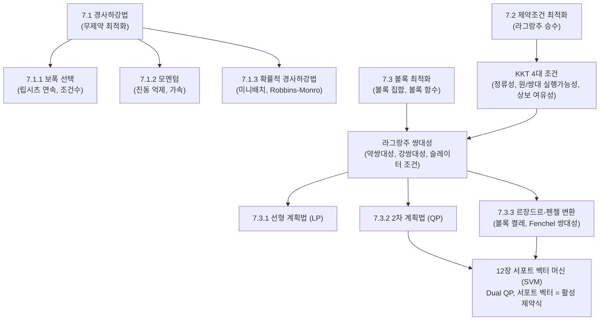

> **교재 쪽수**: 225~248쪽  
> **교재 밖 보충:** MML 7장 본문에 없는 내용(KKT 4조건의 이름 붙인 정리, 슬레이터 조건, 립시츠 보폭 조건, 모멘텀의 $\sqrt\kappa$ 가속, 로빈스-먼로 조건)은 "(교재 밖 보충)"으로 표시했다. 교재 7.2는 라그랑지안과 쌍대성(최소최대 부등식, 약쌍대성) 중심이고, 등식 제약은 부등식 두 개로 바꿔 다룬다. KKT라는 이름은 12장 여백 주석에만 나온다.  
> **이 장이 뒤쪽 장에서 쓰이는 위치**: 머신러닝의 '학습(Learning)'은 거의 예외 없이 목적함수를 최소화하는 연속 최적화 문제입니다. 8장의 경험적 위험 최소화(ERM) 및 MLE/MAP 파라미터 추정, 9장의 선형 회귀 정규방정식 및 경사하강법, 10장의 주성분 분석(PCA) 제약 최적화, 11장의 가우스 혼합 모델(GMM) 잠재변수 최적화, 그리고 특히 **12장의 서포트 벡터 머신(SVM)**은 7장의 KKT 조건, 라그랑주 쌍대성(Lagrangian Duality), 2차 계획법(QP), 볼록 켤레 함수(Convex Conjugate)를 그대로 직접 적용하는 집대성입니다.

---

## 0. 이 장 지도

### 절 목록 및 핵심 요약
- **7.1 경사하강법을 이용한 최적화 (Optimization Using Gradient Descent)**: 1계 미분(그래디언트)을 따라 목적함수를 점진적으로 줄여나가는 무제약 최적화의 기본 알고리즘.
  - **7.1.1 보폭 (Step-size)**: 립시츠 연속성과 조건수에 기반하여 수렴 속도와 안정성을 결정짓는 학습률의 수학적 선택 기준.
  - **7.1.2 모멘텀을 갖는 경사하강법 (Gradient Descent With Momentum)**: 진동을 억제하고 협곡 형태의 지형에서 수렴을 가속화하는 관성(물리적 운동량) 기법.
  - **7.1.3 확률적 경사하강법 (Stochastic Gradient Descent, SGD)**: 대규모 데이터셋에서 전체 데이터 대신 미니배치를 무작위로 추출하여 기댓값 관점에서 계산 효율성을 극대화한 알고리즘.
- **7.2 제약조건이 있는 최적화와 라그랑주 승수 (Constrained Optimization and Lagrange Multipliers)**: 등식 및 부등식 제약조건 하에서 최적해를 찾는 기하학적 원리와 카루시-쿤-터커(KKT) 4대 조건.
- **7.3 볼록 최적화 (Convex Optimization)**: 모든 국소 최적해가 전역 최적해가 되는 특별한 최적화 군과 라그랑주 쌍대성(Lagrangian Duality) 이론.
  - **7.3.1 선형 계획법 (Linear Programming, LP)**: 목적함수와 제약식이 모두 선형인 문제의 표준형과 쌍대 문제 유도.
  - **7.3.2 2차 계획법 (Quadratic Programming, QP)**: 볼록 2차 목적함수와 선형 제약식을 다루며, 12장 서포트 벡터 머신(SVM)의 수학적 토대가 되는 문제.
  - **7.3.3 르장드르-펜첼 변환과 볼록 켤레 함수 (Legendre–Fenchel Transform and Convex Conjugate)**: 함수를 접선의 기울기와 절편 관점에서 바라보는 쌍대 변환과 펜첼 쌍대성(Fenchel Duality).

### 절별 중요도 안내
- **7.1 경사하강법 (★★★)**: 머신러닝 최적화의 만능 일꾼. 8장 경험적 위험 최소화(ERM), 9장 선형 회귀 경사하강법 구현, 신경망 역전파의 최우선 기본기입니다.
- **7.1.1 보폭 (★★)**: 2차 함수에서 헤시안 고유값과 조건수 $\kappa$가 수렴에 미치는 영향을 규명하며, 교재 예제 7.1~7.2에서 집중적으로 다룹니다.
- **7.1.2 모멘텀 (★★)**: 딥러닝 최적화의 필수 구성 요소이자 진동을 줄여 수렴을 빠르게 하는 핵심 기법입니다(수렴률 개선 정도는 교재 밖 보충).
- **7.1.3 확률적 경사하강법 (★★★)**: 대규모 머신러닝의 현실적 기본 알고리즘. 미니배치 기울기의 무편향성(unbiasedness)이 핵심이다. Robbins-Monro 조건은 교재 밖 보충.
- **7.2 제약 최적화 및 라그랑주 승수 (★★★)**: 최적화 이론의 꽃. 10장 PCA(직교 제약)와 12장 SVM(마진 부등식 제약)의 필수 기초입니다.
- **7.3 볼록 최적화 및 쌍대성 (★★★)**: 원 문제(Primal)를 풀기 어려울 때 쌍대 문제(Dual)로 변환하는 원리, 슬레이터 조건에 의한 강쌍대성 성립은 12장 커널 트릭의 핵심 논리입니다.
- **7.3.1 선형 계획법 (★★)**: 쌍대성 전개 과정을 행렬 기호로 손쉽게 연습할 수 있는 가장 대표적인 교재 예제입니다.
- **7.3.2 2차 계획법 (★★★)**: 12장 SVM의 주 문제와 쌍대 문제가 정확히 2차 계획법 형태를 취하므로 시험 대비 직결도가 매우 높습니다.
- **7.3.3 르장드르-펜첼 변환 (★★)**: 힌지 손실의 쌍대 변환, 평활화(Smoothing) 기법, Fenchel 쌍대성 정리의 수학적 뼈대를 제공합니다.

---

## 7.1 경사하강법을 이용한 최적화 (Optimization Using Gradient Descent, 227~232쪽)

### 왜 필요한가 (직관)
우리가 안개 낀 깊은 산속에서 가장 낮은 계곡 바닥(최솟값)으로 내려가야 한다고 상상해 봅시다. 안개가 짙어 산 전체 지형은 보이지 않지만, 내 발밑의 경사가 어느 쪽으로 기울어져 있는지는 알 수 있습니다. 이때 가장 자연스러운 행동은 **현재 서 있는 위치에서 발밑이 가장 가파르게 내려가는 방향으로 한 걸음씩 내딛는 것**입니다. 이것이 바로 경사하강법(gradient descent)의 기본 직관입니다.

수학적으로 어떤 다변수 함수 $f(x)$의 1차 테일러 전개(Taylor expansion)는 현재 점 $x$ 근처에서 다음과 같이 주어집니다:
$$f(x + \Delta x) \approx f(x) + \nabla f(x) \Delta x$$
함수 값을 가장 빠르게 줄이기 위해서는 내적 $\langle \nabla f(x)^\top, \Delta x \rangle$의 값을 가장 음수(최소)로 만들어야 합니다. 코시-슈바르츠 부등식에 의해 두 벡터가 서로 반대 방향(각도 $180^\circ$)을 가리킬 때 내적이 최소가 되므로, 이동 방향 벡터는 음의 그래디언트 방향 $-(\nabla f(x))^\top$이어야 합니다. 즉, **등고선에 수직인 가장 가파른 내리막 방향**으로 이동하는 것입니다.

### 정의와 성질
다변수 미분 가능 함수 $f: \mathbb{R}^D \to \mathbb{R}$을 최소화하는 무제약 최적화 문제를 생각합니다:
$$\min_{x \in \mathbb{R}^D} f(x)$$

1. **1계 필요조건 (First-Order Necessary Condition)**:
   - 만약 점 $x^*$가 국소 최솟값(local minimum)이라면, 그 점에서의 그래디언트는 반드시 영벡터여야 합니다:
     $$\nabla f(x^*) = 0$$
   - 그래디언트가 0인 점을 **정류점(stationary point)** 또는 임계점(critical point)이라 부릅니다. 정류점은 국소 최솟값(local minimum), 국소 최댓값(local maximum), 또는 안장점(saddle point)일 수 있습니다.

2. **경사하강법 알고리즘 (Gradient Descent Algorithm)**:
   - 초기점 $x_0 \in \mathbb{R}^D$에서 시작하여 다음 점화식에 따라 반복(iteration)합니다:
     $$x_{t+1} = x_t - \gamma_t (\nabla f(x_t))^\top$$
   - 여기서:
     - $x_t \in \mathbb{R}^D$: $t$번째 반복에서의 위치 (열벡터).
     - $\gamma_t > 0$: $t$번째 단계에서의 **보폭(step-size)** 또는 **학습률(learning rate)**.
     - $\nabla f(x_t) \in \mathbb{R}^{1 \times D}$: $x_t$에서의 그래디언트 (교재의 행벡터 표기법). 열벡터 $x_t$와 차원을 맞추기 위해 전치 $(\nabla f(x_t))^\top \in \mathbb{R}^{D \times 1}$를 취합니다.

### 손으로 풀어 보는 예제
다음 2변수 2차 함수를 경사하강법으로 최소화해 봅시다:
$$f(x_1, x_2) = x_1^2 + 2x_2^2 - 4x_1 - 4x_2$$

1. **그래디언트 계산**:
   $$\frac{\partial f}{\partial x_1} = 2x_1 - 4, \quad \frac{\partial f}{\partial x_2} = 4x_2 - 4$$
   $$\nabla f(x) = \begin{bmatrix} 2x_1 - 4 & 4x_2 - 4 \end{bmatrix}, \quad (\nabla f(x))^\top = \begin{bmatrix} 2x_1 - 4 \\ 4x_2 - 4 \end{bmatrix}$$
   (정류점은 $2x_1 - 4 = 0 \implies x_1 = 2$, $4x_2 - 4 = 0 \implies x_2 = 1$이며, 이때 $f(2, 1) = 4 + 2 - 8 - 4 = -6$입니다.)

2. **초기점 설정**:
   $$x_0 = \begin{bmatrix} 0 \\ 0 \end{bmatrix}, \quad \text{학습률 } \gamma = 0.2$$
   이때 초기 함수 값: $f(0, 0) = 0$.

3. **1번째 반복 ($t=0 \to t=1$)**:
   $$(\nabla f(x_0))^\top = \begin{bmatrix} 2(0) - 4 \\ 4(0) - 4 \end{bmatrix} = \begin{bmatrix} -4 \\ -4 \end{bmatrix}$$
   $$x_1 = x_0 - \gamma (\nabla f(x_0))^\top = \begin{bmatrix} 0 \\ 0 \end{bmatrix} - 0.2 \begin{bmatrix} -4 \\ -4 \end{bmatrix} = \begin{bmatrix} 0.8 \\ 0.8 \end{bmatrix}$$
   함수 값 계산:
   $$f(0.8, 0.8) = (0.8)^2 + 2(0.8)^2 - 4(0.8) - 4(0.8) = 0.64 + 1.28 - 3.2 - 3.2 = -4.48 < 0$$
   함수 값이 0에서 -4.48로 크게 감소했습니다!

4. **2번째 반복 ($t=1 \to t=2$)**:
   $$(\nabla f(x_1))^\top = \begin{bmatrix} 2(0.8) - 4 \\ 4(0.8) - 4 \end{bmatrix} = \begin{bmatrix} 1.6 - 4 \\ 3.2 - 4 \end{bmatrix} = \begin{bmatrix} -2.4 \\ -0.8 \end{bmatrix}$$
   $$x_2 = x_1 - \gamma (\nabla f(x_1))^\top = \begin{bmatrix} 0.8 \\ 0.8 \end{bmatrix} - 0.2 \begin{bmatrix} -2.4 \\ -0.8 \end{bmatrix} = \begin{bmatrix} 0.8 + 0.48 \\ 0.8 + 0.16 \end{bmatrix} = \begin{bmatrix} 1.28 \\ 0.96 \end{bmatrix}$$
   함수 값 계산:
   $$f(1.28, 0.96) = 1.28^2 + 2(0.96)^2 - 4(1.28) - 4(0.96) = 1.6384 + 1.8432 - 5.12 - 3.84 = -5.4784$$
   진정한 최솟값인 $(2, 1)$과 함수 값 $-6$을 향해 착실히 다가가고 있음을 확인할 수 있습니다.

### 헷갈리는 점 / 자주 하는 실수
- **전치 기호의 의미**: MML 교재에서는 다변수 스칼라 함수의 도함수를 야코비안(Jacobian) 행렬의 특수 형태로 보아 기본적으로 **행벡터($1 \times D$)**로 정의합니다. 따라서 열벡터($D \times 1$)인 $x_t$에서 빼줄 때는 반드시 $(\nabla f(x_t))^\top$로 전치를 붙여야 차원이 맞습니다.
- **국소 최솟값 vs 전역 최솟값**: 경사하강법은 오직 발밑의 기울기만 보고 걷기 때문에, 볼록 함수(convex function)가 아닌 일반적인 비볼록 함수에서는 가장 가까운 **국소 최솟값(local minimum)**에 갇히거나 **안장점(saddle point)**에 멈출 수 있습니다.

---

### 7.1.1 보폭 (Step-size, 229~230쪽)

#### 왜 필요한가 (직관)
하강 방향을 올바르게 잡았더라도, **한 걸음의 크기(보폭 $\gamma$)**를 얼마로 해야 할까요?
- 보폭이 너무 작으면: 개미걸음으로 기어가므로 최적점에 도달하는 데 수천만 번의 계산이 걸립니다.
- 보폭이 너무 크면: 계곡 바닥을 지나쳐 반대편 언덕으로 튕겨져 나가며, 결국 값이 무한대로 튀어 발산(divergence)합니다.
- 계곡 지형이 비대칭일 때: 한 축(예: $x_2$)은 경사가 급하고 다른 축(예: $x_1$)은 완만한 골짜기라면, 보폭이 조금만 커도 급경사 축에서는 좌우로 심하게 요동치며(oscillation) 정작 전진해야 할 완만한 축으로는 거의 나아가지 못합니다.

#### 정의와 성질
1. **립시츠 연속 그래디언트 (Lipschitz Continuous Gradient)** (교재 밖 보충):
   - 함수 $f$의 그래디언트가 립시츠 상수 $L > 0$에 대해 다음 부등식을 만족할 때, $f$를 $L$-평활($L$-smooth)하다고 합니다:
     $$\|\nabla f(x) - \nabla f(y)\| \le L \|x - y\|, \quad \forall x, y$$
   - 이 경우 보폭을 $\gamma < \frac{2}{L}$로 선택하면 목적함수 값이 반드시 감소하여 수렴이 보장됩니다. 보통 안전한 고정 보폭으로 $\gamma \le \frac{1}{L}$을 사용합니다.

2. **2차 형식(Quadratic Form)에서의 최적 보폭과 조건수 (Condition Number)**:
   - 목적함수가 대칭 양의정부호 행렬 $A \succ 0$를 갖는 2차 함수 $f(x) = \frac{1}{2}x^\top A x - b^\top x$인 경우:
     $$\nabla f(x) = (Ax - b)^\top, \quad \nabla^2 f(x) = A$$
   - 행렬 $A$의 고유값들을 $\lambda_{\min} = \lambda_1 \le \lambda_2 \le \dots \le \lambda_D = \lambda_{\max}$라 할 때:
     - 최대 곡률(최대 고유값) $L = \lambda_{\max}$.
     - 발산하지 않고 수렴하기 위한 필요충분조건:
       $$0 < \gamma < \frac{2}{\lambda_{\max}}$$
     - 오차의 수축률(contraction factor)을 최소화하는 **이론적 최적 고정 보폭 $\gamma^*$**:
       $$\gamma^* = \frac{2}{\lambda_{\min} + \lambda_{\max}}$$
     - 이때 한 스텝당 오차가 줄어드는 비율:
       $$\|x_{t+1} - x^*\| \le \left( \frac{\kappa - 1}{\kappa + 1} \right) \|x_t - x^*\|$$
       여기서 $\kappa = \frac{\lambda_{\max}}{\lambda_{\min}} \ge 1$을 행렬 $A$의 **조건수(condition number)**라 합니다.
     - **조건수의 물리적 의미**: $\kappa \approx 1$이면 등고선이 거의 원(구)형이어서 어디서 출발하든 정중앙을 향해 곧장 날아갑니다. 반면 $\kappa \gg 1$이면 등고선이 아주 길쭉한 타원형(칼날 같은 계곡)이 되어 $\frac{\kappa - 1}{\kappa + 1} \approx 1$이 되므로, 극심한 지그재그 진동을 겪으며 수렴이 극도로 느려집니다.

#### 손으로 풀어 보는 예제 (교재 예제 7.1~7.2 변형)
다음 2차 함수를 분석해 봅시다:
$$f(x_1, x_2) = \frac{1}{2} \begin{bmatrix} x_1 & x_2 \end{bmatrix} \begin{bmatrix} 2 & 1 \\ 1 & 20 \end{bmatrix} \begin{bmatrix} x_1 \\ x_2 \end{bmatrix} - \begin{bmatrix} 5 & 3 \end{bmatrix} \begin{bmatrix} x_1 \\ x_2 \end{bmatrix}$$

1. **헤시안 행렬 $A$와 고유값 계산**:
   $$A = \begin{bmatrix} 2 & 1 \\ 1 & 20 \end{bmatrix}$$
   특성방정식:
   $$\det(A - \lambda I) = (2 - \lambda)(20 - \lambda) - 1 = \lambda^2 - 22\lambda + 39 = 0$$
   근의 공식:
   $$\lambda = \frac{22 \pm \sqrt{22^2 - 4(39)}}{2} = \frac{22 \pm \sqrt{484 - 156}}{2} = \frac{22 \pm \sqrt{328}}{2} \approx \frac{22 \pm 18.11}{2}$$
   $$\lambda_{\min} \approx 1.944, \quad \lambda_{\max} \approx 20.056$$

2. **수렴 조건과 최적 학습률**:
   - 수렴 가능한 최대 보폭: $\gamma < \frac{2}{20.056} \approx 0.0997$. (만약 $\gamma \ge 0.1$로 두면 즉시 발산합니다!)
   - 최적 보폭:
     $$\gamma^* = \frac{2}{\lambda_{\min} + \lambda_{\max}} = \frac{2}{22} = \frac{1}{11} \approx 0.0909$$
   - 조건수:
     $$\kappa = \frac{\lambda_{\max}}{\lambda_{\min}} \approx \frac{20.056}{1.944} \approx 10.32$$
   - 수축률: $\frac{10.32 - 1}{10.32 + 1} \approx \frac{9.32}{11.32} \approx 0.823$. 한 스텝마다 오차가 약 82.3%로밖에 줄어들지 않아 수렴에 많은 반복이 필요합니다.

#### 헷갈리는 점 / 자주 하는 실수
- **고정 학습률 vs 학습률 스케줄**: 실전 머신러닝에서는 처음에는 큰 학습률로 빠르게 대략적인 영역을 찾고, 점차 학습률을 줄여가는 스케줄(Step Decay, Cosine Annealing 등)을 사용하는 것이 일반적입니다.

---

### 7.1.2 모멘텀을 갖는 경사하강법 (Gradient Descent With Momentum, 230~231쪽)

#### 왜 필요한가 (직관)
앞서 보았듯 조건수 $\kappa$가 큰 좁고 긴 협곡에서는 경사하강법이 계곡 양 벽을 치며 지그재그로 심하게 튀느라 바닥을 따라 전진하지 못합니다.
이 문제를 해결하기 위해 **물리학의 관성(inertia / momentum)** 개념을 도입합니다. 무거운 쇠구슬을 굴리면, 좌우로 왔다 갔다 하는 힘은 서로 반대 방향이므로 상쇄되어 진동이 줄어들고, 계곡을 따라 완만하게 지속적으로 작용하는 중력은 속도(운동량)로 누적되어 앞으로 시원하게 굴러가게 됩니다.

#### 정의와 성질
모멘텀 기법은 현재 그래디언트뿐만 아니라 **직전 스텝의 이동 벡터**를 일정 비율 반영합니다:
$$\Delta x_{t+1} = \alpha \Delta x_t - \gamma (\nabla f(x_t))^\top$$
$$x_{t+1} = x_t + \Delta x_{t+1}$$

- $\Delta x_t \in \mathbb{R}^D$: $t$번째 스텝에서의 위치 변화량(속도 벡터).
- $\alpha \in [0, 1)$: **모멘텀 파라미터(momentum weight)**. 보통 0.9 내외의 값을 씁니다. 직전 이동 방향을 얼마나 기억할지를 결정합니다.
- $\gamma > 0$: 학습률.
- **수렴 가속 효과 (교재 밖 보충, 매개변수를 잘 고른 2차 문제 기준)**: 모멘텀을 적용하면 2차 문제에서 조건수가 $\kappa$일 때 수렴 속도가 대략 $O\left( \frac{\sqrt{\kappa} - 1}{\sqrt{\kappa} + 1} \right)$로 대폭 개선됩니다! 예를 들어 $\kappa = 100$일 때, 일반 경사하강법의 오차 비율은 $\frac{99}{101} \approx 0.98$이지만, 모멘텀을 쓰면 $\frac{10-1}{10+1} \approx 0.82$가 되어 훨씬 빠르게 수렴합니다.

#### 손으로 풀어 보는 예제
목적함수 $f(x_1, x_2) = \frac{1}{2}(x_1^2 + 10x_2^2)$를 최소화합니다.
$(\nabla f(x))^\top = \begin{bmatrix} x_1 \\ 10x_2 \end{bmatrix}$입니다.
파라미터: $\alpha = 0.5$, $\gamma = 0.1$, 초기점 $x_0 = \begin{bmatrix} 2 \\ 1 \end{bmatrix}$, 초기 속도 $\Delta x_0 = \begin{bmatrix} 0 \\ 0 \end{bmatrix}$.

1. **스텝 1 ($t=0 \to t=1$)**:
   $$(\nabla f(x_0))^\top = \begin{bmatrix} 2 \\ 10 \end{bmatrix}$$
   $$\Delta x_1 = 0.5 \begin{bmatrix} 0 \\ 0 \end{bmatrix} - 0.1 \begin{bmatrix} 2 \\ 10 \end{bmatrix} = \begin{bmatrix} -0.2 \\ -1.0 \end{bmatrix}$$
   $$x_1 = x_0 + \Delta x_1 = \begin{bmatrix} 2 \\ 1 \end{bmatrix} + \begin{bmatrix} -0.2 \\ -1.0 \end{bmatrix} = \begin{bmatrix} 1.8 \\ 0.0 \end{bmatrix}$$
   ($x_2$ 축이 가파르기 때문에 단 1스텝 만에 $x_2=0$에 도달했습니다.)

2. **스텝 2 ($t=1 \to t=2$)**:
   $$(\nabla f(x_1))^\top = \begin{bmatrix} 1.8 \\ 10(0) \end{bmatrix} = \begin{bmatrix} 1.8 \\ 0.0 \end{bmatrix}$$
   $$\Delta x_2 = 0.5 \Delta x_1 - 0.1 (\nabla f(x_1))^\top = 0.5 \begin{bmatrix} -0.2 \\ -1.0 \end{bmatrix} - 0.1 \begin{bmatrix} 1.8 \\ 0 \end{bmatrix} = \begin{bmatrix} -0.1 - 0.18 \\ -0.5 - 0 \end{bmatrix} = \begin{bmatrix} -0.28 \\ -0.50 \end{bmatrix}$$
   $$x_2 = x_1 + \Delta x_2 = \begin{bmatrix} 1.8 \\ 0.0 \end{bmatrix} + \begin{bmatrix} -0.28 \\ -0.50 \end{bmatrix} = \begin{bmatrix} 1.52 \\ -0.50 \end{bmatrix}$$
   직전 스텝의 관성($-1.0$)의 절반인 $-0.5$가 살아남아 $x_2$가 음수 쪽으로 살짝 이동했습니다. 다음 스텝에서는 양수 방향 그래디언트가 발생하여 이 관성을 브레이크 걸어주게 됩니다.

#### 헷갈리는 점 / 자주 하는 실수
- **부호 정의**: 식을 어떻게 정의하느냐에 따라 $\Delta x$를 속도 $v_t$로 정의하고 $x_{t+1} = x_t + v_{t+1}$로 쓸 수도 있고, 뺄셈 형태로 쓸 수도 있습니다. MML 교재(식 (7.14))에서는 이동량을 더하는 형태 $\Delta x_{t+1} = \alpha \Delta x_t - \gamma (\nabla f(x_t))^\top$, $x_{t+1} = x_t + \Delta x_{t+1}$을 표준으로 채택합니다.

---

### 7.1.3 확률적 경사하강법 (Stochastic Gradient Descent, 231~232쪽)

#### 왜 필요한가 (직관)
머신러닝에서 학습 데이터가 100만 개($N = 1,000,000$) 있다고 합시다. 전체 데이터에 대한 손실 함수의 정확한 그래디언트를 한 번 구하려면 100만 개 데이터 전체에 대해 미분을 계산하고 평균을 내야 합니다(이를 **배치 경사하강법, Batch GD**이라 부릅니다).
파라미터를 단 한 번 업데이트하는 데 100만 번의 계산을 하는 것은 극도로 비효율적입니다. 게다가 많은 데이터 샘플들은 서로 유사한 정보를 담고 있습니다.
그렇다면 **데이터 1개(또는 수십 개의 미니배치)만 무작위로 뽑아서 그 작은 샘플의 그래디언트로 일단 한 걸음 내딛으면 어떨까요?** 개별 걸음은 노이즈 때문에 비틀거리겠지만, 평균적으로는 올바른 방향을 가리키므로 전체적으로는 훨씬 빠르고 저렴하게 목표 지점에 도달할 수 있습니다. 이것이 바로 **확률적 경사하강법(SGD)**입니다.

#### 정의와 성질
1. **유한 합 목적함수 (Finite Sum Objective)**:
   머신러닝의 목적함수는 대부분 개별 데이터 샘플 손실의 평균 형태입니다:
   $$f(x) = \frac{1}{N} \sum_{n=1}^N f_n(x)$$
   전체 그래디언트는 $\nabla f(x) = \frac{1}{N}\sum_{n=1}^N \nabla f_n(x)$입니다.

2. **SGD 갱신 규칙**:
   매 반복 $t$마다 인덱스 $n \in \{1, \dots, N\}$ 하나(또는 크기 $B$인 미니배치 $S_t$)를 무작위 균등 분포로 추출합니다:
   $$x_{t+1} = x_t - \gamma_t (\nabla f_n(x_t))^\top$$
   미니배치 $S_t$를 사용하는 경우:
   $$x_{t+1} = x_t - \gamma_t \left( \frac{1}{|S_t|} \sum_{i \in S_t} \nabla f_i(x_t) \right)^\top$$

3. **무편향 추정치 (Unbiased Estimator)**:
   확률변수 $n$에 대한 기댓값을 취하면 전체 그래디언트와 정확히 일치합니다:
   $$\mathbb{E}_n [\nabla f_n(x)] = \sum_{n=1}^N P(n) \nabla f_n(x) = \frac{1}{N} \sum_{n=1}^N \nabla f_n(x) = \nabla f(x)$$
   즉, SGD의 그래디언트는 참 그래디언트의 **무편향 추정치**입니다!

4. **수렴을 위한 Robbins-Monro 조건** (교재 밖 보충. 교재는 학습률을 적절히 줄이면 수렴한다고만 설명한다):
   SGD는 샘플링 노이즈 때문에 학습률 $\gamma_t$를 고정하면 최적점 주변에서 끊임없이 방황(진동)하게 됩니다. 최적점에 정확히 수렴하려면 학습률이 다음 두 조건을 만족하며 서서히 줄어들어야 합니다:
   $$\sum_{t=1}^\infty \gamma_t = \infty \quad \text{그리고} \quad \sum_{t=1}^\infty \gamma_t^2 < \infty$$
   - **첫 번째 조건 ($\sum \gamma_t = \infty$)의 직관**: 초기점이 최적점에서 아무리 멀리 떨어져 있어도, 누적 이동 거리가 무한대가 될 수 있어야 최적점까지 도달할 수 있음을 보장합니다. (보폭이 너무 빨리 줄어들어 도중에 멈추는 premature convergence 방지)
   - **두 번째 조건 ($\sum \gamma_t^2 < \infty$)의 직관**: 무작위 샘플링으로 인한 노이즈 분산의 총합이 유한해야 함을 의미합니다. 즉, 발걸음이 충분히 작아져서 노이즈가 상쇄되고 한 점으로 수렴함을 보장합니다.
   - 대표적 예: $\gamma_t = \frac{c}{t}$. $\sum 1/t = \infty$이고 $\sum 1/t^2 = \pi^2/6 < \infty$이므로 두 조건을 모두 만족한다. ($\gamma_t=c/\sqrt t$는 $\sum\gamma_t^2=c^2\sum 1/t=\infty$라 둘째 조건을 만족하지 **않는다**.)

#### 손으로 풀어 보는 예제
데이터 3개로 구성된 손실 함수 $f(w) = \frac{1}{3}(f_1(w) + f_2(w) + f_3(w))$가 있습니다:
$$f_1(w) = (w - 1)^2, \quad f_2(w) = (w - 3)^2, \quad f_3(w) = (w - 5)^2$$
현재 위치 $w_0 = 0$, 학습률 $\gamma = 0.1$입니다.

1. **배치 경사하강법 (참 그래디언트)**:
   $$\nabla f_1(0) = 2(0 - 1) = -2$$
   $$\nabla f_2(0) = 2(0 - 3) = -6$$
   $$\nabla f_3(0) = 2(0 - 5) = -10$$
   전체 그래디언트: $\nabla f(0) = \frac{-2 + (-6) + (-10)}{3} = \frac{-18}{3} = -6$.
   배치 갱신: $w_1^{\text{Batch}} = 0 - 0.1(-6) = 0.6$.

2. **SGD (샘플 1개 무작위 선택)**:
   - 만약 샘플 2가 뽑혔다면 ($n=2$):
     $$\nabla f_2(0) = -6$$
     $$w_1^{\text{SGD}} = 0 - 0.1(-6) = 0.6$$ (우연히 배치와 동일)
   - 만약 샘플 3이 뽑혔다면 ($n=3$):
     $$\nabla f_3(0) = -10$$
     $$w_1^{\text{SGD}} = 0 - 0.1(-10) = 1.0$$ (배치보다 더 멀리 이동)
   - 만약 샘플 1이 뽑혔다면 ($n=1$):
     $$\nabla f_1(0) = -2$$
     $$w_1^{\text{SGD}} = 0 - 0.1(-2) = 0.2$$ (배치보다 적게 이동)
   - 세 경우의 기댓값: $\mathbb{E}[w_1^{\text{SGD}}] = \frac{0.2 + 0.6 + 1.0}{3} = 0.6 = w_1^{\text{Batch}}$!
   개별 샘플에 따라 이동 거리는 다르지만, 평균적으로는 배치 경사하강법과 정확히 같은 곳을 향함을 수치로 확인할 수 있습니다.

#### 헷갈리는 점 / 자주 하는 실수
- **에포크(Epoch)와 이터레이션(Iteration)**:
  - 이터레이션: 미니배치 1개를 뽑아 파라미터를 1회 업데이트하는 과정.
  - 에포크: 전체 데이터셋 $N$개를 모두 한 번씩 훑는 과정. ($N=10,000$, 미니배치 크기 $B=100$이면 1에포크는 100회의 이터레이션으로 구성됨).

---

## 7.2 제약조건이 있는 최적화와 라그랑주 승수 (Constrained Optimization and Lagrange Multipliers, 233~235쪽)

### 왜 필요한가 (직관)
현실의 머신러닝 문제는 무제약 최적화인 경우가 드뭅니다.
- 투자 포트폴리오를 짤 때 자산 비중의 합은 반드시 1이어야 합니다 ($\sum w_i = 1$).
- 주성분 분석(PCA, 10장)에서 투영 벡터의 길이는 1이어야 합니다 ($\|u\|^2 = 1$).
- 서포트 벡터 머신(SVM, 12장)에서 모든 데이터는 마진 경계 바깥쪽에 위치해야 합니다 ($y_n(w^\top x_n + b) \ge 1$).

이렇게 파라미터가 지켜야 할 **등식(equality)**이나 **부등식(inequality)** 제약이 걸려 있을 때, 어떻게 최적해를 찾을 수 있을까요?

### 등식 제약 조건 (Equality Constraints)
목적함수 $f(x)$를 등식 제약 $g(x) = 0$ 하에서 최소화하는 문제를 생각합니다:
$$\min_x f(x) \quad \text{subject to} \quad g(x) = 0$$

#### 기하학적 직관
$g(x) = 0$은 공간 상의 어떤 곡선(곡면)을 이룹니다. 최적해 $x^*$는 반드시 이 곡면 위에 있어야 합니다.
이 곡면 위를 따라 움직이면서 $f(x)$를 최대한 줄여나가다가 마침내 최솟값에 도달했다고 합시다. 만약 그 점에서도 $g(x)=0$ 곡면을 따라 움직일 때 $f(x)$가 줄어드는 방향이 남아있다면, 거기로 더 이동했을 것입니다. 따라서 **최적점에서는 $g(x)=0$ 곡면의 접선 방향과 $f(x)$ 등고선의 접선 방향이 완전히 일치**해야 합니다!
두 곡면의 접선이 일치한다는 것은, **두 곡면의 법선 벡터(그래디언트)가 서로 평행(parallel)**해야 함을 뜻합니다:
$$\nabla f(x^*) = -\lambda \nabla g(x^*) \iff \nabla f(x^*) + \lambda \nabla g(x^*) = 0$$
여기서 비례 상수 $\lambda \in \mathbb{R}$를 **라그랑주 승수(Lagrange multiplier)**라고 부릅니다.

#### 라그랑지안 함수 (Lagrangian)
이를 하나의 통합된 함수로 만든 것이 **라그랑지안(Lagrangian)** $\mathfrak{L}$입니다:
$$\mathfrak{L}(x, \lambda) = f(x) + \lambda g(x)$$
라그랑지안의 모든 변수($x$와 $\lambda$)에 대한 편미분을 0으로 놓으면:
1. $\nabla_x \mathfrak{L}(x, \lambda) = \nabla f(x) + \lambda \nabla g(x) = 0$ (기울기 평행 조건)
2. $\nabla_\lambda \mathfrak{L}(x, \lambda) = g(x) = 0$ (원래 제약조건 복원)
즉, 제약이 있던 문제가 $\mathfrak{L}(x, \lambda)$의 무제약 정류점을 찾는 문제로 우아하게 변환됩니다!

---

### 부등식 제약 조건과 KKT 조건 (Inequality Constraints & KKT Conditions)
이제 제약조건이 부등식 $g(x) \le 0$인 경우를 확장합니다:
$$\min_x f(x) \quad \text{subject to} \quad g_i(x) \le 0 \quad (i = 1, \dots, m)$$

#### 기하학적 직관: 두 가지 시나리오
최적점 $x^*$가 놓일 수 있는 상황은 정확히 두 가지뿐입니다:

1. **시나리오 1: 제약이 비활성인 경우 (Inactive constraint, 내부 해)**
   - 최적해 $x^*$가 제약 영역의 내부($g_i(x^*) < 0$)에 위치합니다.
   - 이때는 벽(경계)에 부딪히지 않았으므로 제약조건이 없는 것과 마찬가지입니다. 따라서 최적점에서 원래 함수의 기울기가 0이어야 합니다 ($\nabla f(x^*) = 0$).
   - 라그랑주 승수는 **$\lambda_i = 0$**이어야 합니다.

2. **시나리오 2: 제약이 활성인 경우 (Active constraint, 경계 해)**
   - 원래 함수 $f(x)$를 더 줄이려면 $g_i(x) > 0$인 금지 구역으로 넘어가야 하는데, 경계선 $g_i(x) = 0$에 막혀서 더 이상 가지 못하는 상태입니다.
   - 따라서 최적점은 경계 위($g_i(x^*) = 0$)에 있으며, 목적함수가 줄어드는 내리막 방향($-\nabla f$)은 금지 구역(바깥쪽, 즉 $\nabla g_i$ 방향)을 가리키고 있어야 합니다.
   - 즉, $-\nabla f(x^*) = \lambda_i \nabla g_i(x^*)$이며, 이때 비례상수는 반드시 **$\lambda_i \ge 0$**이어야 합니다! (만약 $\lambda_i < 0$이면 허용 영역 안쪽으로 더 내려갈 수 있다는 뜻이 되므로 최솟점일 수 없습니다).

#### 카루시-쿤-터커 4대 조건 (KKT Conditions) — (교재 밖 보충, 하지만 표준 내용이라 꼭 알아 둔다)
MML 7장은 이 네 조건을 이름 붙여 정리하지 않고 라그랑지안·쌍대성으로 설명한다. 12장 SVM 쌍대 유도와 서포트 벡터 해석에 바로 쓰이므로 여기서 정리해 둔다.

위 직관을 수학적으로 정리한 것이 바로 **KKT 조건(Karush-Kuhn-Tucker conditions)**입니다. 라그랑지안 $\mathfrak{L}(x, \lambda) = f(x) + \sum_{i=1}^m \lambda_i g_i(x)$에 대해, 최적점 $(x^*, \lambda^*)$는 다음 네 가지 조건을 반드시 만족해야 합니다:

1. **정류성 (Stationarity)**:
   $$\nabla_x \mathfrak{L}(x^*, \lambda^*) = \nabla f(x^*) + \sum_{i=1}^m \lambda_i^* \nabla g_i(x^*) = 0$$
2. **원 문제 실행가능성 (Primal Feasibility)**:
   $$g_i(x^*) \le 0, \quad \forall i = 1, \dots, m$$
   (원래 제약조건을 만족해야 합니다.)
3. **쌍대 실행가능성 (Dual Feasibility)**:
   $$\lambda_i^* \ge 0, \quad \forall i = 1, \dots, m$$
   (라그랑주 승수는 0 이상이어야 합니다.)
4. **상보 여유성 (Complementary Slackness)**:
   $$\lambda_i^* g_i(x^*) = 0, \quad \forall i = 1, \dots, m$$
   (이 조건이 핵심입니다! $\lambda_i^* > 0$이면 반드시 $g_i(x^*) = 0$이어야 하고, 반대로 $g_i(x^*) < 0$이면 반드시 $\lambda_i^* = 0$이어야 합니다. 둘 중 적어도 하나는 0이어야 합니다.)

---

### 12장 서포트 벡터 머신(SVM)과의 필연적 연결
이 KKT 상보 여유성 조건은 **12장 서포트 벡터 머신(SVM)**을 완벽하게 관통하는 핵심 원리입니다!
SVM에서 데이터를 분류하는 마진 제약조건은 다음과 같습니다:
$$g_n(w, b) = 1 - y_n(w^\top x_n + b) \le 0$$
이 제약에 대한 라그랑주 승수를 $\alpha_n \ge 0$이라 할 때, 상보 여유성 조건은:
$$\alpha_n [1 - y_n(w^\top x_n + b)] = 0$$
- **마진 바깥쪽에 안전하게 잘 분류된 데이터**: $y_n(w^\top x_n + b) > 1 \implies g_n < 0$. 따라서 반드시 **$\alpha_n = 0$**입니다! 이 데이터들은 모델 파라미터 $w = \sum \alpha_n y_n x_n$을 결정하는 데 아무런 기여를 하지 않습니다.
- **마진 경계에 아슬아슬하게 걸쳐 있는 데이터**: $y_n(w^\top x_n + b) = 1 \implies g_n = 0$. 이때 비로소 **$\alpha_n > 0$**이 됩니다!
이처럼 $\alpha_n > 0$을 만족하며 결정 경계(초평면)의 위치를 홀로 지탱하고 있는 소수의 경계 데이터들을 가리켜 바로 **서포트 벡터(Support Vector)**라고 부릅니다. 7장의 KKT 조건이 SVM이라는 모델의 이름 그 자체가 되는 순간입니다.

---

### 손으로 풀어 보는 예제 (KKT 조건 풀이)
다음 제약 최적화 문제를 손으로 풀어봅시다:
$$\min_{x_1, x_2} f(x_1, x_2) = (x_1 - 3)^2 + (x_2 - 4)^2 \quad \text{subject to} \quad x_1 + x_2 \le 5$$

1. **제약식 표준형 변환**:
   $$g(x_1, x_2) = x_1 + x_2 - 5 \le 0$$
2. **라그랑지안 정의**:
   $$\mathfrak{L}(x_1, x_2, \lambda) = (x_1 - 3)^2 + (x_2 - 4)^2 + \lambda(x_1 + x_2 - 5)$$
3. **KKT 조건 세우기**:
   - 정류성:
     $$\frac{\partial \mathfrak{L}}{\partial x_1} = 2(x_1 - 3) + \lambda = 0 \implies x_1 = 3 - \frac{\lambda}{2}$$
     $$\frac{\partial \mathfrak{L}}{\partial x_2} = 2(x_2 - 4) + \lambda = 0 \implies x_2 = 4 - \frac{\lambda}{2}$$
   - 원 문제 실행가능성: $x_1 + x_2 - 5 \le 0$
   - 쌍대 실행가능성: $\lambda \ge 0$
   - 상보 여유성: $\lambda(x_1 + x_2 - 5) = 0$

4. **경우의 수(Case) 분석**:
   - **Case 1: 제약이 비활성 ($\lambda = 0$)**
     $$\lambda = 0 \implies x_1 = 3, \quad x_2 = 4$$
     원 문제 제약조건 검증: $x_1 + x_2 = 3 + 4 = 7 \not\le 5$. 제약조건을 위반하므로 모순! 기각.
   - **Case 2: 제약이 활성 ($\lambda > 0 \implies x_1 + x_2 - 5 = 0$)**
     $x_1 + x_2 = \left(3 - \frac{\lambda}{2}\right) + \left(4 - \frac{\lambda}{2}\right) = 7 - \lambda = 5 \implies \lambda = 2$.
     $\lambda = 2 > 0$이므로 쌍대 실행가능성 만족!
     해의 좌표:
     $$x_1^* = 3 - \frac{2}{2} = 2, \quad x_2^* = 4 - \frac{2}{2} = 3$$
     최솟값: $f(2, 3) = (2 - 3)^2 + (3 - 4)^2 = 1 + 1 = 2$.
     완벽하게 유일한 최적해 $(x_1^*, x_2^*) = (2, 3)$, $\lambda^* = 2$를 도출했습니다.

---

## 7.3 볼록 최적화 (Convex Optimization, 236~245쪽)

### 왜 필요한가 (직관)
일반적인 최적화 문제에서는 컴퓨터가 찾은 해가 "진짜 지구상에서 가장 낮은 곳(전역 최적해)"인지, 아니면 "단지 근처 웅덩이(국소 최적해)"에 불과한지 판별하기가 수학적으로 불가능에 가깝습니다.
하지만 문제가 **볼록 최적화(Convex Optimization)** 범주에 속한다면 기적이 일어납니다:
> **"어떤 국소 최솟값(local minimum)도 예외 없이 전역 최솟값(global minimum)이다!"**

즉, 경사하강법이든 어떤 알고리즘이든 기울기가 0인 지점에 도달하기만 하면, 그것이 곧 전체 우주에서 가장 완벽한 최적해임이 보장됩니다. 이것이 머신러닝 연구자들이 문제를 어떻게든 볼록 문제로 공식화하려고 애쓰는 이유입니다.

### 정의와 성질

#### 1. 볼록 집합 (Convex Set)
집합 $C \subseteq \mathbb{R}^D$ 안의 임의의 두 점 $x, y \in C$를 잡았을 때, 두 점을 잇는 선분 전체가 다시 $C$에 포함되면 $C$를 볼록 집합이라 합니다:
$$\theta x + (1 - \theta) y \in C, \quad \forall \theta \in [0, 1]$$
- 원(원판), 삼각형, 다포체(polyhedron)는 볼록 집합입니다.
- 도넛 모양, 별 모양, 초승달 모양은 두 점을 이은 선분이 영역 밖으로 빠져나가므로 볼록 집합이 아닙니다.

#### 2. 볼록 함수 (Convex Function)
정의역이 볼록 집합인 함수 $f$에 대해, 임의의 두 점 $x, y$ 사이에서 함수 그래프가 두 점을 잇는 현(chord, 직선 선분) 아래쪽에 놓이면 $f$를 볼록 함수라 합니다:
$$f(\theta x + (1 - \theta) y) \le \theta f(x) + (1 - \theta) f(y), \quad \forall \theta \in [0, 1]$$

- **1계 조건 (First-Order Condition)**: 미분 가능한 함수 $f$가 볼록 함수일 필요충분조건은 접선 초평면이 항상 원래 함수 아래에 깔리는 것입니다:
  $$f(y) \ge f(x) + \nabla f(x)(y - x), \quad \forall x, y$$
- **2계 조건 (Second-Order Condition)**: 2회 미분 가능한 함수 $f$가 볼록 함수일 필요충분조건은 모든 점에서 헤시안 행렬이 **반양의정부호(Positive Semidefinite, PSD)**인 것입니다:
  $$\nabla^2 f(x) \succeq 0, \quad \forall x$$
  (즉, 헤시안의 모든 고유값이 0 이상이어야 합니다).
- **옌센 부등식 (Jensen's Inequality)**: 볼록 함수 $f$에 대해, 기댓값의 함수 값은 함수 값의 기댓값 이하입니다:
  $$f(\mathbb{E}[x]) \le \mathbb{E}[f(x)]$$
  (이 부등식은 11장 GMM의 EM 알고리즘 유도에서 핵심 역할을 합니다).

---

### 라그랑주 쌍대성 이론 (Lagrangian Duality Theory)
볼록 최적화의 가장 깊고 아름다운 이론은 바로 **원 문제(Primal Problem)**와 **쌍대 문제(Dual Problem)**의 관계입니다.

#### 원 문제 (Primal Problem)
$$\min_{x \in \mathbb{R}^D} f(x) \quad \text{subject to} \quad g_i(x) \le 0 \; (i=1,\dots,m), \quad h_j(x) = 0 \; (j=1,\dots,p)$$
라그랑지안:
$$\mathfrak{L}(x, \lambda, \nu) = f(x) + \sum_{i=1}^m \lambda_i g_i(x) + \sum_{j=1}^p \nu_j h_j(x), \quad (\lambda_i \ge 0)$$
여기서 놀라운 사실은, 원 문제를 라그랑지안의 최소-최대(min-max) 형태로 다시 쓸 수 있다는 점입니다:
$$\min_x \max_{\lambda \ge 0, \nu} \mathfrak{L}(x, \lambda, \nu)$$
- 만약 어떤 $x$가 제약을 위반하면(예: $g_i(x) > 0$), $\lambda_i \to \infty$로 보내버려 내부의 최댓값이 $+\infty$가 됩니다.
- 반면 제약을 모두 만족하면 $\lambda_i g_i(x) \le 0$이므로 $\lambda_i=0$일 때 최댓값 $f(x)$가 남습니다.
- 따라서 불가능한 영역에는 무한대의 벌점을 주어 자연스럽게 원 문제와 완벽히 동치가 됩니다!

#### 쌍대 함수와 쌍대 문제 (Dual Problem)
이제 $\min$과 $\max$의 순서를 바꾸어 봅시다:
$$\max_{\lambda \ge 0, \nu} \min_x \mathfrak{L}(x, \lambda, \nu)$$
1. **라그랑주 쌍대 함수 (Lagrange Dual Function)**:
   $$\mathfrak{D}(\lambda, \nu) = \inf_{x} \mathfrak{L}(x, \lambda, \nu)$$
   - **경이로운 성질**: 원래 목적함수 $f(x)$가 볼록 함수이든 아니든 상관없이, 쌍대 함수 $\mathfrak{D}(\lambda, \nu)$는 $(\lambda, \nu)$에 대해 **항상 오목 함수(Concave Function)**입니다! (아핀 함수들의 인피멈(infimum)이기 때문입니다).
2. **라그랑주 쌍대 문제 (Lagrange Dual Problem)**:
   $$\max_{\lambda \ge 0, \nu} \mathfrak{D}(\lambda, \nu)$$
   오목 함수를 최대화하는 문제이므로, **쌍대 문제는 언제나 볼록 최적화 문제**가 됩니다!

#### 약쌍대성과 강쌍대성 (Weak & Strong Duality)
- **약쌍대성 (Weak Duality)**:
  어떤 최적화 문제이든, 쌍대 문제의 최적값 $d^*$는 항상 원 문제의 최적값 $p^*$ 이하입니다:
  $$d^* \le p^*$$
  (최소의 최댓값은 최대의 최솟값보다 작거나 같다는 $\max \min \le \min \max$ 부등식에 의해 항상 성립).
  - 차이 $p^* - d^* \ge 0$를 **쌍대성 간극(Duality Gap)**이라 부릅니다.
- **강쌍대성 (Strong Duality)**:
  쌍대성 간극이 0이 되어 두 문제의 최적값이 완전히 일치하는 상태입니다:
  $$d^* = p^*$$
- **슬레이터 조건 (Slater's Condition)** (교재 밖 보충. 교재 7.3은 "목적함수가 볼록이고 제약이 볼록 집합이면 강쌍대성이 성립한다"고만 서술한다):
  원 문제가 볼록 최적화이고, 모든 부등식 제약을 엄격히 만족하는 점이 적어도 하나 존재하면($\exists x \text{ s.t. } g_i(x) < 0$), **강쌍대성이 반드시 성립**합니다.
  강쌍대성이 성립하면, 복잡한 원 문제 대신 다루기 쉬운 쌍대 문제를 풀어 원래의 최적해를 완벽히 복원할 수 있습니다!

---

### 7.3.1 선형 계획법 (Linear Programming, LP, 239~241쪽)

#### 정의와 표준형
목적함수와 제약식이 모두 선형인 문제입니다:
$$\min_{x \in \mathbb{R}^D} c^\top x \quad \text{subject to} \quad A x \le b$$
($c \in \mathbb{R}^D, A \in \mathbb{R}^{m \times D}, b \in \mathbb{R}^m$).

#### 쌍대 선형 계획법 유도
1. 라그랑지안 구성 ($\lambda \ge 0$):
   $$\mathfrak{L}(x, \lambda) = c^\top x + \lambda^\top (A x - b) = (c + A^\top \lambda)^\top x - b^\top \lambda$$
2. $x$에 대한 인피멈 취하기:
   - 만약 $c + A^\top \lambda \neq 0$이라면, $x$를 그 반대 방향으로 무한히 보내버리면 $\mathfrak{L} \to -\infty$가 되어버립니다.
   - 오직 $c + A^\top \lambda = 0$일 때만 유한한 값 $-b^\top \lambda$를 가질 수 있습니다!
   $$\mathfrak{D}(\lambda) = \begin{cases} -b^\top \lambda & \text{if } A^\top \lambda + c = 0 \\ -\infty & \text{otherwise} \end{cases}$$
3. 쌍대 문제 완성:
   $$\max_{\lambda \in \mathbb{R}^m} -b^\top \lambda \quad \text{subject to} \quad A^\top \lambda + c = 0, \quad \lambda \ge 0$$
   (원 문제의 부등식 제약 수 $m$개가 쌍대 문제의 변수 개수가 되고, 원 문제의 변수 수 $D$개가 쌍대 문제의 등식 제약 수가 되는 대칭적 구조를 가집니다).

---

### 7.3.2 2차 계획법 (Quadratic Programming, QP, 241~242쪽)

#### 정의와 표준형
목적함수가 2차 볼록 함수이고 제약식이 선형 부등식인 문제입니다:
$$\min_{x \in \mathbb{R}^D} \frac{1}{2} x^\top Q x + c^\top x \quad \text{subject to} \quad A x \le b$$
여기서 $Q \in \mathbb{R}^{D \times D}$는 양의정부호 대칭 행렬($Q \succ 0$)입니다.

#### 쌍대 2차 계획법 유도 (12장 SVM의 핵심 모체)
1. 라그랑지안 구성:
   $$\mathfrak{L}(x, \lambda) = \frac{1}{2} x^\top Q x + c^\top x + \lambda^\top (A x - b) = \frac{1}{2} x^\top Q x + (c + A^\top \lambda)^\top x - \lambda^\top b$$
2. $x$에 대해 최소화 (정류점 조건):
   $$\nabla_x \mathfrak{L} = Q x + (c + A^\top \lambda) = 0 \implies x^* = -Q^{-1}(c + A^\top \lambda)$$
3. $x^*$를 라그랑지안에 대입:
   $$\mathfrak{D}(\lambda) = \frac{1}{2} (-Q^{-1}(c + A^\top \lambda))^\top Q (-Q^{-1}(c + A^\top \lambda)) + (c + A^\top \lambda)^\top (-Q^{-1}(c + A^\top \lambda)) - \lambda^\top b$$
   $$= \frac{1}{2} (c + A^\top \lambda)^\top Q^{-1} (c + A^\top \lambda) - (c + A^\top \lambda)^\top Q^{-1} (c + A^\top \lambda) - \lambda^\top b$$
   $$= -\frac{1}{2} (c + A^\top \lambda)^\top Q^{-1} (c + A^\top \lambda) - b^\top \lambda$$
4. 쌍대 문제:
   $$\max_{\lambda \ge 0} -\frac{1}{2} (c + A^\top \lambda)^\top Q^{-1} (c + A^\top \lambda) - b^\top \lambda$$
   12장의 서포트 벡터 머신(SVM)에서 원 문제 마진 최소화 식을 라그랑주 쌍대화하여 알파에 관한 2차 최적화 문제로 유도하는 과정이 이 공식과 완전히 동일합니다!

---

### 7.3.3 르장드르-펜첼 변환과 볼록 켤레 함수 (Legendre–Fenchel Transform and Convex Conjugate, 242~245쪽)

#### 왜 필요한가 (직관)
우리가 어떤 볼록 곡선을 그릴 때, 두 가지 방법이 있습니다:
1. 곡선 위의 모든 점 $(x, f(x))$의 좌표를 찍어 그린다.
2. 곡선에 접하는 수많은 접선들을 그어 그 접선들이 감싸는 외곽선(포락선)으로 곡선을 표현한다.

르장드르-펜첼 변환(Legendre-Fenchel Transform)은 바로 **점 $x$ 중심의 함수를 접선의 기울기 $s$와 그 절편 중심의 함수로 변환하는 수학적 도구**입니다.
이 변환을 통해 우리는 다루기 힘든 비미분 함수(예: SVM의 힌지 손실)의 쌍대 함수를 구하고 평활화(smoothing)를 적용할 수 있게 됩니다.

#### 정의와 성질
함수 $f: \mathbb{R}^D \to \mathbb{R}$의 **볼록 켤레 함수(Convex Conjugate)** $f^*: \mathbb{R}^D \to \mathbb{R}$는 다음과 같이 정의됩니다:
$$f^*(s) = \sup_{x \in \text{dom}(f)} \left( \langle s, x \rangle - f(x) \right)$$

1. **기하학적 해석 (y-절편과의 관계)**:
   - 기울기 $s$를 가지며 점 $(x, f(x))$를 지나는 직선 방정식: $y - f(x) = s(x - x_0) \implies y = sx + [f(x) - sx]$.
   - 이 직선의 $y$-절편은 $c(x) = f(x) - sx$입니다.
   - 곡선 전체 아래를 떠받치는 가장 높은 접선의 $y$-절편의 음수값이 바로 $-c = sx - f(x)$의 상한인 $f^*(s)$입니다.
2. **Fenchel-Young 부등식**:
   정의에 의해 임의의 $x, s$에 대해 다음 부등식이 항상 성립합니다:
   $$\langle s, x \rangle \le f(x) + f^*(s)$$
   등호가 성립할 필요충분조건은 $s$가 점 $x$에서의 서브그래디언트($s \in \partial f(x)$), 즉 미분 가능할 때 $s = \nabla f(x)$인 경우입니다.
3. **볼록 켤레의 볼록성**:
   원래 함수 $f$가 볼록이 아니더라도, **$f^*$는 항상 볼록 함수**입니다 (아핀 함수들의 상한이므로). 또한 $f$가 닫힌 볼록 함수이면 $(f^*)^* = f$가 성립합니다.

#### 손으로 풀어 보는 예제 (교재 예제 7.7: 2차 형식의 볼록 켤레)
함수 $f(y) = \frac{\lambda}{2} y^\top K^{-1} y$ ($K \succ 0, \lambda > 0$)의 볼록 켤레 $f^*(\alpha)$를 구해봅시다.
$$f^*(\alpha) = \sup_{y} \left( \alpha^\top y - \frac{\lambda}{2} y^\top K^{-1} y \right)$$
1. $y$에 대해 미분하여 0으로 놓기:
   $$\nabla_y \left( \alpha^\top y - \frac{\lambda}{2} y^\top K^{-1} y \right) = \alpha - \lambda K^{-1} y = 0 \implies y^* = \frac{1}{\lambda} K \alpha$$
2. $y^*$를 대입:
   $$f^*(\alpha) = \alpha^\top \left( \frac{1}{\lambda} K \alpha \right) - \frac{\lambda}{2} \left( \frac{1}{\lambda} K \alpha \right)^\top K^{-1} \left( \frac{1}{\lambda} K \alpha \right)$$
   $$= \frac{1}{\lambda} \alpha^\top K \alpha - \frac{1}{2\lambda} \alpha^\top K \alpha = \frac{1}{2\lambda} \alpha^\top K \alpha$$
   아주 깔끔하게 2차 형식의 켤레 함수가 다시 역행렬의 역행렬($K$)을 갖는 2차 형식이 됨을 확인할 수 있습니다!

#### 펜첼 쌍대성 정리 (Fenchel Duality Theorem, 교재 예제 7.8)
머신러닝 목적함수가 두 함수의 합 $f(Ax) + g(x)$ 형태로 주어질 때:
$$\min_x f(Ax) + g(x) = \max_u -f^*(u) - g^*(-A^\top u)$$
이 정리는 복잡한 정규화 문제(예: Lasso, Ridge)를 분해하여 쌍대 공간에서 매우 효율적으로 풀 수 있게 해주는 강력한 이론적 토대입니다.

---

## 핵심 유도 모음

### 유도 1: 2차 형식에서 경사하강법 최적 보폭 $\gamma^*$ 및 수축률 유도
**목표**: $f(x) = \frac{1}{2}x^\top A x - b^\top x$ ($A \succ 0$)에서 경사하강법 오차 수축률을 최소화하는 최적 보폭 $\gamma^*$를 유도한다.

1. **최적해와 오차 정의**:
   - $\nabla f(x^*) = Ax^* - b = 0 \implies b = Ax^*$.
   - $t$번째 반복의 오차 벡터를 $e_t = x_t - x^*$라 하자.
2. **오차의 점화식 전개**:
   $$x_{t+1} = x_t - \gamma (Ax_t - b)$$
   $$x_{t+1} - x^* = x_t - x^* - \gamma (Ax_t - Ax^*) = (I - \gamma A)(x_t - x^*)$$
   따라서 $e_{t+1} = (I - \gamma A) e_t$.
   *(근거: 경사하강법 점화식에 $b = Ax^*$를 대입하여 선형 변환 형태로 묶음)*
3. **스펙트럼 반경 최소화**:
   - 오차 노름의 최대 수축률은 행렬 $(I - \gamma A)$의 최대 절대 고유값에 의해 결정된다:
     $$\max_i |1 - \gamma \lambda_i| = \max \{ |1 - \gamma \lambda_{\min}|, |1 - \gamma \lambda_{\max}| \}$$
   - 수렴하기 위한 필요충분조건: $|1 - \gamma \lambda_{\max}| < 1 \iff 0 < \gamma < \frac{2}{\lambda_{\max}}$.
   - 수축률을 최소화하려면 양 끝점의 크기가 같아져야 한다:
     $$1 - \gamma \lambda_{\min} = -(1 - \gamma \lambda_{\max}) \iff \gamma(\lambda_{\min} + \lambda_{\max}) = 2$$
     $$\therefore \gamma^* = \frac{2}{\lambda_{\min} + \lambda_{\max}}$$
   *(근거: 볼록 2차 형식의 고유값 범위에서 최악의 수렴 요소를 대칭으로 맞춤)*
4. **최적 수축률 계산**:
   $$1 - \gamma^* \lambda_{\min} = 1 - \frac{2\lambda_{\min}}{\lambda_{\min} + \lambda_{\max}} = \frac{\lambda_{\max} - \lambda_{\min}}{\lambda_{\max} + \lambda_{\min}} = \frac{\kappa - 1}{\kappa + 1}$$
   *(근거: 조건수 $\kappa = \lambda_{\max}/\lambda_{\min}$의 정의 적용)*

---

### 유도 2: 선형 계획법(LP)의 라그랑주 쌍대 문제 유도
**목표**: 원 문제 $\min_{x} c^\top x \text{ s.t. } Ax \le b$의 쌍대 문제를 라그랑주 승수법으로 유도한다.

1. **라그랑지안 구성**:
   $$\mathfrak{L}(x, \lambda) = c^\top x + \lambda^\top (Ax - b), \quad (\lambda \ge 0)$$
   *(근거: 부등식 제약 $Ax - b \le 0$에 쌍대 변수 $\lambda \ge 0$를 곱해 목적함수에 더함)*
2. **$x$에 관한 항으로 재정렬**:
   $$\mathfrak{L}(x, \lambda) = (c + A^\top \lambda)^\top x - b^\top \lambda$$
   *(근거: 내적의 전치 성질 $\lambda^\top Ax = (A^\top \lambda)^\top x$ 적용)*
3. **쌍대 함수 $\mathfrak{D}(\lambda) = \inf_x \mathfrak{L}(x, \lambda)$ 계산**:
   - $x$에 대해 선형 함수이므로, 만약 기울기 벡터가 0이 아니면 $x$를 반대 방향으로 무한히 보내 $\inf$ 값이 $-\infty$가 된다.
   - 따라서 오직 $c + A^\top \lambda = 0$일 때만 유한한 최솟값 $-b^\top \lambda$를 갖는다:
     $$\mathfrak{D}(\lambda) = \begin{cases} -b^\top \lambda & \text{if } A^\top \lambda + c = 0 \\ -\infty & \text{otherwise} \end{cases}$$
   *(근거: 선형 함수의 비유계(unboundedness) 성질)*
4. **쌍대 문제 형성**:
   $$\max_{\lambda \ge 0} \mathfrak{D}(\lambda) \iff \max_{\lambda} -b^\top \lambda \quad \text{subject to} \quad A^\top \lambda + c = 0, \quad \lambda \ge 0$$
   *(근거: 유한한 값을 갖는 실행 가능 영역에 한정하여 상한을 극대화)*

---

### 유도 3: 2차 계획법(QP)의 라그랑주 쌍대 문제 유도
**목표**: 원 문제 $\min_x \frac{1}{2}x^\top Q x + c^\top x \text{ s.t. } Ax \le b$ ($Q \succ 0$)의 쌍대 문제를 유도한다.

1. **라그랑지안 구성**:
   $$\mathfrak{L}(x, \lambda) = \frac{1}{2} x^\top Q x + c^\top x + \lambda^\top (Ax - b) = \frac{1}{2} x^\top Q x + (c + A^\top \lambda)^\top x - b^\top \lambda$$
   *(근거: 제약조건 결합)*
2. **$x$에 대한 최소화 (정류점 도출)**:
   $Q \succ 0$이므로 $\mathfrak{L}$은 $x$에 대해 엄격한 볼록 함수이다. 그래디언트를 0으로 놓는다:
   $$\nabla_x \mathfrak{L} = Qx + c + A^\top \lambda = 0$$
   $$Qx = -(c + A^\top \lambda) \implies x^* = -Q^{-1}(c + A^\top \lambda)$$
   *(근거: $Q$가 양의정부호이므로 역행렬 $Q^{-1}$이 유일하게 존재)*
3. **$x^*$ 대입을 통한 쌍대 함수 계산**:
   $$\mathfrak{D}(\lambda) = \mathfrak{L}(x^*, \lambda) = \frac{1}{2} (-Q^{-1}(c + A^\top \lambda))^\top Q (-Q^{-1}(c + A^\top \lambda)) + (c + A^\top \lambda)^\top (-Q^{-1}(c + A^\top \lambda)) - b^\top \lambda$$
   $$= \frac{1}{2}(c + A^\top \lambda)^\top Q^{-1}(c + A^\top \lambda) - (c + A^\top \lambda)^\top Q^{-1}(c + A^\top \lambda) - b^\top \lambda$$
   $$= -\frac{1}{2}(c + A^\top \lambda)^\top Q^{-1}(c + A^\top \lambda) - b^\top \lambda$$
   *(근거: $Q^{-1} Q Q^{-1} = Q^{-1}$ 및 대칭성 성질)*
4. **쌍대 문제 정의**:
   $$\max_{\lambda \ge 0} -\frac{1}{2}(c + A^\top \lambda)^\top Q^{-1}(c + A^\top \lambda) - b^\top \lambda$$
   *(근거: 쌍대 실행가능성 $\lambda \ge 0$ 결합)*

---

### 유도 4: 펜첼 쌍대성 정리 (Fenchel Duality Theorem)
**목표**: $\min_x f(Ax) + g(x) = \max_u -f^*(u) - g^*(-A^\top u)$를 라그랑주 승수법으로 유도한다.

1. **보조 변수 도입을 통한 동치 문제 변환**:
   $$y = Ax \text{라는 등식 제약을 도입하면,}$$
   $$\min_{x, y} f(y) + g(x) \quad \text{subject to} \quad Ax - y = 0$$
   *(근거: 복합 함수의 입력을 단일 변수 $y$로 분리)*
2. **라그랑지안 구성 (등식 제약 승수 $u$ 도입)**:
   $$\mathfrak{L}(x, y, u) = f(y) + g(x) + u^\top (Ax - y) = [f(y) - u^\top y] + [g(x) + (A^\top u)^\top x]$$
   *(근거: $u^\top Ax = (A^\top u)^\top x$ 전치 성질 및 변수 분리)*
3. **$x$와 $y$에 대해 각각 인피멈 취하기**:
   $$\inf_{x, y} \mathfrak{L}(x, y, u) = \inf_y [f(y) - u^\top y] + \inf_x [g(x) - (-A^\top u)^\top x]$$
   - 첫 번째 항: $\inf_y [f(y) - u^\top y] = -\sup_y [u^\top y - f(y)] = -f^*(u)$.
   - 두 번째 항: $\inf_x [g(x) - (-A^\top u)^\top x] = -\sup_x [(-A^\top u)^\top x - g(x)] = -g^*(-A^\top u)$.
   *(근거: 볼록 켤레 함수의 정의 $h^*(s) = \sup_z (s^\top z - h(z))$ 및 $\inf(-A) = -\sup(A)$ 성질)*
4. **쌍대 문제 완성**:
   $$\max_u \inf_{x, y} \mathfrak{L}(x, y, u) = \max_u -f^*(u) - g^*(-A^\top u)$$
   *(근거: 라그랑주 쌍대 문제의 정의)*

---

## 말로 설명하기 (개념 서술형·구술 대비)

서술형 문항이나 구술 질문에 대비해 말로도 설명해 본다.

**Q. 경사하강법은 왜 음의 기울기 방향으로 가나요? 학습률은 어떻게 정하나요?**
"1차 테일러 근사 $f(x+\Delta)\approx f(x)+\nabla f(x)\Delta$에서 같은 보폭이면 $\Delta$가 기울기 반대 방향일 때 감소량이 가장 크기 때문입니다. 학습률이 너무 크면 발산하고 너무 작으면 느립니다. 2차 함수에서는 헤시안의 최대 고유값 $\lambda_{\max}$에 대해 $\gamma<2/\lambda_{\max}$여야 수렴하고, 조건수가 클수록 지그재그로 느려집니다."

**Q. 모멘텀과 확률적 경사하강법(SGD)을 설명해 보세요.**
"모멘텀은 직전 이동량을 일부 더해 $\Delta x_{t+1}=\alpha\Delta x_t-\gamma\nabla f^\top$로 움직입니다. 좌우로 흔들리는 성분은 서로 상쇄되고 일관된 방향은 누적돼 빨라집니다. SGD는 전체 데이터 대신 무작위 미니배치의 기울기를 씁니다. 그 기댓값이 전체 기울기와 같은 무편향 추정이라 평균적으로 올바른 방향으로 가고, 계산이 훨씬 쌉니다."

**Q. 라그랑주 승수법의 아이디어는?**
"제약 $g(x)=0$ 위에서 최적점에서는 $f$의 기울기와 $g$의 기울기가 평행합니다. 그래서 $\mathfrak L=f+\lambda g$를 만들어 $x$와 $\lambda$에 대한 정류점을 찾으면 제약 문제를 무제약 문제처럼 풀 수 있습니다. 부등식 제약이면 승수가 0 이상이어야 합니다."

**Q. 쌍대 문제란? 약쌍대성과 강쌍대성은?**
"라그랑지안을 $x$에 대해 최소화한 쌍대 함수 $\mathfrak D(\lambda)=\min_x\mathfrak L(x,\lambda)$를 $\lambda\ge0$에서 최대화하는 문제입니다. 쌍대 함수는 항상 오목이라 쌍대 문제는 늘 볼록 문제입니다. 최소최대 부등식 때문에 쌍대 최적값은 원 문제 최적값 이하인데 이것이 약쌍대성이고, 볼록 문제에서는 두 값이 같아지는 강쌍대성이 성립합니다. SVM은 쌍대 문제로 바꿔야 커널을 쓸 수 있습니다."

**Q. KKT 조건 네 가지와 상보 여유성의 의미는? (교재 밖 보충이지만 12장과 직결)**
"정류성($\nabla_x\mathfrak L=0$), 원 문제 실행가능성($g_i\le0$), 쌍대 실행가능성($\lambda_i\ge0$), 상보 여유성($\lambda_ig_i=0$)입니다. 상보 여유성은 제약이 경계에서 걸려 있을 때만 승수가 양수일 수 있다는 뜻입니다. SVM에서 승수가 양수인 점, 즉 마진 경계 위의 점이 서포트 벡터가 되는 이유입니다."

**Q. 볼록 최적화가 왜 중요한가요? 볼록 함수 판정법은?**
"볼록 문제에서는 국소 최솟값이 곧 전역 최솟값이라 경사하강법으로 찾은 정류점을 믿을 수 있습니다. 볼록 함수는 정의(현 아래에 그래프), 1차 조건($f(y)\ge f(x)+\nabla f(x)(y-x)$), 2차 조건(헤시안이 양의 준정부호)으로 판정합니다. 선형회귀의 제곱오차, SVM, 로지스틱 회귀 손실이 볼록입니다."

**Q. 볼록 켤레(르장드르-펜첼 변환)는 무엇인가요?**
"$f^*(s)=\sup_x(s^\top x-f(x))$로, 함수를 접선의 기울기와 절편으로 다시 표현한 것입니다. 항상 볼록이고, 볼록 닫힌 함수면 두 번 하면 원래 함수가 돌아옵니다. 쌍대 문제를 유도하거나 힌지 손실처럼 꺾인 함수를 매끄럽게 만들 때 씁니다."

---

## 연습문제

### 확인 문제 (10문제, 풀이 전체 포함)

#### [문제 1] (경사하강법 1스텝 계산)
함수 $f(x_1, x_2) = \frac{1}{2}(x_1^2 + 4x_2^2) - 2x_1 - 4x_2$에 대해, 초기점 $x_0 = \begin{bmatrix} 0 \\ 0 \end{bmatrix}$에서 학습률 $\gamma = 0.2$로 경사하강법을 1회 수행한 위치 $x_1$을 구하시오.

**[풀이]**
1. 편도함수 계산:
   $$\frac{\partial f}{\partial x_1} = x_1 - 2, \quad \frac{\partial f}{\partial x_2} = 4x_2 - 4$$
2. $x_0 = (0, 0)$에서의 그래디언트 열벡터:
   $$(\nabla f(x_0))^\top = \begin{bmatrix} 0 - 2 \\ 4(0) - 4 \end{bmatrix} = \begin{bmatrix} -2 \\ -4 \end{bmatrix}$$
3. 경사하강법 갱신:
   $$x_1 = x_0 - \gamma (\nabla f(x_0))^\top = \begin{bmatrix} 0 \\ 0 \end{bmatrix} - 0.2 \begin{bmatrix} -2 \\ -4 \end{bmatrix} = \begin{bmatrix} 0.4 \\ 0.8 \end{bmatrix}$$
**답: $x_1 = \begin{bmatrix} 0.4 \\ 0.8 \end{bmatrix}$**

---

#### [문제 2] (조건수와 최적 학습률)
2차 형식 $f(x) = \frac{1}{2}x^\top A x$에서 행렬이 $A = \begin{bmatrix} 6 & 2 \\ 2 & 3 \end{bmatrix}$으로 주어졌다.
(1) 행렬 $A$의 고유값과 조건수 $\kappa$를 구하시오.  
(2) 경사하강법이 발산하지 않고 수렴하기 위한 보폭 $\gamma$의 최대 상한과, 수축률을 최소화하는 최적 보폭 $\gamma^*$를 구하시오.

**[풀이]**
1. 특성방정식:
   $$\det(A - \lambda I) = (6 - \lambda)(3 - \lambda) - 4 = \lambda^2 - 9\lambda + 14 = (\lambda - 7)(\lambda - 2) = 0$$
   따라서 고유값은 $\lambda_{\max} = 7$, $\lambda_{\min} = 2$.
   조건수 $\kappa = \frac{\lambda_{\max}}{\lambda_{\min}} = \frac{7}{2} = 3.5$.
2. 수렴 조건 및 최적 보폭:
   - 최대 상한: $\gamma < \frac{2}{\lambda_{\max}} = \frac{2}{7}$.
   - 최적 보폭: $\gamma^* = \frac{2}{\lambda_{\min} + \lambda_{\max}} = \frac{2}{2 + 7} = \frac{2}{9}$.
**답: (1) 고유값 7, 2 / 조건수 3.5, (2) 상한 $\frac{2}{7}$, 최적 보폭 $\frac{2}{9}$**

---

#### [문제 3] (모멘텀 경사하강법 계산)
함수 $f(x_1, x_2) = x_1^2 + 5x_2^2$에 대해, 초기점 $x_0 = \begin{bmatrix} 1 \\ 2 \end{bmatrix}$, 초기 속도 $\Delta x_0 = \begin{bmatrix} 0 \\ 0 \end{bmatrix}$, 모멘텀 파라미터 $\alpha = 0.5$, 학습률 $\gamma = 0.1$을 적용할 때 $x_1$과 $\Delta x_1$을 구하시오.

**[풀이]**
1. 그래디언트 계산:
   $$(\nabla f(x))^\top = \begin{bmatrix} 2x_1 \\ 10x_2 \end{bmatrix} \implies (\nabla f(x_0))^\top = \begin{bmatrix} 2(1) \\ 10(2) \end{bmatrix} = \begin{bmatrix} 2 \\ 20 \end{bmatrix}$$
2. 모멘텀 갱신:
   $$\Delta x_1 = \alpha \Delta x_0 - \gamma (\nabla f(x_0))^\top = 0.5 \begin{bmatrix} 0 \\ 0 \end{bmatrix} - 0.1 \begin{bmatrix} 2 \\ 20 \end{bmatrix} = \begin{bmatrix} -0.2 \\ -2.0 \end{bmatrix}$$
   $$x_1 = x_0 + \Delta x_1 = \begin{bmatrix} 1 \\ 2 \end{bmatrix} + \begin{bmatrix} -0.2 \\ -2.0 \end{bmatrix} = \begin{bmatrix} 0.8 \\ 0.0 \end{bmatrix}$$
**답: $\Delta x_1 = \begin{bmatrix} -0.2 \\ -2.0 \end{bmatrix}, \quad x_1 = \begin{bmatrix} 0.8 \\ 0.0 \end{bmatrix}$**

---

#### [문제 4] (확률적 경사하강법 미니배치)
데이터셋이 4개의 샘플 손실 $f_1(w) = (w-1)^2$, $f_2(w) = (w-2)^2$, $f_3(w) = (w-4)^2$, $f_4(w) = (w-5)^2$로 이루어져 있다. 현재 $w = 0$에서 미니배치 $S = \{1, 4\}$가 선택되었을 때의 미니배치 그래디언트 $\nabla f_S(0)$와, 전체 데이터의 참 그래디언트 $\nabla f(0)$를 비교하시오.

**[풀이]**
1. 각 샘플의 그래디언트: $f_i'(w) = 2(w - y_i) \implies f_i'(0) = -2y_i$.
   - $f_1'(0) = -2(1) = -2$
   - $f_2'(0) = -2(2) = -4$
   - $f_3'(0) = -2(4) = -8$
   - $f_4'(0) = -2(5) = -10$
2. 미니배치 $S = \{1, 4\}$ 그래디언트:
   $$\nabla f_S(0) = \frac{f_1'(0) + f_4'(0)}{2} = \frac{-2 + (-10)}{2} = -6$$
3. 전체 참 그래디언트:
   $$\nabla f(0) = \frac{-2 + (-4) + (-8) + (-10)}{4} = \frac{-24}{4} = -6$$
**답: $\nabla f_S(0) = -6$, $\nabla f(0) = -6$ (미니배치 평균이 참 그래디언트와 정확히 일치함)**

---

#### [문제 5] (등식 제약 라그랑주 승수법)
원 $x_1^2 + x_2^2 = 25$ 위의 점에서 선형 함수 $f(x_1, x_2) = 3x_1 + 4x_2$의 최솟값과 그때의 좌표, 라그랑주 승수 $\lambda$를 구하시오.

**[풀이]**
1. 라그랑지안 구성:
   $$\mathfrak{L}(x_1, x_2, \lambda) = 3x_1 + 4x_2 + \lambda(x_1^2 + x_2^2 - 25)$$
2. 정류 조건:
   $$\frac{\partial \mathfrak{L}}{\partial x_1} = 3 + 2\lambda x_1 = 0 \implies x_1 = -\frac{3}{2\lambda}$$
   $$\frac{\partial \mathfrak{L}}{\partial x_2} = 4 + 2\lambda x_2 = 0 \implies x_2 = -\frac{4}{2\lambda}$$
3. 제약식 대입:
   $$x_1^2 + x_2^2 = \frac{9}{4\lambda^2} + \frac{16}{4\lambda^2} = \frac{25}{4\lambda^2} = 25 \implies 4\lambda^2 = 1 \implies \lambda = \pm \frac{1}{2}$$
4. 최솟값 판별:
   - $\lambda = \frac{1}{2}$일 때: $x_1 = -3, x_2 = -4 \implies f(-3, -4) = -9 - 16 = -25$.
   - $\lambda = -\frac{1}{2}$일 때: $x_1 = 3, x_2 = 4 \implies f(3, 4) = 9 + 16 = 25$ (최댓값).
**답: 최솟값 $-25$, 최적점 $(-3, -4)$, 라그랑주 승수 $\lambda = \frac{1}{2}$**

---

#### [문제 6] (부등식 제약 KKT 풀이)
문제: $\min_{x_1, x_2} (x_1 - 1)^2 + (x_2 - 2)^2 \text{ subject to } x_1 + x_2 \le 1, x_1 \ge 0, x_2 \ge 0$.
최적해와 라그랑주 승수를 구하시오.

**[풀이]**
1. 무제약 최솟값은 $(1, 2)$이지만, $1 + 2 = 3 > 1$이므로 제약을 위반한다. 따라서 경계 $x_1 + x_2 = 1$이 활성화된다.
2. $x_1 \ge 0, x_2 \ge 0$의 경계 가능성을 포함하여 라그랑지안 구성:
   $$\mathfrak{L} = (x_1 - 1)^2 + (x_2 - 2)^2 + \lambda(x_1 + x_2 - 1) - \mu_1 x_1 - \mu_2 x_2$$
   - 활성 제약 $x_1 + x_2 = 1$에 대해 $\lambda > 0$, 내부 $x_1 > 0, x_2 > 0$ 가정 ($\mu_1 = \mu_2 = 0$):
     $$\frac{\partial \mathfrak{L}}{\partial x_1} = 2(x_1 - 1) + \lambda = 0 \implies x_1 = 1 - \frac{\lambda}{2}$$
     $$\frac{\partial \mathfrak{L}}{\partial x_2} = 2(x_2 - 2) + \lambda = 0 \implies x_2 = 2 - \frac{\lambda}{2}$$
     $$x_1 + x_2 = 3 - \lambda = 1 \implies \lambda = 2$$
     $$\implies x_1 = 1 - 1 = 0, \quad x_2 = 2 - 1 = 1$$
   - 검증: $x_1 = 0$이 경계에 걸쳤으므로 $\mu_1 \ge 0$ 확인:
     $2(0 - 1) + 2 - \mu_1 = 0 \implies \mu_1 = 0$. 모든 KKT 조건 만족!
**답: 최적해 $(x_1^*, x_2^*) = (0, 1)$, 승수 $\lambda = 2$**

---

#### [문제 7] (1차원 SVM의 KKT 조건과 서포트 벡터)
1차원 공간에 두 데이터 포인트 $x_1 = 1$ (라벨 $y_1 = -1$)과 $x_2 = 3$ (라벨 $y_2 = +1$)이 있다.
하드 마진 SVM의 원 문제 $\min_{w, b} \frac{1}{2}w^2 \text{ s.t. } y_i(w x_i + b) \ge 1$을 KKT 조건을 이용하여 풀고, 서포트 벡터와 마진 너비를 구하시오.

**[풀이]**
1. 제약식:
   - 데이터 1: $-1(w(1) + b) \ge 1 \implies -w - b \ge 1 \implies w + b + 1 \le 0$
   - 데이터 2: $+1(w(3) + b) \ge 1 \implies 3w + b \ge 1 \implies 1 - 3w - b \le 0$
2. 라그랑지안:
   $$\mathfrak{L}(w, b, \alpha) = \frac{1}{2}w^2 + \alpha_1 (w + b + 1) + \alpha_2 (1 - 3w - b)$$
3. 정류 조건:
   $$\frac{\partial \mathfrak{L}}{\partial w} = w + \alpha_1 - 3\alpha_2 = 0 \implies w = 3\alpha_2 - \alpha_1$$
   $$\frac{\partial \mathfrak{L}}{\partial b} = \alpha_1 - \alpha_2 = 0 \implies \alpha_1 = \alpha_2$$
   따라서 $\alpha_1 = \alpha_2 = \alpha$라 하면, $w = 3\alpha - \alpha = 2\alpha$.
4. 두 제약이 모두 경계에서 활성화됨 ($\alpha > 0$):
   $w + b = -1$ 이고 $3w + b = 1$.
   아래 식에서 위 식을 빼면: $2w = 2 \implies w^* = 1$.
   $b^* = -1 - w = -2$.
   승수: $2\alpha = 1 \implies \alpha_1^* = \alpha_2^* = \frac{1}{2} > 0$.
5. 해석: 두 데이터 모두 $\alpha_i > 0$이므로 둘 다 **서포트 벡터**이다.
   결정 경계: $w x + b = x - 2 = 0 \implies x = 2$.
   마진 너비: $\frac{2}{|w|} = \frac{2}{1} = 2$.
**답: $w^* = 1, b^* = -2, \alpha_1 = \alpha_2 = 0.5$, 두 점 모두 서포트 벡터, 마진 너비 2**

---

#### [문제 8] (볼록 함수 판정)
함수 $f(x_1, x_2) = 2x_1^2 - 2x_1 x_2 + x_2^2 + \exp(x_1 + x_2)$가 $\mathbb{R}^2$ 전체에서 볼록 함수인지 판정하시오.

**[풀이]**
1. 함수를 $f = f_A + f_B$로 분해:
   $f_A(x_1, x_2) = 2x_1^2 - 2x_1 x_2 + x_2^2$, $f_B(x_1, x_2) = \exp(x_1 + x_2)$.
2. $f_A$의 헤시안:
   $$H_A = \begin{bmatrix} 4 & -2 \\ -2 & 2 \end{bmatrix}$$
   주소행렬식: $4 > 0$, $\det(H_A) = 8 - 4 = 4 > 0$. 따라서 $H_A \succ 0$ (엄격한 양의정부호 행렬, 볼록 함수).
3. $f_B$의 헤시안:
   $$H_B = \exp(x_1 + x_2) \begin{bmatrix} 1 & 1 \\ 1 & 1 \end{bmatrix}$$
   임의의 벡터 $v = [v_1, v_2]^\top$에 대해 $v^\top H_B v = \exp(x_1 + x_2)(v_1 + v_2)^2 \ge 0$. 따라서 $H_B \succeq 0$ (반양의정부호, 볼록 함수).
4. 볼록 함수의 합은 볼록 함수이므로, $f = f_A + f_B$는 볼록 함수이다.
**답: 볼록 함수이다 (헤시안이 양의정부호 행렬과 반양의정부호 행렬의 합으로 양의정부호임)**

---

#### [문제 9] (볼록 켤레 함수 계산)
1차원 함수 $f(x) = \frac{1}{4}x^4$ ($x \in \mathbb{R}$)의 볼록 켤레 함수 $f^*(s)$를 구하시오.

**[풀이]**
1. 정의: $f^*(s) = \sup_{x \in \mathbb{R}} (sx - \frac{1}{4}x^4)$.
2. 미분하여 극대점 찾기:
   $$\frac{d}{dx}\left(sx - \frac{1}{4}x^4\right) = s - x^3 = 0 \implies x^* = s^{1/3}$$
3. 대입:
   $$f^*(s) = s(s^{1/3}) - \frac{1}{4}(s^{1/3})^4 = s^{4/3} - \frac{1}{4}s^{4/3} = \frac{3}{4}s^{4/3}$$
**답: $f^*(s) = \frac{3}{4}|s|^{4/3}$** ($s<0$이어도 $s^{1/3}$이 실수라 같은 식이 성립한다)

---

#### [문제 10] (Fenchel-Young 부등식 검증)
$f(x) = \frac{1}{2}x^2$에 대해 $f^*(s) = \frac{1}{2}s^2$이다.
(1) Fenchel-Young 부등식을 적고, (2) 임의의 실수 $x, s$에 대해 부등식이 성립함을 산술-기하 평균 또는 완전제곱식으로 증명하시오.

**[풀이]**
1. 부등식: $sx \le f(x) + f^*(s) = \frac{1}{2}x^2 + \frac{1}{2}s^2$.
2. 증명:
   $$\left(\frac{1}{2}x^2 + \frac{1}{2}s^2\right) - sx = \frac{1}{2}(x^2 - 2sx + s^2) = \frac{1}{2}(x - s)^2 \ge 0$$
   실수의 제곱은 항상 0 이상이므로 부등식이 항상 성립한다. 등호는 $x = s$, 즉 $s = f'(x) = x$일 때 정확히 성립한다.
**답: $\frac{1}{2}(x - s)^2 \ge 0$이므로 항상 성립하며, 등호는 $s = x$일 때 성립**

---

### 교재 연습문제 안내 (Exercises 7.1 ~ 7.11)

- **7.1 (3차 다항식의 정류점 및 극대/극소/안장점 판정)**
  - *문제 요약*: $f(x) = x^3 + 6x^2 - 3x - 5$의 정류점을 찾고 극대, 극소, 안장점 여부를 판별하라.
  - *풀이*: $f'(x) = 3x^2 + 12x - 3 = 0 \implies x^2 + 4x - 1 = 0$. 근의 공식에 의해 $x = -2 \pm \sqrt{5}$. 2계 도함수 $f''(x) = 6x + 12 = 6(x + 2)$.
    - $x = -2 - \sqrt{5} \approx -4.236$: $f'' = -6\sqrt{5} < 0 \implies$ **국소 극댓값(local maximum)**.
    - $x = -2 + \sqrt{5} \approx 0.236$: $f'' = 6\sqrt{5} > 0 \implies$ **국소 극솟값(local minimum)**.

- **7.2 (미니배치 크기 1인 SGD 업데이트 식 전개)**
  - *문제 요약*: 교재 식 (7.15)의 SGD 업데이트 식에서 미니배치 크기가 1일 때의 식을 작성하라.
  - *풀이*: $t$번째 단계에서 균등 확률로 뽑힌 단일 샘플 인덱스를 $i_t \in \{1, \dots, N\}$이라 하면:
    $$x_{t+1} = x_t - \gamma_t (\nabla f_{i_t}(x_t))^\top$$

- **7.3 (볼록 집합의 연산 성질 참/거짓 판정)**
  - *문제 요약*: 다음 명제의 참/거짓을 판별하라: (a) 두 볼록 집합의 교집합은 볼록이다. (b) 두 볼록 집합의 합집합은 볼록이다. (c) 볼록 집합 $A$에서 볼록 집합 $B$를 뺀 차집합 $A \setminus B$는 볼록이다.
  - *풀이*:
    - (a) **참 (True)**: $x, y \in A \cap B$이면 $x, y \in A$이므로 선분이 $A$에 속하고, 동시에 $B$에도 속하므로 교집합에 속함.
    - (b) **거짓 (False)**: 분리된 두 원의 합집합을 생각하면 두 원 사이의 선분이 집합 밖으로 나감.
    - (c) **거짓 (False)**: 큰 원에서 중심의 작은 원을 빼면 도넛(annulus) 모양이 되어 볼록하지 않음.

- **7.4 (볼록 함수의 연산 성질 참/거짓 판정)**
  - *문제 요약*: 다음 명제의 참/거짓을 판별하라: (a) 합 $f + g$, (b) 차 $f - g$, (c) 곱 $fg$, (d) 최댓값 $\max(f, g)$.
  - *풀이*:
    - (a) **참 (True)**: 비음수 가중치 합은 볼록성을 보존함.
    - (b) **거짓 (False)**: $f(x) = x^2, g(x) = 2x^2$이면 $f - g = -x^2$으로 오목 함수가 됨.
    - (c) **거짓 (False)**: 반례 $f(x) = x$(선형이라 볼록), $g(x) = x^2$(볼록). 곱 $x^3$은 $x<0$에서 오목이라 볼록이 아니다.
    - (d) **참 (True)**: $\max(f, g)$의 에피그래프는 두 에피그래프의 교집합이므로 항상 볼록임.

- **7.5 (표준형 선형 계획법 행렬식 변환)**
  - *문제 요약*: $\max_{x \in \mathbb{R}^2, \xi \in \mathbb{R}} p^\top x + \xi \text{ s.t. } \xi \ge 0, x_0 \le 0, x_1 \le 3$을 표준형 LP로 변환하라.
  - *풀이*: 표준형 $\min \tilde{c}^\top z \text{ s.t. } A z \le b$.
    변수를 $z = \begin{bmatrix} x_0 \\ x_1 \\ \xi \end{bmatrix} \in \mathbb{R}^3$으로 정의.
    $\max p^\top x + \xi \iff \min -p_0 x_0 - p_1 x_1 - \xi \implies \tilde{c} = \begin{bmatrix} -p_0 \\ -p_1 \\ -1 \end{bmatrix}$.
    제약조건:
    $\xi \ge 0 \iff -\xi \le 0$, $x_0 \le 0$, $x_1 \le 3$.
    $$A = \begin{bmatrix} 1 & 0 & 0 \\ 0 & 1 & 0 \\ 0 & 0 & -1 \end{bmatrix}, \quad b = \begin{bmatrix} 0 \\ 3 \\ 0 \end{bmatrix}$$

- **7.6 (그림 7.9 LP의 라그랑주 쌍대 문제 유도)**
  - *문제 요약*: $\min -5x_1 - 3x_2$ subject to $Ax \le b$, $A=\begin{bmatrix}2&2\\2&-4\\-2&1\\0&-1\\0&1\end{bmatrix}$, $b=[33,8,5,-1,8]^\top$ (교재 예제 7.5와 같은 LP)의 쌍대 LP를 유도하라.
  - *풀이*: 유도 2의 공식에 따라, 원 문제 $c = \begin{bmatrix} -5 \\ -3 \end{bmatrix}$에 대해 쌍대 문제는:
    $$\max_{\lambda \in \mathbb{R}^5} -b^\top \lambda \quad \text{subject to} \quad A^\top \lambda = \begin{bmatrix} 5 \\ 3 \end{bmatrix}, \quad \lambda \ge 0$$

- **7.7 (그림 7.4 QP의 라그랑주 쌍대 문제 유도)**
  - *문제 요약*: $Q = \begin{bmatrix} 2 & 1 \\ 1 & 4 \end{bmatrix}, c = \begin{bmatrix} 5 \\ 3 \end{bmatrix}$이고 $[-1, 1]^2$ 박스 제약을 갖는 QP의 쌍대 문제를 유도하라.
  - *풀이*: $Q^{-1} = \frac{1}{7}\begin{bmatrix} 4 & -1 \\ -1 & 2 \end{bmatrix}$를 계산하고, 유도 3의 쌍대 목적함수 $\mathfrak{D}(\lambda) = -\frac{1}{2}(c + A^\top \lambda)^\top Q^{-1}(c + A^\top \lambda) - b^\top \lambda$를 구성하여 $\max_{\lambda \ge 0} \mathfrak{D}(\lambda)$로 정리.

- **7.8 (노름 최소화 문제의 라그랑주 쌍대 유도)**
  - *문제 요약*: $\min_{w \in \mathbb{R}^D} \frac{1}{2}w^\top w \text{ s.t. } w^\top x \ge 1$의 쌍대 문제를 유도하라.
  - *풀이*: 제약식 $1 - w^\top x \le 0$. 라그랑지안 $\mathfrak{L}(w, \lambda) = \frac{1}{2}w^\top w + \lambda(1 - w^\top x)$.
    $\nabla_w \mathfrak{L} = w - \lambda x = 0 \implies w = \lambda x$.
    대입: $\mathfrak{D}(\lambda) = \frac{1}{2}\lambda^2 x^\top x + \lambda - \lambda^2 x^\top x = \lambda - \frac{1}{2}\lambda^2 \|x\|^2$.
    쌍대 문제: $\max_{\lambda \ge 0} \lambda - \frac{1}{2}\lambda^2 \|x\|^2$. (최적해 $\lambda^* = \frac{1}{\|x\|^2}$).

- **7.9 (음의 엔트로피의 볼록 켤레 함수 유도)**
  - *문제 요약*: $f(x) = \sum_{d=1}^D x_d \log x_d$ ($x_d > 0$)의 볼록 켤레 $f^*(s)$를 구하라.
  - *풀이*: $f^*(s) = \sup_x \sum_{d=1}^D (s_d x_d - x_d \log x_d)$.
    각 $d$에 대해 미분: $s_d - (\log x_d + 1) = 0 \implies \log x_d = s_d - 1 \implies x_d = \exp(s_d - 1)$.
    대입: $s_d x_d - x_d(s_d - 1) = x_d = \exp(s_d - 1)$.
    $$\therefore f^*(s) = \sum_{d=1}^D \exp(s_d - 1) = \frac{1}{e} \sum_{d=1}^D \exp(s_d)$$

- **7.10 (일반 2차 형식의 볼록 켤레 함수 유도)**
  - *문제 요약*: $f(x) = \frac{1}{2}x^\top A x + b^\top x + c$ ($A \succ 0$)의 볼록 켤레를 구하라.
  - *풀이*: $s^\top x - f(x) = s^\top x - \frac{1}{2}x^\top A x - b^\top x - c$.
    $x$에 대해 미분: $s - Ax - b = 0 \implies x^* = A^{-1}(s - b)$.
    대입하여 전개하면:
    $$f^*(s) = \frac{1}{2}(s - b)^\top A^{-1}(s - b) - c$$

- **7.11 (SVM 힌지 손실의 볼록 켤레 및 Moreau 평활화)**
  - *문제 요약*: 힌지 손실 $L(\alpha) = \max\{0, 1 - \alpha\}$의 켤레 $L^*(\beta)$를 구하고, $\ell_2$ 근접항을 더한 $L^*(\beta) + \frac{\gamma}{2}\beta^2$의 켤레를 구하라.
  - *풀이*:
    1. $L^*(\beta) = \sup_\alpha (\beta \alpha - \max\{0, 1 - \alpha\})$.
       $\beta \notin [-1, 0]$이면 $\sup = +\infty$. $\beta \in [-1, 0]$이면 $\alpha = 1$에서 최댓값 $\beta$를 가짐.
       $$L^*(\beta) = \begin{cases} \beta & \text{if } -1 \le \beta \le 0 \\ +\infty & \text{otherwise} \end{cases}$$
    2. $h(\beta) = L^*(\beta) + \frac{\gamma}{2}\beta^2 = \beta + \frac{\gamma}{2}\beta^2$ (for $\beta \in [-1, 0]$).
       $h^*(u) = \sup_{\beta \in [-1, 0]} [u\beta - (\beta + \frac{\gamma}{2}\beta^2)] = \sup_{\beta \in [-1, 0]} [(u - 1)\beta - \frac{\gamma}{2}\beta^2]$.
       무제약 최적점 $\beta^* = \frac{u-1}{\gamma}$를 구간 $[-1, 0]$에 사영(projection)하면:
       $$h^*(u) = \begin{cases} 0 & \text{if } u > 1 \\ \frac{(1 - u)^2}{2\gamma} & \text{if } 1 - \gamma \le u \le 1 \\ 1 - u - \frac{\gamma}{2} & \text{if } u < 1 - \gamma \end{cases}$$
       (힌지 손실의 꺾인 모서리가 2차 곡선으로 부드럽게 연결된 Huberized Hinge Loss가 도출됨!)

---

## 시험 직전 10분 요약

### 1. 최적화 핵심 공식 요약표
| 항목 | 수식 | 핵심 의미 / 주의점 |
|---|---|---|
| **경사하강법 갱신** | $x_{t+1} = x_t - \gamma (\nabla f(x_t))^\top$ | 전치 취해 열벡터 일치, 음의 그래디언트 방향 이동 |
| **최적 고정 보폭** | $\gamma^* = \frac{2}{\lambda_{\min} + \lambda_{\max}}$ | 2차 문제에서 오차 수축률 $\frac{\kappa - 1}{\kappa + 1}$ 최소화 |
| **발산 방지 상한** | $\gamma < \frac{2}{\lambda_{\max}}$ | 최대 고유값(곡률)의 역수의 2배 초과 시 발산 |
| **모멘텀 갱신** | $\Delta x_{t+1} = \alpha \Delta x_t - \gamma (\nabla f(x_t))^\top$ | 직전 이동을 기억해 진동을 줄임 (식 7.14) |
| **Robbins-Monro** (교재 밖) | $\sum \gamma_t = \infty, \quad \sum \gamma_t^2 < \infty$ | SGD 수렴 보장 조건, 예 $\gamma_t=c/t$ |
| **KKT 4대 조건** (교재 밖) | 1. $\nabla_x \mathfrak{L} = 0$, 2. $g_i \le 0$, 3. $\lambda_i \ge 0$, 4. $\lambda_i g_i = 0$ | 볼록 문제(+ 제약 자격 조건)에서 최적성의 필요충분조건 |
| **약쌍대성/강쌍대성** | $d^* \le p^*$ (약), $d^* = p^*$ (강) | 약쌍대성은 최소최대 부등식에서 나옴. 볼록 문제면 강쌍대성(교재 7.3) |
| **볼록 켤레 함수** | $f^*(s) = \sup_x (\langle s, x \rangle - f(x))$ | 접선 기울기-절편 관점의 쌍대 변환, 항상 볼록 |
| **Fenchel-Young** | $\langle s, x \rangle \le f(x) + f^*(s)$ | 등호 성립 조건: $s = \nabla f(x)$ |

### 2. KKT 상보 여유성 판정 체크리스트
- $\lambda_i^* = 0 \implies g_i(x^*) \le 0$ (제약이 활동하지 않음, 최적해는 내부 해)
- $g_i(x^*) = 0 \implies \lambda_i^* \ge 0$ (제약이 활동 중, 최적해는 경계 해, $-\nabla f$가 경계 밖을 향함)
- **12장 SVM 연계 판정**:
  - 마진 밖 안전한 점: $y_n(w^\top x_n + b) > 1 \implies \alpha_n = 0$ (서포트 벡터 아님)
  - 마진 경계 위의 점: $y_n(w^\top x_n + b) = 1 \implies \alpha_n > 0$ (**서포트 벡터!**)

### 3. 볼록 최적화 원 문제 vs 쌍대 문제 매핑
- **선형 계획법 (LP)**:
  - Primal: $\min c^\top x \text{ s.t. } Ax \le b$
  - Dual: $\max -b^\top \lambda \text{ s.t. } A^\top \lambda + c = 0, \lambda \ge 0$
- **2차 계획법 (QP)**:
  - Primal: $\min \frac{1}{2}x^\top Q x + c^\top x \text{ s.t. } Ax \le b$
  - Dual: $\max_{\lambda \ge 0} -\frac{1}{2}(c + A^\top \lambda)^\top Q^{-1}(c + A^\top \lambda) - b^\top \lambda$
