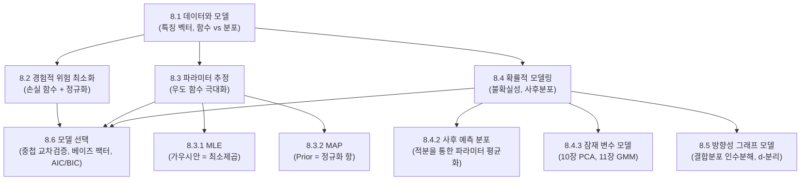

> **교재 쪽수**: 251~288쪽(249~250쪽은 Part II 표지)  
> **연습문제:** Part II에는 장 끝 연습문제가 없어서, 확인 문제를 만들어 넣었다.  
> **이 장이 뒤쪽 장에서 쓰이는 위치**: 8장은 MML Part 2(머신러닝 응용)의 문을 여는 **총론(Foundation)**\ 입니다. 1~7장에서 배운 선형대수, 해석기하, 행렬분해, 미분, 확률분포, 최적화가 머신러닝의 3대 학습 패러다임(경험적 위험 최소화 ERM, 최대우도/최대사후추정 MLE/MAP, 베이지안 추론)으로 어떻게 융합되는지 체계화합니다. 9장의 선형 회귀, 10장의 차원 축소(PCA), 11장의 밀도 추정(GMM), 12장의 분류(SVM)는 모두 8장에서 정의된 원리들의 구체적인 실현체입니다.

---

## 0. 이 장 지도

### 절 목록 및 핵심 요약
- **8.1 데이터, 모델, 그리고 학습 (Data, Models, and Learning)**: 데이터를 벡터로 표현하고, 모델을 함수 또는 확률 분포로 바라보며, 머신러닝 학습이란 결국 파라미터를 찾는 과정임을 정립.
  - **8.1.1 벡터로서의 데이터 (Data as Vectors)**: 특징 벡터(feature vector), 데이터 행렬 $X \in \mathbb{R}^{N \times D}$, 범주형 데이터 변환.
  - **8.1.2 함수로서의 모델 (Models as Functions)**: 결정론적 사상 $f(x; \theta)$, 회귀와 분류, 결정 경계.
  - **8.1.3 확률 분포로서의 모델 (Models as Probability Distributions)**: 관측 노이즈를 포용하는 조건부 우도 $p(y \mid x, \theta)$, 생성 모델 vs 판별 모델.
  - **8.1.4 학습이란 파라미터를 찾는 것 (Learning is Finding Parameters)**: ERM, 확률적 파라미터 추정(MLE/MAP), 베이지안 추론의 세 갈래 길.
- **8.2 경험적 위험 최소화 (Empirical Risk Minimization, ERM)**: 훈련 데이터 평균 손실을 줄이는 최적화 관점의 머신러닝.
  - **8.2.1 가설 공간 (Hypothesis Class of Functions)**: 표현력과 일반화 사이의 트레이드오프, 과소적합과 과적합.
  - **8.2.2 학습을 위한 손실 함수 (Loss Function for Training)**: 0-1 손실, 제곱 손실, 힌지 손실, 교차 엔트로피 손실. 참 위험 $R_{\text{true}}$와 경험적 위험 $R_{\text{emp}}$.
  - **8.2.3 과적합 완화를 위한 정규화 (Regularization to Reduce Overfitting)**: 복잡도에 벌점을 부여하는 $L_2$(Ridge) 및 $L_1$(Lasso, 희소성 유도) 정규화.
  - **8.2.4 일반화 성능 평가를 위한 교차 검증 (Cross-Validation)**: 훈련/검증/테스트 세트 분할, $K$-겹 교차 검증($K$-fold CV).
- **8.3 파라미터 추정 (Parameter Estimation)**: 확률적 관점에서 데이터가 발생할 확률을 극대화하는 파라미터를 점추정(point estimation).
  - **8.3.1 최대우도추정 (Maximum Likelihood Estimation, MLE)**: 우도 $p(\mathcal{D} \mid \theta)$ 극대화, 음의 로그 우도(NLL), 최소제곱법과의 동치성.
  - **8.3.2 최대 사후확률 추정 (Maximum A Posteriori Estimation, MAP)**: 사전분포 $p(\theta)$ 결합, 가우시안 사전분포($L_2$ 정규화)와 라플라스 사전분포($L_1$ 정규화)의 수학적 동치성.
  - **8.3.3 모델 적합 (Model Fitting)**: 사전분포가 유도 편향(inductive bias)으로 작용하여 과적합을 방지하는 원리.
- **8.4 확률적 모델링과 추론 (Probabilistic Modeling and Inference)**: 파라미터를 하나의 고정된 값이 아닌 확률분포로 취급하는 완전한 베이지안 패러다임.
  - **8.4.1 확률적 모델 (Probabilistic Models)**: 내재적 불확실성(Aleatoric)과 무지에 의한 불확실성(Epistemic)의 구분.
  - **8.4.2 베이지안 추론 (Bayesian Inference)**: 사후분포 $p(\theta \mid \mathcal{D})$, 주변 우도 $p(\mathcal{D})$ 적분의 난해성, 사후 예측 분포 $p(x_* \mid \mathcal{D})$.
  - **8.4.3 잠재 변수 모델 (Latent-Variable Models)**: 관측되지 않는 숨은 요인 $z$, 주변화(marginalization), 10장 PCA 및 11장 GMM의 토대.
- **8.5 방향성 그래프 모델 (Directed Graphical Models / Bayesian Networks)**: 복잡한 결합 확률 분포를 조건부 독립성 그래프로 시각화하고 분해.
  - **8.5.1 그래프 시맨틱스 (Graph Semantics)**: 부모-자식 노드와 결합분포 인수분해 $\prod p(x_k \mid \text{pa}_k)$, 플레이트 표기법(Plate notation).
  - **8.5.2 조건부 독립성과 d-분리 (Conditional Independence and d-Separation)**: 연쇄(Chain), 공통 원인(Fork), V-구조(Collider, Explaining away), d-분리 판정 알고리즘.
- **8.6 모델 선택 (Model Selection)**: 여러 가설 모델 중 최적의 모델 구조를 객관적으로 선택하는 기법.
  - **8.6.1 중첩 교차 검증 (Nested Cross-Validation)**: 하이퍼파라미터 튜닝과 일반화 성능 평가의 엄격한 분리를 통한 데이터 누수 방지.
  - **8.6.2 베이지안 모델 선택과 오컴의 면도날 (Bayesian Model Selection)**: 모델 증거(Model Evidence)에 내재된 자동 오컴의 면도날(Automatic Occam's Razor) 수학적 원리.
  - **8.6.3 베이즈 팩터 (Bayes Factors for Model Comparison)**: 두 모델 간 우도비 $K$와 사후 오즈(Posterior Odds).
  - **8.6.4 정보 기준 (Information Criteria)**: AIC(Akaike)와 BIC(Bayesian Information Criterion)의 정의 및 라플라스 근사 유도.

### 절별 중요도 안내
- **8.1 데이터, 모델, 그리고 학습 (★★)**: 머신러닝의 용어와 기호 체계를 통일하는 총론 도입부입니다.
- **8.2 경험적 위험 최소화 (★★★)**: 머신러닝을 최적화 관점으로 보는 핵심 프레임워크. $L_1/L_2$ 정규화의 기하학적 비교와 교차검증이 핵심 개념입니다.
- **8.3 파라미터 추정 (★★★)**: MLE와 최소제곱의 동치성, MAP와 Ridge/Lasso의 동치성 유도가 이 장의 중심 유도입니다.
- **8.4 확률적 모델링과 추론 (★★★)**: 점추정(MLE/MAP)과 분포추정(Bayesian)의 근본적 차이, 불확실성(Aleatoric vs Epistemic)의 개념, 잠재변수 모델의 주변화 적분을 명확히 이해해야 10~11장을 정복할 수 있습니다.
- **8.5 방향성 그래프 모델 (★★★)**: V-구조(Collider)에서 조건화 시 오히려 독립성이 깨지는 'Explaining away' 현상과 d-분리 판정법이 핵심입니다.
- **8.6 모델 선택 (★★)**: 베이지안 오컴의 면도날 원리와 AIC/BIC의 페널티 항 유도는 모델의 복잡도 제어에 대한 깊은 통찰을 요구합니다.

---

## 8.1 데이터, 모델, 그리고 학습 (Data, Models, and Learning, 251~258쪽)

### 왜 필요한가 (직관)
우리가 현실의 문제를 컴퓨터로 풀려고 할 때 세 가지 근본적인 구성 요소가 필요합니다:
1. **데이터(Data)**: 과거에 관측된 현실 세계의 기록.
2. **모델(Model)**: 현실의 작동 규칙이나 입출력 관계를 흉내 내는 수학적 기계(함수 또는 확률 분포).
3. **학습(Learning)**: 모델이 데이터를 가장 잘 설명하거나 미래를 잘 예측하도록 모델 내부의 다이얼(파라미터 $\theta$)을 최적으로 돌려 맞추는 알고리즘.

8장은 9~12장에서 전개될 선형 회귀, 차원 축소, 군집화, 분류 문제를 관통하는 하나의 공통된 설계도(Blue-print)를 제시합니다.

---

### 8.1.1 벡터로서의 데이터 (Data as Vectors, 252~254쪽)

#### 정의와 성질
컴퓨터는 텍스트나 이미지, 환자의 건강 기록을 그대로 이해할 수 없습니다. 따라서 모든 관측 대상은 **숫자들의 나열(특징 벡터, feature vector)**\ 로 수치화되어야 합니다.
- **단일 데이터 포인트**: $D$개의 특징(feature)을 가진 열벡터 $x_n \in \mathbb{R}^D$:
  $$x_n = \begin{bmatrix} x_{n1} \\ x_{n2} \\ \vdots \\ x_{nD} \end{bmatrix}$$
- **데이터 행렬 (Data Matrix)**: $N$개의 데이터 포인트를 행(row) 단위로 쌓은 행렬 $X \in \mathbb{R}^{N \times D}$:
  $$X = \begin{bmatrix} x_1^\top \\ x_2^\top \\ \vdots \\ x_N^\top \end{bmatrix} = \begin{bmatrix} x_{11} & x_{12} & \dots & x_{1D} \\ x_{21} & x_{22} & \dots & x_{2D} \\ \vdots & \vdots & \ddots & \vdots \\ x_{N1} & x_{N2} & \dots & x_{ND} \end{bmatrix}$$
  *(교재 관례 주의: MML 교재에서는 데이터 $x_n$은 $D$차원 열벡터로 정의하되, 전체 데이터 행렬 $X$는 각 데이터를 **행(row)**\ 으로 쌓은 $N \times D$ 행렬을 표준으로 삼습니다).*
- **타깃 라벨 (Targets / Labels)**: 지도학습에서 각 데이터에 대응하는 정답 값 $y_n \in \mathbb{R}$ (회귀) 또는 $y_n \in \{0, 1\}$ (분류). 전체 타깃 벡터는 $y \in \mathbb{R}^N$입니다.
- **범주형 데이터 변환**: "빨강, 초록, 파랑"과 같은 범주형 데이터는 크기 순서가 없으므로 원-핫 인코딩(one-hot encoding)을 통해 $e_1 = [1, 0, 0]^\top, e_2 = [0, 1, 0]^\top, e_3 = [0, 0, 1]^\top$과 같은 직교 단위 벡터로 변환합니다.

---

### 8.1.2 함수로서의 모델 (Models as Functions, 255쪽)

#### 정의와 성질
모델을 입력 $x$를 받아 출력 $\hat{y}$를 내놓는 결정론적(deterministic) 함수 $f: \mathbb{R}^D \to \mathbb{R}$로 간주합니다:
$$\hat{y} = f(x; \theta)$$
- $\theta \in \mathbb{R}^M$: 모델의 동작 방식을 결정하는 **파라미터(parameters)** 벡터.
- **선형 회귀 모델 (Linear Model)**:
  $$f(x) = x^\top \theta + \theta_0 = \sum_{d=1}^D x_d \theta_d + \theta_0$$
  입력 $x$에 바이어스 항을 흡수시키기 위해 더미 특징 $x_0 = 1$을 추가하면 $f(x) = \tilde{x}^\top \tilde{\theta}$의 단일 내적 형태로 깔끔하게 표현할 수 있습니다.
- **분류 모델 (Classification Model)**: 실수 출력을 내는 함수에 부호 함수(sign)나 활성화 함수(sigmoid)를 씌워 불연속적인 클래스를 예측합니다:
  $$\hat{y} = \text{sign}(f(x; \theta))$$
  이때 $f(x; \theta) = 0$을 만족하는 초평면을 **결정 경계(decision boundary)**\ 라 부릅니다.

---

### 8.1.3 확률 분포로서의 모델 (Models as Probability Distributions, 256~257쪽)

#### 왜 확률적 모델인가?
현실 세계의 데이터는 결코 수학 함수대로 정확히 움직이지 않습니다. 동일한 환자에게 동일한 약을 투여해도 혈압 변화가 다를 수 있으며, 센서에는 항상 물리적 잡음(noise)이 낍니다.
따라서 입출력 관계를 단순한 함수 $y = f(x)$가 아니라 **조건부 확률 분포(Conditional Probability Distribution)**\ 로 표현하는 것이 훨씬 정직하고 유연합니다:
$$p(y \mid x, \theta)$$

#### 대표적인 가우시안 노이즈 모델
출력 $y$가 참 함수 $f(x; \theta) = x^\top \theta$에 독립적인 가우시안 노이즈 $\epsilon \sim \mathcal{N}(0, \sigma^2)$가 더해져 생성된다고 가정해 봅시다:
$$y = x^\top \theta + \epsilon$$
이때 입력 $x$가 주어졌을 때 $y$의 조건부 확률 밀도는 다음과 같은 가우시안 분포가 됩니다:
$$\begin{aligned} p(y \mid x, \theta) &= \mathcal{N}(y \mid x^\top \theta, \sigma^2) \\ &= \frac{1}{\sqrt{2\pi\sigma^2}} \\ &\quad \exp\left( -\frac{(y - x^\top \theta)^2}{2\sigma^2} \right) \end{aligned}$$
- 평균 $\mathbb{E}[y \mid x] = x^\top \theta$: 모델의 예측값.
- 분산 $\text{Var}[y \mid x] = \sigma^2$: 데이터에 내재된 불확실성(노이즈의 크기).

#### 판별 모델 vs 생성 모델
- **판별 모델 (Discriminative Model)**: 입력 $x$가 주어졌을 때 출력의 조건부 분포 $p(y \mid x)$만을 직접 모델링합니다 (예: 로지스틱 회귀, 신경망). $x$ 자체가 어떻게 분포하는지에는 관심이 없습니다.
- **생성 모델 (Generative Model)**: 입력과 출력의 결합 분포 $p(x, y) = p(x \mid y)p(y)$를 모델링합니다 (예: 나이브 베이즈, 11장 GMM). 데이터 $x$가 생성되는 메커니즘을 학습하므로 새로운 가상 데이터를 만들어낼 수 있습니다.

---

### 8.1.4 학습이란 파라미터를 찾는 것 (Learning is Finding Parameters, 257~258쪽)

데이터셋 $\mathcal{D} = \{(x_n, y_n)\}_{n=1}^N$이 주어졌을 때, 모델의 파라미터 $\theta$를 학습하는 방법론은 크게 세 가지 철학적 학파(flavor)로 나뉩니다:
1. **경험적 위험 최소화 (ERM)**: 데이터와 예측값 사이의 손실(loss) 평균을 최소화하는 **최적화(Optimization)**\ 적 접근법.
2. **최대우도추정 / 최대사후추정 (MLE / MAP)**: 데이터가 관측될 확률(우도)을 최대화하는 최적의 단일 파라미터 값을 찾는 **확률적 점추정(Point Estimation)** 접근법.
3. **베이지안 추론 (Bayesian Inference)**: 단 하나의 $\theta$를 찍지 않고, 데이터와 부합하는 모든 가능한 $\theta$들의 **사후 확률 분포(Posterior Distribution) $p(\theta \mid \mathcal{D})$** 자체를 계산하는 완전한 확률론적 접근법.

---

## 8.2 경험적 위험 최소화 (Empirical Risk Minimization, ERM, 258~264쪽)

### 왜 필요한가 (직관)
머신러닝의 궁극적인 목표는 **"한 번도 본 적 없는 미래의 새로운 데이터(unseen test data)"에 대해 오차를 최소화**하는 것입니다. 이를 **일반화(Generalization)**\ 라고 부릅니다.
수학적으로 미래 데이터 $(x, y)$가 미지의 참 분포 $p_{\text{true}}(x, y)$에서 나온다고 할 때, 우리가 진짜로 줄이고 싶은 오차는 다음과 같은 **참 위험(Expected / True Risk)**\ 입니다:
$$\begin{aligned} &R_{\text{true}}(f) \\ &= \mathbb{E}_{(x, y) \sim p_{\text{true}}} [\ell(y, f(x))] \\ &= \iint \ell(y, f(x)) p_{\text{true}}(x, y) \, dx dy \end{aligned}$$
하지만 우리는 미래의 참 분포 $p_{\text{true}}(x, y)$를 알지 못하므로 이 적분을 직접 계산할 수 없습니다!
우리가 가진 것은 오직 현재 손에 쥐고 있는 $N$개의 훈련 샘플 $\mathcal{D} = \{(x_n, y_n)\}_{n=1}^N$뿐입니다.
따라서 대수의 법칙(Law of Large Numbers)을 믿고, **"훈련 데이터 $N$개에 대한 평균 오차가 작아지면 참 오차도 대략 작아지겠지"**\ 라고 근사하여 최적화하는 전략이 바로 **경험적 위험 최소화(Empirical Risk Minimization, ERM)**\ 입니다!

---

### 8.2.1 가설 공간 (Hypothesis Class of Functions, 259~260쪽)

#### 정의와 성질
모델이 취할 수 있는 후보 함수들의 집합을 **가설 공간(Hypothesis Class) $\mathcal{H}$**\ 라 합니다:
$$f \in \mathcal{H}$$
- 예: $\mathcal{H} = \{ f(x) = \theta_1 x + \theta_0 \mid \theta_0, \theta_1 \in \mathbb{R} \}$ (1차 선형 함수 집합)
- 예: $\mathcal{H} = \{ f(x) = \sum_{k=0}^M \theta_k x^k \}$ ($M$차 다항식 집합)

#### 유도 편향 (Inductive Bias)과 모델 복잡도
우리가 특정 가설 공간을 선택하는 행위 자체가 "세상의 법칙은 아마 이러이러한 형태일 것이다"라는 사전 가정, 즉 **유도 편향(inductive bias)**\ 을 주입하는 것입니다.
- **과소적합 (Underfitting)**: 가설 공간 $\mathcal{H}$가 너무 단순하여(예: 구불구불한 3차 곡선 데이터에 1차 직선 모델을 고집함) 훈련 데이터의 기본 패턴조차 학습하지 못하고 높은 편향(bias)을 갖는 현상.
- **과적합 (Overfitting)**: 가설 공간 $\mathcal{H}$가 너무 복잡하여(예: 데이터 10개에 9차 다항식을 적용함) 데이터에 포함된 무작위 노이즈까지 그대로 외워 버려 훈련 오차는 0이지만 새로운 시험 데이터에서는 엉망이 되는 현상.

---

### 8.2.2 학습을 위한 손실 함수 (Loss Function for Training, 260~261쪽)

손실 함수 $\ell(y, \hat{y})$는 정답 $y$와 모델의 예측 $\hat{y} = f(x)$ 사이의 불일치를 측정하는 잣대입니다:
1. **0-1 손실 (Zero-One Loss)**:
   $$\ell_{0-1}(y, \hat{y}) = \begin{cases} 0 & \text{if } y = \hat{y} \\ 1 & \text{if } y \neq \hat{y} \end{cases}$$
   - 가장 직관적인 분류 에러 척도이지만, 계단형 불연속 함수이므로 미분이 불가능하여(도함수가 거의 모든 곳에서 0) 경사하강법으로 직접 최적화할 수 없습니다 (NP-hard).
2. **제곱 오차 손실 (Squared Loss)**:
   $$\ell_{\text{sq}}(y, \hat{y}) = \frac{1}{2}(y - \hat{y})^2$$
   - 회귀의 대표적 손실. 매끄럽고 미분 가능하여 최적화가 쉽지만, 큰 이상치(outlier)에 민감합니다.
3. **힌지 손실 (Hinge Loss)**:
   $$\ell_{\text{hinge}}(y, \hat{y}) = \max(0, 1 - y\hat{y}) \quad (y \in \{-1, +1\})$$
   - 12장 서포트 벡터 머신(SVM)의 핵심 손실 함수. 0-1 손실의 볼록 상한(convex surrogate) 역할을 합니다.
4. **교차 엔트로피 손실 (Log / Cross-Entropy Loss)**:
   $$\ell_{\text{ce}}(y, \hat{p}) = - [y \log \hat{p} + (1 - y) \log (1 - \hat{p})]$$
   - 로지스틱 회귀와 딥러닝 분류의 표준 손실 함수.

#### 경험적 위험 (Empirical Risk) 수식
$$R_{\text{emp}}(f) = \frac{1}{N} \sum_{n=1}^N \ell(y_n, f(x_n))$$
ERM은 이 $R_{\text{emp}}(f)$를 최소화하는 파라미터를 찾는 최적화 문제입니다.

---

### 8.2.3 과적합 완화를 위한 정규화 (Regularization to Reduce Overfitting, 261~263쪽)

#### 왜 필요한가 (직관)
훈련 데이터만 보고 $R_{\text{emp}}(f)$를 맹목적으로 최소화하면 모델은 파라미터를 극단적으로 키워 모든 훈련 데이터 점을 억지로 통과하는 뱀 같은 곡선을 그립니다.
과적합을 막기 위해 **"훈련 데이터 오차도 줄이되, 모델 파라미터가 비정상적으로 거대해지면 벌점(penalty)을 매기겠다"**\ 는 안전장치를 답니다. 이것이 **정규화(Regularization)**\ 입니다!

#### 수식과 형태
$$\min_\theta R_{\text{reg}}(\theta) = R_{\text{emp}}(\theta) + \lambda \Omega(\theta)$$
- $\Omega(\theta)$: 파라미터의 복잡도에 벌점을 주는 정규화 함수.
- $\lambda > 0$: **정규화 하이퍼파라미터(Hyperparameter)**. 오차 감소와 모델 단순성 사이의 균형을 조절합니다.

1. **$L_2$ 정규화 (Ridge / Weight Decay)**:
   $$\Omega(\theta) = \|\theta\|_2^2 = \sum_{d=1}^D \theta_d^2$$
   - 파라미터 값들이 극단적으로 커지는 것을 고르게 억제하여 모델을 부드럽게(smooth) 만듭니다.
2. **$L_1$ 정규화 (Lasso)**:
   $$\Omega(\theta) = \|\theta\|_1 = \sum_{d=1}^D |\theta_d|$$
   - 중요하지 않은 특징의 파라미터를 **정확히 0**으로 만들어 유용한 특징만 남기는 **희소성(Sparsity)**\ 을 유도합니다!

#### $L_1$ 희소성의 기하학적 직관
최적화 관점에서 정규화 문제는 제약 최적화 $\min R_{\text{emp}}(\theta) \text{ s.t. } \Omega(\theta) \le C$와 동치입니다:
- $L_2$ 제약 영역 $\{\theta \mid \|\theta\|_2^2 \le C\}$은 매끄러운 **원(구)** 모양입니다. 손실 함수의 타원형 등고선이 원과 만날 때 접점은 일반적으로 좌표축 위가 아니라 일반적인 점이 되므로 가중치들이 0이 되지 않고 작아지기만 합니다.
- $L_1$ 제약 영역 $\{\theta \mid \|\theta\|_1 \le C\}$은 뾰족한 모서리를 가진 **마름모(다이아몬드)** 모양입니다. 손실 함수 등고선이 팽창하다가 마름모와 처음 부딪힐 때, 뾰족하게 튀어나온 **모서리(축 위의 점, 즉 특정 $\theta_d = 0$인 지점)**\ 에서 접할 확률이 압도적으로 높습니다! 이것이 $L_1$ 정규화가 파라미터를 정확히 0으로 만드는 기하학적 이유입니다.

---

### 8.2.4 일반화 성능 평가를 위한 교차 검증 (Cross-Validation, 263~264쪽)

정규화 계수 $\lambda$나 다항식 차수 $M$ 같은 하이퍼파라미터는 훈련 오차만으로는 정할 수 없습니다($\lambda=0$일 때 훈련 오차가 항상 제일 작기 때문입니다).
따라서 전체 데이터를 세 부분으로 쪼갭니다:
1. **훈련 세트 (Training Set)**: 모델 파라미터 $\theta$를 학습하는 데 사용.
2. **검증 세트 (Validation Set)**: 최적의 하이퍼파라미터($\lambda$ 등)를 선택하고 조기 종료(early stopping)를 결정하는 데 사용.
3. **테스트 세트 (Test Set)**: 최종 결정된 모델의 실제 일반화 성능을 딱 한 번 평가하는 데 사용 (학습에 절대 관여 불가).

#### $K$-겹 교차 검증 ($K$-Fold Cross-Validation)
데이터가 적을 때 검증 세트를 고정해 두면 데이터 낭비가 심합니다.
1. 데이터를 $K$개의 균등한 조각(fold)으로 나눕니다.
2. $k=1, \dots, K$에 대해, $k$번째 조각을 검증 세트로 삼고 나머지 $K-1$개 조각으로 모델을 학습하여 검증 오차 $R_k$를 구합니다.
3. $K$번의 검증 오차 평균 $\frac{1}{K}\sum_{k=1}^K R_k$으로 하이퍼파라미터의 성능을 객관적으로 평가합니다.
- $K=N$인 극단적인 경우를 **LOOCV (Leave-One-Out Cross-Validation)**\ 라 부릅니다.

---

## 8.3 파라미터 추정 (Parameter Estimation, 265~272쪽)

### 왜 필요한가 (직관)
ERM이 손실 함수를 사람이 임의로 골라 최적화하는 공학적 접근법이라면, 확률론자들은 다른 질문을 던집니다:
> **"우리가 관측한 데이터 $\mathcal{D}$가 생성되었을 가능성(우도)이 가장 높은 세상의 참 파라미터 $\theta$는 무엇일까?"**

이 질문에 답하는 체계가 바로 **우도 기반의 파라미터 추정(MLE / MAP)**\ 입니다.

---

### 8.3.1 최대우도추정 (Maximum Likelihood Estimation, MLE, 265~268쪽)

#### 정의와 성질
데이터셋 $\mathcal{D} = \{x_1, \dots, x_N\}$이 파라미터 $\theta$를 가진 확률 분포로부터 독립 항등 분포(i.i.d.)로 추출되었다고 가정합니다.
1. **우도 함수 (Likelihood Function)**:
   데이터가 주어졌을 때 파라미터 $\theta$의 타당성을 나타내는 함수:
   $$L(\theta) = p(\mathcal{D} \mid \theta) = \prod_{n=1}^N p(x_n \mid \theta)$$
2. **로그 우도 (Log-Likelihood)**:
   확률의 곱셈은 컴퓨터에서 언더플로우(underflow)를 유발하고 미분이 복잡하므로 단조 증가 함수인 자연로그를 취해 합으로 바꿉니다:
   $$\log L(\theta) = \sum_{n=1}^N \log p(x_n \mid \theta)$$
3. **음의 로그 우도 (Negative Log-Likelihood, NLL)**:
   최대화 문제를 최적화 표준인 최소화 문제로 바꾸기 위해 마이너스를 붙입니다:
   $$\mathcal{L}(\theta) = -\sum_{n=1}^N \log p(x_n \mid \theta)$$
   **NLL은 ERM의 손실 함수 $\ell(x_n, \theta) = -\log p(x_n \mid \theta)$와 정확히 대응됩니다!**
4. **MLE 공식**:
   $$\theta_{\text{ML}} = \arg\max_\theta p(\mathcal{D} \mid \theta) = \arg\min_\theta \mathcal{L}(\theta)$$

---

### 8.3.2 최대 사후확률 추정 (Maximum A Posteriori Estimation, MAP, 268~270쪽)

#### 왜 필요한가 (직관)
동전을 3번 던져 3번 모두 앞면이 나왔다고 합시다. MLE는 "앞면이 나올 확률 $\theta = 1.0$"이라는 극단적인 결론을 내립니다(과적합!).
하지만 우리는 세상의 동전들이 대략 공평하다는 **사전 지식(Prior Knowledge)**\ 을 이미 알고 있습니다.
데이터가 부족할 때 상식적인 사전 지식을 결합하여 극단적인 추정을 막아주는 방법이 바로 **MAP**입니다!

#### 베이즈 정리와 MAP 수식
베이즈 정리(Bayes' Theorem)에 의해 파라미터의 사후 확률 분포(Posterior)는 다음과 같습니다:
$$p(\theta \mid \mathcal{D}) = \frac{p(\mathcal{D} \mid \theta) p(\theta)}{p(\mathcal{D})} \propto p(\mathcal{D} \mid \theta) p(\theta)$$
- $p(\theta)$: 데이터를 보기 전에 우리가 파라미터에 대해 가졌던 믿음인 **사전분포(Prior)**.
- $p(\mathcal{D} \mid \theta)$: 데이터가 제공하는 증거인 **우도(Likelihood)**.
- $p(\theta \mid \mathcal{D})$: 데이터를 관측한 후 갱신된 믿음인 **사후분포(Posterior)**.

사후 확률을 최대로 만드는 단 하나의 점 $\theta_{\text{MAP}}$를 찾습니다:
$$\begin{aligned} \theta_{\text{MAP}} &= \arg\max_\theta p(\theta \mid \mathcal{D}) \\ &= \arg\max_\theta \bigl[ \log p(\mathcal{D} \mid \theta) \\ &\quad + \log p(\theta) \bigr] \end{aligned}$$
부호를 바꾸어 최소화 문제로 쓰면:
$$\begin{aligned} \theta_{\text{MAP}} &= \arg\min_\theta \Bigl[ \underbrace{-\sum_{n=1}^N \log p(x_n \mid \theta)}_{\text{NLL (경험적 오차)}} \\ &\quad + \underbrace{(-\log p(\theta))}_{\text{사전분포에 의한 벌점}} \Bigr] \end{aligned}$$

#### 연결: 가우시안 사전분포의 MAP 추정은 L2 정규화와 같다
- **가우시안 사전분포 $\theta \sim \mathcal{N}(0, \sigma_0^2 I)$**:
  $$-\log p(\theta) = \frac{1}{2\sigma_0^2} \|\theta\|_2^2 + \text{const} \iff L_2 \text{ 정규화 (Ridge)!}$$
- **라플라스 사전분포 $p(\theta) \propto \exp\left(-\frac{\|\theta\|_1}{b}\right)$**:
  $$-\log p(\theta) = \frac{1}{b} \|\theta\|_1 + \text{const} \iff L_1 \text{ 정규화 (Lasso)!}$$
즉, ERM에서 직관적으로 도입했던 정규화 항 $\lambda \Omega(\theta)$는 확률론적 세계관에서 **파라미터의 사전분포 $-\log p(\theta)$와 수학적으로 정확히 동일한 실체**였던 것입니다!

---

### 8.3.3 모델 적합 (Model Fitting, 270~271쪽)

- 데이터의 수 $N$이 매우 적을 때는 사전분포 $p(\theta)$의 영향력이 커서 과적합을 강력하게 방어합니다.
- 데이터의 수 $N \to \infty$로 무한히 많아지면 우도 항 $\sum_{n=1}^N \log p(x_n \mid \theta)$이 압도적으로 커져 사전분포의 영향력은 0으로 수렴하며, 결국 **$\theta_{\text{MAP}} \to \theta_{\text{ML}}$**\ 로 수렴합니다.

---

## 8.4 확률적 모델링과 추론 (Probabilistic Modeling and Inference, 272~278쪽)

### 왜 필요한가 (직관)
MLE와 MAP는 계산이 빠르지만 여전히 치명적인 결함이 있습니다. 결국 **"단 하나의 숫자 $\theta$만 콕 집어서(점추정)"** 세상을 설명하려 한다는 점입니다.
자율주행차가 보행자를 감지할 때, "사람일 확률 51%니까 지나가자"라고 확신하는 것과 "사람일 수도 있고 아닐 수도 있으니 극도로 조심하자"고 불확실성을 표현하는 것은 생사가 걸린 문제입니다.
진정한 베이지안은 점추정을 버리고, **"가능한 모든 파라미터 후보들의 확률 분포 전체"**\ 를 안고 미래를 예측합니다.

---

### 8.4.1 확률적 모델과 불확실성의 두 얼굴 (273~274쪽)

머신러닝의 불확실성은 두 종류로 엄격히 나뉩니다:
1. **우연적 불확실성 (Aleatoric Uncertainty)**:
   - 데이터 생성 과정 자체에 내재된 본질적인 무작위성이나 센서 잡음.
   - 데이터를 100만 개 더 모아도 결코 줄어들지 않는 불확실성입니다 (예: 동전 던지기의 앞뒷면).
2. **인식론적 불확실성 (Epistemic Uncertainty)**:
   - 데이터가 부족해서 "우리가 아직 몰라서" 발생하는 파라미터에 대한 무지.
   - **데이터를 많이 모을수록 점점 줄어들어 0으로 수렴**하는 불확실성입니다!
   - 베이지안 방법론의 진정한 위력은 바로 이 인식론적 불확실성을 정확히 측정할 수 있다는 데 있습니다.

---

### 8.4.2 베이지안 추론 (Bayesian Inference, 273~275쪽)

#### 1. 사후분포 계산
베이즈 정리를 통해 파라미터의 완전한 사후 확률 분포를 구합니다:
$$p(\theta \mid \mathcal{D}) = \frac{p(\mathcal{D} \mid \theta) p(\theta)}{p(\mathcal{D})}$$
여기서 분모인 **주변 우도(Marginal Likelihood)** 또는 **증거(Evidence)**\ 는 모든 가능한 파라미터에 대해 적분한 값입니다:
$$p(\mathcal{D}) = \int p(\mathcal{D} \mid \theta) p(\theta) \, d\theta$$
- **적분의 난해성 (Intractability)**: 파라미터 $\theta$가 수백만 개인 현대 딥러닝에서는 이 고차원 적분을 해석적으로 계산하는 것이 불가능합니다. 이것이 MCMC나 변분 추론(Variational Inference) 같은 근사 기법이 필요한 이유입니다.

#### 2. 사후 예측 분포 (Posterior Predictive Distribution)
새로운 입력 $x_*$가 들어왔을 때 타깃 $y_*$를 예측할 때, 베이지안은 단 하나의 $\theta$를 대입하지 않고 **사후분포 $p(\theta \mid \mathcal{D})$를 가중치로 삼아 가능한 모든 $\theta$의 예측을 평균(앙상블)** 냅니다:
$$\begin{aligned} &p(y_* \mid x_*, \mathcal{D}) \\ &= \int p(y_* \mid x_*, \theta) p(\theta \mid \mathcal{D}) \, d\theta \end{aligned}$$
이 적분을 거치면 예측값은 더 이상 파라미터 $\theta$에 의존하지 않고 오직 데이터 $\mathcal{D}$에만 조건화되며, 예측 평균뿐만 아니라 **예측의 신뢰 구간(분산)**\ 까지 정확히 함께 얻을 수 있습니다!

---

### 8.4.3 잠재 변수 모델 (Latent-Variable Models, 275~277쪽)

현실의 복잡한 데이터 뒤에는 우리가 직접 관측할 수는 없지만 데이터의 숨은 구조를 지배하는 **잠재 변수(Latent Variable) $z$**\ 가 존재하는 경우가 많습니다.
- 예: 10장 PCA에서는 고차원 이미지 뒤에 숨은 저차원 잠재 좌표 $z$를 찾습니다.
- 예: 11장 GMM에서는 데이터가 어느 클러스터에 속하는지를 나타내는 숨은 라벨 $z$가 존재합니다.

결합 확률 $p(x, z \mid \theta)$에서 관측 데이터 $x$만의 확률을 얻으려면 숨은 변수 $z$를 적분(또는 합)하여 지워버려야 합니다(**주변화, marginalization**):
$$p(x \mid \theta) = \int p(x, z \mid \theta) \, dz$$
이 잠재 변수 모델을 학습하는 범용 알고리즘이 바로 11장의 **EM 알고리즘(Expectation-Maximization)**\ 입니다.

---

## 8.5 방향성 그래프 모델 (Directed Graphical Models, 278~283쪽)

### 왜 필요한가 (직관)
변수가 수십 개 있는 복잡한 확률 모델을 수식으로만 쓰면 어떤 변수가 어떤 변수에 영향을 미치는지 한눈에 파악하기 어렵고, 결합 분포 $p(x_1, \dots, x_K)$를 통째로 다루려면 차원의 저주에 빠집니다.
이를 해결하기 위해 확률변수를 동그라미(노드)로, 조건부 인과관계를 화살표(방향성 엣지)로 나타낸 그림 언어가 바로 **방향성 그래프 모델(Directed Graphical Models)** 또는 **베이지안 네트워크(Bayesian Networks)**\ 입니다.

---

### 8.5.1 그래프 시맨틱스 (Graph Semantics, 278~280쪽)

#### 결합 확률 분포의 인수분해 (Factorization)
방향성 비순환 그래프(DAG)에서 모든 노드의 결합 분포는 **"각 노드가 자신의 부모(parents) 노드들에만 조건화된 확률들의 곱"**\ 으로 매우 단순하게 쪼개집니다:
$$p(x_1, x_2, \dots, x_K) = \prod_{k=1}^K p(x_k \mid \text{pa}_k)$$
- 여기서 $\text{pa}_k$는 노드 $x_k$로 들어오는 화살표의 출발점(부모 노드들)의 집합입니다.

#### 플레이트 표기법 (Plate Notation)
데이터 $x_1, \dots, x_N$처럼 동일한 구조가 $N$번 독립적으로 반복되는 경우, 노드를 $N$개 다 그리지 않고 네모난 상자(플레이트)로 묶은 뒤 오른쪽 아래에 반복 횟수 $N$을 적어 표기를 획기적으로 단순화합니다.

---

### 8.5.2 조건부 독립성과 d-분리 (Conditional Independence and d-Separation, 281~283쪽)

그래프 구조만 보고도 복잡한 확률 계산 없이 "어떤 변수들이 주어졌을 때 두 변수가 독립인가?"를 판정할 수 있는 강력한 그래프 이론 알고리즘이 **d-분리(d-separation)**\ 입니다.

#### 3가지 기본 3-노드 그래프 모티프
모든 복잡한 경로는 다음 3가지 기본 구조의 결합으로 분해됩니다:

1. **연쇄 결합 (Tail-to-Head / Chain)**: $A \to B \to C$
   - 결합 분포: $p(A, B, C) = p(A) p(B \mid A) p(C \mid B)$.
   - $B$를 모를 때: $A$와 $C$는 일반적으로 종속입니다 ($A \not\perp C$).
   - **$B$가 주어졌을 때(관측됨)**: $p(A, C \mid B) = \frac{p(A)p(B \mid A)p(C \mid B)}{p(B)} = p(A \mid B)p(C \mid B)$. 따라서 **$A$와 $C$는 조건부 독립**입니다 ($A \perp C \mid B$). 중간 노드 $B$가 정보를 차단합니다!

2. **공통 원인 (Tail-to-Tail / Fork)**: $A \leftarrow B \to C$
   - $B$가 두 사건의 공통 원인입니다.
   - $B$를 모를 때: $A$와 $C$는 공통 원인을 공유하므로 상관관계를 가집니다 ($A \not\perp C$).
   - **$B$가 주어졌을 때(관측됨)**: 공통 원인이 통제되었으므로 **$A$와 $C$는 조건부 독립**이 됩니다 ($A \perp C \mid B$).

3. **공통 효과 / V-구조 (Head-to-Head / Collider)**: $A \to B \leftarrow C$
   - 두 독립적인 원인 $A, C$가 하나의 결과 $B$를 초래합니다.
   - **$B$를 모를 때**: 두 원인은 서로 아무 상관이 없습니다! 따라서 **$A$와 $C$는 무조건부 독립**입니다 ($A \perp C$).
   - **$B$(또는 $B$의 자손)가 주어졌을 때(관측됨)**: **경로가 열리며 $A$와 $C$는 종속이 됩니다!** ($A \not\perp C \mid B$).
   - **Explaining Away 현상 직관**: 잔디가 젖어있는 사건($B$)의 원인이 비($A$)와 스프링클러($C$)라고 합시다. 평소에 비와 스프링클러는 독립입니다. 하지만 잔디가 젖어있는 것을 본 상태에서($B$ 관측), 하늘을 보니 폭우가 내렸다는 사실($A$)을 알게 되면 스프링클러가 틀어졌을 확률($C$)은 급격히 낮아집니다. 한 원인이 다른 원인의 필요성을 설명해 없애버리기(explain away) 때문에 두 원인이 종속이 되는 것입니다!

#### d-분리 판정 알고리즘
노드 집합 $\mathcal{A}$와 $\mathcal{B}$ 사이의 경로가 관측된 조건 노드 집합 $\mathcal{C}$에 의해 **차단(blocked)**\ 된다는 것은, 경로 상의 어떤 노드 $v$에 대해 다음 중 하나가 성립함을 뜻합니다:
1. $v$가 tail-to-head 또는 tail-to-tail 구조이고, **$v \in \mathcal{C}$ (관측됨)**.
2. $v$가 head-to-head(collider) 구조이고, **$v \notin \mathcal{C}$이며 $v$의 어떤 자손도 $\mathcal{C}$에 속하지 않음 (관측되지 않음)**.

$\mathcal{A}$와 $\mathcal{B}$ 사이의 **모든 가능한 경로가 차단**되면, $\mathcal{A}$와 $\mathcal{B}$는 $\mathcal{C}$가 주어졌을 때 d-분리되며, 따라서 **조건부 독립 $\mathcal{A} \perp \mathcal{B} \mid \mathcal{C}$**\ 가 성립합니다!

---

## 8.6 모델 선택 (Model Selection, 283~288쪽)

### 왜 필요한가 (직관)
동일한 데이터셋에 대해 1차 선형 모델, 3차 다항식 모델, 신경망 모델 중 어떤 모델 구조(가설 공간)를 최종적으로 채택해야 할까요?
모델 파라미터 수가 많을수록 훈련 데이터 적합도는 무조건 좋아지지만, 미래 예측 성능은 망가질 수 있습니다. 객관적으로 최선의 모델을 가려내는 수학적 기준이 필요합니다.

---

### 8.6.1 중첩 교차 검증 (Nested Cross-Validation, 284~285쪽)

일반 교차 검증에서 가장 좋은 성능을 보인 하이퍼파라미터 $\lambda^*$의 검증 점수를 그 모델의 최종 일반화 성능이라고 보고하면 **낙관적 편향(optimistic bias)과 데이터 누수(data leakage)**\ 가 발생합니다. (수많은 하이퍼파라미터 중 검증 세트에 우연히 잘 맞은 것을 고른 것이기 때문입니다).
이를 방지하기 위해 두 개의 교차 검증 루프를 겹쳐 사용합니다:
- **외부 루프 (Outer Loop)**: 전체 데이터를 훈련과 시험용으로 나누어, 모델의 **순수한 일반화 성능을 정직하게 측정**.
- **내부 루프 (Inner Loop)**: 외부 루프의 훈련 데이터만을 다시 쪼개어, **최적의 하이퍼파라미터를 튜닝**.
이 분리를 통해 모델 선택 과정 전체의 편향 없는 일반화 오차를 추정할 수 있습니다.

---

### 8.6.2 베이지안 모델 선택과 자동 오컴의 면도날 (285~286쪽)

베이지안 관점에서는 모델 자체 $M$도 하나의 확률변수로 봅니다:
$$p(M \mid \mathcal{D}) \propto p(\mathcal{D} \mid M) p(M)$$
여기서 모든 모델에 동일한 사전 확률 $p(M)$을 준다면, 모델의 우수성은 전적으로 **모델 증거(Model Evidence / Marginal Likelihood)** $p(\mathcal{D} \mid M)$에 의해 결정됩니다:
$$\begin{aligned} &p(\mathcal{D} \mid M) \\ &= \int p(\mathcal{D} \mid \theta_M, M) p(\theta_M \mid M) \, d\theta_M \end{aligned}$$

#### 자동 오컴의 면도날 (Automatic Occam's Razor)의 수학적 원리
확률 밀도의 총합은 항상 1이어야 합니다: $\int p(\mathcal{D} \mid M) d\mathcal{D} = 1$.
- **단순한 모델 ($M_1$)**: 표현할 수 있는 데이터 패턴의 종류가 적기 때문에, 소수의 가능한 데이터셋에 확률 질량이 좁고 높게 집중됩니다.
- **복잡한 모델 ($M_2$)**: 파라미터가 많아 거의 모든 데이터셋을 설명할 수 있지만, 확률의 총합이 1로 보존되어야 하므로 광대한 데이터 공간 전체에 확률 질량이 얇고 넓게 분산됩니다.
따라서 실제 관측된 데이터 $\mathcal{D}$가 단순한 모델로도 충분히 설명 가능한 영역에 있다면, 단순한 모델의 확률 밀도 $p(\mathcal{D} \mid M_1)$가 복잡한 모델의 $p(\mathcal{D} \mid M_2)$보다 **압도적으로 높아집니다!**
사람이 인위적으로 복잡도에 벌점을 주지 않아도, **확률 보존 법칙에 의해 모델 증거 자체가 지나치게 복잡한 모델을 자동으로 응징(penalize)**\ 하는 것입니다!

---

### 8.6.3 베이즈 팩터 (Bayes Factors for Model Comparison, 287쪽)

두 경쟁 모델 $M_1$과 $M_2$를 비교할 때, 두 모델 증거의 비율을 **베이즈 팩터(Bayes Factor)** $K$라 합니다:
$$K = \frac{p(\mathcal{D} \mid M_1)}{p(\mathcal{D} \mid M_2)}$$
사후 오즈(Posterior Odds) 관계식:
$$\underbrace{\frac{p(M_1 \mid \mathcal{D})}{p(M_2 \mid \mathcal{D})}}_{\text{사후 오즈}} = \underbrace{\frac{p(M_1)}{p(M_2)}}_{\text{사전 오즈}} \times \underbrace{\frac{p(\mathcal{D} \mid M_1)}{p(\mathcal{D} \mid M_2)}}_{\text{베이즈 팩터 } K}$$
- $K > 1$: 데이터가 모델 $M_1$을 지지함. (교재 밖 보충: 흔히 쓰는 제프리스 기준으로 $K > 3$이면 실질적, $K > 10$이면 강한, $K > 100$이면 결정적 지지라고 해석한다. 교재는 제프리스-린들리 역설만 언급한다.)

---

### 8.6.4 더 읽을거리 속 정보 기준: AIC와 BIC (288쪽)

복잡한 베이지안 적분을 직접 계산하기 어려울 때 사용하는 대표적인 점근적 근사 공식들입니다:
1. **AIC (Akaike Information Criterion, 아카이케 정보 기준)**:
   $$\begin{aligned} &\text{AIC} = \log p(x \mid \hat{\theta}) - M \\ &\quad (\text{교재 표기}) \end{aligned}$$
   (표준 통계학 관례로는 $-2\log L + 2M$로 정의하여 최솟값을 찾지만, MML 교재에서는 값이 클수록 좋은 형태로 정의합니다).
   - $M$: 모델의 파라미터 개수.
   - 우도 추정치의 편향을 파라미터 수 $M$만큼 보정합니다.

2. **BIC (Bayesian Information Criterion, 베이지안 정보 기준)**:
   $$\begin{aligned} \text{BIC} &= \log p(x \mid \hat{\theta}) \\ &\quad - \frac{1}{2} M \log N \quad (\text{교재 표기}) \end{aligned}$$
   (표준 관례: $-2\log L + M \log N$).
   - $N$: 데이터 샘플 수.
   - **라플라스 근사(Laplace approximation)**\ 를 통해 베이지안 로그 모델 증거 $\log p(\mathcal{D} \mid M)$를 테일러 전개했을 때 유도되는 점근적 공식입니다.
   - $\log N > 2$ (즉 $N \ge 8$)이면 항상 $\frac{1}{2}\log N > 1$이므로, **BIC는 AIC보다 복잡한 모델에 훨씬 더 가혹한 벌점을 부과**합니다.

---

## 핵심 유도 모음

### 유도 1: 선형 가우스 모델에서 최대우도추정(MLE)과 최소제곱법(OLS)의 동치성 유도
**목표**: $y_n = x_n^\top \theta + \epsilon_n$, $\epsilon_n \overset{\text{i.i.d.}}{\sim} \mathcal{N}(0, \sigma^2)$일 때, 우도 최대화가 제곱 오차 최소화와 동치임을 유도한다.

1. **단일 데이터의 조건부 우도**:
   $$p(y_n \mid x_n, \theta) = \frac{1}{\sqrt{2\pi\sigma^2}} \exp\left( -\frac{(y_n - x_n^\top \theta)^2}{2\sigma^2} \right)$$
   *(근거: 정규분포 오차 가정)*
2. **전체 데이터의 결합 우도 (i.i.d. 가정)**:
   $$p(y \mid X, \theta) = \prod_{n=1}^N p(y_n \mid x_n, \theta) = \left( \frac{1}{2\pi\sigma^2} \right)^{N/2} \exp\left( -\frac{1}{2\sigma^2} \sum_{n=1}^N (y_n - x_n^\top \theta)^2 \right)$$
   *(근거: 독립 확률변수 결합확률의 곱셈 법칙)*
3. **로그 우도 함수 계산**:
   $$\log p(y \mid X, \theta) = -\frac{N}{2}\log(2\pi\sigma^2) - \frac{1}{2\sigma^2} \sum_{n=1}^N (y_n - x_n^\top \theta)^2$$
   *(근거: 자연로그 성질 $\log(ab) = \log a + \log b$ 및 $\log(e^z) = z$)*
4. **$\theta$에 관한 최대화 문제로 정리**:
   앞의 항 $-\frac{N}{2}\log(2\pi\sigma^2)$과 상수 $\frac{1}{2\sigma^2} > 0$는 $\theta$에 의존하지 않는다. 따라서:
   $$\arg\max_\theta \log p(y \mid X, \theta) = \arg\max_\theta \left[ - \sum_{n=1}^N (y_n - x_n^\top \theta)^2 \right] = \arg\min_\theta \sum_{n=1}^N (y_n - x_n^\top \theta)^2$$
   행렬 표기로 쓰면:
   $$\arg\min_\theta \|y - X\theta\|_2^2$$
   *(근거: 음수 부호 반전 및 상수 계수 제거)*
   따라서 가우시안 노이즈 하의 MLE는 고전적 최소제곱법(OLS)과 정확히 동치이다.

---

### 유도 2: 가우시안 사전분포 하에서 MAP와 L2 정규화(Ridge)의 동치성 유도
**목표**: 파라미터 사전분포가 $\theta \sim \mathcal{N}(0, \sigma_0^2 I)$일 때 MAP 추정치가 Ridge 회귀와 동치임을 유도한다.

1. **사전분포와 우도의 정의**:
   - 우도: $\log p(y \mid X, \theta) = -\frac{1}{2\sigma^2} \|y - X\theta\|_2^2 + \text{const}_1$.
   - 사전분포: $p(\theta) = (2\pi\sigma_0^2)^{-D/2} \exp\left( -\frac{\|\theta\|_2^2}{2\sigma_0^2} \right) \implies \log p(\theta) = -\frac{1}{2\sigma_0^2} \|\theta\|_2^2 + \text{const}_2$.
   *(근거: 평균 0, 공분산 $\sigma_0^2 I$인 다변수 가우시안 밀도함수)*
2. **로그 사후 확률 전개**:
   $$\log p(\theta \mid y, X) = \log p(y \mid X, \theta) + \log p(\theta) + \text{const}$$
   $$= -\frac{1}{2\sigma^2} \|y - X\theta\|_2^2 - \frac{1}{2\sigma_0^2} \|\theta\|_2^2 + \text{const}'$$
   *(근거: 베이즈 정리의 로그 형태)*
3. **목적함수 정리**:
   전체 식에 $-2\sigma^2$을 곱하여 최소화 문제로 변환:
   $$\arg\max_\theta \log p(\theta \mid y, X) = \arg\min_\theta \left[ \|y - X\theta\|_2^2 + \frac{\sigma^2}{\sigma_0^2} \|\theta\|_2^2 \right]$$
   *(근거: 양수 상수 곱셈은 최적화 해를 바꾸지 않음)*
4. **결과 해석**:
   정규화 계수를 $\lambda = \frac{\sigma^2}{\sigma_0^2}$로 정의하면:
   $$\min_\theta \|y - X\theta\|_2^2 + \lambda \|\theta\|_2^2$$
   이는 정확히 $L_2$ Ridge 회귀 목적함수이다!
   *(직관: 데이터 노이즈 $\sigma^2$가 클수록, 사전분포 분산 $\sigma_0^2$이 작을수록 $\lambda$가 커져 더 강력한 정규화가 걸린다).*

---

### 유도 3: 라플라스 사전분포 하에서 MAP와 L1 정규화(Lasso)의 동치성 유도
**목표**: 파라미터 사전분포가 독립 라플라스 분포 $\theta_d \overset{\text{i.i.d.}}{\sim} \text{Laplace}(0, b)$일 때 MAP 추정치가 Lasso와 동치임을 유도한다.

1. **라플라스 사전분포의 정의**:
   $$p(\theta) = \prod_{d=1}^D \frac{1}{2b} \exp\left( -\frac{|\theta_d|}{b} \right) = \left(\frac{1}{2b}\right)^D \exp\left( -\frac{1}{b}\sum_{d=1}^D |\theta_d|\right) = \left(\frac{1}{2b}\right)^D \exp\left( -\frac{\|\theta\|_1}{b} \right)$$
   *(근거: 1차원 라플라스 확률밀도함수의 독립 결합)*
2. **로그 사전분포 계산**:
   $$\log p(\theta) = -D \log(2b) - \frac{1}{b} \|\theta\|_1$$
   *(근거: 자연로그 성질)*
3. **가우시안 우도와 결합한 로그 사후 확률**:
   $$\log p(\theta \mid y, X) = -\frac{1}{2\sigma^2} \|y - X\theta\|_2^2 - \frac{1}{b} \|\theta\|_1 + \text{const}$$
   *(근거: 베이즈 정리)*
4. **최소화 문제로 정리**:
   $-2\sigma^2$을 곱하면:
   $$\arg\max_\theta \log p(\theta \mid y, X) = \arg\min_\theta \left[ \|y - X\theta\|_2^2 + \frac{2\sigma^2}{b} \|\theta\|_1 \right]$$
   *(근거: 양수 스케일링)*
5. **결론**:
   $\lambda = \frac{2\sigma^2}{b}$로 놓으면 정확히 $L_1$ Lasso 회귀 목적함수와 일치한다.

---

### 유도 4: 1차원 가우시안 모델에서 베이지안 사후분포 완전 유도
**목표**: 데이터 $x_1, \dots, x_N \sim \mathcal{N}(\mu, \sigma^2)$ ($\sigma^2$ 기지)이고 사전분포가 $\mu \sim \mathcal{N}(\mu_0, \sigma_0^2)$일 때, 사후분포 $p(\mu \mid \mathcal{D})$가 가우시안임을 증명하고 모수를 유도한다.

1. **지수부(exponent) 수집**:
   가우시안 분포의 곱은 지수부의 2차식 합이 된다:
   $$p(\mu \mid \mathcal{D}) \propto \exp\left( -\frac{1}{2} J \right)$$
   $$J = \frac{(\mu - \mu_0)^2}{\sigma_0^2} + \sum_{n=1}^N \frac{(x_n - \mu)^2}{\sigma^2}$$
   *(근거: 베이즈 정리 비례 관계)*
2. **$\mu$에 대한 2차식 전개**:
   표본평균 $\bar{x} = \frac{1}{N}\sum x_n$을 사용하면 $\sum (x_n - \mu)^2 = N(\mu - \bar{x})^2 + \sum (x_n - \bar{x})^2$.
   $$J = \frac{\mu^2 - 2\mu\mu_0 + \mu_0^2}{\sigma_0^2} + \frac{N\mu^2 - 2N\mu\bar{x} + N\bar{x}^2}{\sigma^2} + \text{const}$$
   $$= \mu^2 \left( \frac{1}{\sigma_0^2} + \frac{N}{\sigma^2} \right) - 2\mu \left( \frac{\mu_0}{\sigma_0^2} + \frac{N\bar{x}}{\sigma^2} \right) + \text{const}'$$
   *(근거: $\mu$에 관한 동류항 묶기)*
3. **완전제곱식 완성**:
   사후 정밀도(precision)를 $\frac{1}{\sigma_N^2} = \frac{1}{\sigma_0^2} + \frac{N}{\sigma^2}$이라 정의하자.
   $$J = \frac{1}{\sigma_N^2} \left[ \mu - \sigma_N^2 \left( \frac{\mu_0}{\sigma_0^2} + \frac{N\bar{x}}{\sigma^2} \right) \right]^2 + \text{const}''$$
   *(근거: $a\mu^2 - 2b\mu = a(\mu - b/a)^2 - b^2/a$ 완전제곱 공식)*
4. **사후분포 모수 도출**:
   따라서 사후분포 역시 가우시안 $\mathcal{N}(\mu_N, \sigma_N^2)$이며:
   $$\frac{1}{\sigma_N^2} = \frac{1}{\sigma_0^2} + \frac{N}{\sigma^2} \implies \sigma_N^2 = \frac{1}{\frac{1}{\sigma_0^2} + \frac{N}{\sigma^2}}$$
   $$\mu_N = \sigma_N^2 \left( \frac{\mu_0}{\sigma_0^2} + \frac{N\bar{x}}{\sigma^2} \right) = \frac{\frac{1}{\sigma_0^2}\mu_0 + \frac{N}{\sigma^2}\bar{x}}{\frac{1}{\sigma_0^2} + \frac{N}{\sigma^2}}$$
   *(해석: 사후 평균은 사전 평균 $\mu_0$과 데이터 평균 $\bar{x}$의 정밀도 가중 평균이다!)*

---

### 유도 5: 라플라스 근사를 통한 BIC(Bayesian Information Criterion) 유도
**목표**: 모델 증거 $p(\mathcal{D}) = \int p(\mathcal{D} \mid \theta) p(\theta) d\theta$로부터 점근적으로 BIC 공식이 유도됨을 보인다.

1. **피적분함수의 2차 테일러 전개 (라플라스 근사)**:
   $g(\theta) = \log [p(\mathcal{D} \mid \theta) p(\theta)] = \log p(\mathcal{D} \mid \theta) + \log p(\theta)$라 하자.
   $g(\theta)$의 최댓값은 MAP 추정치 $\hat{\theta}$에서 달성되며, 그 점에서의 1계 미분은 0이다 ($\nabla g(\hat{\theta}) = 0$).
   $\hat{\theta}$ 근처에서 2차 테일러 전개:
   $$g(\theta) \approx g(\hat{\theta}) - \frac{1}{2} (\theta - \hat{\theta})^\top H (\theta - \hat{\theta})$$
   여기서 $H = -\nabla^2 g(\hat{\theta})$는 음의 헤시안 행렬(Hessian)이다.
   *(근거: 다변수 함수의 2차 테일러 근사)*
2. **가우스 적분 수행**:

   $$\begin{aligned} p(\mathcal{D}) &= \int \exp(g(\theta)) d\theta \\ &\approx \exp(g(\hat{\theta})) \\ &\quad \int \exp\left( -\frac{1}{2} (\theta - \hat{\theta})^\top H (\theta - \hat{\theta}) \right) d\theta \end{aligned}$$

   다변수 가우스 적분 공식 $\int \exp(-\frac{1}{2}v^\top H v) dv = (2\pi)^{M/2} |H|^{-1/2}$을 적용:
   $$p(\mathcal{D}) \approx \exp(g(\hat{\theta})) (2\pi)^{M/2} |H|^{-1/2}$$
   *(근거: 양의정부호 행렬에 대한 다변수 가우스 적분 정리)*
3. **로그 취하기**:
   $$\begin{aligned} \log p(\mathcal{D}) &\approx \log p(\mathcal{D} \mid \hat{\theta}) \\ &\quad + \log p(\hat{\theta}) + \frac{M}{2}\log(2\pi) \\ &\quad - \frac{1}{2}\log |H| \end{aligned}$$
   *(근거: 자연로그 성질)*
4. **$N \to \infty$ 점근적 분석**:
   데이터 $N$개가 쌓이면 헤시안 $H$는 각 데이터 샘플의 곡률이 누적되므로 $H \approx N \hat{H}_0$ 꼴이 된다.
   따라서 행렬식은 $|H| \approx |N \hat{H}_0| = N^M |\hat{H}_0|$가 되어:
   $$\log |H| \approx M \log N + \log |\hat{H}_0|$$
   $N \to \infty$일 때 $\log N$에 비례하여 무한히 커지는 지배적인 항들만 남기면:
   $$\begin{aligned} \log p(\mathcal{D}) &\approx \log p(\mathcal{D} \mid \hat{\theta}) \\ &\quad - \frac{1}{2} M \log N + \mathcal{O}(1) \end{aligned}$$
   *(근거: $N$이 커질 때 $\mathcal{O}(1)$ 상수항 무시)*
   이것이 바로 교재의 **BIC 공식 (식 (8.49))**\ 이다!

---

## 말로 설명하기 (개념 서술형·구술 대비)

서술형 문항이나 구술 질문에 대비해 말로도 설명해 본다.

**Q. 경험적 위험 최소화(ERM)란? 왜 정규화가 필요한가요?**
"진짜로 줄이고 싶은 것은 모르는 데이터 분포에 대한 기대 손실(참 위험)인데 계산할 수 없으니, 가진 훈련 데이터의 평균 손실(경험적 위험)을 대신 줄이는 방법입니다. 모델이 복잡하면 훈련 데이터의 잡음까지 외워 과적합되므로, 매개변수 크기에 벌점 $\lambda\|\theta\|^2$ 같은 정규화 항을 더합니다. 일반화 성능은 K겹 교차검증으로 추정합니다."

**Q. MLE와 MAP의 차이는? 가우시안 잡음과 사전분포를 가정하면 무엇이 되나요?**
"MLE는 가능도 $p(\mathcal D\mid\theta)$를 최대화하고, MAP는 사전분포를 곱한 사후분포 $p(\theta\mid\mathcal D)\propto p(\mathcal D\mid\theta)p(\theta)$를 최대화합니다. 가우시안 잡음이면 MLE는 최소제곱과 같고, 가우시안 사전분포를 더한 MAP는 L2 정규화(릿지)와 같습니다. 라플라스 사전분포면 L1(라쏘)입니다. 데이터가 많아지면 MAP는 MLE에 가까워집니다."

**Q. 베이즈 추론은 점추정과 무엇이 다른가요?**
"점추정은 매개변수 값을 하나만 고르지만, 베이즈 추론은 사후분포 전체를 유지합니다. 예측할 때 $p(y_*\mid x_*,\mathcal D)=\int p(y_*\mid x_*,\theta)p(\theta\mid\mathcal D)d\theta$로 모든 매개변수의 예측을 평균내므로 예측의 불확실성까지 얻습니다. 대신 주변가능도 적분이 어려워 켤레 사전분포나 근사 추론이 필요합니다."

**Q. 방향 그래프 모델과 d-분리를 설명해 보세요.**
"결합분포를 각 노드가 부모에만 조건부인 인자들의 곱 $\prod_kp(x_k\mid\text{Pa}_k)$로 나타내는 그래프입니다. 두 변수가 관측 집합 $\mathcal C$가 주어졌을 때 조건부 독립인지는, 둘 사이 모든 경로가 막혔는지로 판단합니다. 사슬이나 분기 구조의 가운데 노드가 관측되면 막히고, 충돌(V) 구조는 가운데 노드와 그 자손이 모두 관측되지 않았을 때만 막힙니다. 충돌 노드를 관측하면 오히려 두 원인이 종속되는 것을 explaining away라 합니다."

**Q. 모델 선택은 어떻게 하나요?**
"중첩 교차검증으로 하이퍼파라미터 선택과 성능 평가를 분리하거나, 베이즈 모델 선택으로 주변가능도 $p(\mathcal D\mid M)$가 큰 모델을 고릅니다. 주변가능도는 매개변수를 적분해 복잡한 모델에 자동으로 벌점을 주는 오컴의 면도날 효과가 있습니다. 근사 기준으로 AIC($\log p-M$)와 BIC($\log p-\frac12M\log N$)가 있고, BIC가 매개변수 수에 더 큰 벌점을 줍니다."

---

## 연습문제

### 확인 문제 (10문제, 풀이 전체 포함)

#### [문제 1] (1차원 가우시안 MLE 손계산)
데이터 포인트 3개 $\mathcal{D} = \{2, 4, 6\}$이 가우시안 분포 $\mathcal{N}(\mu, \sigma^2)$에서 추출되었다. 평균 $\mu$와 분산 $\sigma^2$의 최대우도추정치(MLE)를 구하시오.

**[풀이]**
1. 표본평균 $\mu_{\text{ML}}$:
   $$\mu_{\text{ML}} = \frac{1}{N}\sum_{n=1}^N x_n = \frac{2 + 4 + 6}{3} = \frac{12}{3} = 4$$
2. 표본분산 $\sigma_{\text{ML}}^2$:
   $$\sigma_{\text{ML}}^2 = \frac{1}{N}\sum_{n=1}^N (x_n - \mu_{\text{ML}})^2 = \frac{(2 - 4)^2 + (4 - 4)^2 + (6 - 4)^2}{3} = \frac{4 + 0 + 4}{3} = \frac{8}{3} \approx 2.667$$
   *(주의: MLE 분산은 $N-1$이 아닌 $N$으로 나눔)*
**답: $\mu_{\text{ML}} = 4, \quad \sigma_{\text{ML}}^2 = \frac{8}{3}$**

---

#### [문제 2] (가우시안 MAP 추정 손계산)
데이터 $x_1 = 3, x_2 = 5$가 분산 $\sigma^2 = 2$인 가우시안 분포 $\mathcal{N}(\mu, 2)$에서 추출되었다. 모평균 $\mu$에 대한 사전분포가 $\mu \sim \mathcal{N}(0, 1)$ (즉 $\mu_0 = 0, \sigma_0^2 = 1$)일 때, MAP 추정치 $\mu_{\text{MAP}}$를 구하시오.

**[풀이]**
1. 데이터 통계량: $N = 2$, 표본평균 $\bar{x} = \frac{3 + 5}{2} = 4$.
2. MAP 공식 적용:
   $$\mu_{\text{MAP}} = \frac{\frac{1}{\sigma_0^2}\mu_0 + \frac{N}{\sigma^2}\bar{x}}{\frac{1}{\sigma_0^2} + \frac{N}{\sigma^2}} = \frac{\frac{1}{1}(0) + \frac{2}{2}(4)}{\frac{1}{1} + \frac{2}{2}} = \frac{0 + 1(4)}{1 + 1} = \frac{4}{2} = 2.0$$
   *(해석: 데이터 평균 4와 사전 평균 0의 가중 평균으로 절반 위치인 2가 도출됨)*
**답: $\mu_{\text{MAP}} = 2.0$**

---

#### [문제 3] (0-1 손실 vs 제곱 오차 경험적 위험 계산)
이진 분류 데이터 4개 $(x_n, y_n)$에 대해 모델의 실수 출력 $\hat{y}_n$이 다음과 같다:
- 샘플 1: 정답 $y_1 = +1$, 예측 $\hat{y}_1 = 0.8$
- 샘플 2: 정답 $y_2 = +1$, 예측 $\hat{y}_2 = -0.2$
- 샘플 3: 정답 $y_3 = -1$, 예측 $\hat{y}_3 = -0.5$
- 샘플 4: 정답 $y_4 = -1$, 예측 $\hat{y}_4 = 0.1$
(1) 예측 부호 $\text{sign}(\hat{y})$를 기준으로 한 0-1 손실의 경험적 위험을 구하시오.  
(2) 제곱 오차 손실 $\ell(y, \hat{y}) = \frac{1}{2}(y - \hat{y})^2$의 경험적 위험을 구하시오.

**[풀이]**
1. 0-1 손실:
   - 샘플 1: $\text{sign}(0.8) = +1 \implies$ 일치 (0)
   - 샘플 2: $\text{sign}(-0.2) = -1 \neq +1 \implies$ 불일치 (1)
   - 샘플 3: $\text{sign}(-0.5) = -1 \implies$ 일치 (0)
   - 샘플 4: $\text{sign}(0.1) = +1 \neq -1 \implies$ 불일치 (1)
   $$R_{\text{emp}}^{0-1} = \frac{0 + 1 + 0 + 1}{4} = \frac{2}{4} = 0.5$$
2. 제곱 오차 손실:
   - 샘플 1: $\frac{1}{2}(1 - 0.8)^2 = \frac{1}{2}(0.04) = 0.02$
   - 샘플 2: $\frac{1}{2}(1 - (-0.2))^2 = \frac{1}{2}(1.44) = 0.72$
   - 샘플 3: $\frac{1}{2}(-1 - (-0.5))^2 = \frac{1}{2}(0.25) = 0.125$
   - 샘플 4: $\frac{1}{2}(-1 - 0.1)^2 = \frac{1}{2}(1.21) = 0.605$
   $$R_{\text{emp}}^{\text{sq}} = \frac{0.02 + 0.72 + 0.125 + 0.605}{4} = \frac{1.47}{4} = 0.3675$$
**답: (1) 0.5, (2) 0.3675**

---

#### [문제 4] (d-분리 기본 판정: 연쇄와 공통 원인)
그래프 $A \to B \to C$와 $D \leftarrow E \to F$가 있다.
(1) $B$가 관측되지 않았을 때 $A$와 $C$는 독립인가? $B$가 관측되었을 때는 독립인가?  
(2) $E$가 관측되었을 때 $D$와 $F$는 독립인가?

**[풀이]**
1. $A \to B \to C$는 연쇄(tail-to-head) 결합이다.
   - $B$를 모를 때: 경로가 열려 있으므로 종속이다 ($A \not\perp C$).
   - $B$가 관측되었을 때: $B$가 경로를 차단하므로 조건부 독립이다 ($A \perp C \mid B$).
2. $D \leftarrow E \to F$는 공통 원인(tail-to-tail) 결합이다.
   - $E$가 관측되면 경로가 차단되므로 조건부 독립이다 ($D \perp F \mid E$).
**답: (1) 관측 전 종속, 관측 후 독립 / (2) 독립 ($D \perp F \mid E$)**

---

#### [문제 5] (d-분리 고난도 판정: V-구조와 Explaining Away)
그래프 구조가 다음과 같다: $X \to Z \leftarrow Y$, 그리고 $Z \to W$.
(1) 아무것도 관측되지 않았을 때 $X$와 $Y$는 독립인가?  
(2) $W$가 관측되었을 때 $X$와 $Y$는 독립인가?

**[풀이]**
1. $X \to Z \leftarrow Y$는 $Z$에서 만나는 V-구조(head-to-head / collider)이다.
   - $Z$나 그 자손이 관측되지 않으면 경로는 차단되어 있다. 따라서 $X$와 $Y$는 무조건부 독립이다 ($X \perp Y$).
2. $W$는 collider $Z$의 직계 자손(child)이다.
   - d-분리 규칙에 따라, collider 노드 자신뿐만 아니라 **그 자손 노드($W$)가 관측 집합에 포함되는 순간 경로가 활성화(열림)**\ 된다!
   - 따라서 $W$가 관측되면 $X$와 $Y$ 사이의 경로가 열려 종속이 된다 ($X \not\perp Y \mid W$). (Explaining away 현상).
**답: (1) 독립 ($X \perp Y$), (2) 종속 ($X \not\perp Y \mid W$)**

---

#### [문제 6] (중첩 교차 검증의 목적과 절차)
일반 교차 검증 대신 중첩 교차 검증(Nested Cross-Validation)을 사용하는 근본적인 이유를 데이터 누수(Data Leakage) 관점에서 서술하시오.

**[풀이]**
일반 교차 검증에서는 검증 세트의 평균 성능을 기준으로 가장 좋은 하이퍼파라미터 $\lambda^*$를 선택한다. 이 선택된 $\lambda^*$의 검증 오차를 최종 일반화 오차라고 보고하면, 검증 데이터의 정보가 하이퍼파라미터 선택에 이미 사용되었으므로 **데이터 누수(낙관적 편향)**\ 가 발생하여 실제 미래 성능보다 지나치게 좋게 평가된다.
중첩 교차 검증은 **하이퍼파라미터를 튜닝하는 내부 루프(Inner loop)**\ 와, 튜닝에 전혀 관여하지 않은 데이터로 **최종 일반화 성능을 정직하게 측정하는 외부 루프(Outer loop)**\ 를 완전히 분리하여 데이터 누수 없는 무편향 일반화 성능을 제공한다.
**답: 하이퍼파라미터 선택에 검증 데이터가 관여함으로써 발생하는 데이터 누수 및 낙관적 편향을 제거하기 위해 내부/외부 루프를 분리함**

---

#### [문제 7] (베이즈 팩터와 사후 오즈 계산)
두 모델 $M_1$과 $M_2$에 대해 동일한 사전 확률 $p(M_1) = p(M_2) = 0.5$를 부여하였다.
관측 데이터 $\mathcal{D}$에 대해 로그 모델 증거가 각각 $\log p(\mathcal{D} \mid M_1) = -10$, $\log p(\mathcal{D} \mid M_2) = -13$으로 계산되었다.
(1) 베이즈 팩터 $K = \frac{p(\mathcal{D} \mid M_1)}{p(\mathcal{D} \mid M_2)}$를 구하시오.  
(2) 모델 $M_1$의 사후 확률 $p(M_1 \mid \mathcal{D})$를 구하시오.

**[풀이]**
1. 베이즈 팩터:
   $$K = \exp(\log p(\mathcal{D} \mid M_1) - \log p(\mathcal{D} \mid M_2)) = \exp(-10 - (-13)) = \exp(3) \approx 20.086$$
2. 사후 오즈:
   $$\frac{p(M_1 \mid \mathcal{D})}{p(M_2 \mid \mathcal{D})} = \frac{p(M_1)}{p(M_2)} \times K = 1 \times e^3 = e^3$$
   $p(M_1 \mid \mathcal{D}) + p(M_2 \mid \mathcal{D}) = 1$이므로:
   $$p(M_1 \mid \mathcal{D}) = \frac{e^3}{1 + e^3} = \frac{20.086}{1 + 20.086} = \frac{20.086}{21.086} \approx 0.9526$$
**답: (1) $e^3 \approx 20.09$, (2) 약 $95.3\%$**

---

#### [문제 8] (AIC와 BIC를 이용한 모델 선택 비교)
데이터 샘플 수 $N = 1000$이다.
- 모델 A: 파라미터 수 $M_A = 2$, 최대 로그 우도 $\log L_A = -150$.
- 모델 B: 파라미터 수 $M_B = 5$, 최대 로그 우도 $\log L_B = -140$.
교재의 AIC($\log L - M$)와 BIC($\log L - \frac{1}{2}M\log N$) 공식을 적용하여 각각 어느 모델이 선택되는지 판정하시오. ($\ln 1000 \approx 6.908$).

**[풀이]**
1. AIC 계산 (클수록 우수):
   - $\text{AIC}_A = -150 - 2 = -152$
   - $\text{AIC}_B = -140 - 5 = -145$
   $-145 > -152$이므로 **AIC 기준으로는 모델 B 선택**.
2. BIC 계산:
   - $\frac{1}{2} M_A \ln N = \frac{1}{2}(2)(6.908) = 6.908 \implies \text{BIC}_A = -150 - 6.908 = -156.908$
   - $\frac{1}{2} M_B \ln N = \frac{1}{2}(5)(6.908) = 17.270 \implies \text{BIC}_B = -140 - 17.270 = -157.270$
   $-156.908 > -157.270$이므로 **BIC 기준으로는 모델 A 선택!**
   *(해석: $N=1000$으로 데이터가 충분할 때, BIC는 복잡한 모델 B에 훨씬 더 무거운 페널티를 주어 더 단순한 모델 A를 선택함)*
**답: AIC는 모델 B 선택, BIC는 모델 A 선택**

---

#### [문제 9] (우연적 불확실성 vs 인식론적 불확실성 구분)
다음 두 상황에서 주된 불확실성이 우연적(Aleatoric)인지 인식론적(Epistemic)인지 판별하시오:
(1) 동전을 던졌을 때 앞면이 나올지 뒷면이 나올지 모르는 불확실성.  
(2) 북극곰의 몸무게를 추정하려는데, 관측된 북극곰 데이터가 단 2마리뿐이어서 발생하는 모델 파라미터의 불확실성.

**[풀이]**
(1) 동전 던지기는 시스템 자체의 물리적 무작위성으로, 100만 번을 던져도 다음 번 던지기의 결과는 여전히 불확실하다. $\implies$ **우연적 불확실성(Aleatoric)**.  
(2) 북극곰 데이터는 관측 데이터가 부족하여 발생하는 파라미터에 대한 무지이며, 북극곰 1000마리의 데이터를 추가로 모으면 불확실성이 거의 사라진다. $\implies$ **인식론적 불확실성(Epistemic)**.
**답: (1) 우연적 불확실성, (2) 인식론적 불확실성**

---

#### [문제 10] (베이지안 오컴의 면도날 직관)
베이지안 모델 선택에서 복잡한 모델이 단순한 모델보다 모델 증거 $p(\mathcal{D} \mid M)$ 관점에서 불리해질 수 있는 이유를 확률의 정규화 조건($\int p(\mathcal{D} \mid M) d\mathcal{D} = 1$)을 바탕으로 2~3줄로 설명하시오.

**[풀이]**
확률 분포의 전체 적분 값은 항상 1로 고정되어 있다. 파라미터가 많은 복잡한 모델은 생성 가능한 데이터셋의 공간이 매우 넓기 때문에 한정된 확률 질량 1을 온 우주에 얇고 넓게 분산시켜야 한다. 반면 단순한 모델은 소수의 데이터 영역에 확률 질량을 집중시킨다. 따라서 실제 관측된 데이터가 단순한 모델의 영역 안에 있다면, 단순한 모델의 확률 밀도가 복잡한 모델보다 훨씬 높아진다.
**답: 총 확률 질량 1이 보존되어야 하므로, 복잡한 모델은 방대한 데이터 공간에 확률을 얇게 분산시키는 반면 단순한 모델은 집중시키기 때문임**

---

### 교재 단원 안내 (Chapter 8 연계 학습 가이드)

> **안내**: MML 교재 원문에서 Chapter 8은 Part 2 전체를 아우르는 이론적 총론(Foundation) 챕터이므로, 장 끝에 별도의 번호 매겨진 계산 연습문제(Exercises)를 두지 않고 `8.6.4 Further Reading`으로 마무리됩니다.
> 따라서 본 장의 학습은 위에서 제공된 10개의 **확인 문제**와 **핵심 유도 모음**, 그리고 다음 9~12장에서 Chapter 8의 개념들이 어떻게 구현되는지 연계성을 확인하는 것으로 완성됩니다:
- **9장 선형 회귀 (Linear Regression)**: 8.2절의 제곱 손실 ERM, 8.3.1절의 가우시안 MLE, 8.3.2절의 Ridge/Lasso MAP가 완전히 구현됨.
- **10장 차원 축소 (Dimensionality Reduction via PCA)**: 8.4.3절의 잠재변수 모델과 투영 오차 최소화가 구현됨.
- **11장 가우스 혼합 모델 (Density Estimation with GMM)**: 8.4.3절 잠재변수 모델의 EM 알고리즘과 8.1.3절 생성 모델이 구현됨.
- **12장 서포트 벡터 머신 (SVM)**: 8.2.2절 힌지 손실 ERM과 8.2.3절 $L_2$ 마진 정규화가 7장의 KKT 조건과 결합되어 완결됨.

---

## 시험 직전 10분 요약

### 1. 머신러닝 3대 학습 패러다임 비교표
| 패러다임 | 핵심 목표 수식 | 최적화/추론 방식 | 장점 | 단점 |
|---|---|---|---|---|
| **경험적 위험 최소화 (ERM)** | $\min_\theta \frac{1}{N}\sum \ell(y_n, f(x_n)) + \lambda\Omega(\theta)$ | 경사하강법 등 연속 최적화 | 확률 가정 불필요, 빠르고 직관적 | 불확실성 표현 불가, 손실함수 주관성 |
| **최대우도/최대사후 (MLE/MAP)** | $\max_\theta p(\mathcal{D} \mid \theta)$ 또는 $\max_\theta p(\mathcal{D} \mid \theta)p(\theta)$ | NLL 최소화 (점추정) | 확률적 해석 가능, 사전분포로 정규화 | 점추정에 불과, 과적합 위험 잔존 |
| **베이지안 추론 (Bayesian)** | $p(\theta \mid \mathcal{D}) = \frac{p(\mathcal{D} \mid \theta)p(\theta)}{p(\mathcal{D})}$ | 사후분포 계산 및 사후 예측 적분 | 완전한 불확실성 표현, 자동 오컴의 면도날 | 고차원 적분 계산의 극심한 난해성 |

### 2. d-분리 3대 모티프 판정 체크리스트
- **Tail-to-Head (연쇄, $A \to B \to C$)**:
  - $B \notin \mathcal{C}$ (미관측): 경로 열림 ($A \not\perp C$)
  - $B \in \mathcal{C}$ (관측됨): **경로 차단 ($A \perp C \mid B$)**
- **Tail-to-Tail (공통 원인, $A \leftarrow B \to C$)**:
  - $B \notin \mathcal{C}$ (미관측): 경로 열림 ($A \not\perp C$)
  - $B \in \mathcal{C}$ (관측됨): **경로 차단 ($A \perp C \mid B$)**
- **Head-to-Head (Collider, $A \to B \leftarrow C$)**:
  - $B \notin \mathcal{C}$ 이고 $B$의 자손 $\notin \mathcal{C}$: **경로 차단 ($A \perp C$)**
  - $B \in \mathcal{C}$ 또는 $B$의 자손 $\in \mathcal{C}$: **경로 열림 ($A \not\perp C \mid B$)! (Explaining Away)**

### 3. 확률적 사전분포와 정규화의 대응표
| 사전분포 $p(\theta)$ | 음의 로그 사전분포 $-\log p(\theta)$ | 대응하는 정규화 기법 | 효과 |
|---|---|---|---|
| **가우시안 $\mathcal{N}(0, \sigma_0^2 I)$** | $\frac{1}{2\sigma_0^2}\|\theta\|_2^2$ | $L_2$ 정규화 (Ridge, Weight Decay) | 가중치를 부드럽게 0 쪽으로 축소 |
| **라플라스 $\text{Laplace}(0, b)$** | $\frac{1}{b}\|\theta\|_1$ | $L_1$ 정규화 (Lasso) | 비중요 가중치를 정확히 0으로 만들어 희소성 유도 |

### 4. 모델 선택 정보 기준 비교 (MML 교재 표기 기준)
| 기준 | 수식 | 복잡도 페널티 강도 | 특징 |
|---|---|---|---|
| **AIC** | $\log p(x \mid \hat{\theta}) - M$ | 약함 (파라미터 수 $M$) | 우도 편향 보정, 예측 성능 중심 |
| **BIC** | $\log p(x \mid \hat{\theta}) - \frac{1}{2}M\log N$ | 강함 ($N \ge 8$일 때 $\frac{1}{2}\log N > 1$) | 라플라스 근사로 유도된 베이지안 모델 증거 근사, 참 모델 탐색 중심 |
