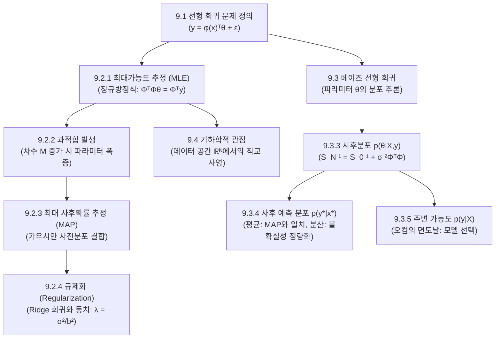

> **교재 범위**: Deisenroth, Faisal, Ong, *Mathematics for Machine Learning*(MML), pp. 289–316.  
> **선후수 연결 및 의존성**: 이 장은 지도학습(Supervised Learning)의 가장 기본이자 핵심인 연속값 함수 근사 문제를 다룹니다. 2~3장의 벡터 공간·기저·직교 사영(Orthogonal Projection), 5장의 행렬 미분과 경사도(Gradient), 6장의 가우시안 분포 및 베이즈 정리(Bayes' Theorem), 7장의 볼록 최적화(Convex Optimization) 기법이 결합하여 완성됩니다. 본 장에서 확립된 최대가능도(MLE)와 베이즈 추론(Bayesian Inference)의 틀은 10장(PCA), 11장(가우스 혼합 모델 GMM), 12장(서포트 벡터 머신 SVM)으로 이어지는 기계학습 핵심 모델의 토대가 됩니다.

---

## 0. 이 장 지도 (Roadmap)

선형 회귀(Linear Regression)는 입력 데이터 $x$와 목표값(타깃) $y$ 사이의 관계를 매개변수 $\theta$에 대해 선형인 함수로 모델링하는 기법입니다. 본 장의 핵심 흐름은 **"단순 최적화(MLE) $\to$ 과적합 문제 인식 $\to$ 확률적 사전 믿음 추가(MAP / 규제화) $\to$ 불확실성을 완전히 다루는 베이즈 추론(Bayesian Linear Regression) $\to$ 기하학적 본질(직교 사영) 규명"**\ 으로 발전합니다.

### 절 목록 및 핵심 요약

| 절 번호 | 절 제목 (영문) | 교재 쪽수 | 핵심 한 줄 요약 | 중요도 |
| :--- | :--- | :--- | :--- | :---: |
| **9.1** | 문제 정의 (Problem Formulation) | 291 | 입력 $x$와 노이즈가 낀 목표값 $y$ 사이의 선형 관계 $y = \phi(x)^\top \theta + \epsilon$ 모델 설정 | ★★☆ |
| **9.2** | 모수 추정 (Parameter Estimation) | 292 | 가능도(Likelihood)와 사후확률(Posterior)을 통한 최적 매개변수 점 추정(Point Estimation) | ★★★ |
| **9.2.1** | 최대가능도 추정 (Maximum Likelihood Estimation) | 293 | 음의 로그 가능도 최소화를 통한 최소제곱법 및 정규방정식(Normal Equation) 도출 | ★★★ |
| **9.2.2** | 선형 회귀에서의 과적합 (Overfitting in Linear Regression) | 298 | 복잡한 모델(고차 다항식)이 노이즈까지 암기하여 일반화 성능이 파괴되는 현상 | ★★☆ |
| **9.2.3** | 최대 사후확률 추정 (Maximum A Posteriori Estimation) | 300 | 가우시안 사전분포(Prior)를 결합하여 모수의 크기를 억제하는 MAP 추정 유도 | ★★★ |
| **9.2.4** | 규제화로서의 MAP (MAP Estimation as Regularization) | 302 | MAP 목적함수와 $L_2$ 능형 회귀(Ridge Regression) 손실함수의 완벽한 동치 증명 | ★★★ |
| **9.3** | 베이즈 선형 회귀 (Bayesian Linear Regression) | 303 | 모수를 단일 점이 아닌 확률분포 전체로 추론하여 예측 불확실성을 수치화 | ★★★ |
| **9.3.1** | 모델 (Model) | 304 | 공액(켤레) 가우시안 사전분포 $p(\theta)$와 우도 $p(y \mid x,\theta)$의 결합 모델 구성 | ★★☆ |
| **9.3.2** | 사전 예측 (Prior Predictions) | 304 | 데이터를 보기 전 모델이 예측하는 출력 분포 $p(y_* \mid x_*)$의 평균 및 분산 | ★★☆ |
| **9.3.3** | 사후 분포 (Posterior Distribution) | 306 | 베이즈 정리를 통해 데이터 관측 후 모수의 사후 가우시안 분포 $p(\theta \mid X, y)$ 유도 (Theorem 9.1) | ★★★ |
| **9.3.4** | 사후 예측 분포 (Posterior Predictions) | 308 | 사후분포를 적분 소거하여 새로운 점 $x_*$에서의 예측 분포 및 신뢰 구간 도출 | ★★★ |
| **9.3.5** | 주변 가능도 계산 (Computing the Marginal Likelihood) | 312 | 모수를 적분 소거한 데이터 생성 확률 $p(y \mid X)$을 계산하여 모델 복잡도 자동 조절 | ★★★ |
| **9.4** | 직교 사영으로서의 최대가능도 (ML as Orthogonal Projection) | 313 | $N$차원 타깃 벡터 공간에서 설계행렬의 열공간(Column Space)으로의 정사영 기하학 | ★★★ |
| **9.5** | 더 읽을거리 (Further Reading) | 315 | 비모수적 확장(가우스 과정, GP)과 비선형/희소 회귀(L1 LASSO)로의 연결 | ★☆☆ |

> **중요도 선정 근거**: 
> - **9.2.1, 9.2.3, 9.2.4, 9.4 (★★★)**: 행렬 미분, 정규방정식 계산, 릿지 회귀의 역행렬 유도, 직교 사영의 기하학은 머신러닝 기초 수학 전반에서 가장 빈번하게 계산과 증명을 요구하는 핵심 영역입니다.
> - **9.3.3, 9.3.4, 9.3.5 (★★★)**: 가우시안 사후분포 유도(제곱 완성법), 예측 불확실성 분해(인식론적 vs 우연적), 주변 가능도(Evidence) 계산은 고급 기계학습(11장 GMM, 가우스 과정, 베이지안 딥러닝)의 필수 관문입니다.
> - **9.1, 9.2.2, 9.3.1, 9.3.2 (★★☆)**: 모델 정의와 개념 이해를 위해 필수적인 징검다리 단계입니다.



---

## 9.1 문제 정의 (Problem Formulation, 291쪽)

### 왜 필요한가 (직관과 개념)
기계학습에서 지도학습(Supervised Learning)의 목표는 입력 변수 $x$로부터 연속적인 출력 변수 $y$를 예측하는 규칙(함수 $f$)을 찾는 것입니다. 이를 **회귀(Regression, 곡선 적합/Curve Fitting)**\ 라고 부릅니다.

현실 세계에서 우리가 관측하는 데이터는 결코 완벽하지 않습니다. 센서의 오차, 측정의 한계, 모델이 미처 고려하지 못한 무수한 환경적 요인으로 인해 항상 잡음(노이즈, noise)이 섞여 있습니다. 따라서 우리는 단순하게 관측된 점들을 선으로 잇는 것이 아니라, **"노이즈 뒤에 숨겨진 참된 시스템 함수 $f(x)$"**\ 를 복원해야 합니다.

```
[관측 데이터] (x₁, y₁), (x₂, y₂), ..., (x_N, y_N)
                 │
                 ▼
         y_n = f(x_n) + ε_n   (노이즈 ε_n이 섞여 있음)
                 │
                 ▼
[목표] 새로운 입력 x_*가 주어졌을 때 신뢰할 수 있는 y_* 예측하기
```

### 정의와 성질

#### 1. 기본 확률적 데이터 생성 모델
- **입력 데이터**: $x_n \in \mathbb{R}^D$ ($D$차원 입력 벡터, $n = 1, \dots, N$)
- **관측 목표값**: $y_n \in \mathbb{R}$ (스칼라 값)
- **노이즈 모델**: $\epsilon_n \sim \mathcal{N}(0, \sigma^2)$ (평균 0, 분산 $\sigma^2$을 갖는 독립동일분포(i.i.d.) 가우시안 노이즈)
- **관측 방정식**:
  $$y_n = f(x_n) + \epsilon_n$$
  노이즈가 평균이 0인 가우시안이므로, 입력 $x_n$이 주어졌을 때 목표값 $y_n$의 조건부 확률분포(우도, Likelihood)는 다음과 같습니다:
  $$p(y_n \mid x_n) = \mathcal{N}(y_n \mid f(x_n), \sigma^2)$$

#### 2. 선형 회귀 모델의 정의
교재에서 정의하는 선형 회귀 함수 $f$는 다음과 같습니다:
$$f(x) = x^\top \theta = \sum_{d=1}^D x_d \theta_d$$
여기서 $\theta \in \mathbb{R}^D$는 우리가 학습해야 할 모수(매개변수 벡터, parameter vector)입니다.

#### 3. 비선형 특징 변환(Non-linear Feature Transformation, $\phi(x)$)
입력 $x$와 출력 $y$ 사이의 관계가 직선(평면)이 아닌 곡선일 경우, 입력 벡터 $x$를 비선형 기저 함수(basis functions)를 통해 $K$차원 특징 공간으로 변환합니다:
$$\phi(x) = \begin{bmatrix} \phi_1(x) \\ \phi_2(x) \\ \vdots \\ \phi_K(x) \end{bmatrix} \in \mathbb{R}^K$$
이때 회귀 함수는 다음과 같이 확장됩니다:
$$f(x) = \phi(x)^\top \theta = \sum_{k=1}^K \phi_k(x) \theta_k$$

> **매우 중요한 포인트**: 기저 함수 $\phi(x)$가 $x$에 대해 비선형(예: $x^2, \sin(x), \exp(x)$)이라 할지라도, **함수 $f$는 모수 $\theta$에 대해서는 여전히 선형(Linear)**\ 입니다! 기계학습에서 '선형 회귀'라고 부르는 이유는 입력 $x$에 대해 선형이어서가 아니라, **미지의 모수 $\theta$에 대해 1차 결합(선형) 형태를 유지하기 때문**입니다. 이 성질 덕분에 최적의 $\theta$를 찾는 문제가 항상 해석적(닫힌 형태, closed-form)으로 풀리게 됩니다.

#### 4. 행렬 및 벡터 표기법 (Matrix Notation)
$N$개의 훈련 데이터를 수식으로 다루기 위해 행렬로 묶습니다:
- **목표값 벡터**: $y = \begin{bmatrix} y_1 \\ y_2 \\ \vdots \\ y_N \end{bmatrix} \in \mathbb{R}^N$
- **설계 행렬 (Design Matrix / Feature Matrix)**:
  $$\Phi = \begin{bmatrix} \phi(x_1)^\top \\ \phi(x_2)^\top \\ \vdots \\ \phi(x_N)^\top \end{bmatrix} = \begin{bmatrix} \phi_1(x_1) & \phi_2(x_1) & \dots & \phi_K(x_1) \\ \phi_1(x_2) & \phi_2(x_2) & \dots & \phi_K(x_2) \\ \vdots & \vdots & \ddots & \vdots \\ \phi_1(x_N) & \phi_2(x_N) & \dots & \phi_K(x_N) \end{bmatrix} \in \mathbb{R}^{N \times K}$$
- 특징 변환이 없는 표준 선형 회귀(절편 포함)의 경우, $\phi(x) = [1, x_1, \dots, x_D]^\top$이 되며 $\Phi \in \mathbb{R}^{N \times (D+1)}$이 됩니다.

---

### 손으로 풀어 보는 예제

**[문제]** 1차원 입력 데이터 3개 ($N=3$)가 주어졌습니다:
$$(x_1, y_1) = (0, 1), \quad (x_2, y_2) = (1, 3), \quad (x_3, y_3) = (2, 4)$$
절편(bias)을 포함하는 1차 직선 모델 $f(x) = \theta_0 + \theta_1 x$를 세우고자 합니다.
1. 특징 함수 벡터 $\phi(x)$를 정의하시오.
2. 설계 행렬 $\Phi$와 타깃 벡터 $y$를 숫자로 구체적으로 구성하시오.

**[풀이]**
1. 절편 $\theta_0$에 대응하는 상수를 1로 두고, 기울기 $\theta_1$에 대응하는 입력을 $x$로 두면:
   $$\phi(x) = \begin{bmatrix} 1 \\ x \end{bmatrix} \in \mathbb{R}^2, \quad \theta = \begin{bmatrix} \theta_0 \\ \theta_1 \end{bmatrix} \in \mathbb{R}^2$$
   따라서 $f(x) = \phi(x)^\top \theta = [1, x] \begin{bmatrix} \theta_0 \\ \theta_1 \end{bmatrix} = \theta_0 + \theta_1 x$가 성립합니다.

2. 데이터 $x_1 = 0, x_2 = 1, x_3 = 2$를 각각 대입하여 행 벡터로 쌓습니다:
   - $n=1$: $\phi(x_1)^\top = [1, 0]$
   - $n=2$: $\phi(x_2)^\top = [1, 1]$
   - $n=3$: $\phi(x_3)^\top = [1, 2]$

   따라서 설계 행렬 $\Phi$와 타깃 벡터 $y$는 다음과 같습니다:
   $$\Phi = \begin{bmatrix} 1 & 0 \\ 1 & 1 \\ 1 & 2 \end{bmatrix} \in \mathbb{R}^{3 \times 2}, \quad y = \begin{bmatrix} 1 \\ 3 \\ 4 \end{bmatrix} \in \mathbb{R}^3$$

---

### 헷갈리는 점 / 자주 하는 실수
1. **설계 행렬의 크기 혼동**: 행의 개수는 **데이터 샘플 수 $N$**\ 이고, 열의 개수는 **특징 차원 수 $K$** (또는 $D+1$)입니다. $N \times K$ 행렬임을 항상 명심해야 합니다. 전치 행렬 $\Phi^\top$은 $K \times N$입니다.
2. **선형성의 의미 왜곡**: "곡선을 표현하니까 비선형 회귀다"라고 생각하기 쉽습니다. 회귀 문제에서 선형/비선형을 판별하는 기준은 **입력 $x$가 아니라 모수 $\theta$**\ 입니다. $f(x) = \theta_1 x + \theta_2 x^2 + \theta_3 \sin(x)$는 $x$에 대해서는 매우 복잡한 비선형이지만, $\theta$에 대해서는 일차 결합이므로 명백한 선형 회귀입니다. 반면 $f(x) = \frac{1}{1 + e^{-\theta x}}$는 $\theta$에 대해 비선형이므로 비선형 모델입니다.


---

## 9.2 모수 추정 (Parameter Estimation, 292쪽)

주어진 훈련 데이터 $\mathcal{D} = \{(x_n, y_n)\}_{n=1}^N$에 가장 잘 들어맞는 모수 $\theta$를 어떻게 찾아낼 수 있을까요? 9.2절에서는 이를 해결하기 위해 두 가지 대표적인 점 추정(point estimation) 기법인 **최대가능도 추정(MLE)**\ 과 **최대 사후확률 추정(MAP)**\ 을 다룹니다.

---

### 9.2.1 최대가능도 추정법 (Maximum Likelihood Estimation, 293쪽)

#### 왜 필요한가 (직관과 개념)
"우리가 관측한 데이터 $y$가 나타날 확률(가능도, Likelihood)이 가장 높아지도록 모수 $\theta$를 설정하자"는 것이 최대가능도 추정의 기본 아이디어입니다.
노이즈가 평균 0인 정규분포(가우시안)를 따른다고 가정하면, 관측값 $y_n$이 모델의 예측값 $\phi(x_n)^\top \theta$에 가까울수록 확률밀도가 높아집니다. 따라서 모든 데이터 포인트에서 예측 오차의 제곱을 최소화하는 **최소제곱법(Least Squares Method)**\ 과 최대가능도 추정은 수학적으로 정확히 일치하게 됩니다.

```
       가능도(Likelihood) 최대화
               ▲
               │ (로그 취하고 부호 반전)
               ▼
   음의 로그 가능도(Negative Log-Likelihood) 최소화
               ▲
               │ (가우시안 노이즈 가정 하에서)
               ▼
      제곱 오차합(Sum of Squared Errors) 최소화
```

#### 정의와 성질

##### 1. 가능도 함수 (Likelihood Function)
모든 데이터 포인트 $(x_n, y_n)$가 독립적으로 생성되었다고 가정(i.i.d.)하면, 전체 데이터셋 $Y = [y_1, \dots, y_N]^\top$의 결합 우도는 각 점 우도의 곱입니다:
$$p(Y \mid X, \theta) = \prod_{n=1}^N p(y_n \mid x_n, \theta) = \prod_{n=1}^N \mathcal{N}(y_n \mid \phi(x_n)^\top \theta, \sigma^2)$$

이를 $N$차원 다변량 정규분포로 한 번에 표현하면:
$$p(Y \mid X, \theta) = \mathcal{N}(y \mid \Phi \theta, \sigma^2 I_N)$$
- 평균 벡터: $\Phi \theta \in \mathbb{R}^N$ (모델의 예측값 벡터 $\hat{y}$)
- 공분산 행렬: $\sigma^2 I_N \in \mathbb{R}^{N \times N}$ (모든 데이터 포인트의 노이즈가 독립이고 동일한 분산 $\sigma^2$을 가짐)

##### 2. 음의 로그 가능도 (Negative Log-Likelihood, NLL)
곱셈으로 이루어진 가능도 함수를 미분하기 편하게 만들기 위해 자연로그를 취하고 부호를 바꿉니다(로그는 단조 증가 함수이므로 최적화 위치는 변하지 않습니다):
$$\mathcal{L}(\theta) = -\log p(Y \mid X, \theta) = -\log \left( (2\pi \sigma^2)^{-\frac{N}{2}} \exp\left( -\frac{1}{2\sigma^2} (y - \Phi\theta)^\top (y - \Phi\theta) \right) \right)$$
$$= \frac{N}{2} \log(2\pi\sigma^2) + \frac{1}{2\sigma^2} \|y - \Phi\theta\|^2$$

여기서 $\theta$에 무관한 상수항과 양수 계수 $\frac{1}{2\sigma^2}$을 제외하면, 최대가능도 추정은 오차의 $L_2$ 노름 제곱을 최소화하는 최소제곱 문제로 귀결됩니다:
$$\theta_{ML} = \arg\min_\theta \|y - \Phi\theta\|^2 = \arg\min_\theta (y - \Phi\theta)^\top (y - \Phi\theta)$$

##### 3. 경사도(Gradient)와 정규방정식 (Normal Equation)
목적함수를 $\theta$에 대해 행렬 미분합니다:
$$\mathcal{L}(\theta) = \frac{1}{2\sigma^2} \left( y^\top y - 2 y^\top \Phi \theta + \theta^\top \Phi^\top \Phi \theta \right) + \text{상수}$$
$$\nabla_\theta \mathcal{L}(\theta) = \frac{1}{\sigma^2} \left( \Phi^\top \Phi \theta - \Phi^\top y \right)$$

최적점에서는 경사도가 영벡터($0$)가 되어야 하므로:
$$\Phi^\top \Phi \theta - \Phi^\top y = 0 \iff \Phi^\top \Phi \theta = \Phi^\top y$$
이 방정식을 **정규방정식(Normal Equation)**\ 이라고 부릅니다.

$\Phi^\top \Phi \in \mathbb{R}^{K \times K}$가 가역 행렬(역행렬이 존재)인 경우, 유일한 해석적 해가 도출됩니다:
$$\theta_{ML} = (\Phi^\top \Phi)^{-1} \Phi^\top y$$

##### 4. 노이즈 분산 $\sigma^2$의 최대가능도 추정
NLL을 $\sigma^2$에 대해 편미분하여 0으로 두면:
$$\frac{\partial \mathcal{L}}{\partial \sigma^2} = \frac{N}{2\sigma^2} - \frac{1}{2(\sigma^2)^2} \|y - \Phi\theta\|^2 = 0$$
$$\sigma_{ML}^2 = \frac{1}{N} \|y - \Phi\theta_{ML}\|^2 = \frac{1}{N} \sum_{n=1}^N (y_n - \phi(x_n)^\top \theta_{ML})^2$$
즉, 최적 모델의 잔차 제곱 평균(MSE)이 곧 노이즈 분산의 MLE 추정량입니다.

---

#### 손으로 풀어 보는 예제

앞선 9.1절의 3개 데이터 포인트를 그대로 사용해 $\theta_{ML}$을 손으로 끝까지 구해봅시다:
$$\Phi = \begin{bmatrix} 1 & 0 \\ 1 & 1 \\ 1 & 2 \end{bmatrix}, \quad y = \begin{bmatrix} 1 \\ 3 \\ 4 \end{bmatrix}$$

**[1단계: $\Phi^\top \Phi$ 계산]**
$$\Phi^\top = \begin{bmatrix} 1 & 1 & 1 \\ 0 & 1 & 2 \end{bmatrix}$$
$$\Phi^\top \Phi = \begin{bmatrix} 1 & 1 & 1 \\ 0 & 1 & 2 \end{bmatrix} \begin{bmatrix} 1 & 0 \\ 1 & 1 \\ 1 & 2 \end{bmatrix} = \begin{bmatrix} 1+1+1 & 0+1+2 \\ 0+1+2 & 0+1+4 \end{bmatrix} = \begin{bmatrix} 3 & 3 \\ 3 & 5 \end{bmatrix}$$

**[2단계: 역행렬 $(\Phi^\top \Phi)^{-1}$ 계산]**
행렬식(determinant): $\det(\Phi^\top \Phi) = (3)(5) - (3)(3) = 15 - 9 = 6 \neq 0$ (역행렬 존재)
$$(\Phi^\top \Phi)^{-1} = \frac{1}{6} \begin{bmatrix} 5 & -3 \\ -3 & 3 \end{bmatrix}$$

**[3단계: $\Phi^\top y$ 계산]**
$$\Phi^\top y = \begin{bmatrix} 1 & 1 & 1 \\ 0 & 1 & 2 \end{bmatrix} \begin{bmatrix} 1 \\ 3 \\ 4 \end{bmatrix} = \begin{bmatrix} 1 + 3 + 4 \\ 0 + 3 + 8 \end{bmatrix} = \begin{bmatrix} 8 \\ 11 \end{bmatrix}$$

**[4단계: $\theta_{ML}$ 곱셈 계산]**
$$\theta_{ML} = (\Phi^\top \Phi)^{-1} \Phi^\top y = \frac{1}{6} \begin{bmatrix} 5 & -3 \\ -3 & 3 \end{bmatrix} \begin{bmatrix} 8 \\ 11 \end{bmatrix} = \frac{1}{6} \begin{bmatrix} (5)(8) + (-3)(11) \\ (-3)(8) + (3)(11) \end{bmatrix} = \frac{1}{6} \begin{bmatrix} 40 - 33 \\ -24 + 33 \end{bmatrix} = \frac{1}{6} \begin{bmatrix} 7 \\ 9 \end{bmatrix} = \begin{bmatrix} 7/6 \\ 3/2 \end{bmatrix}$$
따라서 최적의 선형 함수는 $f(x) = \frac{7}{6} + \frac{3}{2}x$ ($y \approx 1.167 + 1.5x$) 입니다.

**[5단계: 예측값 $\hat{y}$, 잔차 $e$, 노이즈 분산 $\sigma_{ML}^2$ 계산]**
$$\hat{y} = \Phi \theta_{ML} = \begin{bmatrix} 1 & 0 \\ 1 & 1 \\ 1 & 2 \end{bmatrix} \begin{bmatrix} 7/6 \\ 9/6 \end{bmatrix} = \begin{bmatrix} 7/6 \\ 16/6 \\ 25/6 \end{bmatrix}$$
잔차 벡터 $e = y - \hat{y}$:
$$e = \begin{bmatrix} 1 \\ 3 \\ 4 \end{bmatrix} - \begin{bmatrix} 7/6 \\ 16/6 \\ 25/6 \end{bmatrix} = \begin{bmatrix} 6/6 - 7/6 \\ 18/6 - 16/6 \\ 24/6 - 25/6 \end{bmatrix} = \begin{bmatrix} -1/6 \\ 2/6 \\ -1/6 \end{bmatrix} = \frac{1}{6} \begin{bmatrix} -1 \\ 2 \\ -1 \end{bmatrix}$$

노이즈 분산 추정량:
$$\sigma_{ML}^2 = \frac{1}{3} \|e\|^2 = \frac{1}{3} \cdot \frac{1}{36} \left( (-1)^2 + 2^2 + (-1)^2 \right) = \frac{1}{3} \cdot \frac{6}{36} = \frac{1}{18} \approx 0.0556$$

---

#### 헷갈리는 점 / 자주 하는 실수
1. **$\Phi^\top \Phi$가 가역이 아닌 경우**:
   - 데이터 수 $N$보다 특징 차원 $K$가 더 큰 경우 ($N < K$), $\Phi$의 계수(rank)는 최대 $N$이므로 $K \times K$ 행렬인 $\Phi^\top \Phi$의 계수도 최대 $N < K$가 되어 **특이 행렬(Singular Matrix, 행렬식이 0)**\ 이 됩니다.
   - 이때는 정규방정식의 해가 무수히 많아지며, $(\Phi^\top \Phi)^{-1}$을 직접 구할 수 없습니다 (무어-펜로즈 유사역행렬 사용 필요).
2. **행렬 미분의 전치 기호 주의**:
   MML은 스칼라를 벡터로 미분한 결과를 **행벡터**로 쓴다(5장). 그래서 교재 식 (9.11)은 $\frac{d\mathcal{L}}{d\theta}=\frac{1}{\sigma^2}\left(-y^\top\Phi+\theta^\top\Phi^\top\Phi\right)\in\mathbb{R}^{1\times K}$이다. 이 해설은 보기 편하게 전치한 열벡터로 썼다. 어느 쪽이든 0으로 두면 같은 정규방정식 $\Phi^\top\Phi\theta=\Phi^\top y$가 나온다.

---

### 9.2.2 선형 회귀에서의 과적합 (Overfitting in Linear Regression, 298쪽)

#### 왜 필요한가 (직관과 개념)
다항 회귀(Polynomial Regression)에서 기저 함수를 $\phi(x) = [1, x, x^2, \dots, x^M]^\top$로 설정하면, 차수 $M$이 커질수록 모델이 표현할 수 있는 함수의 유연성(expressive power)이 급격히 증가합니다.
- $M$이 너무 작으면: 데이터의 진정한 곡선 패턴을 잡아내지 못함 (**과소적합, Underfitting**)
- $M$이 데이터 수 $N$에 육박하면: 데이터에 포함된 무작위 노이즈 하나하나까지 완벽하게 통과하려고 함수가 요동침 (**과적합, Overfitting**)

```
        Underfitting (M=0,1)      Good Fit (M=3)        Overfitting (M=9)
               y                        y                      y
               │     /                  │     ╭─╮              │   ╭╮  ╭╮
               │    /                   │    ╭╯ ╰╮             │  ╭╯╰╮╭╯╰╮
               │   /                    │   ╭╯   ╰╮            │ ╭╯  ╰╯  ╰╮
               └──/───── x              └───╯─────╰── x        └──╯───────╰── x
          오차가 매우 큼            진짜 함수를 복원         훈련 오차=0, 시험 오차=폭망
```

#### 정의와 성질
1. **훈련 오차(Training Error)와 시험 오차(Test Error)의 괴리**:
   - 차수 $M$이 증가할수록 훈련 데이터에 대한 제곱 오차 $E_{train} = \frac{1}{2}\|y - \Phi\theta\|^2$는 단조 감소하여, $M = N-1$이 되면 $0$이 됩니다.
   - 그러나 훈련에 사용되지 않은 새로운 입력 $x_*$에 대한 일반화 오차(Generalization/Test Error)는 특정 차수를 넘어서는 순간 기하급수적으로 폭증합니다.
2. **모수 크기(Parameter Magnitude)의 폭발**:
   - 과적합이 일어날 때 발생하는 가장 결정적인 징후는 **모수 벡터 $\theta$의 절댓값(노름 $\|\theta\|_2$)이 비정상적으로 거대해진다**는 점입니다.
   - 인접한 데이터 포인트 사이의 아주 미세한 노이즈 차이를 맞추기 위해, 거대한 양수 계수와 거대한 음수 계수가 서로 아슬아슬하게 상쇄되면서 극단적인 진동을 만들어냅니다.

---

### 9.2.3 최대 사후확률 추정법 (Maximum A Posteriori Estimation, 300쪽)

#### 왜 필요한가 (직관과 개념)
MLE는 데이터에만 전적으로 의존하기 때문에 데이터가 적거나 모델이 복잡하면 과적합에 무방비로 노출됩니다.
"자연스러운 물리계나 일반적인 현상에서 회귀 계수 $\theta$가 수십만, 수백만 같은 극단적인 값을 가질 리 없다. $\theta$는 0 주변의 작은 값일 가능성이 높다"는 **사전 지식(사전 믿음, Prior Belief)**\ 을 수학적으로 모델에 부여하는 방법이 바로 **최대 사후확률 추정(MAP)**\ 입니다.

#### 정의와 성질

##### 1. 베이즈 정리와 사후확률 (Posterior)
모수 $\theta$의 사후확률분포 $p(\theta \mid X, Y)$는 가능도와 사전분포의 곱에 비례합니다:
$$p(\theta \mid X, Y) = \frac{p(Y \mid X, \theta) p(\theta)}{p(Y \mid X)} \propto p(Y \mid X, \theta) p(\theta)$$
- **사전분포 $p(\theta)$**: 데이터를 관측하기 전에 모수에 대해 갖는 믿음. 교재에서는 평균 0, 분산 $b^2$을 갖는 등방성(isotropic) 가우시안 사전분포를 채택합니다:
  $$p(\theta) = \mathcal{N}(\theta \mid 0, b^2 I) = (2\pi b^2)^{-\frac{K}{2}} \exp\left( -\frac{1}{2b^2} \theta^\top \theta \right)$$
- **MAP 추정량의 정의**: 사후확률 밀도를 최대화(음의 로그 사후확률을 최소화)하는 모수:
  $$\theta_{MAP} = \arg\max_\theta p(\theta \mid X, Y) = \arg\min_\theta \left\{ -\log p(Y \mid X, \theta) - \log p(\theta) \right\}$$

##### 2. 음의 로그 사후확률의 최소화
$$-\log p(\theta \mid X, Y) = \frac{1}{2\sigma^2} (y - \Phi\theta)^\top (y - \Phi\theta) + \frac{1}{2b^2} \theta^\top \theta + \text{상수}$$
양변에 $\sigma^2$을 곱해 정리하면 다음과 같은 목적함수를 최소화하는 것과 같습니다:
$$J_{MAP}(\theta) = \frac{1}{2} \|y - \Phi\theta\|^2 + \frac{\sigma^2}{2b^2} \|\theta\|^2$$

##### 3. 경사도 및 MAP 닫힌 형태 해 도출
목적함수를 $\theta$에 대해 미분하여 0으로 둡니다:
$$\nabla_\theta J_{MAP}(\theta) = \Phi^\top (\Phi\theta - y) + \frac{\sigma^2}{b^2} \theta = 0$$
$$\left( \Phi^\top \Phi + \frac{\sigma^2}{b^2} I \right) \theta = \Phi^\top y$$

따라서 MAP 추정량은 다음과 같습니다:
$$\theta_{MAP} = \left( \Phi^\top \Phi + \frac{\sigma^2}{b^2} I \right)^{-1} \Phi^\top y$$

> **수학적 보장**: 만약 $b^2 > 0, \sigma^2 > 0$이면, 대칭 양의 준정부호(positive semi-definite) 행렬인 $\Phi^\top \Phi$에 양의 대각행렬 $\frac{\sigma^2}{b^2} I$가 더해지므로, **결과 행렬은 항상 엄격한 양의 정부호(strictly positive definite) 행렬이 되어 언제나 역행렬이 존재**합니다! 즉, $N < K$인 경우에도 MAP 해는 유일하게 안정적으로 계산됩니다.

---

### 9.2.4 규제화 관점에서의 MAP 추정 (MAP Estimation as Regularization, 302쪽)

#### 왜 필요한가 (직관과 개념)
통계학과 기계학습의 최적화 이론에서는 과적합을 막기 위해 손실함수에 가중치 크기에 대한 페널티 항을 인위적으로 더해주는 **규제화(Regularization)** 기법을 오랫동안 사용해 왔습니다. 9.2.4절은 이 순수 최적화적 기법이 확률론적 MAP 추정과 완벽하게 동일한 것임을 보여줍니다.

#### 정의와 성질

##### 1. 정규화 최소제곱법 (Regularized Least Squares / Ridge Regression)
손실함수는 데이터 적합도(오차) 항과 정규화 항(페널티)의 합으로 구성됩니다:
$$J_{RLS}(\theta) = \frac{1}{2} \|y - \Phi\theta\|^2 + \frac{\lambda}{2} \|\theta\|_2^2$$
- 첫 번째 항: **데이터 부적합도(Misfit term)** — 훈련 데이터를 얼마나 잘 맞추는가
- 두 번째 항: **정규화기(Regularizer)** — 모수 벡터의 크기를 작게 유지하도록 강제
- $\lambda \ge 0$: **정규화 강도(Regularization parameter / 하이퍼파라미터)**

이를 미분하여 구한 해는:
$$\theta_{RLS} = (\Phi^\top \Phi + \lambda I)^{-1} \Phi^\top y$$

##### 2. MAP와 능형 회귀(Ridge)의 동치성
MAP 추정량과 능형 회귀의 해를 비교하면 정확히 다음 관계가 성립함을 알 수 있습니다:
$$\lambda = \frac{\sigma^2}{b^2} = \frac{\text{관측 노이즈 분산}}{\text{사전 모수 분산}}$$
- 노이즈 $\sigma^2$이 클수록 $\to$ 관측 데이터를 덜 믿어야 하므로 규제 강도 $\lambda$를 높임
- 사전 믿음의 분산 $b^2$이 작을수록(모수가 0에 가깝다는 확신이 강할수록) $\to \lambda$를 높여 0으로 강하게 수축시킴
- 사전 믿음이 전혀 없으면 ($b^2 \to \infty$) $\to \lambda \to 0$이 되어 $\theta_{MAP} = \theta_{ML}$ (MLE로 복귀)

##### 3. L1 규제 (LASSO)와 라플라스 사전분포 (Laplace Prior) (교재 9.5절 및 보충)
정규화 항을 $L_2$ 노름 대신 $L_1$ 노름 $\|\theta\|_1 = \sum |\theta_k|$로 바꾸면 **라쏘(LASSO)**\ 가 됩니다:
$$J_{LASSO}(\theta) = \frac{1}{2} \|y - \Phi\theta\|^2 + \lambda \|\theta\|_1$$
확률론적으로 이는 모수의 사전분포를 가우시안 대신 **라플라스 분포(Laplace Distribution)**\ 로 설정한 MAP 추정과 완전히 동치입니다:
$$p(\theta) = \prod_{k=1}^K \frac{1}{2b} \exp\left( -\frac{|\theta_k|}{b} \right) \implies -\log p(\theta) = \frac{1}{b} \|\theta\|_1 + \text{상수}$$
라플라스 분포는 0 지점에서 뾰족한 첨점(모서리)을 가지므로, 최적화 과정에서 불필요한 가중치를 정확히 $0$으로 만들어 **희소성(Sparsity)**\ 과 **자동 변수 선택(Variable Selection)** 효과를 낳습니다.

---

#### 손으로 풀어 보는 예제

앞선 예제 ($\Phi^\top \Phi = \begin{bmatrix} 3 & 3 \\ 3 & 5 \end{bmatrix}, \Phi^\top y = \begin{bmatrix} 8 \\ 11 \end{bmatrix}$)에서, 노이즈 분산 $\sigma^2 = 1$, 사전분포 분산 $b^2 = 1$ ($\lambda = \sigma^2/b^2 = 1$)로 설정하고 $\theta_{MAP}$을 손으로 계산해 봅시다.

**[1단계: $(\Phi^\top \Phi + \lambda I)$ 계산]**
$$\Phi^\top \Phi + \lambda I = \begin{bmatrix} 3 & 3 \\ 3 & 5 \end{bmatrix} + \begin{bmatrix} 1 & 0 \\ 0 & 1 \end{bmatrix} = \begin{bmatrix} 4 & 3 \\ 3 & 6 \end{bmatrix}$$

**[2단계: 역행렬 계산]**
$$\det = (4)(6) - (3)(3) = 24 - 9 = 15$$
$$(\Phi^\top \Phi + I)^{-1} = \frac{1}{15} \begin{bmatrix} 6 & -3 \\ -3 & 4 \end{bmatrix}$$

**[3단계: $\theta_{MAP}$ 계산]**
$$\theta_{MAP} = \frac{1}{15} \begin{bmatrix} 6 & -3 \\ -3 & 4 \end{bmatrix} \begin{bmatrix} 8 \\ 11 \end{bmatrix} = \frac{1}{15} \begin{bmatrix} (6)(8) + (-3)(11) \\ (-3)(8) + (4)(11) \end{bmatrix} = \frac{1}{15} \begin{bmatrix} 48 - 33 \\ -24 + 44 \end{bmatrix} = \frac{1}{15} \begin{bmatrix} 15 \\ 20 \end{bmatrix} = \begin{bmatrix} 1 \\ 4/3 \end{bmatrix} \approx \begin{bmatrix} 1.000 \\ 1.333 \end{bmatrix}$$

**[비교 및 분석]**
- 최대가능도 추정량: $\theta_{ML} = \begin{bmatrix} 7/6 \\ 3/2 \end{bmatrix} \approx \begin{bmatrix} 1.167 \\ 1.500 \end{bmatrix}$
- MAP (능형 회귀) 추정량: $\theta_{MAP} = \begin{bmatrix} 1.000 \\ 1.333 \end{bmatrix}$
- 사전분포가 모수를 0 방향으로 끌어당김으로써 두 계수가 모두 작아진 것(**수축, Shrinkage**)을 두 눈으로 똑똑히 확인할 수 있습니다!


---

## 9.3 베이즈 선형 회귀 (Bayesian Linear Regression, 303쪽)

MLE와 MAP는 최적의 모수 $\theta$를 단 하나의 점(point estimate)으로 찾습니다. 하지만 다음과 같은 실전 상황을 상상해 보십시오:
- 훈련 데이터가 5개밖에 없는 영역과, 훈련 데이터가 10,000개나 몰려 있는 영역에서 모델의 예측값 $\hat{y}$이 동일하게 $3.5$로 나왔다면, 우리는 두 예측을 똑같이 신뢰할 수 있을까요?
- 당연히 데이터가 5개뿐인 영역의 예측은 매우 불확실합니다.

**베이즈 접근법(Bayesian Approach)**\ 은 미지의 모수 $\theta$를 단일 상수가 아닌 **확률 변수(random variable)**\ 로 취급합니다. 데이터 관측을 통해 $\theta$의 확률분포 전체를 갱신(사후분포)하고, 새로운 입력을 예측할 때도 단 하나의 숫자가 아니라 **"예측값의 평균과 그 예측이 얼마나 불확실한지 나타내는 분산(신뢰 구간)"**\ 을 통째로 제공합니다.

---

### 9.3.1 모델 설정 (Model, 304쪽)

#### 정의와 성질
1. **모수 사전분포 (Parameter Prior)**:
   모수 $\theta \in \mathbb{R}^K$에 대한 사전 지식을 일반적인 다변량 가우시안 분포로 설정합니다:
   $$p(\theta) = \mathcal{N}(\theta \mid m_0, S_0)$$
   - $m_0 \in \mathbb{R}^K$: 사전 평균 벡터 (사전 지식이 없으면 보통 $0$)
   - $S_0 \in \mathbb{R}^{K \times K}$: 사전 공분산 행렬 (보통 $b^2 I$ 등 대칭 양의 정부호 행렬)

2. **관측 가능도 (Likelihood)**:
   주어진 모수 $\theta$ 하에서 관측치 $y$의 조건부 분포:
   $$p(y \mid x, \theta) = \mathcal{N}(y \mid \phi(x)^\top \theta, \sigma^2)$$

3. **결합 분포 (Joint Distribution)**:
   $$p(y, \theta \mid x) = p(y \mid x, \theta) p(\theta)$$

---

### 9.3.2 사전 예측 (Prior Predictions, 304쪽)

#### 왜 필요한가 (직관)
훈련 데이터를 한 개도 보기 전에, 우리가 가정한 사전분포 $p(\theta)$만으로 모델이 어떤 예측값들을 출력할 수 있는지 확인하는 단계입니다. 사전분포에서 $\theta$를 무작위로 여러 개 샘플링하여 함수 선 $f(x) = \phi(x)^\top \theta$들을 그려보면 모델의 사전 가정이 합리적인지 시각적으로 검증할 수 있습니다.

#### 정의와 유도
새로운 입력 위치 $x_*$에서의 타깃 값 $y_*$의 사전 예측 분포는 모수 $\theta$에 대해 적분 소거(marginalize out)하여 구합니다:
$$p(y_* \mid x_*) = \int p(y_* \mid x_*, \theta) p(\theta) \, d\theta = \mathbb{E}_\theta \left[ p(y_* \mid x_*, \theta) \right]$$

이 적분은 가우시안 분포의 선형 변환 규칙을 사용하면 복잡한 적분 계산 없이 즉시 풀립니다:
- $y_* = \phi(x_*)^\top \theta + \epsilon$, 여기서 $\theta \sim \mathcal{N}(m_0, S_0)$이고 $\epsilon \sim \mathcal{N}(0, \sigma^2)$ (독립)
- **기댓값**:
  $$\mathbb{E}[y_* \mid x_*] = \mathbb{E}_\theta [\phi(x_*)^\top \theta] + \mathbb{E}[\epsilon] = \phi(x_*)^\top m_0 + 0 = \phi(x_*)^\top m_0$$
- **분산**:
  $$\mathbb{V}[y_* \mid x_*] = \mathbb{V}_\theta [\phi(x_*)^\top \theta] + \mathbb{V}[\epsilon] = \phi(x_*)^\top S_0 \phi(x_*) + \sigma^2$$

따라서 사전 예측 분포는 다음과 같은 단변량 가우시안 분포가 됩니다:
$$p(y_* \mid x_*) = \mathcal{N}\left( y_* \;\middle|\; \phi(x_*)^\top m_0, \; \phi(x_*)^\top S_0 \phi(x_*) + \sigma^2 \right)$$

관측 노이즈 $\epsilon$을 제외한 순수 잠재 함수 값 $f(x_*) = \phi(x_*)^\top \theta$의 사전 분포는 단순히 노이즈 분산 $\sigma^2$만 빠진 형태입니다:
$$p(f(x_*)) = \mathcal{N}\left( f(x_*) \;\middle|\; \phi(x_*)^\top m_0, \; \phi(x_*)^\top S_0 \phi(x_*) \right)$$

---

### 9.3.3 사후 분포 (Posterior Distribution, 306쪽)

데이터셋 $\mathcal{D} = (X, Y)$를 관측한 후, 모수 $\theta$의 사후 확률분포 $p(\theta \mid X, Y)$를 베이즈 정리로 계산합니다.

$$\text{Posterior} = \frac{\text{Likelihood} \times \text{Prior}}{\text{Marginal Likelihood}} \iff p(\theta \mid X, Y) = \frac{p(Y \mid X, \theta) p(\theta)}{p(Y \mid X)}$$

가우시안 우도와 가우시안 사전분포는 서로 **켤레(Conjugate)** 관계에 있으므로, 사후분포 역시 **다변량 가우시안 분포**가 됩니다.

> **정리 9.1 (모수 사후분포, Parameter Posterior)**  
> 선형 회귀 모델에서 사전분포 $p(\theta) = \mathcal{N}(m_0, S_0)$와 우도 $p(Y \mid X, \theta) = \mathcal{N}(y \mid \Phi\theta, \sigma^2 I)$가 주어졌을 때, 모수의 사후분포는 닫힌 형태의 가우시안 분포로 계산된다:
> $$p(\theta \mid X, Y) = \mathcal{N}(\theta \mid m_N, S_N)$$
> 여기서 사후 공분산 행렬 $S_N$과 사후 평균 벡터 $m_N$은 다음과 같다:
> $$S_N^{-1} = S_0^{-1} + \sigma^{-2} \Phi^\top \Phi \iff S_N = \left( S_0^{-1} + \sigma^{-2} \Phi^\top \Phi \right)^{-1}$$
> $$m_N = S_N \left( S_0^{-1} m_0 + \sigma^{-2} \Phi^\top y \right)$$

#### 제곱 완성법(Completing the Square)에 의한 증명 스케치
지수 함수 내부의 $\theta$에 대한 2차식들을 모읍니다:
$$\log p(\theta \mid X, Y) = -\frac{1}{2} \left[ \sigma^{-2} (y - \Phi\theta)^\top (y - \Phi\theta) + (\theta - m_0)^\top S_0^{-1} (\theta - m_0) \right] + \text{상수}$$
괄호 안을 전개하여 $\theta$에 대한 2차항과 1차항으로 정리합니다:
$$= -\frac{1}{2} \left[ \theta^\top \left( \sigma^{-2} \Phi^\top \Phi + S_0^{-1} \right) \theta - 2 \theta^\top \left( \sigma^{-2} \Phi^\top y + S_0^{-1} m_0 \right) \right] + \text{상수}$$

일반적인 다변량 가우시안 $\mathcal{N}(\theta \mid m_N, S_N)$의 로그 확률밀도는 다음과 같습니다:
$$\log \mathcal{N}(\theta \mid m_N, S_N) = -\frac{1}{2} \left[ \theta^\top S_N^{-1} \theta - 2 \theta^\top S_N^{-1} m_N + m_N^\top S_N^{-1} m_N \right] + \text{상수}$$

두 식의 2차 계수와 1차 계수를 항등식으로 직접 비교(matching coefficients)하면:
- **2차항 계수 매칭**: $S_N^{-1} = S_0^{-1} + \sigma^{-2} \Phi^\top \Phi$
- **1차항 계수 매칭**: $S_N^{-1} m_N = S_0^{-1} m_0 + \sigma^{-2} \Phi^\top y \implies m_N = S_N (S_0^{-1} m_0 + \sigma^{-2} \Phi^\top y)$  
증명이 완벽하게 끝납니다. (상세 유도는 본 문서 후반의 '핵심 유도 모음' 참조)

> **직관적 해석 (정밀도 행렬, Precision Matrix)**:  
> 공분산의 역행렬을 **정밀도(Precision)**\ 라고 부릅니다.
> - 사후 정밀도($S_N^{-1}$) = 사전 정밀도($S_0^{-1}$) + 데이터가 제공한 정밀도($\sigma^{-2}\Phi^\top\Phi$)
> - 사후 정밀도 가중 평균($S_N^{-1} m_N$) = 사전 정보($S_0^{-1} m_0$) + 데이터 정보($\sigma^{-2}\Phi^\top y$)  
> 즉, 베이즈 추론은 기존의 지식에 데이터가 주는 정보를 단순 덧셈으로 누적하는 과정입니다!

---

### 9.3.4 사후 예측 분포 (Posterior Predictions, 308쪽)

#### 왜 필요한가
새로운 테스트 입력 $x_*$가 주어졌을 때, 갱신된 모수 사후분포 $p(\theta \mid X, Y)$를 바탕으로 $y_*$의 분포를 예측합니다.

#### 정의와 성질
$$p(y_* \mid X, Y, x_*) = \int p(y_* \mid x_*, \theta) \, p(\theta \mid X, Y) \, d\theta$$

이 역시 두 가우시안 분포의 선형 결합이므로 즉시 닫힌 형태가 됩니다:
- $y_* = \phi(x_*)^\top \theta + \epsilon$, 여기서 $\theta \sim \mathcal{N}(m_N, S_N)$, $\epsilon \sim \mathcal{N}(0, \sigma^2)$
- **사후 예측 평균**:
  $$\mathbb{E}[y_* \mid X, Y, x_*] = \phi(x_*)^\top m_N$$
- **사후 예측 분산**:
  $$\sigma_N^2(x_*) = \mathbb{V}[y_* \mid X, Y, x_*] = \underbrace{\phi(x_*)^\top S_N \phi(x_*)}_{\text{인식론적 불확실성 (Epistemic)}} + \underbrace{\sigma^2}_{\text{우연적 불확실성 (Aleatoric)}}$$

따라서 사후 예측 분포는:
$$p(y_* \mid X, Y, x_*) = \mathcal{N}\left( y_* \;\middle|\; \phi(x_*)^\top m_N, \; \phi(x_*)^\top S_N \phi(x_*) + \sigma^2 \right)$$

```
                         예측 분산 σ_N²(x_*)의 구성
               ┌───────────────────────┬───────────────────────┐
               │ 인식론적 불확실성     │ 우연적 불확실성       │
               │ φ(x_*)ᵀ S_N φ(x_*)    │ σ²                    │
├──────────────┼───────────────────────┼───────────────────────┤
│ 원인         │ 데이터 부족, 모델 모수│ 관측 기기 오차,       │
│              │ 에 대한 무지          │ 데이터 자체의 고유 잡음│
├──────────────┼───────────────────────┼───────────────────────┤
│ 데이터 N 증가│ N → ∞ 이면 S_N → 0    │ 불변 (줄어들지 않음)  │
│ 시 변화      │ (0으로 사라짐)        │                       │
├──────────────┼───────────────────────┼───────────────────────┤
│ 공간적 특성  │ 데이터가 많은 곳: 작음│ 모든 입력 영역에서    │
│              │ 외삽(데이터 없는 곳): 큼│ 일정함                │
└──────────────┴───────────────────────┴───────────────────────┘
```

> **MAP와의 놀라운 연결**: 사전분포를 $m_0 = 0, S_0 = b^2 I$로 두면, 사후 예측 평균 $\phi(x_*)^\top m_N$은 앞서 유도한 MAP 추정량의 예측값 $\phi(x_*)^\top \theta_{MAP}$과 **수학적으로 완전히 일치**합니다! 즉, MAP는 베이즈 선형 회귀에서 사후 예측 분포의 '중심(평균)'만 똑 떼어내어 점 추정한 것입니다.

---

### 9.3.5 주변 가능도 계산 및 모델 선택 (Computing the Marginal Likelihood, 312쪽)

#### 왜 필요한가 (오컴의 면도날)
다항 회귀에서 차수 $M$을 몇 차로 정해야 할까요? MLE는 차수가 높을수록 무조건 훈련 데이터 오차가 0이 되므로 항상 가장 복잡한 모델을 선택하는 치명적인 결함이 있습니다.
베이즈 추론에서는 모수를 적분 소거한 **주변 가능도(Marginal Likelihood / Model Evidence)** $p(Y \mid X)$를 계산함으로써, **별도의 검증 데이터(Validation Set)나 교차 검증(Cross Validation) 없이도 훈련 데이터만으로 모델의 복잡도를 자동으로 통제**할 수 있습니다.

#### 정의와 계산
$$p(Y \mid X) = \int p(Y \mid X, \theta) p(\theta) \, d\theta$$
선형 가우시안 시스템의 성질 $Y = \Phi \theta + \epsilon$, $\theta \sim \mathcal{N}(m_0, S_0)$, $\epsilon \sim \mathcal{N}(0, \sigma^2 I)$을 적용하면:
$$p(Y \mid X) = \mathcal{N}(y \mid \Phi m_0, \; \Phi S_0 \Phi^\top + \sigma^2 I)$$

로그 주변 가능도를 전개하면 3개의 직관적인 항으로 분해됩니다:
$$\log p(Y \mid X) = -\frac{1}{2} (y - \Phi m_0)^\top (\Phi S_0 \Phi^\top + \sigma^2 I)^{-1} (y - \Phi m_0) - \frac{1}{2} \log \det(\Phi S_0 \Phi^\top + \sigma^2 I) - \frac{N}{2} \log(2\pi)$$
1. **데이터 적합도 (Data Fit)**: 첫 번째 2차 형식 항. 모델이 데이터를 잘 설명할수록 값이 커집니다.
2. **복잡도 페널티 (Complexity Penalty / Occam's Factor)**: 두 번째 행렬식 로그 항. 모델이 복잡해질수록(특징 차원이 많아질수록) $\Phi S_0 \Phi^\top$이 확장되어 행렬식이 커지고, 마이너스 부호 때문에 주변 가능도를 크게 깎아내립니다.
3. **정규화 상수**: 데이터 차원 $N$에 비례하는 상수.

이 두 힘(적합도 vs 페널티) 사이의 팽팽한 균형을 통해 주변 가능도는 **"데이터를 적절히 설명할 수 있는 가장 단순한 모델"**\ 에서 정점(최댓값)을 찍게 됩니다. 이것이 통계학에서 말하는 **오컴의 면도날(Occam's Razor)**\ 의 수학적 구현입니다.

---

#### 손으로 풀어 보는 예제

앞선 예제 ($\Phi = \begin{bmatrix} 1 & 0 \\ 1 & 1 \\ 1 & 2 \end{bmatrix}, y = \begin{bmatrix} 1 \\ 3 \\ 4 \end{bmatrix}$)에서, 사전분포 $m_0 = \begin{bmatrix} 0 \\ 0 \end{bmatrix}, S_0 = \begin{bmatrix} 1 & 0 \\ 0 & 1 \end{bmatrix} = I$, 노이즈 $\sigma^2 = 1$일 때:
1. 사후분포 $p(\theta \mid X, Y) = \mathcal{N}(m_N, S_N)$을 구하시오.
2. $x_* = 1$ (데이터가 있는 지점)과 $x_* = 3$ (데이터 범위를 벗어난 외삽 지점)에서의 사후 예측 분포를 각각 구하고 분산을 비교하시오.

**[1단계: 사후 공분산 $S_N$ 계산]**
$$S_N^{-1} = S_0^{-1} + \sigma^{-2} \Phi^\top \Phi = I + \begin{bmatrix} 3 & 3 \\ 3 & 5 \end{bmatrix} = \begin{bmatrix} 4 & 3 \\ 3 & 6 \end{bmatrix}$$
$$\det(S_N^{-1}) = 24 - 9 = 15$$
$$S_N = \frac{1}{15} \begin{bmatrix} 6 & -3 \\ -3 & 4 \end{bmatrix}$$

**[2단계: 사후 평균 $m_N$ 계산]**
$$m_N = S_N \left( S_0^{-1} m_0 + \sigma^{-2} \Phi^\top y \right) = S_N \left( 0 + \begin{bmatrix} 8 \\ 11 \end{bmatrix} \right) = \frac{1}{15} \begin{bmatrix} 6 & -3 \\ -3 & 4 \end{bmatrix} \begin{bmatrix} 8 \\ 11 \end{bmatrix} = \begin{bmatrix} 1 \\ 4/3 \end{bmatrix}$$
따라서 사후분포는:
$$p(\theta \mid X, Y) = \mathcal{N}\left( \begin{bmatrix} 1 \\ 4/3 \end{bmatrix}, \; \frac{1}{15} \begin{bmatrix} 6 & -3 \\ -3 & 4 \end{bmatrix} \right)$$

**[3단계: $x_* = 1$에서의 사후 예측 분포]**
특징 벡터: $\phi(x_*) = \begin{bmatrix} 1 \\ 1 \end{bmatrix}$
- 예측 평균:
  $$\mu_*(1) = \phi(1)^\top m_N = [1, 1] \begin{bmatrix} 1 \\ 4/3 \end{bmatrix} = 1 + \frac{4}{3} = \frac{7}{3} \approx 2.333$$
- 모수 불확실성(인식론적):
  $$\phi(1)^\top S_N \phi(1) = [1, 1] \left( \frac{1}{15} \begin{bmatrix} 6 & -3 \\ -3 & 4 \end{bmatrix} \right) \begin{bmatrix} 1 \\ 1 \end{bmatrix} = \frac{1}{15} [3, 1] \begin{bmatrix} 1 \\ 1 \end{bmatrix} = \frac{4}{15} \approx 0.267$$
- 총 예측 분산:
  $$\sigma_N^2(1) = \frac{4}{15} + \sigma^2 = \frac{4}{15} + 1 = \frac{19}{15} \approx 1.267$$

**[4단계: $x_* = 3$에서의 사후 예측 분포 (외삽)]**
특징 벡터: $\phi(x_*) = \begin{bmatrix} 1 \\ 3 \end{bmatrix}$
- 예측 평균:
  $$\mu_*(3) = \phi(3)^\top m_N = [1, 3] \begin{bmatrix} 1 \\ 4/3 \end{bmatrix} = 1 + 3 \left(\frac{4}{3}\right) = 5$$
- 모수 불확실성(인식론적):
  $$\phi(3)^\top S_N \phi(3) = [1, 3] \left( \frac{1}{15} \begin{bmatrix} 6 & -3 \\ -3 & 4 \end{bmatrix} \right) \begin{bmatrix} 1 \\ 3 \end{bmatrix} = \frac{1}{15} [-3, 9] \begin{bmatrix} 1 \\ 3 \end{bmatrix} = \frac{-3 + 27}{15} = \frac{24}{15} = 1.600$$
- 총 예측 분산:
  $$\sigma_N^2(3) = 1.600 + 1 = 2.600$$

**[핵심 분석]**
훈련 데이터가 집중된 $x_*=1$ 부근에서는 모수 불확실성이 $\frac{4}{15} \approx 0.267$에 불과하지만, 데이터 범위를 벗어난 $x_*=3$으로 나가자마자 불확실성이 $1.600$으로 무려 **6배나 급증**했습니다! 이것이 바로 베이지안 기법이 제공하는 탁월한 안전장치(안전한 신뢰구간)입니다.


---

## 9.4 직교 사영으로서의 최대가능도 (Maximum Likelihood as Orthogonal Projection, 313쪽)

### 왜 필요한가 (기하학적 직관)
많은 학생들이 선형 회귀를 단순히 "미분해서 기울기를 0으로 놓는 대수적 계산"으로만 기억합니다. 그러나 선형대수학의 눈으로 바라본 선형 회귀는 **"고차원 벡터 공간에서 한 점을 평면에 수직으로 떨어뜨리는 직교 사영(Orthogonal Projection)"**\ 이라는 극도로 아름다운 기하학적 본질을 품고 있습니다. 9.4절은 2~3장의 직교 사영 이론과 9.2장의 정규방정식이 완벽하게 같은 이야기임을 증명합니다.

```
       [N차원 타깃 벡터 공간 ℝᴺ]
              y (실제 관측 벡터)
              │ ╲
              │   ╲  잔차 벡터 e = y - ŷ  (평면에 수직: Φᵀ e = 0)
              │     ╲
              ▼       ▼
             ŷ = Φθ   ───────── [설계행렬의 열공간 col(Φ)]
           (최적 예측 벡터)
```

---

### 정의와 성질

#### 1. 공간의 재정의: $N$차원 데이터 공간 $\mathbb{R}^N$
- 관측 타깃 벡터: $y = \begin{bmatrix} y_1 \\ y_2 \\ \vdots \\ y_N \end{bmatrix} \in \mathbb{R}^N$ 은 $N$차원 공간 속의 **단 하나의 고정된 점(벡터)**\ 입니다.
- 설계 행렬 $\Phi \in \mathbb{R}^{N \times K}$를 열벡터들의 묶음으로 바라봅니다:
  $$\Phi = \begin{bmatrix} \phi_1 & \phi_2 & \dots & \phi_K \end{bmatrix}, \quad \text{여기서 } \phi_k \in \mathbb{R}^N$$
- 모델의 예측값 벡터 $\hat{y}$:
  $$\hat{y} = \Phi \theta = \theta_1 \phi_1 + \theta_2 \phi_2 + \dots + \theta_K \phi_K$$
  즉, 예측 벡터 $\hat{y}$는 행렬 $\Phi$의 열벡터들의 선형 결합이므로, $N$차원 공간 내에서 $K$개의 열벡터가 펼쳐내는 **$K$차원 부분공간(열공간, Column Space $\text{col}(\Phi)$)** 위에 반드시 놓여야 합니다.

#### 2. 최소제곱 문제의 기하학적 번역
$$\min_\theta \|y - \Phi\theta\|^2 = \min_{\hat{y} \in \text{col}(\Phi)} \|y - \hat{y}\|^2$$
- $y$는 일반적인 경우 노이즈 때문에 부분공간 $\text{col}(\Phi)$ 바깥에 떠 있습니다.
- 부분공간 위의 수많은 점들 중에서 $y$와의 유클리드 거리가 가장 가까운 점 $\hat{y}$은 무엇인가?
- 3장의 **사영 정리(Projection Theorem)**\ 에 의해, 그 점은 바로 **$y$를 부분공간 $\text{col}(\Phi)$ 위로 수직으로 떨어뜨린 정사영(Orthogonal Projection)**\ 입니다!

#### 3. 직교 조건과 정규방정식의 탄생
사영이 수직(직교)이라는 말은, 오차(잔차) 벡터 $e = y - \hat{y} = y - \Phi\theta$가 부분공간을 이루는 모든 기저 벡터 $\phi_1, \dots, \phi_K$와 수직이어야 함을 의미합니다:
$$\langle \phi_k, \; y - \Phi\theta \rangle = \phi_k^\top (y - \Phi\theta) = 0 \quad (\forall k = 1, \dots, K)$$
이를 $K$개의 행으로 쌓아서 하나의 행렬식으로 표현하면:
$$\begin{bmatrix} \phi_1^\top \\ \phi_2^\top \\ \vdots \\ \phi_K^\top \end{bmatrix} (y - \Phi\theta) = 0 \iff \Phi^\top (y - \Phi\theta) = 0$$
$$\Phi^\top \Phi \theta = \Phi^\top y$$
미분을 단 한 번도 쓰지 않고, 순수한 기하학적 직교 조건만으로 **정규방정식이 완벽하게 유도**되었습니다!

#### 4. 사영 행렬 (Projection Matrix / Hat Matrix, $P$)
최적의 $\theta_{ML} = (\Phi^\top \Phi)^{-1} \Phi^\top y$를 예측 벡터 $\hat{y} = \Phi \theta_{ML}$에 대입하면:
$$\hat{y} = \Phi (\Phi^\top \Phi)^{-1} \Phi^\top y = P y$$
여기서 $P \in \mathbb{R}^{N \times N}$를 **사영 행렬(Projection Matrix)** 또는 통계학에서 $y$에 모자(hat)를 씌워 $\hat{y}$를 만든다고 하여 **모자 행렬(Hat Matrix)**\ 이라고 부릅니다:
$$P = \Phi (\Phi^\top \Phi)^{-1} \Phi^\top$$

##### 사영 행렬 $P$의 4대 대수적 성질 (시험 단골 증명)
1. **대칭성 (Symmetric)**:
   $$P^\top = \left( \Phi (\Phi^\top \Phi)^{-1} \Phi^\top \right)^\top = (\Phi^\top)^\top \left( (\Phi^\top \Phi)^{-1} \right)^\top \Phi^\top = \Phi (\Phi^\top \Phi)^{-1} \Phi^\top = P$$
2. **멱등성 (Idempotent)**: 두 번 사영해도 제자리입니다.
   $$P^2 = P P = \Phi (\Phi^\top \Phi)^{-1} \Phi^\top \Phi (\Phi^\top \Phi)^{-1} \Phi^\top = \Phi (\Phi^\top \Phi)^{-1} \Phi^\top = P$$
3. **대각합과 계수 (Trace and Rank)**:
   $$\text{Tr}(P) = \text{Tr}\left( \Phi (\Phi^\top \Phi)^{-1} \Phi^\top \right) = \text{Tr}\left( (\Phi^\top \Phi)^{-1} \Phi^\top \Phi \right) = \text{Tr}(I_K) = K$$
   대칭 멱등 행렬의 계수는 대각합과 같으므로 $\text{rank}(P) = K$입니다.
4. **직교 여공간 사영기 ($I - P$)**:
   잔차 벡터 $e = y - \hat{y} = y - Py = (I - P)y$
   $(I - P)$ 역시 대칭 멱등 행렬이며, $\text{col}(\Phi)$에 수직인 직교 여공간(Orthogonal Complement)으로의 사영 행렬입니다. 피타고라스 정리에 의해 다음이 정확히 성립합니다:
   $$\|y\|^2 = \|\hat{y}\|^2 + \|e\|^2 = \|P y\|^2 + \|(I - P)y\|^2$$

---

### 손으로 풀어 보는 예제

앞선 3개 데이터 예제 ($\Phi = \begin{bmatrix} 1 & 0 \\ 1 & 1 \\ 1 & 2 \end{bmatrix}, y = \begin{bmatrix} 1 \\ 3 \\ 4 \end{bmatrix}$)에서:
1. $3 \times 3$ 사영 행렬 $P$를 손으로 직접 계산하시오.
2. $\hat{y} = Py$와 $e = (I-P)y$를 계산하고, $\Phi^\top e = 0$임을 검산하시오.

**[1단계: 사영 행렬 $P$ 계산]**
앞서 $(\Phi^\top \Phi)^{-1} = \frac{1}{6} \begin{bmatrix} 5 & -3 \\ -3 & 3 \end{bmatrix}$을 구했습니다.
$$P = \Phi (\Phi^\top \Phi)^{-1} \Phi^\top = \begin{bmatrix} 1 & 0 \\ 1 & 1 \\ 1 & 2 \end{bmatrix} \left( \frac{1}{6} \begin{bmatrix} 5 & -3 \\ -3 & 3 \end{bmatrix} \right) \begin{bmatrix} 1 & 1 & 1 \\ 0 & 1 & 2 \end{bmatrix}$$
먼저 앞의 두 행렬을 곱합니다:
$$\Phi (\Phi^\top \Phi)^{-1} = \frac{1}{6} \begin{bmatrix} 1 & 0 \\ 1 & 1 \\ 1 & 2 \end{bmatrix} \begin{bmatrix} 5 & -3 \\ -3 & 3 \end{bmatrix} = \frac{1}{6} \begin{bmatrix} 5 & -3 \\ 2 & 0 \\ -1 & 3 \end{bmatrix}$$
이제 $\Phi^\top$을 곱합니다:
$$P = \frac{1}{6} \begin{bmatrix} 5 & -3 \\ 2 & 0 \\ -1 & 3 \end{bmatrix} \begin{bmatrix} 1 & 1 & 1 \\ 0 & 1 & 2 \end{bmatrix} = \frac{1}{6} \begin{bmatrix} 5 & 5-3 & 5-6 \\ 2 & 2+0 & 2+0 \\ -1 & -1+3 & -1+6 \end{bmatrix} = \frac{1}{6} \begin{bmatrix} 5 & 2 & -1 \\ 2 & 2 & 2 \\ -1 & 2 & 5 \end{bmatrix}$$

- **대칭성 확인**: $P = P^\top$ 완벽 성립.
- **대각합 확인**: $\text{Tr}(P) = \frac{1}{6}(5 + 2 + 5) = \frac{12}{6} = 2 = K$ 완벽 성립!

**[2단계: 사영 계산 및 직교성 검증]**
$$\hat{y} = Py = \frac{1}{6} \begin{bmatrix} 5 & 2 & -1 \\ 2 & 2 & 2 \\ -1 & 2 & 5 \end{bmatrix} \begin{bmatrix} 1 \\ 3 \\ 4 \end{bmatrix} = \frac{1}{6} \begin{bmatrix} 5 + 6 - 4 \\ 2 + 6 + 8 \\ -1 + 6 + 20 \end{bmatrix} = \frac{1}{6} \begin{bmatrix} 7 \\ 16 \\ 25 \end{bmatrix}$$
잔차 벡터:
$$e = y - \hat{y} = \begin{bmatrix} 1 \\ 3 \\ 4 \end{bmatrix} - \frac{1}{6} \begin{bmatrix} 7 \\ 16 \\ 25 \end{bmatrix} = \frac{1}{6} \begin{bmatrix} 6-7 \\ 18-16 \\ 24-25 \end{bmatrix} = \frac{1}{6} \begin{bmatrix} -1 \\ 2 \\ -1 \end{bmatrix}$$

이제 설계행렬 $\Phi$와의 직교성을 검산합니다:
$$\Phi^\top e = \begin{bmatrix} 1 & 1 & 1 \\ 0 & 1 & 2 \end{bmatrix} \left( \frac{1}{6} \begin{bmatrix} -1 \\ 2 \\ -1 \end{bmatrix} \right) = \frac{1}{6} \begin{bmatrix} -1 + 2 - 1 \\ 0 + 2 - 2 \end{bmatrix} = \frac{1}{6} \begin{bmatrix} 0 \\ 0 \end{bmatrix} = \begin{bmatrix} 0 \\ 0 \end{bmatrix}$$
오차 벡터 $e$가 $\Phi$의 모든 기저에 대해 수직임이 명백하게 증명되었습니다!

---

### 헷갈리는 점 / 자주 하는 실수
- **사영이 일어나는 공간의 차원 혼동**:
  - 입력 $x$가 $D$차원이라고 해서 $D$차원 공간에서 사영이 일어난다고 착각하기 쉽습니다.
  - 사영 행렬 $P$의 크기는 $K \times K$가 아니라 **$N \times N$**\ 입니다! 사영은 데이터 샘플 개수 $N$으로 이루어진 $N$차원 타깃 관측 공간 $\mathbb{R}^N$에서 일어납니다.

---

## 9.5 더 읽을거리 (Further Reading, 315쪽)

선형 회귀의 확률적·베이지안 프레임워크는 최신 인공지능 연구의 광범위한 영역으로 직접 확장됩니다:

1. **가우스 과정 (Gaussian Processes, GP)**:
   - 베이즈 선형 회귀는 유한한 $K$개의 기저 함수 $\phi(x)$를 사용합니다. 만약 기저 함수의 개수를 무한대($K \to \infty$)로 보내면 어떻게 될까요?
   - 커널 트릭(Kernel Trick)을 적용하면 모수 $\theta$를 명시적으로 다루지 않고도 함수 공간(function space) 위에 직접 무한 차원 사전분포를 정의할 수 있습니다. 이것이 바로 **가우스 과정(Gaussian Process)**\ 이며, 베이즈 선형 회귀의 비모수적(non-parametric) 완전 확장판입니다.
2. **베이지안 딥러닝과의 연결 (Bayesian Neural Networks)**:
   - Neal(1996)의 유명한 정리에 따르면, 은닉층 뉴런의 개수가 무한대로 발산하는 1개 은닉층 베이지안 인공신경망은 가우스 과정(따라서 무한 차원 베이즈 선형 회귀)과 수학적으로 정확히 동치입니다.
3. **희소 회귀와 고차원 문제 ($N \ll D$)**:
   - 유전체 분석이나 텍스트 분석처럼 특징 차원 $D$가 데이터 수 $N$보다 훨씬 큰 고차원 회귀 문제에서는 가우시안 사전분포(Ridge)보다 라플라스 사전분포(LASSO)를 사용하여 수많은 불필요한 계수를 정확히 0으로 소거하는 변수 선택(Variable Selection) 기법이 강력하게 활용됩니다.


---

## 핵심 유도 모음 (시험 대비 백지 유도 연습)

시험장에서는 공식을 외워 쓰는 것뿐만 아니라, 빈 종이에 첫 줄부터 마지막 줄까지 논리적 비약 없이 증명하는 능력을 평가합니다. 아래 7가지 핵심 유도를 단계별 "성립 이유"와 함께 완전히 숙지하십시오.

---

### [유도 1] 정규방정식(Normal Equation)의 행렬 미분 유도

**[목표]**  
목적함수 $\mathcal{L}(\theta) = \frac{1}{2} \|y - \Phi\theta\|^2$를 최소화하는 모수 $\theta_{ML} = (\Phi^\top \Phi)^{-1} \Phi^\top y$를 유도한다.

| 번호 | 수식 전개 단계 | 이 단계가 성립하는 이유 (수학적 근거) |
| :---: | :--- | :--- |
| **1** | $\mathcal{L}(\theta) = \frac{1}{2} (y - \Phi\theta)^\top (y - \Phi\theta)$ | 벡터의 $L_2$ 노름 제곱의 정의 ($\|v\|^2 = v^\top v$) |
| **2** | $= \frac{1}{2} \left( y^\top - \theta^\top \Phi^\top \right) (y - \Phi\theta)$ | 전치 행렬의 분배법칙 ($(A - B)^\top = A^\top - B^\top$, $(AB)^\top = B^\top A^\top$) |
| **3** | $= \frac{1}{2} \left( y^\top y - y^\top \Phi \theta - \theta^\top \Phi^\top y + \theta^\top \Phi^\top \Phi \theta \right)$ | 행렬 괄호 전개법칙 적용 |
| **4** | $= \frac{1}{2} \left( y^\top y - 2 y^\top \Phi \theta + \theta^\top \Phi^\top \Phi \theta \right)$ | $y^\top \Phi \theta$는 스칼라($1 \times 1$)이므로 자신의 전치인 $\theta^\top \Phi^\top y$와 같음 |
| **5** | $\nabla_\theta (y^\top y) = 0$ | $y^\top y$는 $\theta$를 포함하지 않는 상수항이므로 미분하면 0 |
| **6** | $\nabla_\theta (-2 y^\top \Phi \theta) = -2 \Phi^\top y$ | 선형 형식 벡터 미분 공식: $\nabla_x (a^\top x) = a$ (여기서 $a^\top = y^\top \Phi \implies a = \Phi^\top y$) |
| **7** | $\nabla_\theta (\theta^\top \Phi^\top \Phi \theta) = 2 \Phi^\top \Phi \theta$ | 2차 형식 벡터 미분 공식: 대칭 행렬 $A$에 대해 $\nabla_x (x^\top A x) = 2Ax$ (여기서 $A = \Phi^\top \Phi$는 대칭) |
| **8** | $\nabla_\theta \mathcal{L}(\theta) = \frac{1}{2} \left( -2 \Phi^\top y + 2 \Phi^\top \Phi \theta \right) = \Phi^\top \Phi \theta - \Phi^\top y$ | 미분의 선형성으로 각 항의 도함수를 합산 |
| **9** | $\Phi^\top \Phi \theta - \Phi^\top y = 0 \iff \Phi^\top \Phi \theta = \Phi^\top y$ | 목적함수가 볼록함수(Convex)이므로 경사도가 0인 지점이 전역 최소점 |
| **10** | $\theta_{ML} = (\Phi^\top \Phi)^{-1} \Phi^\top y$ | $\Phi^\top \Phi$가 가역 행렬일 때 양변의 왼쪽에 역행렬 곱함 $\blacksquare$ |

---

### [유도 2] 가우시안 노이즈 분산 $\sigma^2$의 최대가능도 추정량 유도

**[목표]**  
음의 로그 가능도 $\mathcal{L}(\theta, \sigma^2) = \frac{N}{2} \log(2\pi\sigma^2) + \frac{1}{2\sigma^2} \|y - \Phi\theta\|^2$로부터 $\sigma_{ML}^2 = \frac{1}{N} \|y - \Phi\theta_{ML}\|^2$를 유도한다.

| 번호 | 수식 전개 단계 | 이 단계가 성립하는 이유 (수학적 근거) |
| :---: | :--- | :--- |
| **1** | $\mathcal{L}(\sigma^2) = \frac{N}{2} \log(2\pi) + \frac{N}{2} \log(\sigma^2) + \frac{1}{2\sigma^2} \|y - \Phi\theta_{ML}\|^2$ | 로그 성질 $\log(ab) = \log a + \log b$ 적용 및 최적의 $\theta_{ML}$ 대입 |
| **2** | 편의상 $s := \sigma^2 > 0$으로 치환하여 $\mathcal{L}(s) = \frac{N}{2}\log s + \frac{1}{2s}\|y - \Phi\theta_{ML}\|^2 + \text{const}$ | 분산 자체를 단일 최적화 변수로 취급 |
| **3** | $\frac{d}{ds} \left( \frac{N}{2}\log s \right) = \frac{N}{2s}$ | 로그 함수의 기본 미분 공식 $\frac{d}{dx}\log x = \frac{1}{x}$ |
| **4** | $\frac{d}{ds} \left( \frac{1}{2s} \|y - \Phi\theta_{ML}\|^2 \right) = -\frac{1}{2s^2} \|y - \Phi\theta_{ML}\|^2$ | 멱함수의 미분 공식 $\frac{d}{dx} x^{-1} = -x^{-2}$ |
| **5** | $\frac{\partial \mathcal{L}}{\partial s} = \frac{N}{2s} - \frac{1}{2s^2} \|y - \Phi\theta_{ML}\|^2 = 0$ | 극값 조건: 1계 도함수를 0으로 설정 |
| **6** | $\frac{N}{2s} = \frac{1}{2s^2} \|y - \Phi\theta_{ML}\|^2$ | 양변의 음수 항을 이항 |
| **7** | $N = \frac{1}{s} \|y - \Phi\theta_{ML}\|^2 \iff s = \frac{1}{N} \|y - \Phi\theta_{ML}\|^2$ | $s > 0$이므로 양변에 $2s$를 곱하고 $s$에 대해 정리 |
| **8** | $\sigma_{ML}^2 = \frac{1}{N} \|y - \Phi\theta_{ML}\|^2 = \frac{1}{N} \sum_{n=1}^N (y_n - \phi(x_n)^\top \theta_{ML})^2$ | 치환 복원: 최적 모델 잔차의 표본 평균과 일치 $\blacksquare$ |

---

### [유도 3] MAP 추정량 및 능형 회귀($L_2$) 해 유도

**[목표]**  
사전분포 $p(\theta) = \mathcal{N}(0, b^2 I)$와 우도 $p(Y \mid X, \theta) = \mathcal{N}(y \mid \Phi\theta, \sigma^2 I)$로부터 $\theta_{MAP} = (\Phi^\top \Phi + \frac{\sigma^2}{b^2} I)^{-1} \Phi^\top y$를 유도한다.

| 번호 | 수식 전개 단계 | 이 단계가 성립하는 이유 (수학적 근거) |
| :---: | :--- | :--- |
| **1** | $p(\theta \mid X, Y) \propto p(Y \mid X, \theta) p(\theta)$ | 베이즈 정리 (사후분포는 우도와 사전분포의 곱에 비례) |
| **2** | $-\log p(\theta \mid X, Y) = -\log p(Y \mid X, \theta) - \log p(\theta) + \text{상수}$ | 양변에 음의 자연로그 취함 |
| **3** | $-\log p(Y \mid X, \theta) = \frac{1}{2\sigma^2} \|y - \Phi\theta\|^2 + \text{const}$ | 다변량 가우시안 우도의 음의 로그 전개 |
| **4** | $-\log p(\theta) = \frac{1}{2b^2} \|\theta\|^2 + \text{const}$ | 평균 0, 공분산 $b^2 I$인 가우시안 사전분포의 음의 로그 전개 |
| **5** | $J(\theta) = \frac{1}{2\sigma^2} \|y - \Phi\theta\|^2 + \frac{1}{2b^2} \theta^\top \theta$ | 상수를 제거한 사후확률 최소화 목적함수 설정 |
| **6** | $\nabla_\theta J(\theta) = \frac{1}{\sigma^2} (\Phi^\top \Phi \theta - \Phi^\top y) + \frac{1}{b^2} \theta$ | [유도 1]의 우도 미분 결과와 $\nabla_\theta (\theta^\top \theta) = 2\theta$ 적용 |
| **7** | $\frac{1}{\sigma^2} (\Phi^\top \Phi \theta - \Phi^\top y) + \frac{1}{b^2} \theta = 0$ | 사후확률 밀도가 극대가 되는 정류점(Stationary point) 조건 |
| **8** | $(\Phi^\top \Phi \theta - \Phi^\top y) + \frac{\sigma^2}{b^2} \theta = 0$ | 양변에 분산 $\sigma^2$ 곱함 |
| **9** | $\left( \Phi^\top \Phi + \frac{\sigma^2}{b^2} I \right) \theta = \Phi^\top y$ | $\theta$에 대한 1차 결합으로 항 묶음 |
| **10** | $\theta_{MAP} = \left( \Phi^\top \Phi + \frac{\sigma^2}{b^2} I \right)^{-1} \Phi^\top y$ | $\Phi^\top \Phi + \frac{\sigma^2}{b^2} I$는 양의 정부호 행렬이므로 역행렬 곱함 $\blacksquare$ |

---

### [유도 4] 베이즈 선형 회귀 모수 사후분포 완전 유도 (제곱 완성법)

**[목표]**  
사전분포 $p(\theta) = \mathcal{N}(m_0, S_0)$와 우도 $p(Y \mid X, \theta) = \mathcal{N}(y \mid \Phi\theta, \sigma^2 I)$로부터 사후분포 $p(\theta \mid X, Y) = \mathcal{N}(m_N, S_N)$의 $S_N^{-1} = S_0^{-1} + \sigma^{-2}\Phi^\top\Phi$ 및 $m_N = S_N(S_0^{-1}m_0 + \sigma^{-2}\Phi^\top y)$를 유도한다.

| 번호 | 수식 전개 단계 | 이 단계가 성립하는 이유 (수학적 근거) |
| :---: | :--- | :--- |
| **1** | $\log p(\theta \mid X, Y) = \log p(Y \mid X, \theta) + \log p(\theta) + \text{const}$ | 베이즈 정리의 로그 형태 |
| **2** | $= -\frac{1}{2} \left[ \sigma^{-2} (y - \Phi\theta)^\top (y - \Phi\theta) + (\theta - m_0)^\top S_0^{-1} (\theta - m_0) \right] + \text{const}$ | 두 가우시안 지수부 전개 |
| **3** | 우도 지수부: $\sigma^{-2} (y^\top y - 2 y^\top \Phi \theta + \theta^\top \Phi^\top \Phi \theta)$ | 괄호 전개 및 스칼라 전치 성질 ($y^\top \Phi \theta = \theta^\top \Phi^\top y$) |
| **4** | 사전 지수부: $\theta^\top S_0^{-1} \theta - 2 \theta^\top S_0^{-1} m_0 + m_0^\top S_0^{-1} m_0$ | 대칭 행렬 $S_0^{-1}$에 대한 2차 형식 전개 |
| **5** | $\theta$에 무관한 항 $y^\top y$, $m_0^\top S_0^{-1} m_0$를 상수(const)로 묶음 | 사후분포에서 $\theta$의 형태를 결정하는 핵심 항만 분리 |
| **6** | $\log p(\theta \mid X, Y) = -\frac{1}{2} \left[ \theta^\top (\sigma^{-2}\Phi^\top\Phi + S_0^{-1}) \theta - 2 \theta^\top (\sigma^{-2}\Phi^\top y + S_0^{-1}m_0) \right] + \text{const}$ | $\theta$의 2차 형식과 1차 형식으로 재배열 |
| **7** | 목표 가우시안 형태: $-\frac{1}{2} (\theta - m_N)^\top S_N^{-1} (\theta - m_N) = -\frac{1}{2} \left[ \theta^\top S_N^{-1} \theta - 2 \theta^\top S_N^{-1} m_N + m_N^\top S_N^{-1} m_N \right]$ | 표준 다변량 가우시안 $\mathcal{N}(m_N, S_N)$의 로그 확률밀도 전개 |
| **8** | $\theta^\top S_N^{-1} \theta \equiv \theta^\top (\sigma^{-2}\Phi^\top\Phi + S_0^{-1}) \theta$ | 항등식 원리: 2차항 계수 행렬이 일치해야 함 |
| **9** | $S_N^{-1} = S_0^{-1} + \sigma^{-2} \Phi^\top \Phi \iff S_N = (S_0^{-1} + \sigma^{-2} \Phi^\top \Phi)^{-1}$ | 사후 정밀도 행렬 및 사후 공분산 행렬 확정 |
| **10** | $S_N^{-1} m_N \equiv S_0^{-1} m_0 + \sigma^{-2} \Phi^\top y$ | 항등식 원리: 1차항 계수 벡터가 일치해야 함 |
| **11** | $m_N = S_N (S_0^{-1} m_0 + \sigma^{-2} \Phi^\top y)$ | 양변 왼쪽에 사후 공분산 $S_N$을 곱하여 사후 평균 확정 $\blacksquare$ |

---

### [유도 5] 사후 예측 분포의 평균과 분산 유도

**[목표]**  
$p(y_* \mid X, Y, x_*) = \int p(y_* \mid x_*, \theta) p(\theta \mid X, Y) d\theta$의 평균이 $\phi(x_*)^\top m_N$, 분산이 $\phi(x_*)^\top S_N \phi(x_*) + \sigma^2$임을 유도한다.

| 번호 | 수식 전개 단계 | 이 단계가 성립하는 이유 (수학적 근거) |
| :---: | :--- | :--- |
| **1** | $y_* = \phi(x_*)^\top \theta + \epsilon$ | 회귀 모델의 데이터 생성 기본 방정식 |
| **2** | $\theta \sim \mathcal{N}(m_N, S_N), \quad \epsilon \sim \mathcal{N}(0, \sigma^2)$, 두 변수는 상호 독립 | 사후분포 모수와 독립 관측 노이즈의 확률적 정의 |
| **3** | 가우시안 분포의 선형 변환 및 독립 가우시안 변수의 합은 여전히 가우시안 분포를 따름 | 정규분포의 닫힘성(Closure property under linear operations) |
| **4** | $\mathbb{E}[y_*] = \mathbb{E}[\phi(x_*)^\top \theta + \epsilon] = \phi(x_*)^\top \mathbb{E}[\theta] + \mathbb{E}[\epsilon]$ | 기댓값 연산자의 선형성 ($\mathbb{E}[aX + bY] = a\mathbb{E}[X] + b\mathbb{E}[Y]$) |
| **5** | $\mathbb{E}[y_*] = \phi(x_*)^\top m_N + 0 = \phi(x_*)^\top m_N$ | 사후 평균 $\mathbb{E}[\theta] = m_N$과 노이즈 평균 0 대입 |
| **6** | $\mathbb{V}[y_*] = \mathbb{V}[\phi(x_*)^\top \theta + \epsilon] = \mathbb{V}[\phi(x_*)^\top \theta] + \mathbb{V}[\epsilon]$ | 독립인 두 확률변수의 합의 분산은 각 분산의 합 ($\mathbb{V}[X+Y] = \mathbb{V}[X] + \mathbb{V}[Y]$) |
| **7** | $\mathbb{V}[\phi(x_*)^\top \theta] = \phi(x_*)^\top \mathbb{V}[\theta] \phi(x_*) = \phi(x_*)^\top S_N \phi(x_*)$ | 벡터 선형 변환의 공분산 성질 ($\mathbb{V}[A^\top X] = A^\top \mathbb{V}[X] A$) |
| **8** | $\mathbb{V}[y_*] = \phi(x_*)^\top S_N \phi(x_*) + \sigma^2$ | 노이즈 분산 $\mathbb{V}[\epsilon] = \sigma^2$ 대입 |
| **9** | $p(y_* \mid X, Y, x_*) = \mathcal{N}(y_* \mid \phi(x_*)^\top m_N, \; \phi(x_*)^\top S_N \phi(x_*) + \sigma^2)$ | 평균과 분산을 가우시안 밀도함수에 결합 $\blacksquare$ |

---

### [유도 6] 주변 가능도(Marginal Likelihood / Evidence) 유도

**[목표]**  
$p(Y \mid X) = \int p(Y \mid X, \theta) p(\theta) d\theta$가 $\mathcal{N}(y \mid \Phi m_0, \Phi S_0 \Phi^\top + \sigma^2 I)$임을 유도한다.

| 번호 | 수식 전개 단계 | 이 단계가 성립하는 이유 (수학적 근거) |
| :---: | :--- | :--- |
| **1** | $Y = \Phi \theta + \boldsymbol{\epsilon}$, 여기서 $\boldsymbol{\epsilon} = [\epsilon_1, \dots, \epsilon_N]^\top \in \mathbb{R}^N$ | 전체 데이터셋에 대한 벡터-행렬 생성 방정식 |
| **2** | $\theta \sim \mathcal{N}(m_0, S_0), \quad \boldsymbol{\epsilon} \sim \mathcal{N}(0, \sigma^2 I)$, $\theta$와 $\boldsymbol{\epsilon}$은 독립 | 사전분포 및 i.i.d. 가우시안 노이즈 벡터의 정의 |
| **3** | $Y$는 가우시안 벡터 $\theta$의 선형 사상에 독립 가우시안 벡터 $\boldsymbol{\epsilon}$을 더한 것이므로 $Y$의 주변분포 역시 가우시안 | 다변량 정규분포의 아핀 변환 및 덧셈 정리 |
| **4** | $\mathbb{E}[Y \mid X] = \mathbb{E}[\Phi \theta + \boldsymbol{\epsilon}] = \Phi \mathbb{E}[\theta] + \mathbb{E}[\boldsymbol{\epsilon}]$ | 다변량 기댓값 연산자의 선형성 |
| **5** | $\mathbb{E}[Y \mid X] = \Phi m_0 + 0 = \Phi m_0$ | 사전 평균 $\mathbb{E}[\theta] = m_0$ 대입 |
| **6** | $\text{Cov}[Y \mid X] = \text{Cov}[\Phi \theta + \boldsymbol{\epsilon}] = \text{Cov}[\Phi \theta] + \text{Cov}[\boldsymbol{\epsilon}]$ | $\theta$와 $\boldsymbol{\epsilon}$의 상호 독립성에 의해 공분산 합산 성립 |
| **7** | $\text{Cov}[\Phi \theta] = \Phi \text{Cov}[\theta] \Phi^\top = \Phi S_0 \Phi^\top$ | 다변량 공분산 선형 사상 공식 ($\text{Cov}[A X] = A \text{Cov}[X] A^\top$) |
| **8** | $\text{Cov}[Y \mid X] = \Phi S_0 \Phi^\top + \sigma^2 I_N$ | 노이즈 공분산 $\text{Cov}[\boldsymbol{\epsilon}] = \sigma^2 I_N$ 대입 |
| **9** | $p(Y \mid X) = \mathcal{N}(y \mid \Phi m_0, \; \Phi S_0 \Phi^\top + \sigma^2 I_N)$ | 복잡한 적분 계산 없이 가우시안 모멘트 보존 법칙으로 유도 완료 $\blacksquare$ |

---

### [유도 7] 직교 사영 행렬 $P$와 정규방정식의 일치성 증명

**[목표]**  
사영 행렬 $P = \Phi(\Phi^\top\Phi)^{-1}\Phi^\top$가 $P^2 = P$와 $P^\top = P$를 만족함을 보이고, 잔차 벡터 $e = (I-P)y$가 열공간 $\text{col}(\Phi)$에 직교함을 증명한다.

| 번호 | 수식 전개 단계 | 이 단계가 성립하는 이유 (수학적 근거) |
| :---: | :--- | :--- |
| **1** | $P^\top = \left( \Phi (\Phi^\top \Phi)^{-1} \Phi^\top \right)^\top$ | 전치 연산 적용 |
| **2** | $= (\Phi^\top)^\top \left( (\Phi^\top \Phi)^{-1} \right)^\top \Phi^\top = \Phi \left( (\Phi^\top \Phi)^\top \right)^{-1} \Phi^\top$ | 전치 행렬의 곱셈 법칙 ($(ABC)^\top = C^\top B^\top A^\top$) 및 역행렬 전치 교환법칙 |
| **3** | $= \Phi (\Phi^\top \Phi)^{-1} \Phi^\top = P$ | $\Phi^\top \Phi$는 대칭 행렬 ($(\Phi^\top \Phi)^\top = \Phi^\top \Phi$)이므로 대칭성 증명 완료 |
| **4** | $P^2 = P P = \left( \Phi (\Phi^\top \Phi)^{-1} \Phi^\top \right) \left( \Phi (\Phi^\top \Phi)^{-1} \Phi^\top \right)$ | 멱등성 검증을 위해 $P$를 두 번 곱함 |
| **5** | $= \Phi (\Phi^\top \Phi)^{-1} \left( \Phi^\top \Phi \right) (\Phi^\top \Phi)^{-1} \Phi^\top$ | 결합법칙으로 가운데 $\Phi^\top \Phi$를 묶음 |
| **6** | $= \Phi I_K (\Phi^\top \Phi)^{-1} \Phi^\top = \Phi (\Phi^\top \Phi)^{-1} \Phi^\top = P$ | 역행렬의 정의에 의해 $(\Phi^\top \Phi)^{-1} (\Phi^\top \Phi) = I_K$ (멱등성 증명 완료) |
| **7** | 잔차 벡터 $e = y - \hat{y} = y - Py = (I_N - P)y$ | 최적 예측 벡터 $\hat{y} = Py$ 대입 및 항등행렬로 묶음 |
| **8** | $\Phi^\top e = \Phi^\top (I_N - P)y = \left( \Phi^\top - \Phi^\top P \right) y$ | $\Phi^\top$ 분배법칙 |
| **9** | $\Phi^\top P = \Phi^\top \left( \Phi (\Phi^\top \Phi)^{-1} \Phi^\top \right) = (\Phi^\top \Phi) (\Phi^\top \Phi)^{-1} \Phi^\top = I_K \Phi^\top = \Phi^\top$ | $P$ 정의 대입 후 전방 역행렬 상쇄 |
| **10** | $\Phi^\top e = (\Phi^\top - \Phi^\top) y = 0 \cdot y = 0$ | 잔차 벡터가 설계행렬의 모든 열벡터와 직교함이 완벽히 증명됨 $\blacksquare$ |


---

## 말로 설명하기 (개념 서술형·구술 대비)

서술형 문항이나 구술 질문에 대비해 말로도 설명해 본다.

**Q. 선형회귀에서 "선형"은 무엇에 대해 선형인가요?**
"입력이 아니라 매개변수 $\theta$에 대해 선형이라는 뜻입니다. $\phi(x)=[1,x,x^2]^\top$처럼 입력을 비선형 특징으로 바꿔도 $f(x)=\phi(x)^\top\theta$는 $\theta$의 일차결합이라 선형회귀이고, 그래서 정규방정식으로 닫힌 해를 구할 수 있습니다."

**Q. 정규방정식을 유도하고, 가우시안 잡음 가정과의 관계를 설명해 보세요.**
"잡음이 $\mathcal N(0,\sigma^2)$이면 음의 로그가능도가 $\frac{1}{2\sigma^2}\|y-\Phi\theta\|^2$에 상수를 더한 것이라 최대가능도 = 최소제곱입니다. $\theta$로 미분해 0으로 두면 $\Phi^\top\Phi\theta=\Phi^\top y$이고, $\Phi^\top\Phi$가 가역이면 $\theta_{ML}=(\Phi^\top\Phi)^{-1}\Phi^\top y$입니다. 잡음 분산의 최대가능도 추정은 잔차 제곱의 평균입니다."

**Q. 최대가능도 해를 기하학적으로 설명해 보세요.**
"$N$차원 공간에서 $\Phi\theta$는 $\Phi$의 열공간 위의 점입니다. $y$와 가장 가까운 점은 $y$를 열공간에 직교사영한 것이고, 잔차 $y-\Phi\theta$가 모든 열과 직교한다는 조건 $\Phi^\top(y-\Phi\theta)=0$이 바로 정규방정식입니다. 3장의 사영행렬 $\Phi(\Phi^\top\Phi)^{-1}\Phi^\top$이 그대로 나옵니다."

**Q. 과적합과 MAP(릿지)의 관계는?**
"다항식 차수를 높이면 훈련 오차는 0까지 줄지만 계수가 매우 커지며 새 데이터에서 오차가 커집니다. 매개변수에 $\mathcal N(0,b^2I)$ 사전분포를 두고 MAP를 구하면 $\theta_{MAP}=(\Phi^\top\Phi+\frac{\sigma^2}{b^2}I)^{-1}\Phi^\top y$로, $\lambda=\sigma^2/b^2$인 릿지회귀와 같습니다. 대각에 양수가 더해져 항상 가역이 되고 계수가 0 쪽으로 줄어듭니다."

**Q. 베이즈 선형회귀는 MAP와 무엇이 다른가요?**
"MAP는 사후분포의 최빈값 하나만 쓰지만, 베이즈 선형회귀는 사후분포 $\mathcal N(m_N,S_N)$ 전체를 씁니다. $S_N^{-1}=S_0^{-1}+\sigma^{-2}\Phi^\top\Phi$, $m_N=S_N(S_0^{-1}m_0+\sigma^{-2}\Phi^\top y)$입니다. 예측분포의 분산은 $\phi(x_*)^\top S_N\phi(x_*)+\sigma^2$로, 매개변수 불확실성과 잡음이 함께 들어가 데이터가 없는 곳에서는 분산이 커집니다. 사전분포가 $\mathcal N(0,b^2I)$면 예측 평균은 MAP 예측과 같습니다."

**Q. 주변가능도는 왜 모델 선택에 쓰이나요?**
"$p(y\mid X)=\int p(y\mid X,\theta)p(\theta)d\theta=\mathcal N(\Phi m_0,\Phi S_0\Phi^\top+\sigma^2I)$로 매개변수를 적분해 없앤 값입니다. 데이터 적합도 항과 복잡도 벌점 항(로그 행렬식)이 함께 들어 있어, 너무 단순하거나 너무 복잡한 모델보다 적당한 모델에서 가장 커집니다."

---

## 연습문제

### 확인 문제 (계산형 및 개념형 10제 — 상세 해설 및 풀이 수록)

---

#### [문제 1] (계산형) 1차 단순 선형 회귀의 MLE 및 잔차 벡터 계산
다음과 같은 3개의 2차원 관측 데이터가 주어졌습니다:
$$(x_1, y_1) = (0, 1), \quad (x_2, y_2) = (1, 3), \quad (x_3, y_3) = (2, 4)$$
모델을 $f(x) = \theta_0 + \theta_1 x$로 설정할 때:
1. 설계 행렬 $\Phi$와 정규방정식 $(\Phi^\top \Phi)\theta = \Phi^\top y$를 명시적으로 세우시오.
2. $\theta_{ML}$의 최적값을 분수 형태로 정확히 구하시오.
3. 잔차 벡터 $e = y - \hat{y}$를 구하고, $\Phi^\top e = 0$이 됨을 직접 계산으로 검증하시오.
4. 노이즈 분산의 MLE 추정량 $\sigma_{ML}^2$을 구하시오.

**[정답 및 풀이]**
1. $\phi(x) = [1, x]^\top$이므로:
   $$\Phi = \begin{bmatrix} 1 & 0 \\ 1 & 1 \\ 1 & 2 \end{bmatrix}, \quad y = \begin{bmatrix} 1 \\ 3 \\ 4 \end{bmatrix}$$
   $$\Phi^\top \Phi = \begin{bmatrix} 1 & 1 & 1 \\ 0 & 1 & 2 \end{bmatrix} \begin{bmatrix} 1 & 0 \\ 1 & 1 \\ 1 & 2 \end{bmatrix} = \begin{bmatrix} 3 & 3 \\ 3 & 5 \end{bmatrix}$$
   $$\Phi^\top y = \begin{bmatrix} 1 & 1 & 1 \\ 0 & 1 & 2 \end{bmatrix} \begin{bmatrix} 1 \\ 3 \\ 4 \end{bmatrix} = \begin{bmatrix} 8 \\ 11 \end{bmatrix}$$
   정규방정식: $\begin{bmatrix} 3 & 3 \\ 3 & 5 \end{bmatrix} \begin{bmatrix} \theta_0 \\ \theta_1 \end{bmatrix} = \begin{bmatrix} 8 \\ 11 \end{bmatrix}$
2. $\det(\Phi^\top \Phi) = 15 - 9 = 6$이므로 역행렬은:
   $$(\Phi^\top \Phi)^{-1} = \frac{1}{6} \begin{bmatrix} 5 & -3 \\ -3 & 3 \end{bmatrix}$$
   $$\theta_{ML} = \frac{1}{6} \begin{bmatrix} 5 & -3 \\ -3 & 3 \end{bmatrix} \begin{bmatrix} 8 \\ 11 \end{bmatrix} = \frac{1}{6} \begin{bmatrix} 40 - 33 \\ -24 + 33 \end{bmatrix} = \begin{bmatrix} 7/6 \\ 3/2 \end{bmatrix}$$
3. 예측 벡터 $\hat{y} = \Phi \theta_{ML} = \begin{bmatrix} 1 & 0 \\ 1 & 1 \\ 1 & 2 \end{bmatrix} \begin{bmatrix} 7/6 \\ 9/6 \end{bmatrix} = \begin{bmatrix} 7/6 \\ 16/6 \\ 25/6 \end{bmatrix}$
   잔차 벡터 $e = y - \hat{y} = \begin{bmatrix} 1 \\ 3 \\ 4 \end{bmatrix} - \begin{bmatrix} 7/6 \\ 16/6 \\ 25/6 \end{bmatrix} = \frac{1}{6} \begin{bmatrix} -1 \\ 2 \\ -1 \end{bmatrix}$
   직교성 검증:
   $$\Phi^\top e = \begin{bmatrix} 1 & 1 & 1 \\ 0 & 1 & 2 \end{bmatrix} \left( \frac{1}{6} \begin{bmatrix} -1 \\ 2 \\ -1 \end{bmatrix} \right) = \frac{1}{6} \begin{bmatrix} -1 + 2 - 1 \\ 0 + 2 - 2 \end{bmatrix} = \begin{bmatrix} 0 \\ 0 \end{bmatrix}$$
4. 노이즈 분산:
   $$\sigma_{ML}^2 = \frac{1}{N} \|e\|^2 = \frac{1}{3} \cdot \frac{1}{36} ((-1)^2 + 2^2 + (-1)^2) = \frac{6}{108} = \frac{1}{18} \approx 0.0556$$

---

#### [문제 2] (계산형) 2차 다항 특징 변환과 완전 적합
3개의 데이터 $(x_1, y_1) = (-1, 2), (x_2, y_2) = (0, 1), (x_3, y_3) = (1, 4)$가 주어졌습니다.
비선형 기저 함수 $\phi(x) = [1, x, x^2]^\top$를 사용하여 모델 $f(x) = \theta_0 + \theta_1 x + \theta_2 x^2$를 세울 때:
1. 설계 행렬 $\Phi$를 구성하고 역행렬이 존재하는지 판별하시오.
2. $\theta_{ML}$을 구하고, 모든 데이터 포인트에서의 잔차를 구하시오.

**[정답 및 풀이]**
1. $\phi(x) = [1, x, x^2]^\top$이므로:
   $$\Phi = \begin{bmatrix} 1 & -1 & (-1)^2 \\ 1 & 0 & 0^2 \\ 1 & 1 & 1^2 \end{bmatrix} = \begin{bmatrix} 1 & -1 & 1 \\ 1 & 0 & 0 \\ 1 & 1 & 1 \end{bmatrix}, \quad y = \begin{bmatrix} 2 \\ 1 \\ 4 \end{bmatrix}$$
   $\Phi$는 $3 \times 3$ 정방행렬(Vandermonde 형태)입니다.
   $$\det(\Phi) = 1(0 - 0) - (-1)(1 - 0) + 1(1 - 0) = 0 + 1 + 1 = 2 \neq 0$$
   따라서 역행렬이 존재합니다.
2. 데이터 개수 $N=3$과 특징 차원 $K=3$이 같으므로 $\theta_{ML} = \Phi^{-1} y$로 직접 풀립니다:
   - $x=0 \implies f(0) = \theta_0 = 1$
   - $x=1 \implies \theta_0 + \theta_1 + \theta_2 = 4 \implies 1 + \theta_1 + \theta_2 = 4 \implies \theta_1 + \theta_2 = 3$
   - $x=-1 \implies \theta_0 - \theta_1 + \theta_2 = 2 \implies 1 - \theta_1 + \theta_2 = 2 \implies -\theta_1 + \theta_2 = 1$
   두 식을 더하면 $2\theta_2 = 4 \implies \theta_2 = 2$, 대입하면 $\theta_1 = 1$.
   따라서 $\theta_{ML} = \begin{bmatrix} 1 \\ 1 \\ 2 \end{bmatrix}$, 회귀식은 $f(x) = 1 + x + 2x^2$입니다.
   모든 훈련 데이터 점을 완벽하게 통과하므로 잔차 벡터 $e = y - \Phi\theta_{ML} = \begin{bmatrix} 0 \\ 0 \\ 0 \end{bmatrix}$입니다.

---

#### [문제 3] (계산형) 능형 회귀(Ridge / MAP)의 수축 효과 계산
[문제 1]의 데이터 ($\Phi^\top \Phi = \begin{bmatrix} 3 & 3 \\ 3 & 5 \end{bmatrix}, \Phi^\top y = \begin{bmatrix} 8 \\ 11 \end{bmatrix}$)에 정규화 계수 $\lambda = 1$인 능형 회귀(Ridge)를 적용하고자 합니다.
1. $(\Phi^\top \Phi + \lambda I)$의 역행렬을 구하시오.
2. 최적 모수 $\theta_{Ridge}$를 구하고, [문제 1]의 $\theta_{ML} = [7/6, 3/2]^\top$과 계수의 크기를 비교하시오.

**[정답 및 풀이]**
1. $\Phi^\top \Phi + I = \begin{bmatrix} 3+1 & 3 \\ 3 & 5+1 \end{bmatrix} = \begin{bmatrix} 4 & 3 \\ 3 & 6 \end{bmatrix}$
   $$\det = (4)(6) - (3)(3) = 24 - 9 = 15$$
   $$(\Phi^\top \Phi + I)^{-1} = \frac{1}{15} \begin{bmatrix} 6 & -3 \\ -3 & 4 \end{bmatrix}$$
2. $\theta_{Ridge} = \frac{1}{15} \begin{bmatrix} 6 & -3 \\ -3 & 4 \end{bmatrix} \begin{bmatrix} 8 \\ 11 \end{bmatrix} = \frac{1}{15} \begin{bmatrix} 48 - 33 \\ -24 + 44 \end{bmatrix} = \frac{1}{15} \begin{bmatrix} 15 \\ 20 \end{bmatrix} = \begin{bmatrix} 1 \\ 4/3 \end{bmatrix} \approx \begin{bmatrix} 1.000 \\ 1.333 \end{bmatrix}$
   - 비교:
     - $\theta_{0, ML} = 7/6 \approx 1.167 \to \theta_{0, Ridge} = 1.000$ (감소)
     - $\theta_{1, ML} = 3/2 = 1.500 \to \theta_{1, Ridge} = 4/3 \approx 1.333$ (감소)
   - 모수 벡터의 $L_2$ 노름: $\|\theta_{ML}\|^2 = (7/6)^2 + (3/2)^2 = 49/36 + 81/36 = 130/36 \approx 3.611$
   - $\|\theta_{Ridge}\|^2 = 1^2 + (4/3)^2 = 1 + 16/9 = 25/9 \approx 2.778$
   정규화에 의해 가중치 벡터의 크기가 뚜렷하게 0으로 수축(Shrinkage)되었음을 확인할 수 있습니다.

---

#### [문제 4] (계산형) 베이즈 선형 회귀 사후분포 계산
[문제 1]의 데이터에서 사전분포 $p(\theta) = \mathcal{N}\left( \begin{bmatrix} 0 \\ 0 \end{bmatrix}, \begin{bmatrix} 1 & 0 \\ 0 & 1 \end{bmatrix} \right)$, 관측 노이즈 분산 $\sigma^2 = 1$일 때:
1. 사후 정밀도 행렬 $S_N^{-1}$과 사후 공분산 행렬 $S_N$을 구하시오.
2. 사후 평균 벡터 $m_N$을 구하시오.

**[정답 및 풀이]**
1. $m_0 = [0, 0]^\top, S_0 = I, \sigma^2 = 1$이므로:
   $$S_N^{-1} = S_0^{-1} + \sigma^{-2} \Phi^\top \Phi = I + \begin{bmatrix} 3 & 3 \\ 3 & 5 \end{bmatrix} = \begin{bmatrix} 4 & 3 \\ 3 & 6 \end{bmatrix}$$
   $$S_N = \left( S_N^{-1} \right)^{-1} = \frac{1}{15} \begin{bmatrix} 6 & -3 \\ -3 & 4 \end{bmatrix}$$
2. $m_N = S_N (S_0^{-1} m_0 + \sigma^{-2} \Phi^\top y) = S_N (0 + \Phi^\top y) = \frac{1}{15} \begin{bmatrix} 6 & -3 \\ -3 & 4 \end{bmatrix} \begin{bmatrix} 8 \\ 11 \end{bmatrix} = \begin{bmatrix} 1 \\ 4/3 \end{bmatrix}$
   따라서 사후분포는 $p(\theta \mid X, Y) = \mathcal{N}\left( \begin{bmatrix} 1 \\ 4/3 \end{bmatrix}, \; \frac{1}{15} \begin{bmatrix} 6 & -3 \\ -3 & 4 \end{bmatrix} \right)$ 입니다.

---

#### [문제 5] (계산형) 사후 예측 분포와 내삽 vs 외삽 분산 비교
[문제 4]의 사후분포 결과를 이용하여:
1. 훈련 데이터가 존재하는 $x_* = 1$에서의 사후 예측 분포 $p(y_* \mid x_* = 1)$을 구하시오.
2. 훈련 데이터 범위를 벗어난 $x_* = 3$에서의 사후 예측 분포 $p(y_* \mid x_* = 3)$을 구하시오.
3. 두 예측의 분산 차이가 발생하는 이유를 '인식론적 불확실성' 관점에서 설명하시오.

**[정답 및 풀이]**
1. $x_* = 1 \implies \phi(1) = [1, 1]^\top$:
   - 평균: $\mu_*(1) = [1, 1] \begin{bmatrix} 1 \\ 4/3 \end{bmatrix} = 1 + 4/3 = 7/3 \approx 2.333$
   - 모수 분산: $\phi(1)^\top S_N \phi(1) = [1, 1] \left( \frac{1}{15} \begin{bmatrix} 6 & -3 \\ -3 & 4 \end{bmatrix} \right) \begin{bmatrix} 1 \\ 1 \end{bmatrix} = \frac{1}{15} [3, 1] \begin{bmatrix} 1 \\ 1 \end{bmatrix} = \frac{4}{15} \approx 0.267$
   - 총 예측 분산: $\sigma_N^2(1) = \frac{4}{15} + 1 = \frac{19}{15} \approx 1.267$
   - $p(y_* \mid x_*=1) = \mathcal{N}(7/3, 19/15)$
2. $x_* = 3 \implies \phi(3) = [1, 3]^\top$:
   - 평균: $\mu_*(3) = [1, 3] \begin{bmatrix} 1 \\ 4/3 \end{bmatrix} = 1 + 4 = 5.000$
   - 모수 분산: $\phi(3)^\top S_N \phi(3) = [1, 3] \left( \frac{1}{15} \begin{bmatrix} 6 & -3 \\ -3 & 4 \end{bmatrix} \right) \begin{bmatrix} 1 \\ 3 \end{bmatrix} = \frac{1}{15} [-3, 9] \begin{bmatrix} 1 \\ 3 \end{bmatrix} = \frac{24}{15} = 1.600$
   - 총 예측 분산: $\sigma_N^2(3) = 1.600 + 1 = 2.600$
   - $p(y_* \mid x_*=3) = \mathcal{N}(5, 2.6)$
3. **이유 분석**: 고유 노이즈 분산 $\sigma^2 = 1$은 입력 위치와 무관하게 동일합니다. 그러나 모수 불확실성 $\phi(x_*)^\top S_N \phi(x_*)$는 데이터가 존재하는 내삽(interpolation) 영역에서는 데이터가 주는 정보에 의해 작게 억제되지만, 데이터가 없는 외삽(extrapolation) 영역으로 갈수록 기저 함수 크기의 제곱에 비례하여 급격히 팽창합니다. 이것이 데이터 부족에 기인한 '인식론적 불확실성(Epistemic Uncertainty)'의 특성입니다.

---

#### [문제 6] (개념형) MLE, MAP, 베이즈 선형 회귀의 예측 평균 일치 조건
사전분포 $p(\theta) = \mathcal{N}(0, b^2 I)$와 가우시안 우도 $p(Y \mid X, \theta) = \mathcal{N}(\Phi\theta, \sigma^2 I)$가 주어졌을 때:
1. MAP 추정량의 예측값과 베이즈 선형 회귀 사후 예측 분포의 평균이 수학적으로 완전히 일치함을 보이시오.
2. $b^2 \to \infty$ 극한에서 MLE와 MAP의 관계를 설명하시오.

**[정답 및 풀이]**
1. 베이즈 사후 평균 공식:
   $$m_N = (S_0^{-1} + \sigma^{-2}\Phi^\top\Phi)^{-1} (S_0^{-1}m_0 + \sigma^{-2}\Phi^\top y)$$
   여기서 $m_0 = 0, S_0 = b^2 I$를 대입하면 $S_0^{-1} = \frac{1}{b^2} I$이므로:
   $$m_N = \left( \frac{1}{b^2} I + \sigma^{-2}\Phi^\top\Phi \right)^{-1} \sigma^{-2}\Phi^\top y$$
   괄호 안과 밖의 $\sigma^{-2}$를 묶어내면:
   $$m_N = \left( \sigma^{-2} (\Phi^\top\Phi + \frac{\sigma^2}{b^2} I) \right)^{-1} \sigma^{-2}\Phi^\top y = \left( \Phi^\top\Phi + \frac{\sigma^2}{b^2} I \right)^{-1} \Phi^\top y = \theta_{MAP}$$
   따라서 사후 예측 평균 $\mathbb{E}[y_*] = \phi(x_*)^\top m_N = \phi(x_*)^\top \theta_{MAP}$가 성립합니다.
2. $b^2 \to \infty$는 사전 믿음의 분산이 무한대(사전 지식이 전혀 없음, 무정보 사전분포/uninformative prior)임을 뜻합니다.
   이때 $\frac{\sigma^2}{b^2} I \to 0$이 되므로:
   $$\lim_{b^2 \to \infty} \theta_{MAP} = (\Phi^\top \Phi)^{-1} \Phi^\top y = \theta_{ML}$$
   즉, 사전 정보가 없을 때 MAP는 정확히 MLE로 수렴합니다.

---

#### [문제 7] (계산형) 사영 행렬의 대수적 성질과 대각합 계산
설계 행렬 $\Phi \in \mathbb{R}^{3 \times 2}$에 대해 모자 행렬 $P = \Phi(\Phi^\top\Phi)^{-1}\Phi^\top$이 다음과 같이 주어졌습니다:
$$P = \frac{1}{6} \begin{bmatrix} 5 & 2 & -1 \\ 2 & 2 & 2 \\ -1 & 2 & 5 \end{bmatrix}$$
1. $P^2$을 계산하여 멱등성($P^2 = P$)을 검증하시오.
2. $\text{Tr}(P)$를 구하고, 이것이 $\Phi$의 열의 개수 $K=2$와 일치함을 설명하시오.
3. 행렬 $I - P$의 고유값들을 모두 구하시오.

**[정답 및 풀이]**
1. $P^2 = \frac{1}{36} \begin{bmatrix} 5 & 2 & -1 \\ 2 & 2 & 2 \\ -1 & 2 & 5 \end{bmatrix} \begin{bmatrix} 5 & 2 & -1 \\ 2 & 2 & 2 \\ -1 & 2 & 5 \end{bmatrix}$
   - (1,1): $25 + 4 + 1 = 30 = 6 \times 5$
   - (1,2): $10 + 4 - 2 = 12 = 6 \times 2$
   - (1,3): $-5 + 4 - 5 = -6 = 6 \times (-1)$
   - (2,2): $4 + 4 + 4 = 12 = 6 \times 2$
   - (3,3): $1 + 4 + 25 = 30 = 6 \times 5$
   따라서 $P^2 = \frac{1}{36} \begin{bmatrix} 30 & 12 & -6 \\ 12 & 12 & 12 \\ -6 & 12 & 30 \end{bmatrix} = \frac{1}{6} \begin{bmatrix} 5 & 2 & -1 \\ 2 & 2 & 2 \\ -1 & 2 & 5 \end{bmatrix} = P$ 성립.
2. $\text{Tr}(P) = \frac{1}{6}(5 + 2 + 5) = \frac{12}{6} = 2$.
   순환성(cyclic property)에 의해 $\text{Tr}(AB) = \text{Tr}(BA)$이므로:
   $$\text{Tr}(\Phi(\Phi^\top\Phi)^{-1}\Phi^\top) = \text{Tr}((\Phi^\top\Phi)^{-1}\Phi^\top\Phi) = \text{Tr}(I_2) = 2$$
3. 사영 행렬의 고유값은 항상 1 또는 0입니다. $\text{Tr}(P) = 2$이므로 $P$의 고유값은 $1, 1, 0$입니다.
   따라서 $I - P$의 고유값은 $1 - \lambda_i$이므로 $0, 0, 1$입니다. (즉, 1차원 직교 여공간으로의 사영).

---

#### [문제 8] (개념형) 고차 다항 회귀에서 모수 폭발(Exploding Weights)이 발생하는 원인
데이터 수 $N$에 비해 다항 회귀 차수 $M$이 과도하게 클 때, 훈련 오차는 0으로 줄어들지만 $\|\theta\|_2$는 수백만 단위로 폭증합니다. 이 현상이 일어나는 수학적 메커니즘을 설명하시오.

**[정답 및 풀이]**
- 다항 기저 함수 $\phi(x) = [1, x, x^2, \dots, x^M]^\top$에서 차수가 높아질수록 기저 벡터 간의 상관관계(상관계수)가 극도로 높아집니다 (예: $x^8$과 $x^9$는 유사한 곡선 형태를 가짐).
- 이로 인해 설계 행렬의 열벡터들이 거의 일차 종속에 가까워지는 **다중공선성(Multicollinearity)**\ 이 발생하며, $\Phi^\top \Phi$의 최소 고유값이 0에 극도로 가까워집니다 ($\det(\Phi^\top\Phi) \approx 0$, 조건수(condition number) 폭증).
- 역행렬 $(\Phi^\top \Phi)^{-1}$의 고유값은 원래 고유값의 역수이므로, 최소 고유값에 대응하는 방향으로 역행렬의 원소들이 천문학적으로 커집니다.
- 결국 노이즈가 조금만 섞여 있어도 그 노이즈를 상쇄하여 훈련 오차를 0으로 맞추기 위해 거대한 양의 가중치와 거대한 음의 가중치가 격렬하게 맞부딪히며 파라미터 노름 $\|\theta\|_2$가 폭발하게 됩니다.

---

#### [문제 9] (개념형) L1 (LASSO) vs L2 (Ridge) 규제화와 사전분포의 기하학
1. 능형 회귀($L_2$)와 라쏘($L_1$)를 각각 베이지안 사전분포 관점에서 비교하시오.
2. 라쏘가 희소한 해(Sparsity: 일부 모수를 정확히 0으로 만듦)를 유도하는 이유를 등고선(등위면) 기하학으로 설명하시오.

**[정답 및 풀이]**
1. **사전분포 관점**:
   - $L_2$ 규제: 모수에 독립적인 가우시안 사전분포 $p(\theta) \propto \exp(-\frac{\lambda}{2}\|\theta\|_2^2)$를 가정한 MAP 추정.
   - $L_1$ 규제: 모수에 독립적인 라플라스 사전분포 $p(\theta) \propto \exp(-\lambda\|\theta\|_1)$를 가정한 MAP 추정.
2. **등고선 기하학적 원리**:
   - 최소제곱 손실함수의 등고선은 타원형 형태를 가집니다.
   - $L_2$ 제약 영역 $\{\theta : \|\theta\|_2^2 \le C\}$은 매끄러운 원(구) 형태입니다. 타원과 원이 처음 접하는 점은 일반적으로 축(Axis) 위가 아닌 일반적인 지점이므로 모수가 0이 되지 않고 작아지기만 합니다.
   - $L_1$ 제약 영역 $\{\theta : \|\theta\|_1 \le C\}$은 축 위에 뾰족한 모서리(첨점, Vertex)를 갖는 마름모(다포체) 형태입니다. 타원형 등고선이 팽창하면서 마름모와 처음 접촉할 때, 뾰족하게 튀어나온 모서리(즉, 특정 축 위의 점)에서 접촉할 확률이 압도적으로 높습니다. 모서리에서는 다른 좌표축의 값이 정확히 $0$이 되므로, 라쏘는 불필요한 특징의 가중치를 정확히 0으로 만들어 자동 변수 선택을 수행합니다.

---

#### [문제 10] (개념형) 주변 가능도(Marginal Likelihood)와 오컴의 면도날
주변 가능도 $\log p(Y \mid X) = \int p(Y \mid X, \theta) p(\theta) d\theta$가 복잡한 모델(과적합 모델)에 스스로 벌점을 부과하여 최적의 모델 복잡도를 선택할 수 있는 원리를 설명하시오.

**[정답 및 풀이]**
- 확률밀도함수의 전체 적분값은 항상 1이어야 합니다: $\int p(Y \mid X) dY = 1$.
- **단순한 모델**: 생성할 수 있는 데이터셋 $Y$의 가짓수가 제한적입니다. 따라서 소수의 특정 데이터 패턴에 대해 높은 확률밀도 $p(Y \mid X)$를 집중적으로 할당합니다.
- **매우 복잡한 모델**: 무한히 많은 다양한 데이터셋을 표현할 수 있는 유연성을 가집니다. 그러나 총 확률의 합이 1로 보존되어야 하므로, 넓은 데이터 공간에 확률밀도를 얇고 넓게 분산시켜야 합니다.
- 따라서 실제 관측된 데이터 $Y$가 단순한 모델로도 충분히 설명 가능한 데이터라면, 복잡한 모델이 부여하는 확률밀도 $p(Y \mid X)$는 단순한 모델보다 훨씬 낮아집니다.
- 수식적으로도 로그 주변 가능도는 "데이터 적합도" 항과 행렬식 $\log \det(\Phi S_0 \Phi^\top + \sigma^2 I)$로 구성된 "복잡도 페널티" 항으로 분해되어, 파라미터가 불필요하게 많아질수록 페널티가 급격히 커져 자동으로 과적합을 차단합니다.

---

### 교재 연습문제 안내 ((교재 특이사항) Part II 핵심 예제 및 심화 과제 5선)

> **교재 특이사항 안내**:  
> MML 교재의 기초수학 파트(Part I, 2~7장)에는 장 끝에 별도의 'Exercises' 절이 번호와 함께 수록되어 있으나, 응용 머신러닝 파트(Part II, 8~12장)는 각 장 끝에 별도의 번호 매겨진 Exercises 절이 없고 바로 'Further Reading'으로 끝납니다. 따라서 본 해설서에서는 시험 대비를 위해 9장 본문 전체를 관통하는 핵심 예제(Example) 및 핵심 심화 과제 5선을 엄선하여 질문 요약과 풀이 방향을 완벽히 제시합니다.

---

#### [교재 과제 1] 다항 특징 변환과 차수 $M$의 영향 (Example 9.1 / Figure 9.5)
- **질문 요약**: 1차원 데이터셋에 $M$차 다항 기저 함수 $\phi(x) = [1, x, x^2, \dots, x^M]^\top$를 적용할 때, $M=0, 1, 3, 9$에 따른 적합선의 형태 변화와 과적합 발생 양상을 분석하시오.
- **풀이 방향**:
  - $M=0$: $f(x) = \theta_0$ (상수 함수). 데이터의 평균으로만 예측하므로 심각한 과소적합.
  - $M=1$: $f(x) = \theta_0 + \theta_1 x$ (직선). 전반적인 추세는 따르지만 곡률을 표현 못함.
  - $M=3$: $f(x) = \sum_{m=0}^3 \theta_m x^m$ (3차 곡선). 노이즈에 둔감하면서 데이터의 참된 주기/곡률 패턴을 가장 훌륭하게 복원.
  - $M=9$: 데이터 포인트 개수 $N$에 가까워지면서 모든 훈련 점을 정확히 지나기 위해 데이터 사이 구간에서 극단적으로 요동침. 훈련 오차는 0이지만 시험 오차는 크게 커진다.

#### [교재 과제 2] 모수 정규화와 능형 회귀의 억제 효과 (Figure 9.7)
- **질문 요약**: $M=9$ 다항 회귀에서 $\theta_{ML}$의 계수 크기와, 가우시안 사전분포 분산 $b^2$을 부여한 $\theta_{MAP}$의 계수 크기 변화를 비교하시오.
- **풀이 방향**:
  - MLE의 경우 $M=9$일 때 고차 계수가 $+10^5, -10^5$ 수준으로 발산함.
  - 능형 회귀 손실함수 $\frac{1}{2}\|y - \Phi\theta\|^2 + \frac{\lambda}{2}\|\theta\|^2$에서 $\lambda = \sigma^2/b^2 > 0$을 도입하면, 행렬 $\Phi^\top\Phi$의 대각 원소에 $\lambda$가 더해져 고유값이 $\lambda_i + \lambda$로 상승함.
  - 역행렬 연산 시 $(\lambda_i + \lambda)^{-1}$이 되어 고유값이 0에 가까워 폭발하던 방향의 계수를 강하게 압축(수축)시킴. 결과적으로 $M=9$의 유연성을 유지하면서도 부드러운 곡선 적합을 달성함.

#### [교재 과제 3] 베이즈 선형 회귀의 함수 공간 사후분포 샘플링 (Figure 9.9 & 9.10)
- **질문 요약**: 베이즈 선형 회귀에서 사후분포 $p(\theta \mid X, Y)$로부터 샘플링한 모수 $\theta^{(s)} \sim \mathcal{N}(m_N, S_N)$를 이용해 여러 개의 회귀선 $f^{(s)}(x) = \phi(x)^\top \theta^{(s)}$를 그렸을 때 나타나는 기하학적 특성을 설명하시오.
- **풀이 방향**:
  - 훈련 데이터가 관측된 위치 $x_n$에서는 모든 샘플링된 함수선들이 데이터 포인트 주변의 좁은 병목(choke point)을 일제히 통과함 (모수 불확실성이 낮음).
  - 훈련 데이터가 없는 영역으로 갈수록 샘플링된 함수선들이 위아래로 부채꼴처럼 넓게 퍼져나감. 이 선들의 평균이 $\phi(x)^\top m_N$이며, 퍼진 폭의 표준편차가 바로 $\sqrt{\phi(x)^\top S_N \phi(x)}$임을 시각적으로 설명함.

#### [교재 과제 4] 주변 가능도를 통한 최적 모델 자동 선택 (Section 9.3.5)
- **질문 요약**: $M=0, 1, \dots, 9$ 차수 모델들에 대해 $\log p(Y \mid X, M)$을 계산했을 때 최대가 되는 차수가 왜 실제 참된 차수 부근에서 나타나는지 논증하시오.
- **풀이 방향**:
  - 모델 차수 $M$이 증가함에 따라 첫 번째 항 $-\frac{1}{2}(y - \Phi m_0)^\top (\Phi S_0 \Phi^\top + \sigma^2 I)^{-1}(y - \Phi m_0)$ (데이터 적합도)은 단조 증가함.
  - 반면 두 번째 항 $-\frac{1}{2}\log\det(\Phi S_0 \Phi^\top + \sigma^2 I)$ (복잡도 페널티)은 $M$차원 부피가 커지므로 단조 감소함.
  - 두 곡선의 합은 최적 차수(예: $M=3$)에서 전역 극댓값을 형성하며, $M \ge 4$부터는 페널티 감소량이 적합도 증가량을 압도하여 주변 가능도가 급락함을 그래프 개형과 함께 서술함.

#### [교재 과제 5] 정규방정식의 기하학적 직교 분해 (Figure 9.12)
- **질문 요약**: 1차원 데이터 $x \in \mathbb{R}^1$에 대해 원점을 지나는 직선 $y = \theta x$를 적합할 때, 데이터 벡터 $y = [y_1, \dots, y_N]^\top$와 기저 벡터 $x = [x_1, \dots, x_N]^\top$가 이루는 사영 관계를 $N$차원 공간에서 증명하시오.
- **풀이 방향**:
  - $\Phi = x \in \mathbb{R}^N$ (1차원 열벡터). 부분공간은 $x$ 방향의 직선.
  - 사영 행렬은 스칼라 분모를 갖는 $P = \frac{x x^\top}{x^\top x}$.
  - 최적 추정량 $\theta_{ML} = (x^\top x)^{-1} x^\top y = \frac{x^\top y}{x^\top x} = \frac{\sum x_n y_n}{\sum x_n^2}$.
  - 잔차 $e = y - \theta_{ML} x$에 대해 $x^\top e = x^\top y - \frac{x^\top y}{x^\top x} x^\top x = 0$임을 보여 고교 기하학의 벡터 내적 0 조건과 완벽히 일치함을 보임.

---

## 시험 직전 10분 요약 (Cheat Sheet)

### 1. 선형 회귀 핵심 공식 총람

| 항목 | 공식 / 표현식 | 행렬 차원 및 비고 |
| :--- | :--- | :--- |
| **모델 방정식** | $y_n = \phi(x_n)^\top \theta + \epsilon_n, \quad \epsilon_n \sim \mathcal{N}(0, \sigma^2)$ | $\phi(x) \in \mathbb{R}^K, \theta \in \mathbb{R}^K$ |
| **행렬 표현** | $y = \Phi \theta + \boldsymbol{\epsilon}, \quad \boldsymbol{\epsilon} \sim \mathcal{N}(0, \sigma^2 I_N)$ | $\Phi \in \mathbb{R}^{N \times K}, y \in \mathbb{R}^N$ |
| **정규방정식 (MLE)** | $\Phi^\top \Phi \theta = \Phi^\top y \iff \theta_{ML} = (\Phi^\top \Phi)^{-1} \Phi^\top y$ | $\text{rank}(\Phi)=K$ 필요 |
| **노이즈 분산 MLE** | $\sigma_{ML}^2 = \frac{1}{N} \|y - \Phi \theta_{ML}\|^2$ | 잔차 제곱의 표본 평균 |
| **사전분포 (Prior)** | $p(\theta) = \mathcal{N}(\theta \mid m_0, S_0)$ | 등방성: $m_0=0, S_0=b^2 I$ |
| **MAP / 능형 회귀 해** | $\theta_{MAP} = (\Phi^\top \Phi + \frac{\sigma^2}{b^2} I)^{-1} \Phi^\top y = (\Phi^\top \Phi + \lambda I)^{-1} \Phi^\top y$ | $\lambda = \frac{\sigma^2}{b^2}$, 항상 역행렬 존재 |
| **사후 공분산 (Bayes)** | $S_N^{-1} = S_0^{-1} + \sigma^{-2} \Phi^\top \Phi \iff S_N = (S_0^{-1} + \sigma^{-2}\Phi^\top\Phi)^{-1}$ | 정밀도의 합산 |
| **사후 평균 (Bayes)** | $m_N = S_N (S_0^{-1} m_0 + \sigma^{-2} \Phi^\top y)$ | 정밀도 가중 평균 |
| **사후 예측 평균** | $\mathbb{E}[y_* \mid x_*] = \phi(x_*)^\top m_N$ | MAP 예측값과 일치 |
| **사후 예측 분산** | $\sigma_N^2(x_*) = \phi(x_*)^\top S_N \phi(x_*) + \sigma^2$ | 인식론적(모수) + 우연적(노이즈) |
| **주변 가능도** | $p(Y \mid X) = \mathcal{N}(y \mid \Phi m_0, \; \Phi S_0 \Phi^\top + \sigma^2 I_N)$ | 오컴의 면도날 모델 선택 |
| **사영 행렬 (Hat)** | $P = \Phi (\Phi^\top \Phi)^{-1} \Phi^\top$ | $P^2=P, P^\top=P, \text{Tr}(P)=K$ |
| **직교 조건** | $\Phi^\top (y - Py) = \Phi^\top (I - P)y = 0$ | 잔차 벡터는 $\text{col}(\Phi)$에 수직 |

---

### 2. 패러다임별 비교 판단표

| 비교 기준 | 최대가능도 추정 (MLE) | 최대 사후확률 추정 (MAP) | 베이즈 선형 회귀 (Bayesian) |
| :--- | :--- | :--- | :--- |
| **모수 $\theta$의 정의** | 고정된 미지의 상수 | 고정된 미지의 상수 | **확률 변수 (Random Variable)** |
| **사전 지식 활용** | 없음 (데이터에만 의존) | 가우시안 사전분포 $p(\theta)$ 반영 | 사전분포 $p(\theta)$ 반영 |
| **출력 결과 형태** | 단일 점 추정값 $\theta_{ML}$ | 단일 점 추정값 $\theta_{MAP}$ | **사후 확률분포 $p(\theta \mid X, Y)$** |
| **과적합 취약성** | 매우 취약 ($N < K$시 계산 불가) | 강인함 (규제화 항이 발산 방지) | 완전 면역 (모든 모수 적분 소거) |
| **예측값 형태** | 단일 점 $\phi(x_*)^\top \theta_{ML}$ | 단일 점 $\phi(x_*)^\top \theta_{MAP}$ | **분포 $\mathcal{N}(\mu_*, \sigma_N^2(x_*))$** |
| **불확실성 제공 여부**| 불가 | 불가 | **가능 (신뢰구간 정량화)** |
| **모델 선택 기준** | 훈련 오차 (과적합 유발) | 교차 검증(CV) 필요 | **주변 가능도 $p(Y \mid X)$** |

---

### 3. 시험장 1초 판별 체크리스트
- [ ] $\Phi$의 크기는 $N \times K$인가? 전치 행렬 $\Phi^\top$은 $K \times N$인가?
- [ ] $\Phi^\top \Phi$는 $K \times K$인가? 역행렬을 취할 때 차원이 $K \times K$로 유지되는가?
- [ ] 사영 행렬 $P$의 크기는 $N \times N$인가? $\text{Tr}(P) = K$가 맞는가?
- [ ] $\theta_{MAP}$을 구할 때 대각선에 더해지는 값이 $\frac{\sigma^2}{b^2} = \lambda$인가? (역수가 아님에 주의!)
- [ ] 사후 공분산 $S_N$을 계산할 때 역행렬을 두 번 취하는가? ($S_N = (S_0^{-1} + \sigma^{-2}\Phi^\top\Phi)^{-1}$)
- [ ] 사후 예측 분산에서 노이즈 분산 $\sigma^2$을 마지막에 반드시 더해주었는가?
- [ ] 잔차 벡터 $e = y - \hat{y}$와 기저 행렬 $\Phi$를 곱했을 때 $\Phi^\top e = 0$이 나오는가?
