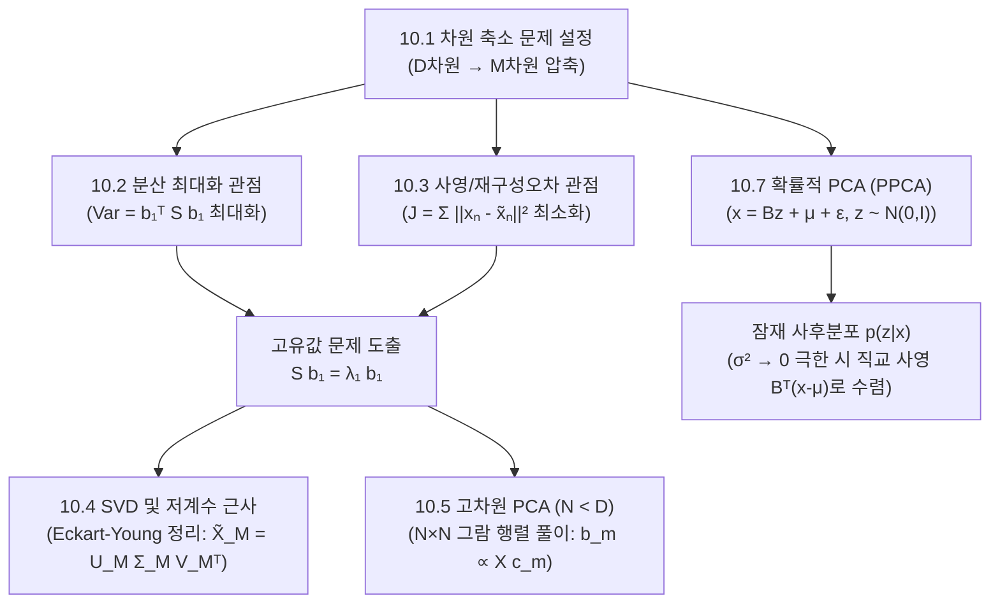

> **교재 범위**: Deisenroth, Faisal, Ong, *Mathematics for Machine Learning*(MML), pp. 317–347.  
> **선후수 연결 및 의존성**: 이 장은 비지도 학습(Unsupervised Learning)의 대표 기법인 차원 축소(Dimensionality Reduction)를 다룹니다. 3장의 직교 사영(Orthogonal Projection), 4장의 고유값 분해(Eigendecomposition) 및 특이값 분해(SVD), 7장의 등식 제약 조건 최적화(라그랑주 승수법, Lagrange Multipliers), 6장의 가우시안 확률 모델이 완벽하게 결합된 장입니다. 여기서 다루는 데이터 압축과 잠재 표현(Latent Representation)의 개념은 현대 오토인코더(Autoencoder), 확산 모델(Diffusion Model), 고차원 임베딩 분석의 기초를 이룹니다.

---

## 0. 이 장 지도 (Roadmap)

주성분 분석(PCA, Principal Component Analysis)은 고차원($D$차원) 공간에 흩어져 있는 데이터의 핵심 정보를 손실을 최소화하면서 저차원($M$차원, $M \ll D$) 공간으로 압축하는 선형 차원 축소 알고리즘입니다. MML 교재 10장은 PCA를 **세 가지 서로 다른 심오한 관점**에서 유도하고 이들이 왜 수학적으로 정확히 일치하는지를 증명합니다:

1. **분산 최대화 관점 (Maximum Variance)**: 사영된 데이터의 분산(정보량)을 가장 크게 만드는 축을 찾자!
2. **사영/재구성 오차 최소화 관점 (Minimum Reconstruction Error)**: 원래 데이터와 사영된 데이터 사이의 유클리드 거리 제곱 오차를 가장 작게 만들자!
3. **잠재 변수/확률론적 관점 (Latent Variable / Probabilistic PCA)**: 저차원 가우시안 잠재 변수로부터 고차원 데이터가 노이즈와 함께 생성되었다는 생성 모델을 세우자!

### 절 목록 및 핵심 요약

| 절 번호 | 절 제목 (영문) | 교재 쪽수 | 핵심 한 줄 요약 | 중요도 |
| :--- | :--- | :--- | :--- | :---: |
| **10.1** | 문제 설정 (Problem Setting) | 319 | $D$차원 데이터를 정보 손실을 최소화하며 $M$차원 잠재 좌표로 선형 변환하는 프레임워크 | ★★☆ |
| **10.2** | 분산 최대화 관점 (Maximum Variance Perspective) | 320 | 데이터가 가장 넓게 퍼지는 방향을 주성분으로 선택하는 라그랑주 승수법 기반 유도 | ★★★ |
| **10.2.1**| 최대 분산 방향 (Direction with Maximal Variance) | 321 | 1차원 사영 분산 $b_1^\top S b_1$ 최대화 $\to$ 공분산 행렬 $S$의 최대 고유벡터 도출 | ★★★ |
| **10.2.2**| 최대 분산 $M$차원 부분공간 ($M$-dim Subspace with Maximal Variance) | 323 | 직교 제약 조건 하에서 상위 $M$개의 고유벡터가 최적의 기저가 됨을 증명 | ★★★ |
| **10.3** | 사영 관점 (Projection Perspective) | 325 | 원본 데이터와 복원 데이터 사이의 거리 제곱(재구성 오차)을 최소화하는 관점 | ★★★ |
| **10.3.1**| 설정 및 목적함수 (Setting and Objective) | 326 | 아핀 부분공간 위의 점 $\tilde{x}_n = b + B z_n$과 오차 함수 $J = \frac{1}{N}\sum \|x_n - \tilde{x}_n\|^2$ 정의 | ★★☆ |
| **10.3.2**| 최적 좌표 탐색 (Finding Optimal Coordinates) | 327 | 최적 오프셋은 데이터 평균($b = \mu$), 최적 좌표는 직교 사영 계수($z_{nm} = b_m^\top(x_n-\mu)$) | ★★★ |
| **10.3.3**| 주부분공간 기저 탐색 (Finding the Basis of the Principal Subspace) | 329 | 재구성 오차 최소화가 버려진 $D-M$개 고유값의 합 $\sum_{j=M+1}^D \lambda_j$과 같음을 증명 (동치성) | ★★★ |
| **10.4** | 고유벡터 계산과 저계수 근사 (Eigenvector & Low-Rank Approx) | 332 | 특이값 분해(SVD)와 Eckart-Young 정리를 통한 최적 계수 $M$ 행렬 근사 증명 | ★★★ |
| **10.4.1**| 저계수 근사를 통한 PCA (PCA Using Low-Rank Matrix Approx) | 333 | 중심화 데이터 행렬 $X$의 절단 SVD(Truncated SVD)가 곧 PCA 해임을 증명 | ★★★ |
| **10.4.2**| 실무적 계산 고려사항 (Practical Aspects) | 334 | 고차원에서의 특성방정식 한계(Abel-Ruffini)와 수치적 거듭제곱법(Power Iteration) | ★★☆ |
| **10.5** | 고차원에서의 PCA (PCA in High Dimensions, $N < D$) | 335 | $D \times D$ 공분산 대신 $N \times N$ 그람 행렬 $\frac{1}{N}X^\top X$를 풀어 연산량을 획기적으로 절감 | ★★★ |
| **10.6** | 실전에서의 PCA 핵심 단계 (Key Steps of PCA in Practice) | 337 | 중심화(평균 차감), 표준화(정규화), 고유분해, 사영, 복원 6단계 완벽 정리 | ★★★ |
| **10.7** | 잠재 변수 관점 (Latent Variable Perspective, PPCA) | 339 | 확률적 PCA: 가우시안 잠재 변수 $z$로부터 관측치 $x = Bz + \mu + \epsilon$을 생성하는 모델 | ★★★ |
| **10.7.1**| 생성 과정 및 확률 모델 (Generative Process & Probabilistic Model) | 340 | 사전분포 $p(z)$와 조건부 분포 $p(x \mid z)$로 정의되는 그래피컬 모델 | ★★☆ |
| **10.7.2**| 가능도 및 결합 분포 (Likelihood and Joint Distribution) | 342 | 주변 가우시안 분포 $p(x) = \mathcal{N}(\mu, BB^\top + \sigma^2 I)$ 유도 | ★★★ |
| **10.7.3**| 사후 분포 (Posterior Distribution) | 343 | $p(z \mid x)$ 계산, Woodbury 항등식 역행렬 변환, $\sigma^2 \to 0$ 극한에서의 표준 PCA 복원 | ★★★ |
| **10.8** | 더 읽을거리 (Further Reading) | 345 | 커널 PCA, 오토인코더(Autoencoder), GP-LVM과의 개념적 계보 | ★☆☆ |

> **중요도 선정 근거**:  
> - **10.2, 10.3, 10.4, 10.5, 10.7 (★★★)**: 라그랑주 승수법 유도, 두 관점의 동치성 증명, SVD 및 Eckart-Young 연결, $N < D$ 차원 축소 트릭, PPCA의 잠재변수 사후분포는 구술 및 필기시험에서 가장 깊이 있는 선형대수·확률 결합 문제로 출제됩니다.



---

## 10.1 문제 설정 (Problem Setting, 318쪽)

### 왜 필요한가 (직관과 개념)
현대 머신러닝 데이터는 차원이 매우 높습니다. 예를 들어 $28 \times 28$ 크기의 작은 흑백 이미지 하나만 해도 784차원 벡터($D = 784$)입니다.
하지만 고차원 데이터의 모든 축이 다 중요한 정보를 담고 있는 것은 아닙니다.
- **다중공선성과 중복성**: 픽셀 값들끼리는 서로 강한 상관관계를 가집니다.
- **차원의 저주(Curse of Dimensionality)**: 차원이 높아질수록 데이터가 존재하는 공간의 부피가 기하급수적으로 팽창하여, 데이터를 채우기 위해 필요한 표본 수가 폭증하고 거리 개념이 무의미해집니다.
- **시각화의 한계**: 인간은 3차원을 초과하는 공간을 직접 볼 수 없습니다.

따라서 데이터의 중요한 정보(본질적인 변동/분산)는 고스란히 보존하면서, 덜 중요한 정보(잡음/상관된 중복 축)를 쳐내어 $M$차원($M \ll D$)으로 데이터를 압축해야 합니다.

### 정의와 성질

#### 1. 인코더(Encoder)와 디코더(Decoder)의 쌍
- **원본 고차원 데이터**: $x_n \in \mathbb{R}^D$ ($n = 1, \dots, N$)
- **압축된 저차원 잠재 좌표 (코드)**: $z_n \in \mathbb{R}^M$ ($M < D$)
- **인코더 (Encoder, 사영/압축 매핑)**:
  $$z_n = g(x_n) = B^\top (x_n - \mu)$$
- **디코더 (Decoder, 복원/재구성 매핑)**:
  $$\tilde{x}_n = h(z_n) = B z_n + \mu$$

여기서:
- $B = [b_1, b_2, \dots, b_M] \in \mathbb{R}^{D \times M}$: $M$개의 정규직교(orthonormal) 기저 벡터로 이루어진 변환 행렬 ($B^\top B = I_M$)
- $\mu \in \mathbb{R}^D$: 데이터의 중심(오프셋 벡터, 보통 데이터 표본 평균)
- $\tilde{x}_n \in \mathbb{R}^D$: 저차원 코드 $z_n$으로부터 다시 $D$차원 공간으로 복원한 **재구성 벡터(Reconstruction Vector)**

---

## 10.2 분산 최대화 관점 (Maximum Variance Perspective, 320쪽)

### 왜 필요한가 (직관과 개념)
데이터를 1차원 직선 위로 사영(그림자 드리우기)한다고 상상해 보십시오.
- 만약 데이터가 길쭉하게 늘어선 방향으로 선을 긋고 사영하면, 데이터 포인트들이 서로 겹치지 않고 넓게 퍼져 원래의 위치 관계를 잘 유지합니다 (**분산 최대화 $\to$ 정보 보존**).
- 반대로 데이터가 좁게 모인 수직 방향으로 사영하면, 모든 점들이 한 덩어리로 뭉개져 버려 원래 어떤 점이 어디 있었는지 구별할 수 없게 됩니다 (**정보 소실**).

따라서 **"사영된 데이터들의 분산(Variance)이 가장 커지도록 사영 축을 정하는 것"**이 PCA의 첫 번째 핵심 철학입니다.

```
       [2차원 원본 데이터]           [최적 사영 방향 b₁ (최대 분산)]
              y                            y
              │    ●                       │    ● ╱
              │   ● ●                      │   ● ╱●   (점들이 길게 퍼짐:
              │  ● ● ●                     │  ● ╱● ●   정보 보존 우수!)
              │ ● ●                        │ ● ╱●
              └──────── x                  └───╱──── x
                                              b₁
                                     [나쁜 사영 방향 b₂ (최소 분산)]
                                           점들이 한 점으로 뭉개짐!
```

---

### 10.2.1 최대 분산 방향 유도 (Direction with Maximal Variance, 321쪽)

#### 정의와 성질

##### 1. 중심화 데이터 및 표본 공분산 행렬
데이터셋의 표본 평균을 $\mu = \frac{1}{N} \sum_{n=1}^N x_n$이라 할 때, 평균을 0으로 맞춘 중심화 데이터(Centered Data)를 가정합니다:
$$\sum_{n=1}^N x_n = 0 \iff \mu = 0$$

표본 공분산 행렬(Data Covariance Matrix) $S \in \mathbb{R}^{D \times D}$는 다음과 같이 정의됩니다:
$$S = \frac{1}{N} \sum_{n=1}^N x_n x_n^\top = \frac{1}{N} X X^\top$$
- $X = [x_1, x_2, \dots, x_N] \in \mathbb{R}^{D \times N}$은 데이터 행렬입니다.
- $S$는 대칭(Symmetric) 행렬이며, 양의 준정부호(Positive Semi-Definite) 행렬입니다 ($x^\top S x \ge 0$).

> **교재 표기법 주의 (MML 관례)**: 통계학의 비편향 공분산은 자유도 분모로 $\frac{1}{N-1}$을 사용하지만, MML 교재와 머신러닝 교과서(Bishop 등)에서는 최대가능도 표본 공분산 관례인 **$\frac{1}{N}$**을 일관되게 사용합니다. 본 해설서도 교재 관례인 $\frac{1}{N}$을 엄격히 따릅니다.

##### 2. 1차원 사영 분산의 수식화
길이가 1인 단위 방향 벡터 $b_1 \in \mathbb{R}^D$ ($b_1^\top b_1 = 1$) 위로 데이터 $x_n$을 사영한 스칼라 좌표는 $z_{n1} = b_1^\top x_n$ 입니다.
- 사영된 데이터의 평균:
  $$\frac{1}{N} \sum_{n=1}^N z_{n1} = \frac{1}{N} \sum_{n=1}^N b_1^\top x_n = b_1^\top \left( \frac{1}{N} \sum_{n=1}^N x_n \right) = b_1^\top 0 = 0$$
- 사영된 데이터의 분산 $V_1$:
  $$V_1 = \frac{1}{N} \sum_{n=1}^N (z_{n1} - 0)^2 = \frac{1}{N} \sum_{n=1}^N (b_1^\top x_n)^2 = \frac{1}{N} \sum_{n=1}^N (b_1^\top x_n)(x_n^\top b_1)$$
  $$= b_1^\top \left( \frac{1}{N} \sum_{n=1}^N x_n x_n^\top \right) b_1 = b_1^\top S b_1$$

##### 3. 라그랑주 승수법을 통한 최적화
목표는 단위 길이 제약 조건 $\|b_1\|^2 = b_1^\top b_1 = 1$ 하에서 분산 $b_1^\top S b_1$을 최대화하는 것입니다:
$$\max_{b_1} b_1^\top S b_1 \quad \text{subject to } b_1^\top b_1 = 1$$

7장의 라그랑주 승수법(Lagrange Multipliers)에 따라 라그랑지안 함수를 세웁니다:
$$\mathfrak{L}(b_1, \lambda_1) = b_1^\top S b_1 - \lambda_1 (b_1^\top b_1 - 1)$$

$b_1$에 대해 편미분하고 0으로 둡니다:
$$\nabla_{b_1} \mathfrak{L} = 2 S b_1 - 2 \lambda_1 b_1 = 0 \iff S b_1 = \lambda_1 b_1$$

이것은 정확히 **공분산 행렬 $S$의 고유값 방정식(Eigenvalue Equation)**입니다!
- $b_1$은 공분산 행렬 $S$의 **고유벡터(Eigenvector)**이어야 합니다.
- $\lambda_1$은 이에 대응하는 **고유값(Eigenvalue)**입니다.

이때 사영된 데이터의 분산 값을 계산해 보면:
$$V_1 = b_1^\top S b_1 = b_1^\top (\lambda_1 b_1) = \lambda_1 (b_1^\top b_1) = \lambda_1$$
분산 $V_1$이 다름 아닌 **고유값 $\lambda_1$ 그 자체**가 됩니다!
따라서 분산 $V_1$을 최대로 만들려면, 수많은 고유값들 중에서 **가장 큰 고유값(최대 고유값) $\lambda_1$에 대응하는 고유벡터 $b_1$**을 선택해야 합니다. 이것이 바로 **제1 주성분(First Principal Component)**입니다.

---

### 10.2.2 최대 분산을 갖는 $M$차원 부분공간 (322쪽)

#### 제2 주성분 $b_2$의 유도
제1 주성분 $b_1$과 겹치지 않는 새로운 정보를 포착하기 위해, $b_2$는 $b_1$과 서로 직교($b_2^\top b_1 = 0$)하면서 단위 길이($b_2^\top b_2 = 1$)를 만족해야 합니다:
$$\max_{b_2} b_2^\top S b_2 \quad \text{subject to } b_2^\top b_2 = 1, \; b_2^\top b_1 = 0$$

두 개의 제약 조건을 라그랑지안에 넣습니다:
$$\mathfrak{L}(b_2, \lambda_2, \eta) = b_2^\top S b_2 - \lambda_2 (b_2^\top b_2 - 1) - \eta (b_2^\top b_1)$$
$b_2$로 미분:
$$\nabla_{b_2} \mathfrak{L} = 2 S b_2 - 2 \lambda_2 b_2 - \eta b_1 = 0$$
양변 왼쪽에 $b_1^\top$을 곱합니다:
$$2 b_1^\top S b_2 - 2 \lambda_2 (b_1^\top b_2) - \eta (b_1^\top b_1) = 0$$
- $S$의 대칭성과 $S b_1 = \lambda_1 b_1$에 의해: $b_1^\top S b_2 = (S b_1)^\top b_2 = \lambda_1 b_1^\top b_2 = 0$
- 직교 조건에 의해 $b_1^\top b_2 = 0$
- 단위 길이에 의해 $b_1^\top b_1 = 1$
따라서 $0 - 0 - \eta (1) = 0 \implies \eta = 0$이 됩니다!

결국 남는 방정식은 다시 단순한 고유값 방정식이 됩니다:
$$S b_2 = \lambda_2 b_2$$
따라서 $b_2$ 역시 $S$의 고유벡터이며, $b_1$을 제외한 남은 고유값들 중 **두 번째로 큰 고유값 $\lambda_2$에 대응하는 고유벡터**를 선택해야 분산이 극대화됩니다.

#### 일반화: $M$차원 주부분공간 (Principal Subspace)
귀납법(Mathematical Induction)에 의해, $M$차원 부분공간으로 분산을 최대화하며 사영할 때 최적의 정규직교 기저 $b_1, \dots, b_M$은 공분산 행렬 $S$의 **가장 큰 고유값 $M$개($\lambda_1 \ge \lambda_2 \ge \dots \ge \lambda_M$)에 대응하는 고유벡터들**입니다.
이때 $M$개 축으로 사영된 데이터의 총 분산의 합은 고유값들의 합과 같습니다:
$$\sum_{m=1}^{M} \mathbb{V}[z_m] = \sum_{m=1}^M \lambda_m$$


---

## 10.3 사영 관점 / 재구성 오차 최소화 (Projection Perspective, 325쪽)

### 왜 필요한가 (직관과 개념)
10.2절에서는 "데이터를 사영했을 때 분산을 가장 크게 만들자"는 관점으로 출발했습니다.
10.3절에서는 완전히 다른, 그러나 매우 직관적인 공학적 관점에서 출발합니다:
**"원래 고차원 데이터 $x_n$과 저차원으로 압축했다가 다시 복원한 데이터 $\tilde{x}_n$ 사이의 차이(재구성 오차, Reconstruction Error)를 가장 작게 만들자!"**

데이터를 압축해서 전송하거나 저장할 때 발생하는 왜곡을 최소화하겠다는 목표입니다. 놀랍게도 이 최소 재구성 오차 문제는 분산 최대화 문제와 수학적으로 **완전히 동일한 고유값 분해 해**로 귀결됩니다.

```
                  xₙ (원래 고차원 데이터)
                  │ ╲
                  │   ╲  재구성 오차 벡터: xₙ - x̃ₙ
                  │     ╲ (길이 ||xₙ - x̃ₙ||를 최소화해야 함!)
                  ▼       ▼
                  x̃ₙ = b + B zₙ  ─── [아핀 부분공간 U]
                 (복원된 근사 벡터)
```

---

### 10.3.1 설정 및 목적함수 (Setting and Objective, 326쪽)

#### 정의
$D$차원 벡터 공간 내에서 원점을 지나지 않을 수도 있는 $M$차원 **아핀 부분공간(Affine Subspace)** $U \subset \mathbb{R}^D$를 생각합니다.
- 아핀 부분공간의 정의: $U = \{ \tilde{x} \in \mathbb{R}^D \mid \tilde{x} = b + B z, \; z \in \mathbb{R}^M \}$
- $b \in \mathbb{R}^D$: 부분공간의 원점을 지정하는 **오프셋 벡터(Offset Vector)**
- $B = [b_1, \dots, b_M] \in \mathbb{R}^{D \times M}$: $U$의 방향을 결정하는 **정규직교 기저 행렬 ($B^\top B = I_M$)**
- $z_n = [z_{n1}, \dots, z_{nM}]^\top \in \mathbb{R}^M$: 데이터 $x_n$이 부분공간 $U$ 상에서 갖는 **저차원 좌표 벡터 (코드)**

복원된 벡터 $\tilde{x}_n$은 다음과 같이 기저 벡터들의 선형 결합에 오프셋을 더한 형태입니다:
$$\tilde{x}_n = b + \sum_{m=1}^M z_{nm} b_m = b + B z_n$$

#### 목적함수: 평균 제곱 재구성 오차 (Average Squared Reconstruction Error)
우리의 목표는 원본 데이터와 복원 벡터 간의 유클리드 거리 제곱의 평균 $J$를 최소화하는 $b, B, \{z_n\}_{n=1}^N$을 찾는 것입니다:
$$J(b, B, z_1, \dots, z_N) = \frac{1}{N} \sum_{n=1}^N \|x_n - \tilde{x}_n\|^2 = \frac{1}{N} \sum_{n=1}^N \left\| x_n - \left( b + B z_n \right) \right\|^2$$

---

### 10.3.2 최적 좌표 및 최적 오프셋 탐색 (327쪽)

#### 1. 최적 잠재 좌표 $z_{nm}$ 도출
기저 행렬 $B$와 오프셋 $b$가 고정되어 있다고 가정하고, $J$를 특정 데이터의 $m$번째 좌표 $z_{nm}$에 대해 편미분합니다:
$$\frac{\partial J}{\partial z_{nm}} = -\frac{2}{N} b_m^\top \left( x_n - b - \sum_{j=1}^M z_{nj} b_j \right)$$
정규직교 기저의 성질 $b_m^\top b_j = \delta_{mj}$ (기저끼리 내적하면 $m=j$일 때만 1, 다르면 0)을 적용하면:
$$b_m^\top \left( \sum_{j=1}^M z_{nj} b_j \right) = z_{nm}$$
따라서 편도함수는 다음과 같이 극도로 단순해집니다:
$$\frac{\partial J}{\partial z_{nm}} = -\frac{2}{N} \left( b_m^\top (x_n - b) - z_{nm} \right) = 0$$
$$z_{nm} = b_m^\top (x_n - b)$$

이를 벡터 형태로 묶으면:
$$z_n = B^\top (x_n - b)$$
> **기하학적 의미**: 최적의 저차원 좌표 $z_n$은 중심을 $b$로 이동시킨 데이터 벡터 $(x_n - b)$를 기저 벡터 $b_m$ 위로 **직교 사영(내적)**한 그림자의 길이입니다!

#### 2. 최적 오프셋 벡터 $b$ 도출
최적 좌표 $z_n = B^\top (x_n - b)$를 목적함수에 대입하기 전, $J$를 오프셋 $b$에 대해 직접 편미분합니다:
$$\frac{\partial J}{\partial b} = -\frac{2}{N} \sum_{n=1}^N \left( x_n - b - B z_n \right) = 0$$
양변을 2로 나누고 합 기호를 분배합니다:
$$\frac{1}{N} \sum_{n=1}^N x_n - b - B \left( \frac{1}{N} \sum_{n=1}^N z_n \right) = 0$$
표본 평균을 $\mu = \bar{x} = \frac{1}{N} \sum_{n=1}^N x_n$, 잠재 좌표 평균을 $\bar{z} = \frac{1}{N} \sum_{n=1}^N z_n$이라 두면:
$$\mu - b - B \bar{z} = 0$$

앞서 구한 최적 좌표 공식의 평균을 취하면 $\bar{z} = B^\top (\mu - b)$이므로 대입합니다:
$$\mu - b - B B^\top (\mu - b) = 0 \iff (I - B B^\top)(\mu - b) = 0$$
이 식은 $\mu - b$가 부분공간 방향($B$의 열공간) 안에 있기만 하면 성립한다. 즉 $b = \mu + Bw$ 꼴이면 모두 최적인데, 어느 것을 골라도 같은 아핀 부분공간이 되므로 가장 간단한 것을 고른다:
$$b = \mu = \frac{1}{N} \sum_{n=1}^N x_n$$
즉, **아핀 부분공간의 최적 원점(오프셋)은 데이터 전체의 표본 평균(중심)**이어야 합니다!

따라서 최적 좌표와 복원 벡터는 다음과 같이 확정됩니다:
$$z_n = B^\top (x_n - \mu)$$
$$\tilde{x}_n = \mu + B B^\top (x_n - \mu)$$

---

### 10.3.3 주부분공간 기저 탐색 및 동치성 증명 (329쪽)

이제 최적의 정규직교 기저 행렬 $B = [b_1, \dots, b_M]$를 결정해야 합니다.
$D$차원 전체 공간 $\mathbb{R}^D$를 포괄하는 완전한 정규직교 기저 $(b_1, \dots, b_M, b_{M+1}, \dots, b_D)$를 생각합니다.
- 앞쪽 $M$개: 우리가 보존할 주부분공간 기저 ($B$)
- 뒤쪽 $D-M$개: 우리가 차원을 축소하면서 버릴 직교 여공간 기저

중심화된 데이터 벡터 $(x_n - \mu)$를 완전 정규직교 기저로 전개하면:
$$x_n - \mu = \sum_{d=1}^D \beta_{nd} b_d, \quad \text{여기서 } \beta_{nd} = b_d^\top (x_n - \mu)$$

복원된 벡터 $\tilde{x}_n - \mu$는 앞쪽 $M$개의 기저 성분만 취한 것입니다:
$$\tilde{x}_n - \mu = \sum_{m=1}^M \beta_{nm} b_m$$

따라서 원본 벡터와 복원 벡터의 차이(오차 벡터)는 정확히 **버려진 뒤쪽 $D-M$개의 기저 성분의 합**입니다:
$$x_n - \tilde{x}_n = (x_n - \mu) - (\tilde{x}_n - \mu) = \sum_{j=M+1}^D \beta_{nj} b_j$$

기저들이 정규직교이므로 오차 벡터의 노름 제곱은 계수 제곱의 합과 같습니다:
$$\|x_n - \tilde{x}_n\|^2 = \sum_{j=M+1}^D \beta_{nj}^2 = \sum_{j=M+1}^D \left( b_j^\top (x_n - \mu) \right)^2$$

이제 전체 데이터에 대해 평균 재구성 오차 $J_M$을 계산합니다:
$$J_M = \frac{1}{N} \sum_{n=1}^N \sum_{j=M+1}^D b_j^\top (x_n - \mu)(x_n - \mu)^\top b_j = \sum_{j=M+1}^D b_j^\top \left( \frac{1}{N} \sum_{n=1}^N (x_n - \mu)(x_n - \mu)^\top \right) b_j$$
괄호 안이 정확히 표본 공분산 행렬 $S$입니다!
$$J_M = \sum_{j=M+1}^D b_j^\top S b_j$$

정규직교 제약 조건 $b_j^\top b_j = 1$ 하에서 이 오차합 $J_M$을 최소화하려면, 10.2절의 라그랑주 승수법 결과에 의해 $b_j$는 $S$의 고유벡터여야 하며, 그 값은 고유값 $\lambda_j$가 됩니다:
$$J_M = \sum_{j=M+1}^D \lambda_j$$

> **결정적 결론 (두 관점의 완벽한 일치)**:  
> - 재구성 오차 $J_M = \sum_{j=M+1}^D \lambda_j$를 **최소화**하려면, 버려지는 $D-M$개의 고유값을 **가장 작은 고유값들**로 골라야 합니다!
> - 버려지는 고유값이 가장 작다는 것은, 거꾸로 **우리가 보존하는 앞쪽 $M$개의 고유값 $\lambda_1, \dots, \lambda_M$이 가장 큰 고유값들이어야 함**을 뜻합니다.
> - 따라서 **"재구성 오차 최소화"와 "사영 분산 최대화"는 완전히 동일한 고유값 분해 문제**입니다!

---

### [필수 손계산] 작은 2차원 데이터셋으로 PCA 처음부터 끝까지 손계산하기

시험에 가장 직결되는 작은 2차원 데이터셋($N=4, D=2, M=1$)을 이용해 중심화부터 공분산, 고유값/고유벡터, 1차원 좌표 사영, 2차원 공간 복원, 재구성 오차 검산까지 모든 계산 단계를 한 줄도 생략하지 않고 손으로 풀어봅시다.

#### 문제 설정
4개의 2차원 데이터 포인트가 주어졌습니다:
$$x_1 = \begin{bmatrix} 1 \\ 1 \end{bmatrix}, \quad x_2 = \begin{bmatrix} 2 \\ 3 \end{bmatrix}, \quad x_3 = \begin{bmatrix} 3 \\ 2 \end{bmatrix}, \quad x_4 = \begin{bmatrix} 4 \\ 4 \end{bmatrix}$$
이 데이터를 PCA를 통해 1차원($M=1$)으로 차원 축소하시오.

---

#### [1단계] 표본 평균 $\mu$ 및 중심화 데이터 $X_c$ 계산
$$\mu = \frac{1}{4} \left( \begin{bmatrix} 1 \\ 1 \end{bmatrix} + \begin{bmatrix} 2 \\ 3 \end{bmatrix} + \begin{bmatrix} 3 \\ 2 \end{bmatrix} + \begin{bmatrix} 4 \\ 4 \end{bmatrix} \right) = \frac{1}{4} \begin{bmatrix} 1+2+3+4 \\ 1+3+2+4 \end{bmatrix} = \frac{1}{4} \begin{bmatrix} 10 \\ 10 \end{bmatrix} = \begin{bmatrix} 2.5 \\ 2.5 \end{bmatrix}$$

각 데이터에서 평균 $\mu$를 뺍니다:
- $x_1 - \mu = \begin{bmatrix} 1 - 2.5 \\ 1 - 2.5 \end{bmatrix} = \begin{bmatrix} -1.5 \\ -1.5 \end{bmatrix} = \begin{bmatrix} -3/2 \\ -3/2 \end{bmatrix}$
- $x_2 - \mu = \begin{bmatrix} 2 - 2.5 \\ 3 - 2.5 \end{bmatrix} = \begin{bmatrix} -0.5 \\ 0.5 \end{bmatrix} = \begin{bmatrix} -1/2 \\ 1/2 \end{bmatrix}$
- $x_3 - \mu = \begin{bmatrix} 3 - 2.5 \\ 2 - 2.5 \end{bmatrix} = \begin{bmatrix} 0.5 \\ -0.5 \end{bmatrix} = \begin{bmatrix} 1/2 \\ -1/2 \end{bmatrix}$
- $x_4 - \mu = \begin{bmatrix} 4 - 2.5 \\ 4 - 2.5 \end{bmatrix} = \begin{bmatrix} 1.5 \\ 1.5 \end{bmatrix} = \begin{bmatrix} 3/2 \\ 3/2 \end{bmatrix}$

중심화 데이터 행렬 $X_c \in \mathbb{R}^{2 \times 4}$:
$$X_c = \begin{bmatrix} -1.5 & -0.5 & 0.5 & 1.5 \\ -1.5 & 0.5 & -0.5 & 1.5 \end{bmatrix}$$

---

#### [2단계] 표본 공분산 행렬 $S = \frac{1}{N} X_c X_c^\top$ 계산
- (1,1) 원소 (첫 번째 좌표의 분산):
  $$S_{11} = \frac{1}{4} \left( (-1.5)^2 + (-0.5)^2 + 0.5^2 + 1.5^2 \right) = \frac{1}{4} (2.25 + 0.25 + 0.25 + 2.25) = \frac{1}{4}(5.0) = 1.25 = \frac{5}{4}$$
- (2,2) 원소 (두 번째 좌표의 분산):
  $$S_{22} = \frac{1}{4} \left( (-1.5)^2 + 0.5^2 + (-0.5)^2 + 1.5^2 \right) = \frac{1}{4} (2.25 + 0.25 + 0.25 + 2.25) = 1.25 = \frac{5}{4}$$
- (1,2) 및 (2,1) 원소 (공분산):
  $$S_{12} = S_{21} = \frac{1}{4} \left( (-1.5)(-1.5) + (-0.5)(0.5) + (0.5)(-0.5) + (1.5)(1.5) \right)$$
  $$= \frac{1}{4} (2.25 - 0.25 - 0.25 + 2.25) = \frac{1}{4}(4.0) = 1.0 = 1$$

따라서 공분산 행렬은 다음과 같습니다:
$$S = \begin{bmatrix} 5/4 & 1 \\ 1 & 5/4 \end{bmatrix} = \begin{bmatrix} 1.25 & 1.0 \\ 1.0 & 1.25 \end{bmatrix}$$

---

#### [3단계] 고유값 및 고유벡터 계산
특성방정식(Characteristic Equation): $\det(S - \lambda I) = 0$
$$\det \begin{bmatrix} \frac{5}{4} - \lambda & 1 \\ 1 & \frac{5}{4} - \lambda \end{bmatrix} = \left( \frac{5}{4} - \lambda \right)^2 - (1)(1) = 0$$
$$\left( \frac{5}{4} - \lambda \right)^2 = 1 \iff \frac{5}{4} - \lambda = \pm 1$$
- $\lambda_1 = \frac{5}{4} + 1 = \frac{9}{4} = 2.25$ (최대 고유값)
- $\lambda_2 = \frac{5}{4} - 1 = \frac{1}{4} = 0.25$ (최소 고유값)

총 분산 확인:
$$\text{Tr}(S) = \frac{5}{4} + \frac{5}{4} = \frac{10}{4} = 2.50 = \lambda_1 + \lambda_2 = 2.25 + 0.25 \quad (\text{일치!})$$
제1 주성분이 설명하는 분산 비율(Explained Variance Ratio):
$$\frac{\lambda_1}{\lambda_1 + \lambda_2} = \frac{2.25}{2.50} = \frac{9}{10} = 90\%$$

**고유벡터 $b_1$ 구하기 ($\lambda_1 = 9/4$):**
$$(S - \lambda_1 I) v = \begin{bmatrix} 5/4 - 9/4 & 1 \\ 1 & 5/4 - 9/4 \end{bmatrix} \begin{bmatrix} v_1 \\ v_2 \end{bmatrix} = \begin{bmatrix} -1 & 1 \\ 1 & -1 \end{bmatrix} \begin{bmatrix} v_1 \\ v_2 \end{bmatrix} = \begin{bmatrix} 0 \\ 0 \end{bmatrix}$$
$$-v_1 + v_2 = 0 \implies v_1 = v_2$$
단위 벡터로 정규화: $\|b_1\|^2 = v_1^2 + v_2^2 = 2 v_1^2 = 1 \implies v_1 = \frac{1}{\sqrt{2}}$
$$b_1 = \frac{1}{\sqrt{2}} \begin{bmatrix} 1 \\ 1 \end{bmatrix}$$

**고유벡터 $b_2$ 구하기 ($\lambda_2 = 1/4$):**
$$(S - \lambda_2 I) v = \begin{bmatrix} 5/4 - 1/4 & 1 \\ 1 & 5/4 - 1/4 \end{bmatrix} \begin{bmatrix} v_1 \\ v_2 \end{bmatrix} = \begin{bmatrix} 1 & 1 \\ 1 & 1 \end{bmatrix} \begin{bmatrix} v_1 \\ v_2 \end{bmatrix} = \begin{bmatrix} 0 \\ 0 \end{bmatrix}$$
$$v_1 + v_2 = 0 \implies v_2 = -v_1$$
단위 벡터로 정규화:
$$b_2 = \frac{1}{\sqrt{2}} \begin{bmatrix} -1 \\ 1 \end{bmatrix}$$

---

#### [4단계] 1차원 잠재 좌표 $z_n$ 계산 (사영/인코딩)
$M=1$이므로 기저 행렬은 $B = b_1 = \frac{1}{\sqrt{2}} \begin{bmatrix} 1 \\ 1 \end{bmatrix}$ 입니다.
공식: $z_n = b_1^\top (x_n - \mu)$
- $n=1$: $z_1 = \frac{1}{\sqrt{2}} [1, 1] \begin{bmatrix} -1.5 \\ -1.5 \end{bmatrix} = \frac{-1.5 - 1.5}{\sqrt{2}} = \frac{-3}{\sqrt{2}} = -\frac{3\sqrt{2}}{2} \approx -2.121$
- $n=2$: $z_2 = \frac{1}{\sqrt{2}} [1, 1] \begin{bmatrix} -0.5 \\ 0.5 \end{bmatrix} = \frac{-0.5 + 0.5}{\sqrt{2}} = 0$
- $n=3$: $z_3 = \frac{1}{\sqrt{2}} [1, 1] \begin{bmatrix} 0.5 \\ -0.5 \end{bmatrix} = \frac{0.5 - 0.5}{\sqrt{2}} = 0$
- $n=4$: $z_4 = \frac{1}{\sqrt{2}} [1, 1] \begin{bmatrix} 1.5 \\ 1.5 \end{bmatrix} = \frac{1.5 + 1.5}{\sqrt{2}} = \frac{3}{\sqrt{2}} = \frac{3\sqrt{2}}{2} \approx 2.121$

**사영된 데이터의 표본 분산 검산:**
$$\frac{1}{4} \sum_{n=1}^4 z_n^2 = \frac{1}{4} \left( \left(-\frac{3}{\sqrt{2}}\right)^2 + 0^2 + 0^2 + \left(\frac{3}{\sqrt{2}}\right)^2 \right) = \frac{1}{4} \left( \frac{9}{2} + 0 + 0 + \frac{9}{2} \right) = \frac{1}{4} (9) = \frac{9}{4} = 2.25$$
사영된 좌표의 분산이 정확히 최대 고유값 $\lambda_1 = 2.25$와 완벽하게 일치합니다!

---

#### [5단계] 2차원 공간으로 복원 $\tilde{x}_n$ 계산 (디코딩)
공식: $\tilde{x}_n = \mu + b_1 z_n$
- $n=1$:
  $$\tilde{x}_1 = \begin{bmatrix} 2.5 \\ 2.5 \end{bmatrix} + \frac{1}{\sqrt{2}} \begin{bmatrix} 1 \\ 1 \end{bmatrix} \left(-\frac{3}{\sqrt{2}}\right) = \begin{bmatrix} 2.5 \\ 2.5 \end{bmatrix} + \begin{bmatrix} -1.5 \\ -1.5 \end{bmatrix} = \begin{bmatrix} 1 \\ 1 \end{bmatrix}$$
  (원래 점 $x_1 = [1, 1]^\top$과 오차 없이 완벽 복원!)
- $n=2$:
  $$\tilde{x}_2 = \begin{bmatrix} 2.5 \\ 2.5 \end{bmatrix} + \frac{1}{\sqrt{2}} \begin{bmatrix} 1 \\ 1 \end{bmatrix} (0) = \begin{bmatrix} 2.5 \\ 2.5 \end{bmatrix}$$
- $n=3$:
  $$\tilde{x}_3 = \begin{bmatrix} 2.5 \\ 2.5 \end{bmatrix} + \frac{1}{\sqrt{2}} \begin{bmatrix} 1 \\ 1 \end{bmatrix} (0) = \begin{bmatrix} 2.5 \\ 2.5 \end{bmatrix}$$
- $n=4$:
  $$\tilde{x}_4 = \begin{bmatrix} 2.5 \\ 2.5 \end{bmatrix} + \frac{1}{\sqrt{2}} \begin{bmatrix} 1 \\ 1 \end{bmatrix} \left(\frac{3}{\sqrt{2}}\right) = \begin{bmatrix} 2.5 \\ 2.5 \end{bmatrix} + \begin{bmatrix} 1.5 \\ 1.5 \end{bmatrix} = \begin{bmatrix} 4 \\ 4 \end{bmatrix}$$
  (원래 점 $x_4 = [4, 4]^\top$과 오차 없이 완벽 복원!)

---

#### [6단계] 재구성 오차 검산 ($J_1 = \lambda_2$ 확인)
각 데이터별 재구성 오차 제곱:
- $\|x_1 - \tilde{x}_1\|^2 = \left\| \begin{bmatrix} 1 \\ 1 \end{bmatrix} - \begin{bmatrix} 1 \\ 1 \end{bmatrix} \right\|^2 = 0$
- $\|x_2 - \tilde{x}_2\|^2 = \left\| \begin{bmatrix} 2 \\ 3 \end{bmatrix} - \begin{bmatrix} 2.5 \\ 2.5 \end{bmatrix} \right\|^2 = (-0.5)^2 + (0.5)^2 = 0.25 + 0.25 = 0.5$
- $\|x_3 - \tilde{x}_3\|^2 = \left\| \begin{bmatrix} 3 \\ 2 \end{bmatrix} - \begin{bmatrix} 2.5 \\ 2.5 \end{bmatrix} \right\|^2 = (0.5)^2 + (-0.5)^2 = 0.25 + 0.25 = 0.5$
- $\|x_4 - \tilde{x}_4\|^2 = \left\| \begin{bmatrix} 4 \\ 4 \end{bmatrix} - \begin{bmatrix} 4 \\ 4 \end{bmatrix} \right\|^2 = 0$

평균 제곱 재구성 오차:
$$J_1 = \frac{1}{4} \sum_{n=1}^4 \|x_n - \tilde{x}_n\|^2 = \frac{1}{4} (0 + 0.5 + 0.5 + 0) = \frac{1.0}{4} = 0.25$$

버려진 두 번째 고유값:
$$\lambda_2 = 0.25$$
$$J_1 = \lambda_2 = 0.25 \quad (\text{완벽하게 일치!})$$
이로써 수식의 모든 이론적 성질이 한 치의 오차도 없이 손계산으로 증명되었습니다!


---

## 10.4 고유벡터 계산과 저계수 근사 (333쪽)

### 왜 필요한가 (직관과 개념)
10.2절과 10.3절에서 우리는 PCA의 최적 기저가 공분산 행렬 $S$의 고유벡터임을 보였습니다. 그렇다면 컴퓨터는 실제로 이 고유벡터들을 어떻게 계산할까요?
공분산 행렬 $S = \frac{1}{N}XX^\top$를 먼저 만들고 고유값 분해를 하는 것은 계산 오차(수치적 불안정성)와 불필요한 메모리 낭비를 유발합니다. 10.4절은 4장에서 배운 **특이값 분해(SVD, Singular Value Decomposition)**를 통해 공분산 행렬을 직접 만들지 않고도 데이터 행렬 $X$ 자체로부터 PCA를 우아하고 안정적으로 수행하는 수학적 원리를 밝힙니다.

---

### 10.4.1 저계수 행렬 근사를 통한 PCA와 Eckart-Young 정리 (334쪽)

#### 1. 중심화 데이터 행렬의 SVD
중심화된 데이터 행렬 $X = [x_1 - \mu, \dots, x_N - \mu] \in \mathbb{R}^{D \times N}$의 특이값 분해는 다음과 같습니다:
$$X = U \Sigma V^\top$$
- $U \in \mathbb{R}^{D \times D}$: 좌측 특이벡터(Left Singular Vectors)로 이루어진 직교 행렬 ($U^\top U = U U^\top = I_D$)
- $V \in \mathbb{R}^{N \times N}$: 우측 특이벡터(Right Singular Vectors)로 이루어진 직교 행렬 ($V^\top V = V V^\top = I_N$)
- $\Sigma \in \mathbb{R}^{D \times N}$: 직사각형 대각 행렬, 대각 원소에 특이값(Singular Values)이 내림차순 정렬됨 ($\sigma_1 \ge \sigma_2 \ge \dots \ge \sigma_{\min(D, N)} \ge 0$)

#### 2. 공분산 행렬 $S$와 SVD의 직접 연결
표본 공분산 행렬 $S$에 SVD 식을 대입합니다:
$$S = \frac{1}{N} X X^\top = \frac{1}{N} (U \Sigma V^\top) (U \Sigma V^\top)^\top = \frac{1}{N} U \Sigma V^\top V \Sigma^\top U^\top$$
$V$는 직교 행렬이므로 $V^\top V = I_N$으로 소거됩니다:
$$S = \frac{1}{N} U (\Sigma \Sigma^\top) U^\top = U \left( \frac{1}{N} \Sigma \Sigma^\top \right) U^\top$$

여기서 $\Sigma \Sigma^\top \in \mathbb{R}^{D \times D}$는 완벽한 대각 행렬입니다:
$$\frac{1}{N} \Sigma \Sigma^\top = \text{diag}\left( \frac{\sigma_1^2}{N}, \; \frac{\sigma_2^2}{N}, \; \dots, \; \frac{\sigma_D^2}{N} \right)$$

이것은 정확히 공분산 행렬 $S$의 **스펙트럼 분해(고유값 분해)** $S = U \Lambda U^\top$의 형태입니다!
따라서:
- **공분산 행렬 $S$의 고유벡터들**은 다름 아닌 **데이터 행렬 $X$의 좌측 특이벡터(행렬 $U$의 열벡터들 $u_d$)**입니다!
- **공분산 행렬 $S$의 고유값들 $\lambda_d$**과 **데이터 행렬 $X$의 특이값들 $\sigma_d$** 사이의 관계:
  $$\lambda_d = \frac{\sigma_d^2}{N}$$

#### 3. Eckart-Young-Mirsky 정리와의 일치
선형대수학의 유명한 **에카르트-영 정리(Eckart-Young Theorem)**에 따르면, 임의의 행렬 $X$에 대해 계수(rank)가 $M$ 이하인 행렬들 중 스펙트럼 노름 $\|X - A\|_2$(교재 식 (10.50), 정리 4.25)를 최소화하는 최적의 계수 $M$ 근사 행렬 $\tilde{X}_M$은 상위 $M$개의 특이값만 남긴 **절단 SVD(Truncated SVD)**입니다:
$$\tilde{X}_M = \arg\min_{\text{rank}(A) \le M} \|X - A\|_2 = U_M \Sigma_M V_M^\top$$
> 교재 밖 보충: 같은 결론이 프로베니우스 노름 $\|X - A\|_F$에서도 성립한다(Eckart–Young–Mirsky). 재구성 오차 $J_M$은 프로베니우스 노름 쪽과 직접 연결된다: $\frac{1}{N}\|X - \tilde{X}_M\|_F^2 = \frac{1}{N}\sum_{j>M}\sigma_j^2 = \sum_{j>M}\lambda_j$.

한편, PCA에서 데이터를 상위 $M$개 주성분으로 사영했다가 복원한 행렬 $\tilde{X}$는:
$$\tilde{X} = B B^\top X = U_M U_M^\top (U \Sigma V^\top) = U_M (U_M^\top U) \Sigma V^\top = U_M \Sigma_M V_M^\top$$
정확히 에카르트-영 정리의 최적 저계수 근사 행렬 $\tilde{X}_M$과 **수학적으로 완전히 일치**합니다!
즉, PCA는 통계학적으로는 "분산 최대화"이지만, 행렬 대수학적으로는 **"데이터 행렬의 최적 저계수 근사(Optimal Low-Rank Approximation)"**입니다.

---

### 10.4.2 실무적 계산 고려사항 (334쪽)

1. **아벨-루피니 정리(Abel-Ruffini Theorem)와 고유값 계산**:
   - 5차 이상의 다항식은 일반적인 대수적 근의 공식(사칙연산과 거듭제곱근)이 존재하지 않습니다.
   - 따라서 $D \ge 5$인 행렬의 특성방정식 $\det(S - \lambda I) = 0$은 손으로 풀 수 없으며, 컴퓨터는 반드시 반복적인 수치 해석 알고리즘(수치선형대수)을 사용해야 합니다.
2. **거듭제곱법 (Power Iteration)**:
   - 최대 고유벡터 하나를 빠르게 찾을 때 임의의 벡터 $v_0$에 행렬 $S$를 반복해서 곱하는 방법:
     $$v_{k+1} = \frac{S v_k}{\|S v_k\|}$$
   - $k \to \infty$로 갈 때, 최대 고유값에 대응하는 고유벡터로 지수적으로 수렴합니다.
3. **QR 알고리즘 및 Lanczos 알고리즘** (교재 밖 보충, 교재는 "현대 선형대수 패키지의 반복법"이라고만 쓴다):
   - 모든 고유쌍을 구할 때는 직교-상삼각 분해를 반복하는 QR 알고리즘이 표준이며, 희소 행렬이나 거대 행렬에서는 란초스(Lanczos) 알고리즘이 사용됩니다.

---

## 10.5 고차원 데이터에서의 PCA (PCA in High Dimensions, $N < D$, 335쪽)

### 왜 필요한가 (직관과 연산량 비교)
생체 유전자(DNA 마이크로어레이) 데이터나 고해상도 얼굴 이미지 인식(Eigenfaces) 문제에서는 샘플 수 $N$은 100개에 불과한데, 특징 차원 $D$는 10,000차원 이상인 경우가 비일비재합니다 ($N \ll D$).
- 공분산 행렬 $S = \frac{1}{N}XX^\top$의 크기는 **$10,000 \times 10,000$**이 됩니다!
- 원소 개수만 1억 개이며, 이 거대한 행렬의 고유값을 계산하는 알고리즘($\mathcal{O}(D^3)$)은 약 $10^{12}$회의 연산을 필요로 하므로 메모리가 터지거나 연산이 멈춥니다.
- 하지만 데이터 포인트가 $N$개뿐이므로, 이 데이터들이 $D$차원 공간에서 펼쳐낼 수 있는 부분공간의 계수(rank)는 **기껏해야 $N$차원**에 불과합니다. 나머지 $D-N$개의 축 방향으로는 데이터가 전혀 없으므로 분산(고유값)이 정확히 0입니다!

10.5절에서는 이 기하학적 잉여성을 역이용하여, $D \times D$ 행렬 대신 **$N \times N$ 크기의 초소형 행렬**만 풀어서 완벽하게 동일한 PCA 고유벡터를 구해내는 기적의 연산 단축 기법을 다룹니다.

---

### 수학적 유도

중심화 데이터 행렬 $X \in \mathbb{R}^{D \times N}$에 대해:
- 원래 풀어야 하는 $D \times D$ 고유값 문제:
  $$S b_m = \lambda_m b_m \iff \frac{1}{N} X X^\top b_m = \lambda_m b_m \quad (m = 1, \dots, M)$$

여기서 순서를 뒤집어 **$N \times N$ 그람 행렬(Gram Matrix)** $K := \frac{1}{N} X^\top X \in \mathbb{R}^{N \times N}$를 정의하고, 이 작은 행렬의 고유값 문제를 풉니다:
$$\frac{1}{N} X^\top X c_m = \lambda_m c_m \quad (c_m \in \mathbb{R}^N, \; \|c_m\| = 1)$$

이제 이 식의 양변 왼쪽에 행렬 $X$를 곱해줍니다:
$$X \left( \frac{1}{N} X^\top X c_m \right) = X (\lambda_m c_m)$$
결합법칙으로 괄호의 묶음을 바꿉니다:
$$\left( \frac{1}{N} X X^\top \right) (X c_m) = \lambda_m (X c_m)$$
$$\therefore S (X c_m) = \lambda_m (X c_m)$$

놀랍게도:
1. $N \times N$ 행렬 $\frac{1}{N}X^\top X$의 고유값 $\lambda_m$은 $D \times D$ 행렬 $S$의 고유값과 **완전히 동일**합니다!
2. $S$의 고유벡터 $b_m$은 다름 아닌 **$X c_m$에 비례**합니다!

#### 정규화 상수 도출
고유벡터 $b_m = \alpha_m X c_m$이 단위 길이($\|b_m\|^2 = 1$)를 갖도록 스케일링 계수 $\alpha_m$을 결정합니다:
$$b_m^\top b_m = (\alpha_m X c_m)^\top (\alpha_m X c_m) = \alpha_m^2 c_m^\top X^\top X c_m = 1$$
앞서 $\frac{1}{N}X^\top X c_m = \lambda_m c_m$이므로 $X^\top X c_m = N \lambda_m c_m$입니다. 이를 대입하면:
$$\alpha_m^2 c_m^\top (N \lambda_m c_m) = \alpha_m^2 N \lambda_m (c_m^\top c_m) = \alpha_m^2 N \lambda_m (1) = 1$$
$$\therefore \alpha_m = \frac{1}{\sqrt{N \lambda_m}}$$

따라서 최종 고유벡터는 다음과 같이 계산됩니다:
$$b_m = \frac{1}{\sqrt{N \lambda_m}} X c_m$$

> **연산량 비교 (Computational Complexity)**:  
> - 기존 방식 ($S$ 직접 계산 및 고유분해): $\mathcal{O}(D^2 N) + \mathcal{O}(D^3)$  
> - 고차원 트릭 ($N \times N$ 행렬 풀이): $\mathcal{O}(N^2 D) + \mathcal{O}(N^3) + \mathcal{O}(N D M)$  
> $D = 10,000, N = 100$일 때, 지배항이 $D^3 = 10^{12}$에서 $N^2 D = 10^{8}$ 수준으로, 약 **1만 배** 줄어듭니다. 이 아이디어는 훗날 비선형 커널 PCA(Kernel PCA)의 이론적 초석이 됩니다.

---

### [손으로 풀어 보는 예제: N < D]

$D=3, N=2$인 극단적인 고차원 상황을 손으로 풀어봅시다.
중심화 데이터 행렬 $X_c \in \mathbb{R}^{3 \times 2}$가 다음과 같이 주어졌습니다:
$$X_c = \begin{bmatrix} -1 & 1 \\ -1 & 1 \\ 1 & -1 \end{bmatrix}$$
$N=2$이므로, $3 \times 3$ 행렬 $S$ 대신 $2 \times 2$ 행렬 $K = \frac{1}{2}X_c^\top X_c$를 이용하여 최대 고유벡터 $b_1$을 구하시오.

**[1단계: $2 \times 2$ 그람 행렬 $K$ 계산]**
$$X_c^\top = \begin{bmatrix} -1 & -1 & 1 \\ 1 & 1 & -1 \end{bmatrix}$$
$$X_c^\top X_c = \begin{bmatrix} -1 & -1 & 1 \\ 1 & 1 & -1 \end{bmatrix} \begin{bmatrix} -1 & 1 \\ -1 & 1 \\ 1 & -1 \end{bmatrix} = \begin{bmatrix} 1+1+1 & -1-1-1 \\ -1-1-1 & 1+1+1 \end{bmatrix} = \begin{bmatrix} 3 & -3 \\ -3 & 3 \end{bmatrix}$$
$$K = \frac{1}{2} X_c^\top X_c = \begin{bmatrix} 1.5 & -1.5 \\ -1.5 & 1.5 \end{bmatrix}$$

**[2단계: $K$의 고유값 및 고유벡터 계산]**
$$\det(K - \lambda I) = (1.5 - \lambda)^2 - (-1.5)^2 = (1.5 - \lambda)^2 - 2.25 = 0$$
$$\lambda^2 - 3\lambda = 0 \implies \lambda(\lambda - 3) = 0$$
따라서 0이 아닌 유일한 최대 고유값은 $\lambda_1 = 3$ 입니다.

$\lambda_1 = 3$에 대한 고유벡터 $c_1$:
$$(K - 3I) c_1 = \begin{bmatrix} 1.5 - 3 & -1.5 \\ -1.5 & 1.5 - 3 \end{bmatrix} \begin{bmatrix} c_{11} \\ c_{12} \end{bmatrix} = \begin{bmatrix} -1.5 & -1.5 \\ -1.5 & -1.5 \end{bmatrix} \begin{bmatrix} c_{11} \\ c_{12} \end{bmatrix} = \begin{bmatrix} 0 \\ 0 \end{bmatrix}$$
$$c_{11} + c_{12} = 0 \implies c_{12} = -c_{11}$$
단위 정규화: $c_1 = \frac{1}{\sqrt{2}} \begin{bmatrix} -1 \\ 1 \end{bmatrix}$

**[3단계: $b_1 = \frac{1}{\sqrt{N\lambda_1}} X_c c_1$ 계산]**
- $N = 2, \lambda_1 = 3 \implies \sqrt{N\lambda_1} = \sqrt{2 \times 3} = \sqrt{6}$
- $X_c c_1$ 계산:
  $$X_c c_1 = \begin{bmatrix} -1 & 1 \\ -1 & 1 \\ 1 & -1 \end{bmatrix} \left( \frac{1}{\sqrt{2}} \begin{bmatrix} -1 \\ 1 \end{bmatrix} \right) = \frac{1}{\sqrt{2}} \begin{bmatrix} 1 + 1 \\ 1 + 1 \\ -1 - 1 \end{bmatrix} = \frac{1}{\sqrt{2}} \begin{bmatrix} 2 \\ 2 \\ -2 \end{bmatrix} = \begin{bmatrix} \sqrt{2} \\ \sqrt{2} \\ -\sqrt{2} \end{bmatrix}$$
- 정규화 곱셈:
  $$b_1 = \frac{1}{\sqrt{6}} \begin{bmatrix} \sqrt{2} \\ \sqrt{2} \\ -\sqrt{2} \end{bmatrix} = \frac{\sqrt{2}}{\sqrt{6}} \begin{bmatrix} 1 \\ 1 \\ -1 \end{bmatrix} = \frac{1}{\sqrt{3}} \begin{bmatrix} 1 \\ 1 \\ -1 \end{bmatrix}$$

**[4단계: 원래의 $3 \times 3$ 공분산 행렬 $S$로 검산]**
$$S = \frac{1}{2} X_c X_c^\top = \frac{1}{2} \begin{bmatrix} -1 & 1 \\ -1 & 1 \\ 1 & -1 \end{bmatrix} \begin{bmatrix} -1 & -1 & 1 \\ 1 & 1 & -1 \end{bmatrix} = \frac{1}{2} \begin{bmatrix} 2 & 2 & -2 \\ 2 & 2 & -2 \\ -2 & -2 & 2 \end{bmatrix} = \begin{bmatrix} 1 & 1 & -1 \\ 1 & 1 & -1 \\ -1 & -1 & 1 \end{bmatrix}$$
$$S b_1 = \begin{bmatrix} 1 & 1 & -1 \\ 1 & 1 & -1 \\ -1 & -1 & 1 \end{bmatrix} \left( \frac{1}{\sqrt{3}} \begin{bmatrix} 1 \\ 1 \\ -1 \end{bmatrix} \right) = \frac{1}{\sqrt{3}} \begin{bmatrix} 1 + 1 + 1 \\ 1 + 1 + 1 \\ -1 - 1 - 1 \end{bmatrix} = \frac{1}{\sqrt{3}} \begin{bmatrix} 3 \\ 3 \\ -3 \end{bmatrix} = 3 \left( \frac{1}{\sqrt{3}} \begin{bmatrix} 1 \\ 1 \\ -1 \end{bmatrix} \right) = 3 b_1$$
고유값 3, 고유벡터 $b_1$이 한 치의 오차도 없이 정확히 증명되었습니다!

---

## 10.6 실전에서의 PCA 핵심 단계 (Key Steps in Practice, 336쪽)

실제 데이터 분석 및 머신러닝 파이프라인에서 PCA를 적용할 때 거치는 필수 6단계를 정리합니다.

1. **평균 중심화 (Mean Centering)**:
   각 특징별 표본 평균 $\mu_d = \frac{1}{N} \sum_{n=1}^N x_{nd}$를 계산하여 모든 데이터에서 차감합니다:
   $$x_{nd} \leftarrow x_{nd} - \mu_d$$
   > 중심화를 건너뛰면 제1 주성분이 데이터의 분산 방향이 아니라 **원점에서 데이터 덩어리 중심을 가리키는 평균 벡터 방향**으로 왜곡되어 분석이 완전히 망가집니다!

2. **표준화 (Standardization / Z-score Normalization) — 필요 시**:
   각 특징의 단위(스케일)가 다른 경우(예: 키 cm와 몸무게 kg, 연소득 원), 표준편차 $\sigma_d = \sqrt{\frac{1}{N}\sum (x_{nd}-\mu_d)^2}$로 나누어 분산을 1로 맞춥니다:
   $$x_{nd} \leftarrow \frac{x_{nd} - \mu_d}{\sigma_d}$$
   > 표준화를 적용한 PCA는 데이터의 **공분산 행렬(Covariance Matrix)** 대신 **상관관계 행렬(Correlation Matrix)**의 고유값을 구하는 것과 같습니다. 스케일이 비정상적으로 큰 단 하나의 변수가 주성분을 독식하는 참사를 방지합니다.

3. **표본 공분산 행렬 $S$ 계산**:
   $$S = \frac{1}{N} X_c X_c^\top \in \mathbb{R}^{D \times D}$$

4. **고유값 분해 및 정렬**:
   $S b_d = \lambda_d b_d$를 풀어 고유값을 내림차순으로 정렬합니다:
   $$\lambda_1 \ge \lambda_2 \ge \dots \ge \lambda_D \ge 0$$

5. **압축 차원 $M$ 결정 (설명된 분산 비율)**:
   누적 설명 분산 비율(Cumulative Explained Variance Ratio)이 목표 임계값(예: 90% 또는 95%)을 넘는 최소 $M$을 선택합니다:
   $$\frac{\sum_{m=1}^M \lambda_m}{\sum_{d=1}^D \lambda_d} \ge 0.90$$

6. **사영(인코딩) 및 복원(디코딩)**:
   - $M$차원 잠재 좌표: $z_n = B^\top (x_n - \mu)$, 여기서 $B = [b_1, \dots, b_M] \in \mathbb{R}^{D \times M}$
   - $D$차원 복원 벡터: $\tilde{x}_n = B z_n + \mu = B B^\top (x_n - \mu) + \mu$
   - 표준화를 적용했던 경우, 표준편차를 먼저 곱한 뒤 평균을 더해 복원합니다:
     $$\tilde{x}_{nd} \leftarrow \tilde{x}_{nd} \cdot \sigma_d + \mu_d$$


---

## 10.7 잠재 변수 관점 / 확률적 PCA (Latent Variable Perspective, PPCA, 339쪽)

### 왜 필요한가 (직관과 확률 모델의 당위성)
지금까지 다룬 표준 PCA는 뛰어난 기하학적·대수적 도구이지만, 다음과 같은 태생적 한계를 갖습니다:
1. **결측치(Missing Data) 처리 불가**: 입력 데이터의 일부 원소가 누락되면 행렬 계산 자체가 불가능합니다.
2. **생성 모델(Generative Model)의 부재**: 데이터의 분포를 학습한 것이 아니므로, 새로운 그럴듯한 가상 데이터를 스스로 샘플링(생성)할 수 없습니다.
3. **불확실성(Uncertainty) 미반영**: 잠재 좌표 $z$를 오직 단 하나의 점으로만 사영하므로, 사영 위치에 대한 신뢰도를 알 수 없습니다.
4. **차원 $M$의 확률적 선택 불가**: 주변 가능도(Marginal Likelihood) 개념이 없어 베이지안 모델 선택을 적용할 수 없습니다.

Tipping과 Bishop(1999)이 제안한 **확률적 주성분 분석(Probabilistic PCA, PPCA)**은 표준 PCA를 **가우시안 잠재 변수 생성 모델(Gaussian Latent Variable Model)**로 재해석함으로써 이 모든 한계를 완벽하게 해결합니다.

```
       [PPCA 그래피컬 모델]
           z ~ N(0, I_M)        (저차원 잠재 변수 사전분포)
                 │
                 ▼  (x = Bz + μ + ε)
           x ~ N(Bz+μ, σ²I)     (고차원 관측 데이터)
```

---

### 10.7.1 생성 과정 및 확률 모델 (340쪽)

#### 1. 잠재 변수 사전분포 (Latent Prior)
보이지 않는 $M$차원 잠재 변수(Latent Variable) $z \in \mathbb{R}^M$가 표준 정규분포를 따른다고 가정합니다:
$$z \sim \mathcal{N}(0, I_M)$$
- 각 잠재 차원은 서로 독립이며, 평균 0, 분산 1을 갖습니다.

#### 2. 관측 데이터 생성 메커니즘 (Observation Model)
고차원 데이터 $x \in \mathbb{R}^D$는 잠재 변수 $z$의 선형 변환에 중심점 $\mu$와 등방성 가우시안 노이즈 $\epsilon$이 더해져 생성됩니다:
$$x = B z + \mu + \epsilon \in \mathbb{R}^D$$
- $B \in \mathbb{R}^{D \times M}$: 잠재 공간에서 데이터 공간으로 매핑하는 **변환 행렬(투사 행렬)**
- $\mu \in \mathbb{R}^D$: 데이터 공간의 평균(오프셋)
- $\epsilon \sim \mathcal{N}(0, \sigma^2 I_D)$: $z$와 독립인 관측 노이즈 ($\sigma^2$: 노이즈 분산)

따라서 $z$가 주어졌을 때 $x$의 조건부 확률분포(우도)는 다음과 같습니다:
$$p(x \mid z, B, \mu, \sigma^2) = \mathcal{N}(x \mid B z + \mu, \sigma^2 I_D)$$

---

### 10.7.2 우도 및 결합 분포 (342쪽)

#### 1. 데이터의 주변 분포 (Marginal Distribution / Evidence)
잠재 변수 $z$를 적분 소거하여 관측 데이터 $x$ 자체의 주변 확률분포를 구합니다:
$$p(x \mid B, \mu, \sigma^2) = \int p(x \mid z, B, \mu, \sigma^2) p(z) \, dz$$

이 적분은 6장의 선형 가우시안 시스템 공식에 의해 적분 기호 없이 즉시 풀립니다:
- **기댓값**:
  $$\mathbb{E}[x] = \mathbb{E}[B z + \mu + \epsilon] = B \mathbb{E}[z] + \mu + \mathbb{E}[\epsilon] = B(0) + \mu + 0 = \mu$$
- **공분산 행렬**:
  $$\text{Cov}[x] = \text{Cov}[B z + \mu + \epsilon] = \text{Cov}[B z] + \text{Cov}[\epsilon] = B \text{Cov}[z] B^\top + \sigma^2 I_D = B B^\top + \sigma^2 I_D$$

따라서 주변 분포는 다음과 같습니다:
$$p(x \mid B, \mu, \sigma^2) = \mathcal{N}(x \mid \mu, C), \quad \text{여기서 } C = B B^\top + \sigma^2 I_D \in \mathbb{R}^{D \times D}$$

#### 2. $x$와 $z$의 결합 분포 (Joint Distribution)
$$p\left( \begin{bmatrix} x \\ z \end{bmatrix} \right) = \mathcal{N}\left( \begin{bmatrix} \mu \\ 0 \end{bmatrix}, \; \begin{bmatrix} B B^\top + \sigma^2 I_D & B \\ B^\top & I_M \end{bmatrix} \right)$$
- 상호 공분산: $\text{Cov}[x, z] = \mathbb{E}[(x-\mu) z^\top] = \mathbb{E}[(Bz+\epsilon)z^\top] = B \mathbb{E}[zz^\top] = B I_M = B$

---

### 10.7.3 사후 분포 및 표준 PCA로의 수렴 (342쪽)

#### 1. 잠재 변수 사후분포 $p(z \mid x)$ 유도
관측된 데이터 $x$가 주어졌을 때, 이 데이터를 만들어낸 잠재 좌표 $z$의 확률분포는 가우시안 조건부 분포 공식에 의해 계산됩니다:
$$p(z \mid x) = \mathcal{N}(z \mid m, C_z)$$
- **사후 평균**:
  $$m = B^\top (B B^\top + \sigma^2 I_D)^{-1} (x - \mu)$$
- **사후 공분산**:
  $$C_z = I_M - B^\top (B B^\top + \sigma^2 I_D)^{-1} B$$

#### 2. 우드베리(Woodbury) 항등식을 통한 $M \times M$ 역행렬 변환
위 식에서 $(B B^\top + \sigma^2 I_D)^{-1}$는 거대한 $D \times D$ 행렬의 역행렬을 요구합니다.
행렬 역행렬 보조정리(Woodbury / Push-through Identity)를 적용하면 다음과 같이 아름답게 바뀝니다:
$$B^\top (B B^\top + \sigma^2 I_D)^{-1} = (B^\top B + \sigma^2 I_M)^{-1} B^\top$$
이를 대입하면:
$$m = (B^\top B + \sigma^2 I_M)^{-1} B^\top (x - \mu)$$
$$C_z = \sigma^2 (B^\top B + \sigma^2 I_M)^{-1}$$
이제 우리는 $D \times D$가 아니라 훨씬 작은 **$M \times M$ 크기의 역행렬만 계산**하면 됩니다!

#### 3. 노이즈 0 극한 ($\sigma^2 \to 0$)에서의 표준 PCA 복원
만약 관측 노이즈가 0으로 수렴한다면 ($\sigma^2 \to 0$):
- 사후 공분산:
  $$C_z = \lim_{\sigma^2 \to 0} \sigma^2 (B^\top B + \sigma^2 I_M)^{-1} = 0$$
  즉, 잠재 좌표의 확률적 불확실성이 사라지고 단 하나의 고정된 점으로 붕괴합니다.
- 사후 평균:
  $$m = \lim_{\sigma^2 \to 0} (B^\top B + \sigma^2 I_M)^{-1} B^\top (x - \mu) = (B^\top B)^{-1} B^\top (x - \mu)$$
  정규직교 기저 조건 $B^\top B = I_M$을 적용하면:
  $$m = B^\top (x - \mu)$$
  이것은 표준 PCA에서 유도했던 **최적 잠재 좌표 $z_n = B^\top (x_n - \mu)$와 완벽하게 일치**합니다!

#### 4. PPCA의 최대가능도 모수 해 (교재 10.8절 식 (10.77)~(10.79), 증명은 Tipping & Bishop 1999)
로그 주변 가능도 $\sum_{n=1}^N \log p(x_n \mid B, \mu, \sigma^2)$를 최대화하는 모수 해는 닫힌 형태로 정확히 풀립니다:
- $\mu_{ML} = \frac{1}{N} \sum_{n=1}^N x_n$ (표본 평균)
- $\sigma_{ML}^2 = \frac{1}{D - M} \sum_{j=M+1}^D \lambda_j$ (**버려진 $D-M$개 고유값의 산술 평균!**)
- $B_{ML} = U_M (\Lambda_M - \sigma_{ML}^2 I_M)^{1/2} R$
  - $U_M \in \mathbb{R}^{D \times M}$: 공분산 $S$의 상위 $M$개 고유벡터 행렬
  - $\Lambda_M = \text{diag}(\lambda_1, \dots, \lambda_M)$: 상위 $M$개 고유값 대각 행렬
  - $R \in \mathbb{R}^{M \times M}$: 임의의 직교 회전 행렬 ($R R^\top = I_M$)

> **수학적 경이로움**: 노이즈 분산의 MLE 추정량 $\sigma_{ML}^2$이 정확히 **PCA에서 사영하며 버려진 잔여 고유값들의 평균**으로 도출됩니다! 노이즈가 없는 극한($\sigma \to 0$)에서는 $BB^\top$가 데이터 공분산과 같아져 $B = U_M \Lambda_M^{1/2} R$이 됩니다(교재 식 (10.81)). $B$의 열은 고유벡터에 $\sqrt{\lambda}$를 곱한 것이라 정규직교는 아니지만, 열공간이 PCA의 주부분공간과 같으므로 PPCA와 PCA가 같은 답을 줍니다.

---

## 10.8 더 읽을거리 (Further Reading, 343쪽)

PCA의 선형적 한계를 극복하고 현대 생성 모델로 나아가는 주요 확장 분야들입니다:

1. **커널 PCA (Kernel PCA)**:
   - 10.5절의 고차원 PCA 트릭($N \times N$ 그람 행렬 풀이)에 커널 트릭 $k(x_i, x_j) = \langle \phi(x_i), \phi(x_j) \rangle$을 적용하면, 데이터를 비선형 특징 공간으로 보낸 뒤 PCA를 수행할 수 있습니다. 스위스 롤(Swiss roll)처럼 꼬인 비선형 다양체(Manifold)를 성공적으로 펼쳐냅니다.
2. **오토인코더 (Autoencoders)와의 동치성**:
   - 딥러닝의 오토인코더에서 인코더와 디코더의 활성화 함수를 모두 선형(Linear, $f(x)=x$)으로 설정하고 은닉층 뉴런 수를 $M$개로 두면, 복원 오차를 최소화하는 신경망의 최적 가중치 공간은 정확히 **PCA가 생성하는 주부분공간과 수학적으로 동치**가 됩니다.
3. **가우스 과정 잠재 변수 모델 (GP-LVM)**:
   - PPCA의 선형 변환 $x = Bz + \mu$를 비선형 가우스 과정(Gaussian Process)으로 대체한 모델입니다.
4. **인자 분석 (Factor Analysis, FA)**:
   - PPCA는 모든 센서/특징의 노이즈 분산이 $\sigma^2 I$로 동일하다고 가정하지만, 인자 분석은 특징마다 서로 다른 노이즈 분산 $\Psi = \text{diag}(\sigma_1^2, \dots, \sigma_D^2)$을 허용하는 일반화 모델입니다.


---

## 핵심 유도 모음 (시험 대비 백지 유도 연습)

시험장에서 백지에 직접 완벽하게 유도할 수 있어야 하는 10장의 7대 핵심 유도입니다.

---

### [유도 1] 제1 주성분의 분산 최대화와 라그랑주 승수법

**[목표]**  
중심화 데이터 공분산 행렬 $S$에 대해 제약 조건 $b_1^\top b_1 = 1$ 하에서 사영 분산 $V_1 = b_1^\top S b_1$을 최대화하는 벡터가 $S b_1 = \lambda_1 b_1$을 만족함을 유도한다.

| 번호 | 수식 전개 단계 | 이 단계가 성립하는 이유 (수학적 근거) |
| :---: | :--- | :--- |
| **1** | $V_1 = \frac{1}{N} \sum_{n=1}^N (b_1^\top x_n)^2$ | 단위 벡터 $b_1$ 위로 사영된 데이터의 표본 분산 정의 (평균은 0) |
| **2** | $= \frac{1}{N} \sum_{n=1}^N b_1^\top x_n x_n^\top b_1 = b_1^\top \left( \frac{1}{N} \sum_{n=1}^N x_n x_n^\top \right) b_1$ | 스칼라 내적의 결합법칙 및 행렬 밖으로 $b_1$ 인수분해 |
| **3** | $V_1 = b_1^\top S b_1$ | 표본 공분산 행렬 $S = \frac{1}{N} \sum x_n x_n^\top$의 정의 |
| **4** | 목적: $\max_{b_1} b_1^\top S b_1 \quad \text{s.t.} \quad b_1^\top b_1 - 1 = 0$ | 등식 제약 조건 하에서의 2차 형식 최대화 문제 정식화 |
| **5** | $\mathfrak{L}(b_1, \lambda_1) = b_1^\top S b_1 - \lambda_1 (b_1^\top b_1 - 1)$ | 라그랑주 승수 $\lambda_1$을 도입한 라그랑지안 함수 구성 |
| **6** | $\nabla_{b_1} (b_1^\top S b_1) = 2 S b_1$ | 대칭 행렬 $S$에 대한 2차 형식 벡터 미분 공식 ($\nabla_x x^\top A x = 2Ax$) |
| **7** | $\nabla_{b_1} (\lambda_1 b_1^\top b_1) = 2 \lambda_1 b_1$ | 2차 형식 벡터 미분 공식 ($A = I$) |
| **8** | $\nabla_{b_1} \mathfrak{L} = 2 S b_1 - 2 \lambda_1 b_1 = 0$ | 극대점에서의 1계 최적성 조건 (정류점) |
| **9** | $S b_1 = \lambda_1 b_1$ | 양변을 2로 나누어 정리 (고유값 방정식 도출) |
| **10** | $V_1 = b_1^\top S b_1 = b_1^\top (\lambda_1 b_1) = \lambda_1 (b_1^\top b_1) = \lambda_1$ | 분산이 고유값과 같으므로 분산 최대화를 위해 최대 고유값 선택 $\blacksquare$ |

---

### [유도 2] 사영 관점에서 최적 오프셋 $b = \mu$ 및 최적 좌표 유도

**[목표]**  
목적함수 $J = \frac{1}{N}\sum \|x_n - (b + Bz_n)\|^2$를 최소화하는 최적 오프셋이 표본 평균 $\mu$이고, 최적 좌표가 $z_n = B^\top(x_n - \mu)$임을 유도한다.

| 번호 | 수식 전개 단계 | 이 단계가 성립하는 이유 (수학적 근거) |
| :---: | :--- | :--- |
| **1** | $J = \frac{1}{N} \sum_{n=1}^N \left\| x_n - b - \sum_{m=1}^M z_{nm} b_m \right\|^2$ | 복원 벡터 $\tilde{x}_n = b + \sum z_{nm} b_m$ 대입 |
| **2** | $\frac{\partial J}{\partial z_{nk}} = -\frac{2}{N} b_k^\top \left( x_n - b - \sum_{m=1}^M z_{nm} b_m \right)$ | 벡터 노름 제곱의 합성함수 미분법 (체인 룰) |
| **3** | $b_k^\top b_m = \delta_{km} = \begin{cases} 1 & (k=m) \\ 0 & (k \neq m) \end{cases}$ | 기저 벡터들의 정규직교성 ($B^\top B = I_M$) |
| **4** | $b_k^\top \left( \sum_{m=1}^M z_{nm} b_m \right) = z_{nk}$ | 내적의 선형성에 의해 $m=k$인 항만 남고 모두 소거 |
| **5** | $\frac{\partial J}{\partial z_{nk}} = -\frac{2}{N} \left( b_k^\top (x_n - b) - z_{nk} \right) = 0 \implies z_{nk} = b_k^\top (x_n - b)$ | 도함수를 0으로 두어 최적 좌표 확정 |
| **6** | $\frac{\partial J}{\partial b} = -\frac{2}{N} \sum_{n=1}^N (x_n - b - B z_n) = 0$ | 목적함수를 오프셋 $b$에 대해 편미분 |
| **7** | $\frac{1}{N}\sum_{n=1}^N x_n - b - B \left( \frac{1}{N}\sum_{n=1}^N z_n \right) = 0$ | 합 기호 분배 및 표본 평균 $\mu = \frac{1}{N}\sum x_n, \bar{z} = \frac{1}{N}\sum z_n$ 정의 |
| **8** | $\bar{z} = \frac{1}{N}\sum_{n=1}^N B^\top(x_n - b) = B^\top(\mu - b)$ | 최적 좌표 공식의 표본 평균 대입 |
| **9** | $\mu - b - B B^\top (\mu - b) = 0 \iff (I - B B^\top)(\mu - b) = 0$ | 7단계 식에 $\bar{z}$ 대입 후 인수분해 |
| **10** | $b = \mu = \frac{1}{N} \sum_{n=1}^N x_n$ | 모든 기저 선택에 대해 항상 성립하는 자명한 최적 오프셋 확정 $\blacksquare$ |

---

### [유도 3] 재구성 오차 최소화와 분산 최대화의 동치성 증명

**[목표]**  
평균 재구성 오차 $J_M = \frac{1}{N}\sum \|x_n - \tilde{x}_n\|^2$가 버려진 $D-M$개의 고유값의 합 $\sum_{j=M+1}^D \lambda_j$과 같음을 증명한다.

| 번호 | 수식 전개 단계 | 이 단계가 성립하는 이유 (수학적 근거) |
| :---: | :--- | :--- |
| **1** | $\mathbb{R}^D$의 완전 정규직교 기저 $(b_1, \dots, b_M, b_{M+1}, \dots, b_D)$ 설정 | $M$차원 부분공간 기저와 $(D-M)$차원 직교 여공간 기저로 분할 |
| **2** | $x_n - \mu = \sum_{d=1}^D \beta_{nd} b_d, \quad \beta_{nd} = b_d^\top (x_n - \mu)$ | 중심화 데이터를 완전 정규직교 기저로 전개 |
| **3** | $\tilde{x}_n - \mu = \sum_{m=1}^M \beta_{nm} b_m$ | 복원 벡터는 앞쪽 $M$개의 기저 성분만 취함 |
| **4** | $x_n - \tilde{x}_n = \sum_{j=M+1}^D \beta_{nj} b_j$ | 두 벡터의 차이는 버려진 뒤쪽 $D-M$개 기저의 선형 결합 |
| **5** | $\|x_n - \tilde{x}_n\|^2 = \left\| \sum_{j=M+1}^D \beta_{nj} b_j \right\|^2 = \sum_{j=M+1}^D \beta_{nj}^2$ | 피타고라스 정리 및 기저의 정규직교성 ($\|b_j\|=1, b_j \perp b_k$) |
| **6** | $J_M = \frac{1}{N} \sum_{n=1}^N \sum_{j=M+1}^D (b_j^\top (x_n - \mu))^2$ | 계수 $\beta_{nj} = b_j^\top (x_n - \mu)$ 대입 |
| **7** | $= \sum_{j=M+1}^D b_j^\top \left( \frac{1}{N} \sum_{n=1}^N (x_n - \mu)(x_n - \mu)^\top \right) b_j$ | 합 순서 교환 및 $b_j$ 밖으로 인수분해 |
| **8** | $J_M = \sum_{j=M+1}^D b_j^\top S b_j$ | 표본 공분산 행렬 $S$의 정의 대입 |
| **9** | 제약 조건 $b_j^\top b_k = \delta_{jk}$ 하에서 최소화 $\implies S b_j = \lambda_j b_j$ | [유도 1]의 라그랑주 승수법 결과에 의해 $b_j$는 $S$의 고유벡터 |
| **10** | $J_M = \sum_{j=M+1}^D \lambda_j$ | 오차 최소화를 위해 가장 작은 $D-M$개의 고유값을 버려야 하므로, 보존되는 $M$개는 가장 큰 고유값이어야 함 $\blacksquare$ |

---

### [유도 4] SVD를 통한 공분산 분해 및 Eckart-Young 최적 근사 증명

**[목표]**  
중심화 데이터 $X = U \Sigma V^\top$로부터 $S = \frac{1}{N} U \Sigma \Sigma^\top U^\top$를 보이고, PCA 복원 행렬이 최적 계수 $M$ 근사 $\tilde{X}_M = U_M \Sigma_M V_M^\top$임을 증명한다.

| 번호 | 수식 전개 단계 | 이 단계가 성립하는 이유 (수학적 근거) |
| :---: | :--- | :--- |
| **1** | $X = U \Sigma V^\top$ | 중심화 데이터 행렬 $X \in \mathbb{R}^{D \times N}$의 특이값 분해 (SVD) 정의 |
| **2** | $S = \frac{1}{N} X X^\top = \frac{1}{N} (U \Sigma V^\top)(U \Sigma V^\top)^\top$ | 표본 공분산 행렬 $S$의 정의 |
| **3** | $= \frac{1}{N} U \Sigma V^\top V \Sigma^\top U^\top$ | 전치 행렬 곱셈 법칙 ($(ABC)^\top = C^\top B^\top A^\top$) |
| **4** | $= \frac{1}{N} U \Sigma I_N \Sigma^\top U^\top = U \left( \frac{1}{N} \Sigma \Sigma^\top \right) U^\top$ | $V$의 직교성 ($V^\top V = I_N$) 적용 |
| **5** | $\frac{1}{N} \Sigma \Sigma^\top = \text{diag}(\sigma_1^2/N, \dots, \sigma_D^2/N)$ | 직사각형 대각행렬 $\Sigma$의 거듭제곱 대각성 |
| **6** | $S U = U \Lambda \implies S u_d = (\sigma_d^2/N) u_d$ | $S$의 고유벡터가 $U$의 열벡터 $u_d$이고 고유값이 $\lambda_d = \sigma_d^2/N$임이 증명됨 |
| **7** | PCA 기저 행렬 $B = U_M \in \mathbb{R}^{D \times M}$ | 상위 $M$개의 고유벡터 선택 |
| **8** | 사영 및 복원 데이터 행렬: $\tilde{X} = B B^\top X = U_M U_M^\top (U \Sigma V^\top)$ | PCA 복원 수식 대입 |
| **9** | $U_M^\top U = [I_M \;\; 0] \in \mathbb{R}^{M \times D}$ | $U$의 열벡터들의 정규직교성 ($u_i^\top u_j = \delta_{ij}$) |
| **10** | $\tilde{X} = U_M [I_M \;\; 0] \Sigma V^\top = U_M \Sigma_M V_M^\top = \tilde{X}_M$ | 에카르트-영 정리의 최적 계수 $M$ 절단 SVD 근사와 완전히 일치 $\blacksquare$ |

---

### [유도 5] 고차원 데이터 ($N < D$)에서의 그람 행렬 고유값 트릭

**[목표]**  
$N \times N$ 행렬 $\frac{1}{N}X^\top X c_m = \lambda_m c_m$으로부터 $S$의 단위 고유벡터 $b_m = \frac{1}{\sqrt{N\lambda_m}} X c_m$을 유도한다.

| 번호 | 수식 전개 단계 | 이 단계가 성립하는 이유 (수학적 근거) |
| :---: | :--- | :--- |
| **1** | $\frac{1}{N} X^\top X c_m = \lambda_m c_m \quad (c_m^\top c_m = 1)$ | $N \times N$ 그람 행렬 $K = \frac{1}{N}X^\top X$의 고유값 문제 정의 |
| **2** | $X \left( \frac{1}{N} X^\top X c_m \right) = X (\lambda_m c_m)$ | 양변 왼쪽에 $D \times N$ 데이터 행렬 $X$를 곱함 |
| **3** | $\left( \frac{1}{N} X X^\top \right) (X c_m) = \lambda_m (X c_m)$ | 스칼라 및 행렬 곱셈의 결합법칙 적용 |
| **4** | $S (X c_m) = \lambda_m (X c_m)$ | $D \times D$ 공분산 행렬 $S = \frac{1}{N}XX^\top$의 정의 대입 |
| **5** | $b_m \propto X c_m$ | $X c_m$이 행렬 $S$의 고유값 $\lambda_m$에 대응하는 고유벡터임이 증명됨 |
| **6** | $b_m = \alpha_m X c_m$ | 단위 벡터로 만들기 위한 스케일링 상수 $\alpha_m$ 설정 |
| **7** | $b_m^\top b_m = (\alpha_m X c_m)^\top (\alpha_m X c_m) = \alpha_m^2 c_m^\top X^\top X c_m = 1$ | 단위 노름 제약 조건 $\|b_m\|^2 = 1$ 적용 |
| **8** | $X^\top X c_m = N \lambda_m c_m$ | 1단계의 고유값 식에 양변 $N$을 곱한 결과 |
| **9** | $\alpha_m^2 c_m^\top (N \lambda_m c_m) = \alpha_m^2 N \lambda_m (c_m^\top c_m) = \alpha_m^2 N \lambda_m = 1$ | $c_m$의 정규직교성 ($c_m^\top c_m = 1$) 대입 |
| **10** | $\alpha_m = \frac{1}{\sqrt{N\lambda_m}} \implies b_m = \frac{1}{\sqrt{N\lambda_m}} X c_m$ | 최종 정규화된 고유벡터 공식 확정 $\blacksquare$ |

---

### [유도 6] PPCA 주변 가능도 $p(x)$ 및 결합 분포 유도

**[목표]**  
$z \sim \mathcal{N}(0, I_M)$과 $x = Bz + \mu + \epsilon$, $\epsilon \sim \mathcal{N}(0, \sigma^2 I_D)$로부터 $p(x) = \mathcal{N}(\mu, BB^\top + \sigma^2 I_D)$를 유도한다.

| 번호 | 수식 전개 단계 | 이 단계가 성립하는 이유 (수학적 근거) |
| :---: | :--- | :--- |
| **1** | $p(z) = \mathcal{N}(z \mid 0, I_M)$ | 가우시안 잠재 변수 사전분포의 정의 |
| **2** | $x = B z + \mu + \epsilon, \quad \epsilon \sim \mathcal{N}(0, \sigma^2 I_D), \quad z \perp \epsilon$ | 선형 관측 생성 모델 및 독립 가우시안 잡음 정의 |
| **3** | $p(x \mid B, \mu, \sigma^2) = \int p(x \mid z) p(z) dz$ | 결합분포로부터 잠재 변수 $z$ 적분 소거 (Marginalization) |
| **4** | 가우시안 변수 $z, \epsilon$의 아핀 결합이므로 $x$의 주변분포 역시 가우시안 | 정규분포의 선형 사상 닫힘성 |
| **5** | $\mathbb{E}[x] = B \mathbb{E}[z] + \mu + \mathbb{E}[\epsilon] = B(0) + \mu + 0 = \mu$ | 기댓값 연산자의 선형성 적용 |
| **6** | $\text{Cov}[x] = \text{Cov}[B z + \mu + \epsilon] = \text{Cov}[B z] + \text{Cov}[\epsilon]$ | $z$와 $\epsilon$의 독립성에 의해 교차 공분산이 0 |
| **7** | $\text{Cov}[Bz] = B \text{Cov}[z] B^\top = B I_M B^\top = B B^\top$ | 다변량 공분산 선형 사상 공식 ($\text{Cov}[A X] = A \text{Cov}[X] A^\top$) |
| **8** | $\text{Cov}[\epsilon] = \sigma^2 I_D$ | 등방성 가우시안 노이즈 공분산 대입 |
| **9** | $C := \text{Cov}[x] = B B^\top + \sigma^2 I_D$ | 두 공분산 합산 |
| **10** | $p(x \mid B, \mu, \sigma^2) = \mathcal{N}(x \mid \mu, \; B B^\top + \sigma^2 I_D)$ | 기댓값과 공분산을 가우시안 밀도함수에 결합 $\blacksquare$ |

---

### [유도 7] PPCA 사후분포 $p(z \mid x)$의 Woodbury 역행렬 변환 및 극한

**[목표]**  
$m = B^\top(BB^\top + \sigma^2 I)^{-1}(x-\mu)$가 $(B^\top B + \sigma^2 I)^{-1}B^\top(x-\mu)$와 같음을 증명하고, $\sigma^2 \to 0$일 때 $B^\top(x-\mu)$로 수렴함을 보인다.

| 번호 | 수식 전개 단계 | 이 단계가 성립하는 이유 (수학적 근거) |
| :---: | :--- | :--- |
| **1** | $m = B^\top (B B^\top + \sigma^2 I_D)^{-1} (x - \mu)$ | 결합 가우시안 조건부 평균 기본 공식 |
| **2** | 목표: $B^\top (B B^\top + \sigma^2 I_D)^{-1} \equiv (B^\top B + \sigma^2 I_M)^{-1} B^\top$ | $D \times D$ 역행렬을 $M \times M$ 역행렬로 축소하는 행렬 항등식 |
| **3** | $(B B^\top + \sigma^2 I_D) B = B (B^\top B) + \sigma^2 B = B (B^\top B + \sigma^2 I_M)$ | 양변에 $B$를 곱하여 괄호 분배 (교환성 확인) |
| **4** | 양변 왼쪽에 $(B B^\top + \sigma^2 I_D)^{-1}$을 곱함: $B = (B B^\top + \sigma^2 I_D)^{-1} B (B^\top B + \sigma^2 I_M)$ | 역행렬 상쇄 법칙 |
| **5** | 양변 오른쪽에 $(B^\top B + \sigma^2 I_M)^{-1}$을 곱함: $B (B^\top B + \sigma^2 I_M)^{-1} = (B B^\top + \sigma^2 I_D)^{-1} B$ | 푸시스루 항등식(Push-through Identity) 성립 |
| **6** | 양변에 전치(Transpose)를 취함: $\left( (B^\top B + \sigma^2 I_M)^{-1} \right)^\top B^\top = B^\top \left( (B B^\top + \sigma^2 I_D)^{-1} \right)^\top$ | 전치 행렬 곱셈 법칙 |
| **7** | $(B^\top B + \sigma^2 I_M)^{-1} B^\top = B^\top (B B^\top + \sigma^2 I_D)^{-1}$ | 대칭 행렬의 역행렬은 대칭이므로 전치 기호 제거 (증명 완료) |
| **8** | $m = (B^\top B + \sigma^2 I_M)^{-1} B^\top (x - \mu)$ | 1단계 식에 7단계 항등식을 대입 |
| **9** | $\lim_{\sigma^2 \to 0} m = (B^\top B + 0)^{-1} B^\top (x - \mu) = (B^\top B)^{-1} B^\top (x - \mu)$ | 노이즈 분산이 0으로 가는 극한 취함 |
| **10** | $B^\top B = I_M \implies m = I_M^{-1} B^\top (x - \mu) = B^\top (x - \mu)$ | 표준 PCA의 직교 사영 계수 공식과 완벽하게 일치 $\blacksquare$ |


---

## 말로 설명하기 (개념 서술형·구술 대비)

서술형 문항이나 구술 질문에 대비해 말로도 설명해 본다.

**Q. PCA를 한 문장으로 설명하고, 왜 공분산 행렬의 고유벡터가 답인지 말해 보세요.**
"데이터를 가장 넓게 퍼져 보이는 방향 몇 개로 사영해 차원을 줄이는 방법입니다. 단위 벡터 $b$로 사영한 분산은 $b^\top Sb$이고, $\|b\|=1$ 제약에서 라그랑주 승수법을 쓰면 $Sb=\lambda b$가 나옵니다. 그때 분산이 $\lambda$ 자체이므로 가장 큰 고유값의 고유벡터가 제1 주성분입니다. 다음 주성분은 앞의 것과 직교한다는 제약을 더하면 같은 방식으로 다음 고유벡터가 됩니다."

**Q. 분산 최대화와 재구성 오차 최소화가 같은 답을 주는 이유는?**
"정규직교 기저로 전개하면, 중심화한 데이터의 제곱 길이가 남긴 성분과 버린 성분으로 피타고라스처럼 나뉩니다. 전체는 고정이므로 남긴 분산을 키우는 것과 버린 오차를 줄이는 것이 같습니다. 식으로는 재구성 오차가 $J_M=\sum_{j>M}\lambda_j$, 버린 고유값의 합입니다."

**Q. PCA와 SVD는 어떤 관계인가요?**
"중심화한 데이터 행렬을 $X=U\Sigma V^\top$로 분해하면 $S=\frac1N XX^\top=U\frac{\Sigma\Sigma^\top}{N}U^\top$이라, 왼쪽 특이벡터가 주성분이고 $\lambda_d=\sigma_d^2/N$입니다. 상위 $M$개로 복원한 행렬은 절단 SVD $U_M\Sigma_MV_M^\top$와 같고, Eckart–Young 정리에 따라 계수 $M$ 이하 행렬 중 가장 가까운 근사입니다."

**Q. 데이터 수가 차원보다 훨씬 적으면 어떻게 계산하나요?**
"$D\times D$ 공분산 대신 $N\times N$ 행렬 $\frac1N X^\top X$의 고유벡터 $c$를 구합니다. 양변에 $X$를 곱하면 $Xc$가 $S$의 고유벡터가 되고 고유값도 같습니다. 길이를 1로 맞추려면 $b=Xc/\sqrt{N\lambda}$로 나눕니다."

**Q. 실제로 PCA를 할 때 전처리는?**
"평균을 빼서 중심화하고, 변수마다 단위가 다르면 표준편차로 나눠 표준화합니다. 표준화하지 않으면 소득(원)처럼 숫자가 큰 변수 하나가 제1 주성분을 독차지합니다. 새 데이터에도 훈련 데이터의 평균과 표준편차를 그대로 씁니다."

**Q. 확률적 PCA(PPCA)는 무엇이고 일반 PCA와 어떻게 연결되나요?**
"$z\sim\mathcal N(0,I)$, $x=Bz+\mu+\epsilon$, $\epsilon\sim\mathcal N(0,\sigma^2I)$인 생성 모델입니다. $z$를 적분하면 $x\sim\mathcal N(\mu,BB^\top+\sigma^2I)$이고, 관측에서 $z$의 사후분포도 가우시안이라 불확실성을 함께 얻습니다. 최대가능도 해에서 잡음 분산은 버린 고유값의 평균이고, $\sigma\to0$이면 $B$의 열공간이 PCA 주부분공간과 같아집니다. 새 데이터를 생성할 수 있다는 점이 일반 PCA와 다릅니다."

---

## 연습문제

### 확인 문제 (계산형 및 개념형 10제 — 상세 해설 및 풀이 수록)

---

#### [문제 1] (계산형) 2차원 데이터셋의 공분산 행렬 및 PCA 전체 계산
다음 3개의 2차원 데이터 포인트가 주어졌습니다:
$$x_1 = \begin{bmatrix} 1 \\ 2 \end{bmatrix}, \quad x_2 = \begin{bmatrix} 2 \\ 1 \end{bmatrix}, \quad x_3 = \begin{bmatrix} 3 \\ 3 \end{bmatrix}$$
1. 표본 평균 $\mu$와 중심화 데이터 행렬 $X_c$를 구하시오.
2. 표본 공분산 행렬 $S = \frac{1}{3}X_c X_c^\top$을 계산하시오.
3. $S$의 고유값 $\lambda_1, \lambda_2$와 단위 고유벡터 $b_1, b_2$를 구하시오.
4. $M=1$로 차원 축소할 때, 제1 주성분이 설명하는 분산 비율을 구하시오.

**[정답 및 풀이]**
1. $\mu = \frac{1}{3} \left( \begin{bmatrix} 1 \\ 2 \end{bmatrix} + \begin{bmatrix} 2 \\ 1 \end{bmatrix} + \begin{bmatrix} 3 \\ 3 \end{bmatrix} \right) = \frac{1}{3} \begin{bmatrix} 6 \\ 6 \end{bmatrix} = \begin{bmatrix} 2 \\ 2 \end{bmatrix}$
   - $x_1 - \mu = [-1, 0]^\top$
   - $x_2 - \mu = [0, -1]^\top$
   - $x_3 - \mu = [1, 1]^\top$
   $$X_c = \begin{bmatrix} -1 & 0 & 1 \\ 0 & -1 & 1 \end{bmatrix}$$
2. $S = \frac{1}{3} X_c X_c^\top = \frac{1}{3} \begin{bmatrix} -1 & 0 & 1 \\ 0 & -1 & 1 \end{bmatrix} \begin{bmatrix} -1 & 0 \\ 0 & -1 \\ 1 & 1 \end{bmatrix} = \frac{1}{3} \begin{bmatrix} 1+0+1 & 0+0+1 \\ 0+0+1 & 0+1+1 \end{bmatrix} = \frac{1}{3} \begin{bmatrix} 2 & 1 \\ 1 & 2 \end{bmatrix}$
3. $\det(S - \lambda I) = \left( \frac{2}{3} - \lambda \right)^2 - \left(\frac{1}{3}\right)^2 = 0 \iff \frac{2}{3} - \lambda = \pm \frac{1}{3}$
   - $\lambda_1 = \frac{2}{3} + \frac{1}{3} = 1$ (최대 고유값)
   - $\lambda_2 = \frac{2}{3} - \frac{1}{3} = \frac{1}{3}$
   - 고유벡터:
     - $\lambda_1 = 1$: $(S - I)v = \begin{bmatrix} -1/3 & 1/3 \\ 1/3 & -1/3 \end{bmatrix} v = 0 \implies v_1 = v_2 \implies b_1 = \frac{1}{\sqrt{2}} \begin{bmatrix} 1 \\ 1 \end{bmatrix}$
     - $\lambda_2 = 1/3$: $(S - \frac{1}{3}I)v = \begin{bmatrix} 1/3 & 1/3 \\ 1/3 & 1/3 \end{bmatrix} v = 0 \implies v_2 = -v_1 \implies b_2 = \frac{1}{\sqrt{2}} \begin{bmatrix} -1 \\ 1 \end{bmatrix}$
4. 총 분산: $\text{Tr}(S) = 2/3 + 2/3 = 4/3 = \lambda_1 + \lambda_2 = 1 + 1/3 = 4/3$
   설명된 분산 비율: $\frac{\lambda_1}{\lambda_1 + \lambda_2} = \frac{1}{4/3} = \frac{3}{4} = 75\%$

---

#### [문제 2] (계산형) 잠재 좌표 사영 및 재구성 오차 검산
[문제 1]의 결과를 바탕으로 $M=1$ PCA를 적용할 때:
1. 세 점의 1차원 잠재 좌표 $z_1, z_2, z_3$을 구하고, 이들의 표본 분산이 $\lambda_1 = 1$과 일치함을 검증하시오.
2. 2차원 복원 벡터 $\tilde{x}_1, \tilde{x}_2, \tilde{x}_3$을 구하시오.
3. 평균 제곱 재구성 오차 $J_1$을 계산하고, 이것이 $\lambda_2 = 1/3$과 일치함을 검증하시오.

**[정답 및 풀이]**
1. $z_n = b_1^\top (x_n - \mu) = \frac{1}{\sqrt{2}}[1, 1](x_n - \mu)$:
   - $z_1 = \frac{1}{\sqrt{2}} (-1 + 0) = -\frac{1}{\sqrt{2}}$
   - $z_2 = \frac{1}{\sqrt{2}} (0 - 1) = -\frac{1}{\sqrt{2}}$
   - $z_3 = \frac{1}{\sqrt{2}} (1 + 1) = \frac{2}{\sqrt{2}} = \sqrt{2}$
   - 분산 검산:
     $$\frac{1}{3} \sum_{n=1}^3 z_n^2 = \frac{1}{3} \left( \left(-\frac{1}{\sqrt{2}}\right)^2 + \left(-\frac{1}{\sqrt{2}}\right)^2 + (\sqrt{2})^2 \right) = \frac{1}{3} \left( \frac{1}{2} + \frac{1}{2} + 2 \right) = \frac{1}{3} (3) = 1 = \lambda_1 \quad (\text{일치!})$$
2. $\tilde{x}_n = \mu + b_1 z_n$:
   - $\tilde{x}_1 = \begin{bmatrix} 2 \\ 2 \end{bmatrix} + \frac{1}{\sqrt{2}} \begin{bmatrix} 1 \\ 1 \end{bmatrix} \left(-\frac{1}{\sqrt{2}}\right) = \begin{bmatrix} 2 \\ 2 \end{bmatrix} + \begin{bmatrix} -0.5 \\ -0.5 \end{bmatrix} = \begin{bmatrix} 1.5 \\ 1.5 \end{bmatrix}$
   - $\tilde{x}_2 = \begin{bmatrix} 2 \\ 2 \end{bmatrix} + \begin{bmatrix} -0.5 \\ -0.5 \end{bmatrix} = \begin{bmatrix} 1.5 \\ 1.5 \end{bmatrix}$
   - $\tilde{x}_3 = \begin{bmatrix} 2 \\ 2 \end{bmatrix} + \frac{1}{\sqrt{2}} \begin{bmatrix} 1 \\ 1 \end{bmatrix} (\sqrt{2}) = \begin{bmatrix} 2 \\ 2 \end{bmatrix} + \begin{bmatrix} 1 \\ 1 \end{bmatrix} = \begin{bmatrix} 3 \\ 3 \end{bmatrix}$
3. 재구성 오차 제곱:
   - $\|x_1 - \tilde{x}_1\|^2 = (1 - 1.5)^2 + (2 - 1.5)^2 = 0.25 + 0.25 = 0.5$
   - $\|x_2 - \tilde{x}_2\|^2 = (2 - 1.5)^2 + (1 - 1.5)^2 = 0.25 + 0.25 = 0.5$
   - $\|x_3 - \tilde{x}_3\|^2 = (3 - 3)^2 + (3 - 3)^2 = 0$
   - 평균 오차:
     $$J_1 = \frac{1}{3} (0.5 + 0.5 + 0) = \frac{1}{3} = \lambda_2 \quad (\text{완벽하게 일치!})$$

---

#### [문제 3] (계산형) 고차원 PCA ($N < D$) 단축 알고리즘
차원 $D=1000$이고 데이터 수 $N=3$인 중심화 데이터 행렬 $X_c \in \mathbb{R}^{1000 \times 3}$에 대해, $3 \times 3$ 그람 행렬 $K = \frac{1}{3}X_c^\top X_c$의 고유값 분해 결과가 다음과 같이 주어졌습니다:
- 고유값: $\lambda_1 = 5, \; \lambda_2 = 2, \; \lambda_3 = 0$
- $\lambda_1 = 5$에 대응하는 단위 고유벡터: $c_1 = \frac{1}{\sqrt{2}} [1, 0, -1]^\top$
원래 $1000 \times 1000$ 공분산 행렬 $S = \frac{1}{3}X_c X_c^\top$의 최대 고유벡터 $b_1$을 $X_c$와 $c_1$의 수식으로 명시적으로 구하고, $\|b_1\|=1$임을 보이시오.

**[정답 및 풀이]**
1. 10.5절의 고차원 PCA 정규화 공식에 의해:
   $$b_1 = \frac{1}{\sqrt{N \lambda_1}} X_c c_1$$
   여기서 $N = 3, \lambda_1 = 5$이므로 $\sqrt{N\lambda_1} = \sqrt{15}$입니다.
   따라서:
   $$b_1 = \frac{1}{\sqrt{15}} X_c \left( \frac{1}{\sqrt{2}} \begin{bmatrix} 1 \\ 0 \\ -1 \end{bmatrix} \right) = \frac{1}{\sqrt{30}} X_c \begin{bmatrix} 1 \\ 0 \\ -1 \end{bmatrix} = \frac{1}{\sqrt{30}} (x_{c1} - x_{c3})$$
2. 노름 검산:
   $$\|b_1\|^2 = b_1^\top b_1 = \frac{1}{15} c_1^\top (X_c^\top X_c) c_1 = \frac{1}{15} c_1^\top (3 K) c_1 = \frac{3}{15} c_1^\top (K c_1) = \frac{1}{5} c_1^\top (5 c_1) = c_1^\top c_1 = 1$$
   따라서 $b_1$은 정확히 단위 길이를 갖는 $S$의 고유벡터입니다.

---

#### [문제 4] (개념형) 총 분산 보존 정리 (Total Variance Decomposition)
임의의 데이터 공분산 행렬 $S \in \mathbb{R}^{D \times D}$에 대해, 각 원래 특징들의 표본 분산의 합과 모든 고유값들의 합이 같음($\sum_{d=1}^D S_{dd} = \sum_{d=1}^D \lambda_d$)을 증명하시오.

**[정답 및 풀이]**
- 행렬의 대각합(Trace)은 주대각선 원소들의 합으로 정의됩니다: $\text{Tr}(S) = \sum_{d=1}^D S_{dd}$.
- 공분산 행렬 $S$의 주대각선 원소 $S_{dd}$는 각 $d$번째 특징 변수의 표본 분산입니다.
- 대칭 행렬 $S$는 직교 행렬 $U$에 의해 대각화됩니다: $S = U \Lambda U^\top$, 여기서 $\Lambda = \text{diag}(\lambda_1, \dots, \lambda_D)$.
- 대각합의 순환 불변성(Cyclic property: $\text{Tr}(ABC) = \text{Tr}(BCA)$)에 의해:
  $$\text{Tr}(S) = \text{Tr}(U \Lambda U^\top) = \text{Tr}(\Lambda U^\top U) = \text{Tr}(\Lambda I_D) = \text{Tr}(\Lambda) = \sum_{d=1}^D \lambda_d$$
- 따라서 원래 좌표계에서의 총 분산의 합은 주성분 좌표계에서의 고유값(분산)들의 합과 정확히 일치하며, PCA는 정보의 총량을 잃지 않고 회전시키는 변환임이 증명됩니다.

---

#### [문제 5] (개념형) PCA 전 표준화(Standardization)가 필수적인 경우
데이터셋의 각 열을 분산으로 나누는 표준화를 거치지 않고 PCA를 수행했을 때 발생할 수 있는 심각한 문제를 구체적인 예시와 함께 설명하시오.

**[정답 및 풀이]**
- PCA는 분산이 큰 방향을 주성분으로 채택합니다.
- 만약 변수 1이 '연간 소득(원)'이고 변수 2가 '나이(세)'라면, 소득 변수는 수천만~수억 단위의 분산을 갖는 반면 나이는 수백 단위의 분산을 갖습니다.
- 중심화만 수행하고 PCA를 돌리면, 공분산 행렬의 (1,1) 원소가 (2,2) 원소보다 비교할 수 없을 만큼 크므로, 제1 주성분 고유벡터는 데이터의 본질적인 상관 패턴과 무관하게 거의 $b_1 \approx [1, 0]^\top$ (소득 축)에 수평으로 정렬됩니다.
- 즉, **단위(스케일)가 큰 단 하나의 변수가 주성분을 완전히 독식**하여 다른 모든 유의미한 변수들의 정보를 완전히 무시하게 됩니다.
- 따라서 변수들의 측정 단위가 서로 다른 경우 반드시 표준편차로 나누어 분산을 1로 맞춘 후(상관 행렬 기반 PCA) 주성분을 추출해야 합니다.

---

#### [문제 6] (개념형) SVD와 Eckart-Young 정리를 통한 PCA의 최적성
중심화 데이터 $X \in \mathbb{R}^{D \times N}$에 대해, PCA가 왜 "프로베니우스 노름 기준 최적의 계수 $M$ 행렬 근사"인지 Eckart-Young 정리를 사용하여 설명하시오.

**[정답 및 풀이]**
- Eckart-Young-Mirsky 정리(교재 정리 4.25는 스펙트럼 노름으로 서술, 프로베니우스 노름에서도 성립)에 따르면, 임의의 행렬 $X$의 SVD가 $X = \sum_{i=1}^r \sigma_i u_i v_i^\top$일 때, 임의의 계수 $M$ 이하인 행렬 $A$ 중 오차 $\|X - A\|_F^2$를 최소화하는 최적 행렬($\sigma_M > \sigma_{M+1}$이면 유일)은 상위 $M$개의 특이값 성분만 남긴 절단 SVD 행렬 $\tilde{X}_M = \sum_{i=1}^M \sigma_i u_i v_i^\top = U_M \Sigma_M V_M^\top$입니다.
- PCA에서 데이터를 상위 $M$개 주성분 기저 $B = U_M$으로 사영한 후 복원한 데이터 행렬은 $\tilde{X} = B B^\top X = U_M U_M^\top (U \Sigma V^\top) = U_M \Sigma_M V_M^\top$입니다.
- 두 행렬이 완벽히 동일하므로, PCA는 데이터 행렬 전체를 계수 $M$인 행렬로 압축할 때 정보 손실(프로베니우스 오차)을 수학적으로 가장 작게 만드는 최적해임이 보장됩니다.

---

#### [문제 7] (계산형) PPCA의 결합 공분산 및 주변 분산 계산
PPCA 모델에서 잠재 차원 $M=1$, 데이터 차원 $D=2$이고 파라미터가 다음과 같이 주어졌습니다:
$$B = \begin{bmatrix} 2 \\ 1 \end{bmatrix}, \quad \mu = \begin{bmatrix} 0 \\ 0 \end{bmatrix}, \quad \sigma^2 = 1$$
1. 관측 데이터 $x$의 주변 공분산 행렬 $C = B B^\top + \sigma^2 I_2$를 구하시오.
2. 결합 가우시안 분포 $p\left(\begin{bmatrix} x \\ z \end{bmatrix}\right)$의 $3 \times 3$ 공분산 행렬을 작성하시오.

**[정답 및 풀이]**
1. $B B^\top = \begin{bmatrix} 2 \\ 1 \end{bmatrix} [2, 1] = \begin{bmatrix} 4 & 2 \\ 2 & 1 \end{bmatrix}$
   $$C = B B^\top + \sigma^2 I_2 = \begin{bmatrix} 4 & 2 \\ 2 & 1 \end{bmatrix} + \begin{bmatrix} 1 & 0 \\ 0 & 1 \end{bmatrix} = \begin{bmatrix} 5 & 2 \\ 2 & 2 \end{bmatrix}$$
2. 결합 공분산 행렬:
   $$\text{Cov}\left( \begin{bmatrix} x \\ z \end{bmatrix} \right) = \begin{bmatrix} C & B \\ B^\top & I_1 \end{bmatrix} = \begin{bmatrix} 5 & 2 & 2 \\ 2 & 2 & 1 \\ 2 & 1 & 1 \end{bmatrix}$$

---

#### [문제 8] (계산형) PPCA 잠재 변수 사후분포 $p(z \mid x)$ 손계산
[문제 7]의 파라미터($B = [2, 1]^\top, \mu = 0, \sigma^2 = 1$)에서 관측치 $x = \begin{bmatrix} 3 \\ 1 \end{bmatrix}$이 들어왔을 때:
1. 사후 평균 $m$과 사후 분산 $C_z$를 Woodbury 형태의 공식 $m = (B^\top B + \sigma^2 I)^{-1} B^\top (x - \mu)$를 사용하여 구하시오.
2. $\sigma^2 \to 0$일 때의 사후 평균 극한값을 구하고, 표준 PCA의 사영 좌표와 비교하시오.

**[정답 및 풀이]**
1. $B^\top B = [2, 1] \begin{bmatrix} 2 \\ 1 \end{bmatrix} = 4 + 1 = 5$ (스칼라!)
   - 사후 분산:
     $$C_z = \sigma^2 (B^\top B + \sigma^2 I_1)^{-1} = 1 \cdot (5 + 1)^{-1} = \frac{1}{6}$$
   - 사후 평균:
     $$B^\top (x - \mu) = [2, 1] \begin{bmatrix} 3 \\ 1 \end{bmatrix} = 6 + 1 = 7$$
     $$m = (B^\top B + \sigma^2 I)^{-1} B^\top (x - \mu) = \frac{1}{5 + 1} \cdot 7 = \frac{7}{6} \approx 1.167$$
   따라서 사후분포는 $p(z \mid x) = \mathcal{N}(7/6, 1/6)$ 입니다.
2. $\sigma^2 \to 0$ 극한:
   $$m_{\sigma^2 \to 0} = (B^\top B)^{-1} B^\top (x - \mu) = \frac{7}{5} = 1.4$$
   표준 PCA에서 단위 기저 벡터 $b_1 = \frac{B}{\|B\|} = \frac{1}{\sqrt{5}}[2, 1]^\top$ 위로의 사영 좌표는:
   $$z_{PCA} = b_1^\top x = \frac{7}{\sqrt{5}}$$
   이때 복원 벡터는 $b_1 z_{PCA} = \frac{7}{5}[2, 1]^\top = B m_{\sigma^2 \to 0}$으로 완벽하게 일치합니다!

---

#### [문제 9] (개념형) PPCA에서 노이즈 분산의 MLE 추정식의 의미
PPCA의 최대가능도 해에서 노이즈 분산 $\sigma_{ML}^2 = \frac{1}{D - M} \sum_{j=M+1}^D \lambda_j$가 도출됩니다. 이 수식이 갖는 물리적·기하학적 의미를 설명하시오.

**[정답 및 풀이]**
- $D$차원 데이터 공간에서 상위 $M$개의 주성분 방향은 데이터의 유의미한 신호(Signal)가 존재하는 $M$차원 주부분공간을 형성합니다.
- 나머지 $D-M$개의 직교 여공간 방향은 모델이 신호로 설명하지 않고 버린 차원들입니다.
- PPCA는 이 버려진 $D-M$개의 모든 방향에 대해 등방성(Isotropic) 가우시안 노이즈 $\epsilon \sim \mathcal{N}(0, \sigma^2 I)$가 균일하게 퍼져 있다고 가정합니다.
- 따라서 버려진 차원들에서 관측된 표본 분산들($\lambda_{M+1}, \dots, \lambda_D$)은 순수한 노이즈의 분산으로 해석되며, 이들의 산술 평균이 모델 전체의 등방성 노이즈 분산 $\sigma^2$의 가장 합리적인 최대가능도 추정량이 됩니다.

---

#### [문제 10] (개념형) 차원 축소 4대 기법 비교 (PCA vs Kernel PCA vs Autoencoder vs Factor Analysis)
아래 4가지 기법의 선형성 여부, 확률 모델 여부, 노이즈 가정을 비교 설명하시오.

**[정답 및 풀이]**
1. **표준 PCA (Standard PCA)**:
   - 선형 기법 (Linear)
   - 비확률적 기하학적 사영 모델 (Deterministic)
   - 노이즈에 대한 확률적 가정이 없음.
2. **확률적 PCA (PPCA)**:
   - 선형 기법 (Linear)
   - 잠재 변수 기반 가우시안 확률 모델
   - 모든 특징에 동일한 분산을 갖는 **등방성 노이즈 ($\sigma^2 I$)** 가정.
3. **인자 분석 (Factor Analysis, FA)**:
   - 선형 기법 (Linear)
   - 잠재 변수 기반 가우시안 확률 모델
   - 특징마다 서로 다른 고유 노이즈를 갖는 **대각 공분산 노이즈 ($\Psi = \text{diag}(\sigma_1^2, \dots, \sigma_D^2)$)** 가정.
4. **오토인코더 / 커널 PCA (Autoencoder / Kernel PCA)**:
   - **비선형 기법 (Non-linear)**
   - 비선형 활성화 함수(신경망) 또는 커널 트릭을 통해 곡면 다양체(Non-linear Manifold) 상의 비선형 차원 축소를 수행함. 선형 활성화 함수를 쓴 오토인코더는 표준 PCA와 동치임.

---

### 교재 예제와 연결한 심화 과제 5선 (Part II에는 장 끝 연습문제가 없음)

> **교재 특이사항 안내**:  
> MML 교재의 기초수학 파트(Part I, 2~7장)에는 장 끝에 별도의 'Exercises' 절이 번호와 함께 수록되어 있으나, 응용 머신러닝 파트(Part II, 8~12장)는 각 장 끝에 별도의 번호 매겨진 Exercises 절이 없고 바로 'Further Reading'으로 끝납니다. 따라서 본 해설서에서는 시험 대비를 위해 10장 본문 전체를 관통하는 핵심 예제(Example) 및 핵심 심화 과제 5선을 엄선하여 질문 요약과 풀이 방향을 완벽히 제시합니다.

---

#### [예제 연계 과제 1] MNIST 숫자 임베딩과 클래스 분리 (Example 10.3 / Figure 10.10)
- **질문 요약**: 784차원의 MNIST 손글씨 숫자 '0'과 '1' 데이터를 2차원 주성분 공간($M=2$)으로 사영했을 때, 비지도 학습임에도 불구하고 두 숫자가 평면 상에서 뚜렷하게 분리되는 이유를 선형대수학적으로 설명하시오.
- **풀이 방향**:
  - 숫자 '0'은 중앙이 비어 있고 테두리에 픽셀이 집중된 반면, 숫자 '1'은 중앙에 수직선 형태로 픽셀이 집중되어 두 숫자 간의 픽셀 공분산 패턴이 극명하게 다름.
  - 784차원 픽셀 공간에서 전체 분산을 가장 크게 만드는 상위 2개의 고유벡터 $b_1, b_2$는 주로 중앙 픽셀의 유무와 테두리 픽셀의 유무를 반영하는 가중치 형태를 띰.
  - 따라서 라벨(정답) 정보 없이 오직 분산만 최대화하여 $z = B^\top(x-\mu)$로 사영했음에도 불구하고, 두 클래스의 평균 위치가 2차원 평면의 서로 다른 사분면에 클러스터를 형성함을 서술함.

#### [예제 연계 과제 2] 주성분 차수 $M$에 따른 재구성 품질과 압축률 (Example 10.4 / Figure 10.12)
- **질문 요약**: 784차원 이미지를 $M=1, 10, 100, 500$으로 복원할 때 시각적 품질 변화와 평균 제곱 오차 $J_M = \sum_{j=M+1}^D \lambda_j$의 감소 추세를 분석하시오.
- **풀이 방향**:
  - 교재 예제 10.4는 숫자 "8"의 훈련 이미지 5,389장으로 주부분공간을 구하고, 시험 이미지를 주성분 1, 10, 100, 500개로 복원한다(그림 10.12).
  - 주성분 1개: 흐릿하고 평범한 "8" 모양이지만 그럭저럭 알아볼 만하다.
  - 주성분 10개, 100개: 갈수록 선명해지고 획의 세부가 살아난다.
  - 주성분 500개: 원본과 거의 같다. 평균 제곱 재구성 오차(그림 10.13)는 주성분 수가 늘수록 빠르게 줄어 소수의 주성분이 분산 대부분을 담는다.
  - 고유값 스크리 플롯(Scree Plot)에서 고유값이 급격히 감소하다 완만해지는 엘보우(Elbow) 지점과 복원 오차 곡선의 급격한 평탄화 관계를 설명함.

#### [예제 연계 과제 3] 고차원 안면 인식(Eigenfaces)에서의 $N < D$ 연산 단축 (Section 10.5)
- **질문 요약**: $100 \times 100$ 크기의 얼굴 사진 50장($N=50, D=10,000$)이 주어졌을 때, 고유얼굴(Eigenfaces)을 구하는 효율적인 알고리즘 절차를 기술하시오.
- **풀이 방향**:
  - $10000 \times 10000$ 공분산 행렬 $S$를 만들면 메모리 및 시간 복잡도가 폭발하므로, $50 \times 50$ 그람 행렬 $K = \frac{1}{50}X_c^\top X_c$를 생성함.
  - $K$의 고유값 $\lambda_m$과 고유벡터 $c_m$을 구함 ($50 \times 50$이므로 1초 미만에 계산 완료).
  - 공식 $b_m = \frac{1}{\sqrt{50\lambda_m}} X_c c_m$을 통해 10,000차원 고유얼굴 벡터 $b_m$을 즉시 복원함. 이 벡터를 $100 \times 100$ 이미지로 재배열한 것이 '고유얼굴(Eigenface)'임을 명시함.

#### [예제 연계 과제 4] PPCA 잠재 공간 샘플링을 통한 가상 데이터 생성 (Example 10.5 / Figure 10.15)
- **질문 요약**: PPCA가 단순 차원 축소를 넘어 어떻게 새로운 손글씨 이미지를 무한히 합성할 수 있는 '생성 모델'로 작동하는지 그 수학적 메커니즘을 설명하시오.
- **풀이 방향**:
  - 교재 예제 10.5: 숫자 "8"을 2차원 주부분공간으로 사영한 잠재 좌표(그림 10.15의 파란 점) 근처에서 임의의 $z_*$를 골라 $\tilde{x}_* = Bz_*$로 이미지를 만든다. 고른 위치에 따라 모양·기울기·크기가 다른 "8"이 나온다.
  - 훈련 데이터에서 멀리 떨어진 $z_*$를 고르면 깨진 이미지가 나온다. 생성된 이미지의 내재 차원은 2뿐이다.
  - PPCA에서는 $z \sim \mathcal{N}(0, I_M)$에서 뽑아 $x = Bz + \mu + \epsilon$으로 생성하므로, 사전분포가 "훈련 데이터 근처"를 자연스럽게 정해 준다.
  - (교재 밖 보충) 두 잠재 점 사이를 $z(t) = (1-t)z_A + t z_B$로 이으면 모양이 연속적으로 바뀐다.

#### [예제 연계 과제 5] 선형 오토인코더와 PCA 목적함수의 완전 일치 (Section 10.8 / Figure 10.16)
- **질문 요약**: 단일 은닉층 선형 인공신경망의 인코더 가중치 $W_e \in \mathbb{R}^{M \times D}$, 디코더 가중치 $W_d \in \mathbb{R}^{D \times M}$에 대해 손실함수 $\frac{1}{N}\sum \|x_n - W_d W_e x_n\|^2$를 최소화할 때 최적해의 성질을 논하시오.
- **풀이 방향**:
  - $W_d W_e$는 계수가 최대 $M$인 $D \times D$ 사영 행렬임.
  - 에카르트-영 정리에 의해 최적의 계수 $M$ 사영 행렬은 직교 사영 행렬 $B B^\top$이어야 함.
  - 손실을 최소화하는 가중치 $W_d, W_e$는 각각 $B R, R^{-1} B^\top$ ($R$은 임의의 $M \times M$ 가역 행렬)의 형태를 띠며, 이들이 형성하는 $M$차원 은닉 공간은 PCA의 주부분공간과 정확히 동일한 공간을 펼쳐냄을 증명함.

---

## 시험 직전 10분 요약 (Cheat Sheet)

### 1. PCA 핵심 공식 총람

| 항목 | 공식 / 표현식 | 행렬 차원 및 비고 |
| :--- | :--- | :--- |
| **표본 평균** | $\mu = \frac{1}{N} \sum_{n=1}^N x_n$ | $\mu \in \mathbb{R}^D$ |
| **표본 공분산** | $S = \frac{1}{N} \sum_{n=1}^N (x_n - \mu)(x_n - \mu)^\top = \frac{1}{N} X_c X_c^\top$ | $S \in \mathbb{R}^{D \times D}$, 대칭 양의 준정부호 |
| **고유값 방정식** | $S b_m = \lambda_m b_m \quad (b_m^\top b_m = 1)$ | $\lambda_1 \ge \lambda_2 \ge \dots \ge \lambda_D \ge 0$ |
| **사영 (인코딩)** | $z_n = B^\top (x_n - \mu)$ | $B = [b_1, \dots, b_M] \in \mathbb{R}^{D \times M}, z_n \in \mathbb{R}^M$ |
| **복원 (디코딩)** | $\tilde{x}_n = B z_n + \mu = B B^\top (x_n - \mu) + \mu$ | $\tilde{x}_n \in \mathbb{R}^D$ |
| **사영 분산 합** | $\sum_{m=1}^M \mathbb{V}[z_m] = \sum_{m=1}^M \lambda_m$ | 상위 $M$개 고유값의 합 |
| **재구성 오차** | $J_M = \frac{1}{N}\sum \|x_n - \tilde{x}_n\|^2 = \sum_{j=M+1}^D \lambda_j$ | 버려진 $D-M$개 고유값의 합 |
| **설명 분산 비율** | $\text{EVR} = \frac{\sum_{m=1}^M \lambda_m}{\sum_{d=1}^D \lambda_d}$ | 분모는 $\text{Tr}(S)$와 동일 |
| **SVD 연결** | $X_c = U \Sigma V^\top \implies S = \frac{1}{N} U \Sigma \Sigma^\top U^\top$ | $b_d = u_d, \; \lambda_d = \sigma_d^2/N$ |
| **고차원 트릭 ($N<D$)**| $\frac{1}{N} X_c^\top X_c c_m = \lambda_m c_m \implies b_m = \frac{1}{\sqrt{N\lambda_m}} X_c c_m$ | $N \times N$ 그람 행렬 풀이 |
| **PPCA 주변 분포** | $p(x) = \mathcal{N}(\mu, \; B B^\top + \sigma^2 I_D)$ | 가우시안 잠재 변수 생성 모델 |
| **PPCA 사후 평균** | $m = (B^\top B + \sigma^2 I_M)^{-1} B^\top (x - \mu)$ | $\sigma^2 \to 0$ 시 $B^\top(x-\mu)$로 수렴 |
| **PPCA 노이즈 MLE** | $\sigma_{ML}^2 = \frac{1}{D - M} \sum_{j=M+1}^D \lambda_j$ | 버려진 고유값들의 산술 평균 |

---

### 2. PCA를 바라보는 4대 관점 비교표

| 관점 | 출발 목적함수 | 최적화 대상 | 핵심 결과 수식 |
| :--- | :--- | :--- | :--- |
| **1. 분산 최대화** | $\max_{B} \text{Tr}(B^\top S B) \;\text{s.t.}\; B^\top B = I$ | 사영 축 $B$ | $S b_m = \lambda_m b_m$, 상위 $M$개 고유벡터 선택 |
| **2. 재구성 오차 최소화**| $\min_{b, B, z} \frac{1}{N}\sum \|x_n - (b + Bz_n)\|^2$ | 오프셋 $b$, 기저 $B$, 코드 $z$ | $b = \mu, \; z_n = B^\top(x_n-\mu), \; J = \sum_{j=M+1}^D \lambda_j$ |
| **3. 저계수 행렬 근사** | $\min_{\text{rank}(A) \le M} \|X_c - A\|_F^2$ | 계수 $M$ 행렬 $A$ | $\tilde{X}_M = U_M \Sigma_M V_M^\top$ (Eckart-Young 정리) |
| **4. 확률적 잠재 변수** | $\max_{B, \mu, \sigma^2} \sum \log p(x_n \mid B, \mu, \sigma^2)$ | 생성 가중치 $B$, 노이즈 $\sigma^2$| $\sigma^2_{ML} = \frac{1}{D-M}\sum_{j=M+1}^D \lambda_j, \; B_{ML} = U_M (\Lambda_M - \sigma^2 I)^{1/2} R$ |

---

### 3. 시험장 1초 판별 체크리스트
- [ ] 데이터 중심화($x_n - \mu$)를 먼저 수행했는가?
- [ ] 표본 공분산 계산 시 분모가 $N$인가? ($1/(N-1)$이 아님에 주의)
- [ ] 고유벡터의 크기가 1로 정규화($b^\top b = 1$)되었는가?
- [ ] 사영 좌표 $z_n$은 $M$차원 벡터이고, 복원 벡터 $\tilde{x}_n$은 $D$차원 벡터인가?
- [ ] 복원 벡터를 계산할 때 평균 $\mu$를 잊지 않고 다시 더해주었는가? ($\tilde{x}_n = B z_n + \mu$)
- [ ] 재구성 오차의 합은 보존된 고유값이 아니라 **버려진 고유값들의 합($\sum_{j=M+1}^D \lambda_j$)**인가?
- [ ] $N < D$일 때 고유벡터 스케일링 계수가 $\frac{1}{\sqrt{N\lambda_m}}$인가?
- [ ] PPCA 사후 평균에서 역행렬의 크기는 $D \times D$가 아닌 $M \times M$인가?
